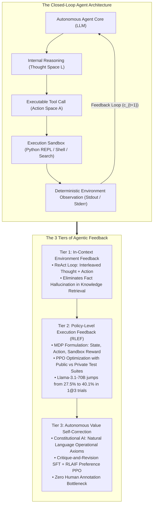
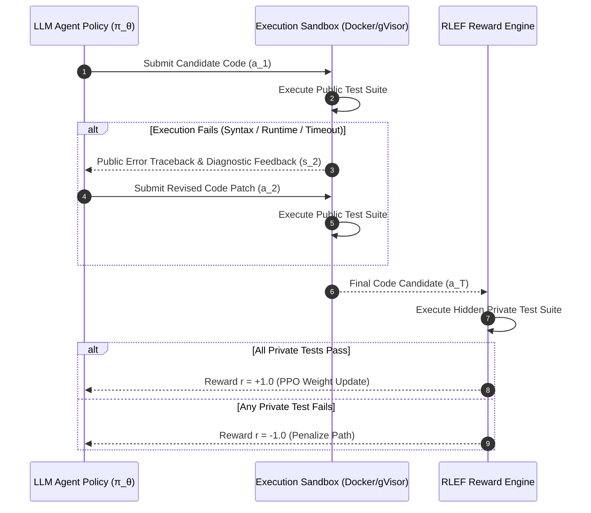
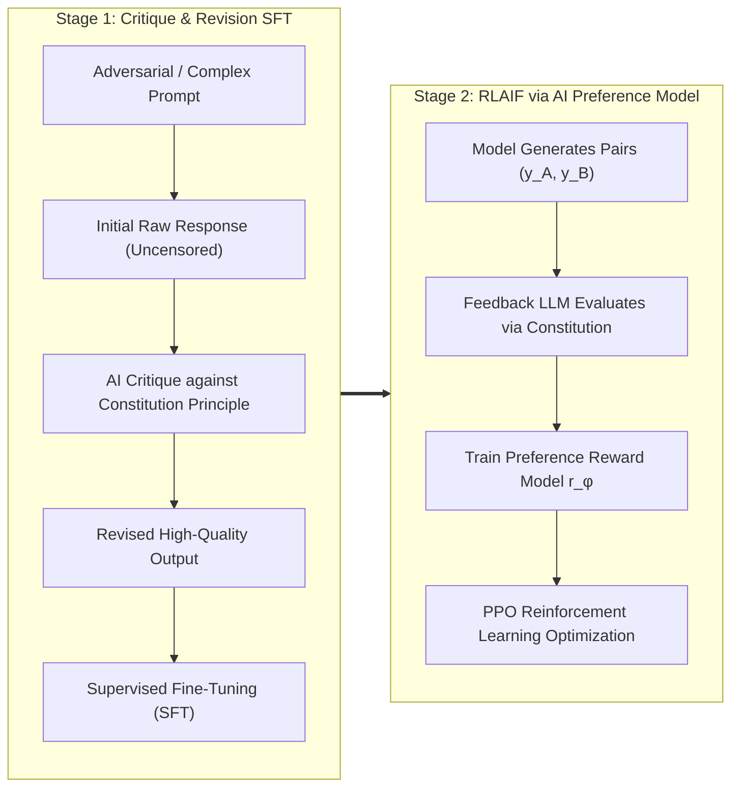

Welcome to the fourth installment of our engineering breakdown of **Stanford University's CS329A: Self-Improving AI Agents (Autumn 2025)**.

In Lectures 2 and 3, we explored how test-time compute scaling and Process Reward Models (PRMs) allow models to explore reasoning trees and verify intermediate mathematical derivations. Yet, despite their sophisticated internal reasoning chains, models constrained to pure text generation remain **"closed-room test takers"**—entirely dependent on static, frozen parametric memory acquired during pre-training. When faced with evolving external facts, dynamic APIs, or syntax-critical code execution, an ungrounded model inevitably hallucinates, incapable of verifying its outputs against real-world systems.

Today, we break out of that closed room. **Lecture 4** marks the structural pivot from passive language models to active, closed-loop autonomous agents: **Tool Use and Execution Feedback Loops**.

Instead of treating code or API calls as final text generation targets, modern autonomous agents treat tools as interactive sensors and actuators. In this lecture, we dissect the three fundamental tiers of agentic feedback:
1. **Prompt-Level Environment Feedback:** Unifying reasoning and actions via **ReAct** (Yao et al., 2022).
2. **Policy-Level Execution Feedback:** Baking compiler and test-runner diagnostics directly into neural weights via **RLEF** (Reinforcement Learning from Execution Feedback, 2024).
3. **Self-Supervised Value Alignment:** Replacing expensive human evaluators with autonomous critique-revision loops via **Constitutional AI** (Anthropic, 2022).



{/* truncate */}

---

### 1. The ReAct Framework: Harmonizing Reasoning and Action

Prior to the introduction of ReAct (Yao et al., 2022, Princeton & Google Research), the research community was split into two isolated agent paradigms:
1. **Reasoning-Only (Chain-of-Thought / CoT):** The model produces internal rationales step-by-step. While effective for closed-book arithmetic, it suffers from severe hallucination because it has no mechanism to query ground-truth external environments. Once an early factual mistake enters the generation context, the model continues building elaborate deductions upon that flawed premise.
2. **Action-Only (WebGPT / Act):** The model directly outputs API calls and environment commands. However, without an explicit scratchpad to track working memory, synthesize observations, and plan subsequent sub-goals, action-only models frequently enter infinite browsing loops or lose task orientation.

#### Mathematical Expansion of the Action Space

ReAct reconciles this dichotomy by formalizing the agent's action space as the union of physical actions and internal linguistic deliberation:

```text
A_hat = A ∪ L
```

Where:
* `A` represents the set of external environment actions (e.g., `Search[query]`, `ExecuteCode[script]`, `Click[element]`).
* `L` represents the space of free-form natural language thoughts.

Crucially, an action `a_t` drawn from `L` produces **no state change in the external environment**. Instead, it updates the agent's internal history context:

```text
c_{t+1} = ( c_t, a_t )   where a_t ∈ L
```

When the agent selects an action `a_t` from `A`, the external environment transitions and returns a deterministic observation:

```text
c_{t+1} = ( c_t, a_t, o_t )   where a_t ∈ A, o_t = Env(a_t)
```

#### The Tripartite Interaction Cycle

A standard ReAct trajectory follows an interleaved sequence:

```text
Thought 1: Decompose query into sub-questions. First, find the birth year of Alan Turing.
Action 1: Search["Alan Turing birth date"]
Observation 1: Alan Mathison Turing (23 June 1912 - 7 June 1954) was an English mathematician...
Thought 2: Turing was born in 1912. Now determine the population of London in that year.
Action 2: Search["London population 1912"]
Observation 2: In 1912, the administrative county of London had an estimated population of 4.52 million...
Thought 3: Both values are verified. The answer is 4.52 million.
Action 3: Finish["4.52 million"]
```

#### Empirical Validation: The Hallucination Drop

The empirical findings from Yao et al. revealed dramatic shifts in agent reliability:
* **HotpotQA (Multi-Hop Knowledge Retrieval):**
  * In error-attribution audits of CoT, **56% of all failures were direct hallucinations** (inventing non-existent entities, papers, or dates).
  * With ReAct, factual fabrication dropped to **0%**. If the model lacked information, it was forced to issue an explicit search action.
* **ALFWorld (Interactive Text-Based Environment):**
  * When tasked with multi-room navigation and object manipulation, Action-Only models succeeded in only 45% of trials due to goal drifting. ReAct boosted success rates to **71%**.
* **Critical Production Engineering Rule (Stop Sequences):**
  * Standard autoregressive models naturally attempt to predict subsequent text without waiting. If allowed, an LLM will hallucinate its own synthetic `Observation:` text!
  * **Implementation Mandate:** Production engines must configure stop sequences (`stop=["\nObservation:"]`) to halt generation immediately after an `Action:` string. The host orchestration layer intercepts the action, runs the real API or sandbox, and appends the authentic environment response before re-invoking the model.

---

### 2. Policy-Level Execution Feedback: RLEF (Reinforcement Learning from Execution Feedback)

While ReAct provides in-context grounding via prompting, software engineering tasks require a deeper capability: **iterative code debugging against a real execution environment**.

#### The Paradox of In-Context Self-Debugging

When developers ask standard models to debug broken Python scripts by pasting compiler tracebacks into prompts, empirical studies (Olausson et al., 2024; Kapoor et al., 2024) uncovered a counterintuitive phenomenon:

> **"Prompting a frozen pre-trained model with its previous error traceback often yields lower task accuracy than discarding the error entirely and independently sampling a brand-new solution from scratch."**

Pre-trained LLMs lack the inductive bias to correlate line-numbered compiler exceptions with structural semantic errors in their code. Faced with a traceback, frozen models frequently oscillate, making irrelevant syntactic edits or repeating the exact same bug under different variable names.

To solve this, **RLEF (arxiv:2410.02089, 2024)** shifts feedback from static prompt engineering to policy reinforcement learning.

#### Formalizing Multi-Turn Code Generation as an MDP

RLEF models multi-turn code synthesis as a discrete-time Markov Decision Process (MDP):
* **State Space ($S$):** The problem prompt, prior code attempts, and compiler/test diagnostics:
  ```text
  s_t = ( Problem_Spec, Code_1, Err_1, ..., Code_{t-1}, Err_{t-1} )
  ```
* **Action Space ($A$):** The generated code patch or full program $a_t$.
* **Environment Transition:** The code is executed in an isolated sandbox running an automated test harness.



#### Dual Test Suites: Public vs. Private Verification

A core contribution of RLEF is its architectural prevention of **Reward Hacking**:
1. **Public Test Suite (`T_public`):** Provided to the agent during debugging turns. The compiler traceback, assertion errors, and stderr outputs serve as state observations $s_t$.
2. **Private Test Suite (`T_private`):** Strictly withheld from the agent's context. Only executed at episode termination to compute scalar rewards.

If an agent attempts to exploit public tests by hardcoding trivial lookup tables (`if input == test_1: return val_1`), it systematically fails the hidden private suite, incurring maximal policy penalties.

#### Objective Function and Reward Formulation

The policy `\pi_\theta` is trained using Proximal Policy Optimization (PPO) with a token-level Kullback-Leibler (KL) divergence penalty against the reference model `\rho`:

```text
R(s_t, a_t) = r(s_t, a_t) - β * log( π_θ(a_t | s_t) / ρ(a_t | s_t) )
```

The environmental reward structure is defined as:

```text
r(s_t, a_t) = {
    +1.0,  if all T_private tests pass at episode termination
    -1.0,  if any test fails after maximum retry budget T
    -0.2,  intermediate penalty if a_t contains uncompilable/syntax errors
}
```

#### Empirical Benchmark: Demolishing AlphaCodium on CodeContests

On the formidable **CodeContests** benchmark (competitive programming problems sourced from Codeforces and LeetCode Hard), RLEF established new state-of-the-art results:
* Applying RLEF to an open-weights `Llama-3.1-70B-Instruct` model elevated its pass rate from **27.5% to 40.1%** using a retry budget of only 3 attempts ($1@3$).
* For comparison, **AlphaCodium** (utilizing GPT-4 with a massive budget of 100 parallel code rollouts, $pass@100$) attained only **29.0%**. RLEF exceeded 100-sample GPT-4 by **11.1 percentage points** using only 3 sequential execution turns.

#### The Random Feedback Ablation Experiment

To verify that the model genuinely learned diagnostic reasoning rather than simple stochastic variation, the researchers performed a random feedback ablation:
* Supplying the agent with synthetic error messages from *unrelated* problems caused its performance to collapse below baseline.
* This demonstrated mathematically that the policy had encoded an active semantic mapping between execution tracebacks and localized code diffs.

---

### 3. AI-Supervised Feedback: Constitutional AI and RLAIF

ReAct relies on deterministic API observations; RLEF relies on deterministic compiler test suites. But what happens in subjective, open-ended domains where no automated compiler exists?
* Is this architectural RFC comprehensive and modular?
* Does this code review satisfy organizational security guidelines without leaking credentials?
* Does this response resist adversarial prompt injection?

Traditional Reinforcement Learning from Human Feedback (RLHF) requires fleets of human crowd-workers to manually evaluate pairs of completions. This approach introduces severe bottlenecks: prohibitive costs, inconsistent annotation quality, human cognitive fatigue, and lack of transparency.

In 2022, Anthropic introduced **Constitutional AI (RLAIF: Reinforcement Learning from AI Feedback)**, establishing a mechanism for autonomous self-alignment guided entirely by a written set of principles (the "Constitution").



#### The Two-Phase Constitutional Pipeline

1. **Phase 1: Critique-and-Revision SFT (Curating the Dataset)**
   * The base model is prompted with edge-case or high-difficulty queries.
   * Upon producing an initial response $y_0$, an automated prompt selects a random principle from the Constitution and instructs the model:
     * **Critique Prompt:** *"Review your previous response against Principle X: 'Ensure the explanation contains no security vulnerabilities and adheres to strict static type definitions.' Identify all specific violations."*
     * **Revision Prompt:** *"Rewrite your response to eliminate all identified defects while preserving technical depth."*
   * The revised outputs ``(y*)`` are accumulated into a supervised fine-tuning dataset, effectively training the model to produce aligned, self-corrected outputs on the first turn.

2. **Phase 2: RLAIF (Reinforcement Learning from AI Feedback)**
   * The fine-tuned model generates candidate pairs $(y_A, y_B)$ for a given input $x$.
   * An independent AI evaluator model inspects both options against constitutional guidelines and assigns probability logits:
     ```text
     P( y_A > y_B | x, Constitution )
     ```
   * A preference reward model `r_\phi(x, y)` is trained directly on these AI-generated soft labels, bypassing human raters entirely.
   * The target model is subsequently optimized against `r_\phi` via standard PPO.

#### The Scaling Implication: Scalable Oversight

Constitutional AI demonstrates that human guidance can be compressed into a compact document of high-level declarative principles. Instead of supervising millions of individual examples, human system architects supervise the **constitutional ruleset**, while AI evaluation fleets scale the oversight across billions of tokens.

---

### 4. Enterprise Architecture: Designing an Industrial Execution Mesh

Integrating autonomous tool use and code feedback into production requires a multi-layered, defensive execution architecture. Below is the blueprint recommended by Stanford CS329A for robust enterprise agent environments:

```text
┌────────────────────────────────────────────────────────────────────────┐
│             Production Tool & Sandbox Execution Architecture            │
├────────────────────────────────────────────────────────────────────────┤
│                                                                        │
│  [ Client Task / PRD ]                                                 │
│          │                                                             │
│          ▼                                                             │
│  ┌──────────────────────────────────────────────────────────────────┐  │
│  │                    Orchestration Agent Core                      │  │
│  │  • ReAct Prompt Engine with Strict Stop Sequences                │  │
│  │  • Context Manager (Sliding Working Memory + AST Index)          │  │
│  │  • Tool Dispatcher with JSON-RPC Schema Validation               │  │
│  └───────────────────┬──────────────────────────────▲───────────────┘  │
│                      │ Structured Tool Call         │ Clean Telemetry  │
│                      ▼                              │ Observation      │
│  ┌──────────────────────────────────────────────────┴───────────────┐  │
│  │                     Security Sandbox Gateway                     │  │
│  │  • MicroVM / gVisor Container Isolation (Zero Host FS Access)   │  │
│  │  • Network Egress Firewall (Whitelisted Domain Filtering)        │  │
│  │  • Resource Quotas: 2.0 CPU Cores, 2GB RAM, 5-Second Timeout    │  │
│  ├──────────────────────────────────────────────────────────────────┤  │
│  │                   Isolated Execution Runtimes                    │  │
│  │  ┌─────────────────────────┐     ┌────────────────────────────┐  │  │
│  │  │ Python REPL (Ephemeral) │     │ Bash Shell (Restricted)    │  │  │
│  │  │ • Pytest Public Harness │     │ • AST Static Linter        │  │  │
│  │  │ • Traceback Formatter   │     │ • Semgrep Security Scanner │  │  │
│  │  └─────────────────────────┘     └────────────────────────────┘  │  │
│  └──────────────────────────────────────────────────────────────────┘  │
│                                                                        │
└────────────────────────────────────────────────────────────────────────┘
```

#### Core Production Security Principles
1. **Ephemeral Sandboxing:** Every code execution block must run in an immutable, throwaway environment (e.g., Docker container with gVisor or Firecracker microVM) with a maximum lifespan bounded by strict timeouts (e.g., 5,000 ms).
2. **Network Egress Isolation:** Prevent prompt-injected agents from exfiltrating environment variables or database credentials by disabling outbound internet access, except through dedicated, authenticated proxy endpoints.
3. **Traceback Sanitization:** Before piping terminal stderr back into the agent's context, strip absolute host paths and sensitive environment tokens to avoid context clutter and credential leakage.

---

### 5. Technical Deep Dive: Practical Engineering Q&A

**Q: How do we prevent an autonomous ReAct agent from hallucinating fake tool responses?**
**A:** This is the most common vulnerability in naive agent implementations. Because autoregressive models are trained on continuous dialogue transcripts, they naturally anticipate what an observation should look like and generate synthetic `Observation: Success...` strings. To prevent this, configure explicit inference stop tokens: `stop=["\nObservation:"]`. The moment the LLM finishes emitting its `Action:` call, generation halts immediately. Your backend runner intercepts control, executes the real tool in the sandbox, and appends the authentic environment output before triggering the next generation pass.

**Q: Why does RLEF generalize better than fine-tuning (SFT) directly on pre-recorded error traces?**
**A:** SFT on static traces suffers from **distributional shift**. If the model makes a mistake during test time that was not present in the training traces, it enters an unvisited state space and fails catastrophically. In contrast, RLEF exposes the policy to its *own* idiosyncratic coding bugs through active exploration in an MDP. By experiencing failure, receiving real execution penalties, and finding the compensatory patch through PPO, the policy establishes robust, fault-tolerant internal representations.

---

### 6. Summary and Core Technical Takeaways

1. **Closed-Loop Grounding:** Pure parametric generation is fundamentally brittle. ReAct unifies the action space with natural language reasoning (`\hat = A \cup L`), completely eliminating factual hallucination on multi-hop benchmarks.
2. **Execution Feedback via RL:** In-context debugging of frozen models fails due to lack of diagnostic alignment. RLEF trains models inside an MDP using compiler and public/private test signals, allowing 70B models to outperform 100-rollout GPT-4 frameworks on hard coding benchmarks.
3. **Autonomous Alignment:** Constitutional AI replaces human RLHF annotation bottlenecks with high-level declarative principles, powering self-improving critique-revision loops and scalable RLAIF oversight.
4. **Defensive Sandbox Architecture:** Enterprise agent deployments require strict process boundaries: ephemeral microVMs, resource quotas, stop-sequence enforcement, and dual test harness separation.

---

### What's Coming Next in Stanford CS329A:
In **Lecture 5**, we scale from localized single-step tool execution to multi-horizon strategic planning: **《Multi-Step Planning & Tree Search: ADaPT, LATS, SPRINT, and Monte Carlo Tree Search for Language Agents》**. We will analyze how agents look tens of steps ahead, build dynamic search trees, and backtrack like grandmasters. Stay tuned!