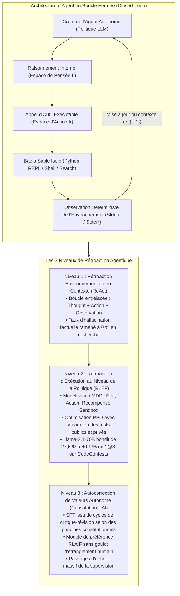
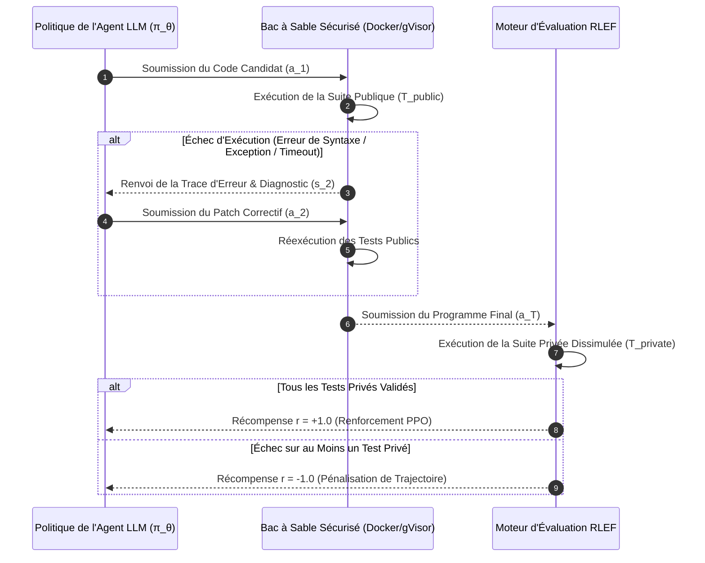
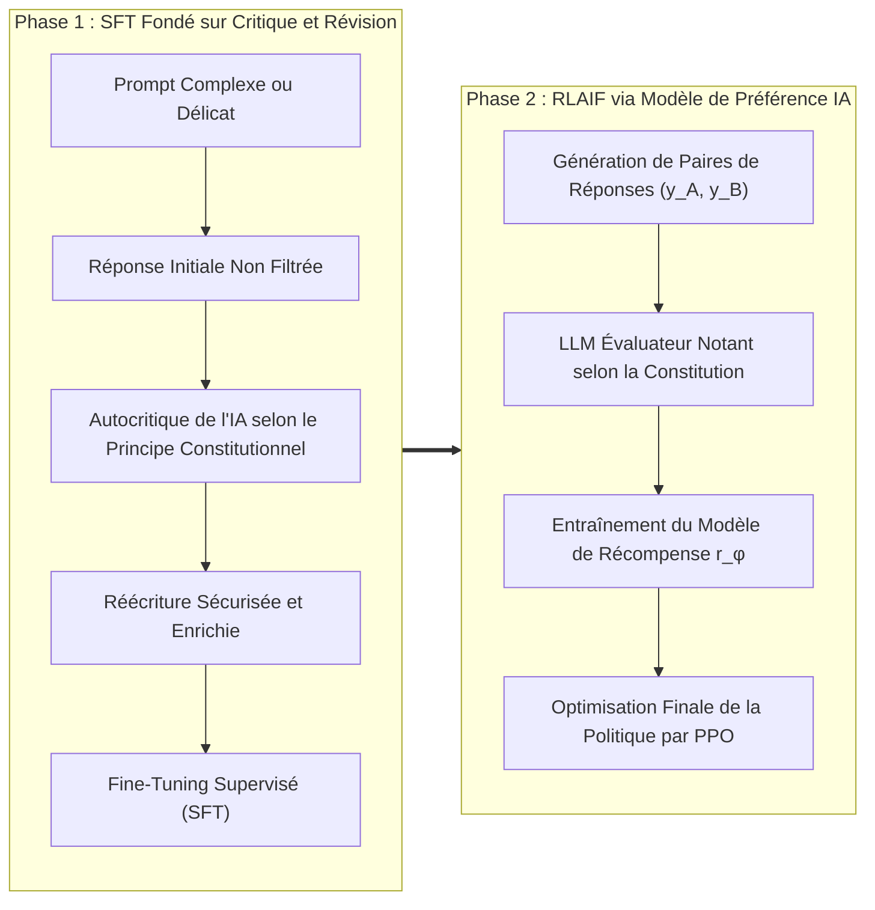

Bienvenue dans ce quatrième volet de notre série d'analyses techniques consacrée au cours de master de l'**Université Stanford, CS329A: Self-Improving AI Agents (Automne 2025)**.

Dans les cours 2 et 3, nous avons démontré comment le passage à l'échelle du calcul lors de l'inférence (Test-time Compute Scaling) et les modèles de récompense de processus (PRM) permettent aux modèles de langage d'explorer des arbres de recherche et de vérifier étape par étape des déductions mathématiques complexes. Cependant, quelle que soit l'élégance de leurs chaînes de pensée (CoT), les modèles limités à la génération pure de texte demeurent des **« étudiants isolés dans une salle d'examen fermée »**. Ils dépendent exclusivement de la mémoire paramétrique statique et figée acquise durant le pré-entraînement. Face à des faits externes évolutifs, des APIs dynamiques ou des contraintes d'exécution logicielle strictes, un modèle non ancré dans l'environnement physique alucine inévitablement.

Le **cours 4** marque la rupture architecturale majeure qui fait sortir le modèle de son confinement : **l'utilisation d'outils (Tool Use) et les boucles de rétroaction d'exécution (Execution Feedback Loops)**.

Les agents autonomes modernes ne considèrent plus le code ou les appels d'API comme de simples cibles textuelles, mais comme des **capteurs et des actionneurs** interactifs. Dans cette leçon, nous disséquons les trois niveaux fondamentaux de rétroaction agentique :
1. **Rétroaction environnementale en contexte (Prompt-Level) :** L'unification de la réflexion et de l'action via **ReAct** (Yao et al., 2022).
2. **Rétroaction d'exécution au niveau de la politique (Policy-Level) :** L'ancrage direct des diagnostics de compilation et des tests dans les poids neuronaux via **RLEF** (Reinforcement Learning from Execution Feedback, 2024).
3. **Auto-alignement des valeurs sans supervision humaine :** Le remplacement des annotateurs humains par des boucles de critique-révision guidées par des principes déclaratifs via **Constitutional AI** (Anthropic, 2022).



{/* truncate */}

---

### 1. L'Harmonisation de la Pensée et de l'Action : Le Cadre ReAct (Yao et al., 2022)

Avant l'introduction de ReAct (Yao et al., 2022, Université de Princeton et Google Research), la recherche était fragmentée entre deux paradigmes antagonistes :
1. **Raisonnement Pur (Chain-of-Thought / CoT) :** On incite le modèle à décomposer son raisonnement pas à pas. Efficace pour les calculs arithmétiques fermés, cette approche souffre d'hallucinations sévères : dès qu'une prémisse erronée s'immisce dans le contexte, le modèle élabore des justifications de plus en plus sophistiquées sur une base factuelle totalement fausse.
2. **Action Pure (Action-only / WebGPT, Act) :** Le modèle émet directement des requêtes API ou des commandes de recherche. Toutefois, privé d'une mémoire de travail (Working Memory) pour synthétiser les observations et planifier les sous-objectifs, il s'enferme fréquemment dans des boucles infinies ou perd le fil de la tâche.

#### Extension Mathématique de l'Espace d'Action

L'apport fondamental de ReAct consiste à modéliser l'espace d'action global de l'agent comme l'union de l'espace d'action physique et de l'espace linguistique de délibération :

```text
A_hat = A ∪ L
```

Où :
* `A` représente l'ensemble des actions physiques exécutables dans l'environnement externe (ex. `Search[query]`, `ExecuteCode[script]`, `Click[element]`).
* `L` représente l'espace des réflexions libres en langage naturel (Thoughts).

La propriété mathématique cruciale réside dans le fait qu'une action de pensée `a_t \in L` **ne provoque aucune transition d'état dans l'environnement physique**. Elle actualise uniquement le contexte de mémoire interne de l'agent :

```text
c_{t+1} = ( c_t, a_t )   (lorsque a_t ∈ L)
```

En revanche, lorsque l'agent sélectionne une action physique `a_t \in A`, l'environnement extérieur s'exécute et retourne une observation déterministe :

```text
c_{t+1} = ( c_t, a_t, o_t )   (lorsque a_t ∈ A, où o_t = Env(a_t))
```

#### Exemple Concret d'un Cycle d'Interaction

Une trace d'exécution standard ReAct alterne de façon fluide pensée, action et observation :

```text
Thought 1: Décomposer la question en deux sous-objectifs. D'abord, trouver l'année de naissance d'Alan Turing.
Action 1: Search["Alan Turing date de naissance"]
Observation 1: Alan Mathison Turing (23 juin 1912 - 7 juin 1954) était un mathématicien britannique...
Thought 2: Turing est né en 1912. Il faut maintenant déterminer la population estimée de Londres cette année-là.
Action 2: Search["Londres population 1912"]
Observation 2: En 1912, le comté administratif de Londres comptait une population officielle estimée à 4,52 millions d'habitants...
Thought 3: Les deux données sont vérifiées. La réponse finale est 4,52 millions.
Action 3: Finish["4,52 millions"]
```

#### Validation Empirique : La Chute Drastique des Hallucinations

Les expériences menées par Yao et al. ont établi des gains d'une ampleur inédite :
* **Benchmark de Recherche Multi-Sauts (HotpotQA) :**
  * Lors de l'analyse des échecs des modèles CoT, **56 % des erreurs provenaient directement d'hallucinations pures** (invention de personnes, de dates ou de publications).
  * Avec ReAct, le taux d'invention factuelle est tombé à **0 %**, le modèle étant contraint d'interroger explicitement l'environnement extérieur dès qu'une information lui fait défaut.
* **Environnements Interactifs Textuels (ALFWorld) :**
  * Pour la navigation multi-pièces et la manipulation d'objets, les modèles en action pure ont plafonné à 45 % de succès par dérive d'objectifs, tandis que ReAct a atteint **71 %**.
* **Règle Essentielle d'Ingénierie de Production (Séquence d'Arrêt / Stop Sequence) :**
  * Les modèles autorégressifs ont une propension naturelle à continuer d'anticiper la suite du texte. Sans restriction, ils génèrent spontanément de fausses `Observation:` inventées de toutes pièces.
  * **Exigence de Mise en Œuvre :** Le moteur d'inférence doit impérativement intégrer une séquence d'arrêt (`stop=["\nObservation:"]`). Dès que le modèle émet la ligne `Action:`, la génération s'arrête net. L'orchestrateur exécute l'outil réel dans le bac à sable et injecte le retour authentique avant de déclencher le tour suivant.

---

### 2. Ancrer la Rétroaction dans les Poids du Modèle : RLEF (Reinforcement Learning from Execution Feedback)

Tandis que ReAct repose sur une interaction en contexte par incitations textuelles, l'ingénierie logicielle avancée exige une capacité plus profonde : **la faculté d'analyser des traces d'erreurs de compilation et de déboguer son propre code de manière itérative (Self-Debugging)**.

#### Le Paradoxe de l'Autodébogage par Prompt

Lorsqu'on demande à un modèle pré-entraîné figé (Frozen LLM) de corriger un script erroné en lui fournissant la trace d'erreur (Traceback) du terminal, les études empiriques (Olausson et al., 2024 ; Kapoor et al., 2024) révèlent un résultat contre-intuitif :

> **« Présenter le message d'erreur à un modèle figé pour lui demander de corriger son code produit souvent un taux de succès inférieur à celui obtenu en ignorant totalement l'erreur et en échantillonnant une solution entièrement nouvelle de manière indépendante (Independent Sampling) ! »**

Les modèles pré-entraînés ne possèdent pas le biais inductif nécessaire pour relier les numéros de ligne d'une exception aux failles logiques de leur propre code. Face à une trace d'erreur, ils oscillent, modifient des noms de variables sans pertinence ou reproduisent la même erreur sous une syntaxe à peine remaniée.

Le cadre **RLEF (arxiv:2410.02089, fin 2024)** a résolu ce verrou fondamental non pas par des astuces de prompt, mais par **l'apprentissage par renforcement (PPO)**.

#### Modélisation de la Génération de Code Multitour en Processus MDP

RLEF formalise le cycle « génération `\to` feedback d'exécution `\to` patch correctif » sur $T$ tours au maximum comme un Processus de Décision Markovien (MDP) en temps discret :
* **Espace d'États ($S$) :** Énoncé du problème, tentatives de code antérieures et diagnostics d'erreurs :
  ```text
  s_t = ( Problem_Spec, Code_1, Err_1, ..., Code_{t-1}, Err_{t-1} )
  ```
* **Espace d'Actions ($A$) :** Le patch correctif ou le programme complet produit par l'agent $a_t$.
* **Transition d'Environnement :** Le code est exécuté dans un bac à sable isolé intégrant une suite de tests automatisée.



#### Double Suite de Tests : Prévention du Piratage de Récompense (Reward Hacking)

Le pilier conceptuel de RLEF réside dans la **séparation stricte entre tests publics et tests privés** :
1. **Suite Publique (`T_public`) :** Fournie à l'agent pendant ses phases de débogage. Les avertissements de compilation et les erreurs d'assertion constituent les observations d'état $s_t$.
2. **Suite Privée (`T_private`) :** Totalement masquée du contexte de l'agent. Elle n'est exécutée qu'en fin d'épisode pour attribuer la récompense finale.

Si le modèle tente de tricher en programmant des tables de correspondance ad hoc (`if input == test_1: return val_1`), il échoue massivement sur les tests privés dissimulés et subit une sévère pénalité de politique.

#### Fonction Objectif et Conception de la Récompense

La politique `\pi_\theta` est optimisée via l'algorithme PPO avec une pénalité de divergence KL par rapport au modèle de référence `\rho` :

```text
R(s_t, a_t) = r(s_t, a_t) - β * log( π_θ(a_t | s_t) / ρ(a_t | s_t) )
```

La fonction de récompense environnementale $r(s_t, a_t)$ est calibrée ainsi :

```text
r(s_t, a_t) = {
    +1.0,  si tous les tests de T_private réussissent en fin d'épisode
    -1.0,  en cas d'échec persistant après épuisement du budget d'essais T
    -0.2,  pénalité intermédiaire si a_t contient des erreurs de syntaxe non compilables
}
```

#### Résultats sur Benchmark : Écrasement d'AlphaCodium sur CodeContests

Sur le redoutable benchmark **CodeContests** (problèmes d'olympiades de programmation issus de Codeforces et LeetCode Hard), RLEF a réalisé une percée spectaculaire :
* En appliquant RLEF au modèle open-weights `Llama-3.1-70B-Instruct`, le taux de réussite est passé de **27,5 % à 40,1 %** avec seulement 3 tentatives ($1@3$).
* À titre de comparaison, **AlphaCodium** (utilisant GPT-4 avec un échantillonnage massif de 100 solutions parallèles, $pass@100$) n'avait atteint que **29,0 %**. RLEF a surclassé GPT-4 de **11,1 points de pourcentage**, avec seulement 3 étapes séquentielles.

#### L'Expérience d'Ablation par Rétroaction Aléatoire

Afin de vérifier que le modèle comprenait véritablement la cause des anomalies, les chercheurs ont procédé à une ablation déterminante :
* En fournissant intentionnellement à l'agent les messages d'erreur d'un problème tiers sans rapport, ses performances se sont effondrées sous la ligne de base.
* Cela a démontré mathématiquement que la politique entraînée par RLEF **établit une correspondance causale précise entre les numéros de ligne du traceback et les modifications logiques requises**.

---

### 3. L'IA au Service de l'IA : Constitutional AI et RLAIF

ReAct s'appuie sur des APIs externes et RLEF sur des compilateurs déterministes. Mais comment réguler la rétroaction dans des domaines ouverts ou subjectifs où aucun compilateur n'existe ?
* Cette proposition d'architecture logicielle respecte-t-elle les principes de modularité et de scalabilité ?
* Cette revue de code signale-t-elle les failles de sécurité avec rigueur tout en maintenant un ton constructif ?
* Cette réponse est-elle protégée contre des tentatives d'injection de prompt malveillantes ?

L'apprentissage par renforcement à partir de rétroaction humaine (RLHF) traditionnel s'appuie sur des milliers d'annotateurs humains. Cette méthode se heurte à des verrous majeurs : coûts prohibitifs, divergences de jugement, fatigue cognitive et manque de standardisation.

En 2022, Anthropic a introduit **Constitutional AI (RLAIF : Apprentissage par Renforcement à partir de Rétroaction d'IA)**, instaurant une méthode d'auto-alignement guidée par un ensemble de règles explicites rédigées en langage naturel (la « Constitution »).



#### Le Pipeline Constitutionnel en Deux Phases

1. **Phase 1 : Critique et Révision (Critique `\to` Revision `\to` SFT)**
   * Le modèle de base est confronté à des requêtes complexes ou provocatrices.
   * Dès qu'il produit une réponse initiale $y_0$, le système extrait un principe constitutionnel et lui ordonne :
     * **Prompt de Critique :** *« Évalue ta réponse précédente selon le Principe 3 : "Garantir l'absence de vulnérabilités et imposer un typage statique strict". Identifie chaque violation spécifique. »*
     * **Prompt de Révision :** *« Réécris intégralement la réponse pour corriger tous les défauts relevés tout en préservant une haute technicité. »*
   * Ces données autocorrigées ``(y*)`` forment le corpus d'un premier apprentissage supervisé (SFT).

2. **Phase 2 : RLAIF (Apprentissage par Renforcement avec Rétroaction d'IA)**
   * Le modèle affiné génère des paires d'alternatives $(y_A, y_B)$ pour une entrée $x$.
   * Un modèle évaluateur indépendant analyse les deux options à la lumière de la Constitution et émet des probabilités :
     ```text
     P( y_A > y_B | x, Constitution )
     ```
   * Un modèle de récompense de préférences `r_\phi(x, y)` est entraîné à partir de ces étiquettes, puis la politique de l'agent est optimisée via PPO.

#### L'Enjeu : Une Supervision Extensible (Scalable Oversight)

Constitutional AI prouve que des milliers d'heures de labeur humain peuvent être synthétisées dans **un corpus concis de principes déclaratifs**. Les ingénieurs humains se concentrent sur la gouvernance des règles de haut niveau, tandis que des flottes de modèles d'évaluation déploient l'alignement à l'échelle de milliards de tokens.

---

### 4. Architecture Industrielle : Conception d'un Maillage d'Exécution Sécurisé

Le déploiement en production d'agents autonomes dotés d'outils et de boucles de code requiert une infrastructure de défense en profondeur. Stanford CS329A préconise le schéma architectural suivant :

```text
┌────────────────────────────────────────────────────────────────────────┐
│             Architecture Industrielle de Bac à Sable et d'Outils       │
├────────────────────────────────────────────────────────────────────────┤
│                                                                        │
│  [ Requête Métier / Spécification PRD ]                                │
│          │                                                             │
│          ▼                                                             │
│  ┌──────────────────────────────────────────────────────────────────┐  │
│  │                    Moteur d'Orchestration d'Agent                │  │
│  │  • Moteur de Prompts ReAct avec Séquences d'Arrêt Strictes       │  │
│  │  • Gestionnaire de Contexte (Mémoire Glissante + Index AST)      │  │
│  │  • Validateur d'Appels d'Outils Basé sur Schéma JSON-RPC         │  │
│  └───────────────────┬──────────────────────────────▲───────────────┘  │
│                      │ Commande d'Appel Structurée  │ Télémétrie       │
│                      ▼                              │ Assainie         │
│  ┌──────────────────────────────────────────────────┴───────────────┐  │
│  │                     Passerelle de Sécurité du Bac à Sable        │  │
│  │  • Isolation par MicroVM / Conteneur gVisor (Accès FS hôte nul)  │  │
│  │  • Pare-feu Réseau Sortant (Filtrage strict sur liste blanche)   │  │
│  │  • Quotas de Ressources : 2.0 Cœurs CPU, 2 Go RAM, Timeout 5 s   │  │
│  ├──────────────────────────────────────────────────────────────────┤  │
│  │                     Environnements d'Exécution Isolés            │  │
│  │  ┌─────────────────────────┐     ┌────────────────────────────┐  │  │
│  │  │ Python REPL Éphémère    │     │ Shell Bash Restreint       │  │  │
│  │  │ • Harnais Public Pytest │     │ • Linter Statique AST      │  │  │
│  │  │ • Épurateur de Traces   │     │ • Scanner Sécurité Semgrep │  │  │
│  │  └─────────────────────────┘     └────────────────────────────┘  │  │
│  └──────────────────────────────────────────────────────────────────┘  │
│                                                                        │
└────────────────────────────────────────────────────────────────────────┘
```

#### Trois Principes de Sécurité Essentiels
1. **Isolation Éphémère :** Tout bloc de code doit être exécuté dans un bac à sable jetable (conteneur gVisor ou microVM Firecracker) détruit dès la fin du traitement.
2. **Verrouillage du Réseau Sortant (Egress Isolation) :** Empêche tout agent corrompu par injection de prompt d'exfiltrer des clés d'API ou des variables d'environnement vers l'extérieur.
3. **Assainissement des Traces :** Avant d'injecter la sortie d'erreur dans le contexte de l'agent, masquer les chemins physiques absolus et les jetons sensibles pour éviter les fuites et la saturation du contexte.

---

### 5. Questions Techniques Clés et Enseignements Pratiques

**Q : Comment empêcher formellement un agent ReAct de fabriquer de fausses observations sans attendre l'exécution réelle ?**
**A :** C'est le piège le plus classique. Les modèles autorégressifs anticipent la suite naturelle de la conversation et écrivent spontanément `Observation: Succès...` après avoir émis `Action:`. L'unique parade consiste à enregistrer un jeton d'arrêt strict à l'inférence : `stop=["\nObservation:"]`. Dès que la ligne `Action:` est générée, le moteur stoppe immédiatement. Le serveur hôte prend alors le relais, lance l'outil dans le bac à sable et injecte le résultat réel sous forme de chaîne de caractères avant de réactiver le modèle.

**Q : Pourquoi l'apprentissage par renforcement RLEF surpasse-t-il le fine-tuning supervisé (SFT) sur des traces de logs statiques ?**
**A :** Le SFT sur des journaux d'erreurs statiques souffre d'un **décalage distributionnel (Distributional Shift)**. Dès lors que l'agent commet en production une erreur absente de la base d'entraînement, il pénètre un espace d'états inconnu et échoue. En revanche, RLEF fait explorer au modèle ses propres modes de défaillance au sein d'un MDP : en subissant de réelles pénalités et en apprenant à élaborer des correctifs via PPO, l'agent développe une résilience logicielle supérieure.

---

### 6. Synthèse et Enseignements Majeurs

1. **Ancrage par l'Interaction :** Les modèles limités à leur mémoire interne dérivent inévitablement vers l'hallucination. ReAct associe réflexion et action (`\hat = A \cup L`), éradiquant la fabrication de faits lors de recherches documentaires complexes.
2. **Rétroaction Encodée dans les Poids :** Le prompt sur modèles figés montre vite ses limites. RLEF formalise le débogage comme un MDP piloté par des compilateurs, permettant à des modèles 70B de surpasser des configurations GPT-4 à 100 échantillons.
3. **Alignement Constitutionnel Autonome :** Constitutional AI remplace l'annotation humaine laborieuse par des principes déclaratifs, ouvrant la voie à des cycles d'autocorrection et à une supervision hautement scalable (RLAIF).
4. **Infrastructure d'Exécution Sécurisée :** L'industrialisation des agents exige des gardes-fous stricts : arrêts sur balises, microVMs jetables et séparation rigoureuse des suites de tests publiques et privées.

---

### À Suivre dans Stanford CS329A :
Dans le **cours 5**, nous passerons de l'exécution ponctuelle d'outils à la planification stratégique multi-horizons : **《Planification Multi-Étapes et Recherche Arborescente : ADaPT, LATS, SPRINT et MCTS pour Agents de Langage》**. Nous découvrirons comment les agents anticipent des dizaines de coups à l'avance et explorent des arbres de recherche à la manière de grands maîtres d'échecs. Restez à l'écoute !