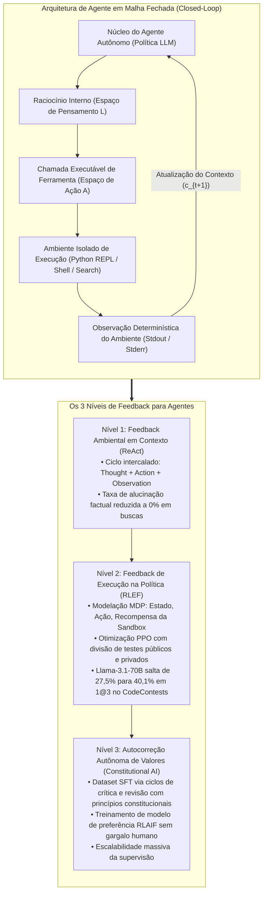
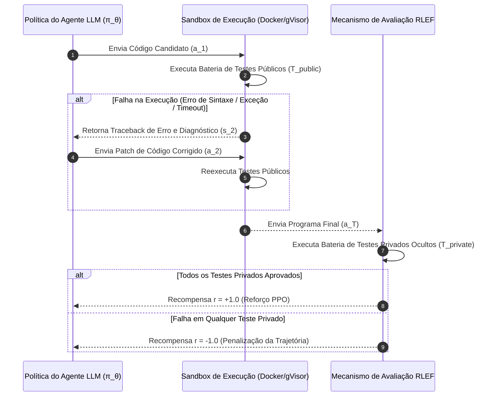
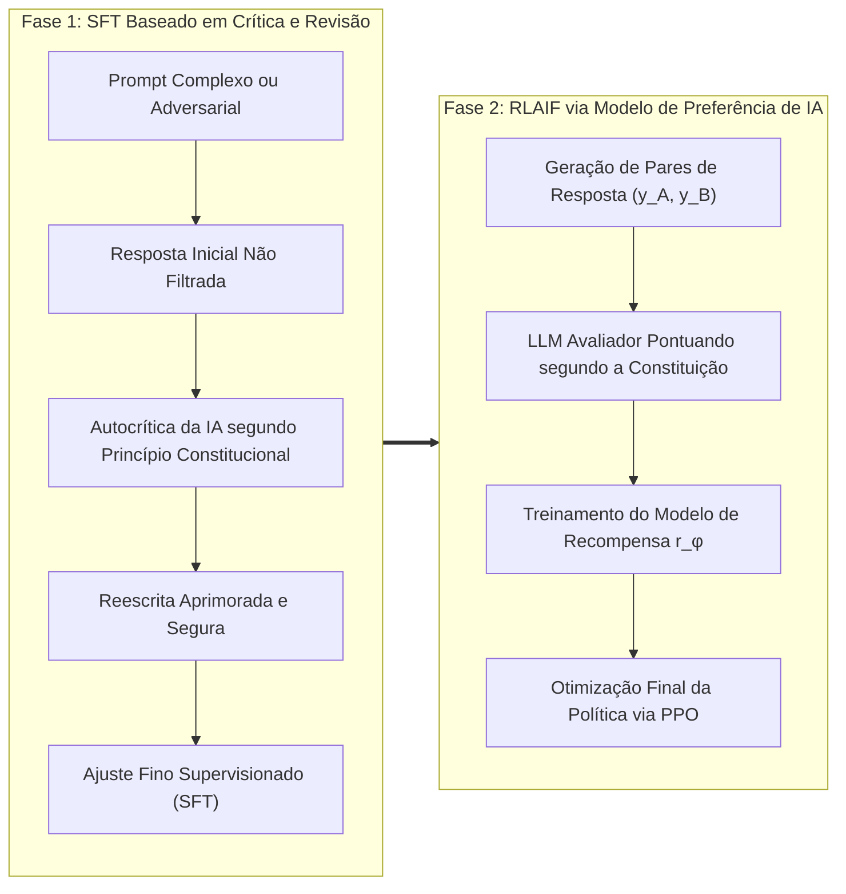

Boas-vindas ao quarto volume de nossa análise técnica detalhada do curso de pós-graduação da **Universidade de Stanford, CS329A: Self-Improving AI Agents (Agentes de IA que se Autoaperfeiçoam, Outono de 2025)**.

Nas Aulas 2 e 3, investigamos como o dimensionamento computacional no momento da inferência (Test-time Compute Scaling) e os Modelos de Recompensa de Processo (PRMs) capacitam os modelos de linguagem a explorar árvores de busca e validar derivações matemáticas intermediárias. No entanto, por mais sofisticada que seja uma cadeia de raciocínio (CoT), modelos limitados estritamente à geração de texto permanecem **"estudantes trancados em uma sala resolvendo provas"**. Eles dependem exclusivamente da memória paramétrica estática e congelada (Parametric Memory) adquirida no pré-treinamento. Perante dados dinâmicos do mundo exterior, APIs mutáveis ou restrições sintáticas rígidas de código executável, um modelo sem ancoragem no ambiente inevitavelmente alucina.

A **Aula 4** representa o ponto de virada arquitetural que liberta o modelo desse confinamento: **o uso de ferramentas (Tool Use) e os ciclos de feedback de execução (Feedback Loops)**.

Agentes autônomos modernos não tratam código ou chamadas de API como meros alvos de texto final, mas como **sensores e atuadores** interativos. Nesta aula, dissecamos e reestruturamos os três níveis fundamentais de feedback para agentes:
1. **Feedback ambiental no nível de prompt:** A integração entre reflexão e ação via **ReAct** (Yao et al., 2022).
2. **Feedback de execução no nível da política:** A gravação direta de diagnósticos de compiladores e suítes de teste nos pesos neurais via **RLEF** (Reinforcement Learning from Execution Feedback, 2024).
3. **Alinhamento autônomo de valores sem supervisão humana:** A substituição de avaliadores humanos caros por ciclos de crítica e revisão orientados por princípios em linguagem natural via **Constitutional AI** (Anthropic, 2022).



{/* truncate */}

---

### 1. A Sinergia entre Pensamento e Ação: O Framework ReAct (Yao et al., 2022)

Antes do surgimento do ReAct (Yao et al., 2022, Universidade de Princeton e Google Research), a comunidade científica dividia-se em dois paradigmas isolados:
1. **Apenas Raciocínio (Chain-of-Thought / CoT):** Estimula o modelo a explicitar seus pensamentos passo a passo. É eficaz para problemas matemáticos fechados, mas sofre com graves alucinações por falta de conexão com a realidade. Uma vez que uma premissa incorreta surge no contexto, o modelo constrói deduções cada vez mais fantasiosas sobre uma base falsa.
2. **Apenas Ação (Action-only / WebGPT, Act):** O modelo emite diretamente comandos de API ou buscas na web. Contudo, desprovido de uma memória de trabalho (Working Memory) para registrar por que realizou uma busca ou qual é o próximo subobjetivo, ele entra com frequência em loops infinitos ou perde o rumo da tarefa.

#### Expansão Matemática do Espaço de Ações

A inovação central do ReAct reside em formalizar o espaço total de ações do agente como a união entre o espaço de ações físicas externas e o espaço linguístico de deliberação:

```text
A_hat = A ∪ L
```

Em que:
* `A` representa o conjunto de ações físicas executáveis no ambiente externo (ex.: `Search[query]`, `ExecuteCode[script]`, `Click[element]`).
* `L` representa o espaço de pensamentos livres em linguagem natural (Thoughts).

A propriedade matemática fundamental é que uma ação de pensamento `a_t \in L` **não gera qualquer transição de estado no ambiente externo**. Ela atualiza apenas o contexto da memória interna do agente:

```text
c_{t+1} = ( c_t, a_t )   (quando a_t ∈ L)
```

Por outro lado, quando o agente emite uma ação executável `a_t \in A`, o ambiente exterior é acionado e retorna uma observação determinística:

```text
c_{t+1} = ( c_t, a_t, o_t )   (quando a_t ∈ A, sendo o_t = Env(a_t))
```

#### O Ciclo Tripartite de Interação: Exemplo Prático

Um fluxo de execução padrão ReAct intercala rigorosamente reflexão, ação e observação:

```text
Thought 1: Decompor a pergunta do usuário em duas subtarefas. Primeiro, buscar o ano de nascimento de Alan Turing.
Action 1: Search["Alan Turing data de nascimento"]
Observation 1: Alan Mathison Turing (23 de junho de 1912 - 7 de junho de 1954) foi um matemático britânico...
Thought 2: Turing nasceu em 1912. Agora devo consultar a população estimada de Londres naquele mesmo ano.
Action 2: Search["Londres populacao 1912"]
Observation 2: Em 1912, o condado administrativo de Londres contava com uma população oficial estimada em cerca de 4,52 milhões de habitantes...
Thought 3: Ambos os valores foram verificados com precisão. A resposta final é 4,52 milhões.
Action 3: Finish["4,52 milhões"]
```

#### Validação Empírica: A Queda Drástica das Alucinações

Os experimentos desenvolvidos por Yao et al. evidenciaram ganhos expressivos de confiabilidade:
* **Benchmark de Recuperação de Conhecimento Multietapas (HotpotQA):**
  * Na auditoria de causas de falha do CoT, **56% dos erros decorreram de pura alucinação factual** (invenção de autores, datas ou entidades inexistentes).
  * Com o loop ReAct, a taxa de invenção factual despencou para **0%**, já que, diante de qualquer lacuna informativa, o modelo é forçado a consultar o ambiente externo.
* **Ambientes Textuais Interativos (ALFWorld):**
  * Em tarefas de navegação por múltiplos cômodos e manipulação de objetos, modelos baseados apenas em ações atingiram míseros 45% de sucesso devido à perda de foco, enquanto o ReAct alcançou **71%**.
* **Regra Mandatória de Engenharia de Produção (Sequência de Parada / Stop Sequence):**
  * Modelos autorregressivos têm como premissa prever continuamente o texto subsequente. Sem restrições, eles inventam suas próprias respostas fictícias (`Observation:`).
  * **Diretriz de Implementação:** No motor de inferência deve ser configurada uma sequência de parada explícita (`stop=["\nObservation:"]`). No instante em que o LLM gera a linha `Action:`, a geração é interrompida de imediato. O orquestrador executa a ferramenta real na sandbox e injeta a saída autêntica antes de ativar o turno seguinte.

---

### 2. Gravando o Feedback nos Pesos Neurais: RLEF (Reinforcement Learning from Execution Feedback)

Enquanto o ReAct soluciona a interação contextual via prompts, o desenvolvimento de software robusto demanda uma habilidade superior: **a capacidade de depurar ativamente erros de compilação e falhas em testes automatizados (Self-Debugging)**.

#### O Paradoxo da Autodepuração por Prompts

Ao solicitar a um modelo pré-treinado estático (Frozen LLM) que repare um script com erro anexando a mensagem de traceback do terminal, estudos empíricos recentes (Olausson et al., 2024; Kapoor et al., 2024) demonstraram um fenômeno desconcertante:

> **"Apresentar a mensagem de erro a um modelo congelado para que ele corrija seu código resulta frequentemente em uma taxa de acerto inferior a descartar o erro totalmente e reamostrar uma solução nova de forma independente (Independent Sampling)!"**

Modelos pré-treinados não possuem o viés indutivo necessário para associar números de linha de uma exceção às falhas lógicas do algoritmo. Perante o erro, eles entram em círculos viciosos, alteram nomes de variáveis sem propósito ou repetem o mesmo bug em linhas diferentes.

O framework **RLEF (arxiv:2410.02089, final de 2024)** resolveu essa limitação na raiz, substituindo truques de prompt por **aprendizado por reforço (PPO)**.

#### Formalização da Geração de Código Multiturnos como um MDP

O RLEF modela o ciclo "geração `\to` feedback de execução `\to` correção" ao longo de até $T$ turnos como um Processo de Decisão de Markov (MDP) de tempo discreto:
* **Espaço de Estados ($S$):** Enunciado do problema, tentativas de código anteriores e diagnósticos de erro do compilador/testes:
  ```text
  s_t = ( Problem_Spec, Code_1, Err_1, ..., Code_{t-1}, Err_{t-1} )
  ```
* **Espaço de Ações ($A$):** O patch de código ou programa completo gerado pelo agente $a_t$.
* **Transição de Ambiente:** O código é compilado e executado em uma sandbox isolada com suporte a baterias de testes automatizados.



#### Baterias de Teste Duais: Prevenção contra Burla de Recompensa (Reward Hacking)

O pilar de segurança do RLEF baseia-se na **separação estrita entre testes públicos e privados**:
1. **Bateria Pública (`T_public`):** Disponibilizada ao agente durante os ciclos de depuração. Avisos do compilador, falhas de asserção e stderr compõem o estado $s_t$.
2. **Bateria Privada (`T_private`):** Totalmente omitida do contexto do modelo. Executada somente no fim do episódio para o cômputo da recompensa escalar definitiva.

Se o modelo tentar burlar os testes públicos por meio de tabelas pré-computadas (`if input == test_1: return val_1`), ele será reprovado em massa nos testes privados ocultos, recebendo severas penalizações de gradiente.

#### Função Objetivo e Projeto de Recompensa

A política `\pi_\theta` é otimizada via algoritmo PPO incorporando uma penalização por divergência KL em relação ao modelo de referência `\rho`:

```text
R(s_t, a_t) = r(s_t, a_t) - β * log( π_θ(a_t | s_t) / ρ(a_t | s_t) )
```

A função de recompensa ambiental escalar $r(s_t, a_t)$ é definida como:

```text
r(s_t, a_t) = {
    +1.0,  caso todos os testes em T_private sejam aprovados no fim do episódio
    -1.0,  em caso de persistência de falhas após esgotado o orçamento T
    -0.2,  penalidade intermediária caso a_t contenha erros de sintaxe não compiláveis
}
```

#### Resultados em Benchmarks: Superando o AlphaCodium no CodeContests

No prestigiado benchmark **CodeContests** (desafios de programação competitiva extraídos do Codeforces e LeetCode Hard), o RLEF estabeleceu uma marca histórica:
* Ao aplicar o RLEF sobre o modelo de pesos abertos `Llama-3.1-70B-Instruct`, a taxa de acerto saltou de **27,5% para 40,1%** com um limite de apenas 3 tentativas ($1@3$).
* Para efeito de comparação, o **AlphaCodium** (que utilizava o GPT-4 com um esquema maciço de 100 amostragens paralelas, $pass@100$) atingiu apenas **29,0%**. O RLEF superou o GPT-4 em **11,1 pontos percentuais**, empregando apenas 3 turnos sequenciais.

#### Experimento de Ablação com Feedback Aleatório

Para certificar que o modelo aprendeu diagnóstico causal real, os pesquisadores realizaram um teste de ablação conclusivo:
* Ao injetar propositalmente mensagens de erro de problemas alheios, o desempenho do agente despencou abaixo da linha de base.
* Isso provou matematicamente que a política treinada via RLEF **associa ativamente as linhas de erro do traceback a modificações estruturais precisas no código-fonte**.

---

### 3. IA Supervisionando IA: Constitutional AI e RLAIF

O ReAct apoia-se em APIs externas e o RLEF utiliza compiladores determinísticos. Mas como estruturar feedback em domínios subjetivos ou abertos onde não existem compiladores automatizados?
* Esta proposta de arquitetura de software cumpre os princípios de desacoplamento e escalabilidade?
* Esta revisão de código pontua vulnerabilidades com rigor mantendo um tom colaborativo?
* Esta resposta técnica está blindada contra ataques de injeção de prompt?

O aprendizado por reforço a partir de feedback humano (RLHF) tradicional depende de milhares de avaliadores humanos. Essa abordagem depara-se com limitações severas: custos altíssimos, divergências entre avaliadores, fadiga cognitiva e falta de padronização.

Em 2022, a Anthropic introduziu a **Constitutional AI (RLAIF: Aprendizado por Reforço com Feedback de IA)**, estabelecendo uma metodologia de autoalinhamento governada integralmente por princípios declarativos redigidos em linguagem natural (a "Constituição").



#### O Pipeline Constitucional em Duas Fases

1. **Fase 1: Crítica e Revisão (Critique `\to` Revision `\to` SFT)**
   * O modelo recebe instruções desafiadoras ou limítrofes.
   * Ao emitir a resposta preliminar $y_0$, o sistema seleciona um princípio constitucional e determina:
     * **Prompt de Crítica:** *“Analise sua resposta anterior à luz do Princípio 3: 'Garantir que o código não exponha vulnerabilidades e imponha tipagem estática rigorosa'. Aponte cada falha específica.”*
     * **Prompt de Revisão:** *“Reescreva integralmente a resposta sanando todos os problemas apontados e mantendo o máximo rigor técnico.”*
   * As respostas corrigidas ``(y*)`` são compiladas para compor a base de um primeiro ajuste fino supervisionado (SFT).

2. **Fase 2: RLAIF (Aprendizado por Reforço com Feedback de IA)**
   * O modelo ajustado gera pares de alternativas $(y_A, y_B)$ para uma mesma solicitação $x$.
   * Um modelo avaliador independente analisa as duas opções à luz da Constituição e atribui probabilidades:
     ```text
     P( y_A > y_B | x, Constitution )
     ```
   * Treina-se um modelo de recompensa de preferências `r_\phi(x, y)` com base nesses rótulos, guiando a otimização da política do agente via PPO.

#### O Impacto: Supervisão Escalável (Scalable Oversight)

A Constitutional AI comprova que dezenas de milhares de horas de trabalho humano podem ser condensadas em **um documento conciso de diretrizes declarativas**. Os engenheiros concentram-se na definição das regras de alto nível, enquanto frotas de avaliação de IA expandem a supervisão sobre bilhões de tokens.

---

### 4. Arquitetura Corporativa: Projetando uma Infraestrutura Segura de Execução

Colocar em produção agentes com suporte a ferramentas e execução de código exige defesas em profundidade. O blueprint padrão recomendado por Stanford CS329A contempla:

```text
┌────────────────────────────────────────────────────────────────────────┐
│             Arquitetura Empresarial para Sandbox e Ferramentas         │
├────────────────────────────────────────────────────────────────────────┤
│                                                                        │
│  [ Demanda do Cliente / Especificação PRD ]                            │
│          │                                                             │
│          ▼                                                             │
│  ┌──────────────────────────────────────────────────────────────────┐  │
│  │                    Núcleo do Agente Orquestrador                 │  │
│  │  • Motor de Prompts ReAct com Sequências de Parada Rigorosas     │  │
│  │  • Gestor de Contexto (Memória Deslizante + Índice AST de Código)│  │
│  │  • Despachante de Ferramentas Baseado em Validação JSON-RPC      │  │
│  └───────────────────┬──────────────────────────────▲───────────────┘  │
│                      │ Chamada Estruturada          │ Telemetria Limpa │
│                      ▼                              │ (Stdout/Stderr)  │
│  ┌──────────────────────────────────────────────────┴───────────────┐  │
│  │                     Gateway de Segurança da Sandbox              │  │
│  │  • Isolamento por MicroVM / Contêineres gVisor (Sem acesso ao FS)│  │
│  │  • Firewall de Tráfego de Saída (Apenas domínios autorizados)    │  │
│  │  • Limites Estritos: 2.0 Cores CPU, 2GB RAM, Timeout de 5s       │  │
│  ├──────────────────────────────────────────────────────────────────┤  │
│  │                     Ambientes de Execução Isolados               │  │
│  │  ┌─────────────────────────┐     ┌────────────────────────────┐  │  │
│  │  │ Python REPL Efêmero     │     │ Shell Bash Restrito        │  │  │
│  │  │ • Harness Pytest Público│     │ • Linter Estático AST      │  │  │
│  │  │ • Higienizador de Erros │     │ • Scanner Semgrep          │  │  │
│  │  └─────────────────────────┘     └────────────────────────────┘  │  │
│  └──────────────────────────────────────────────────────────────────┘  │
│                                                                        │
└────────────────────────────────────────────────────────────────────────┘
```

#### Três Princípios Fundamentais de Segurança
1. **Sandboxing Efêmero:** Toda execução de código deve operar em contêineres descartáveis (gVisor ou microVMs Firecracker) destruídos imediatamente após a conclusão.
2. **Isolamento de Conexões Externas (Egress Filtering):** Bloqueia o tráfego de saída não autorizado, impedindo que prompts maliciosos vazem segredos de ambiente ou credenciais para servidores externos.
3. **Higienização de Tracebacks:** Antes de devolver mensagens de erro ao contexto do agente, deve-se mascarar caminhos absolutos e chaves sensíveis para evitar vazamentos e poluição de contexto.

---

### 5. Perguntas Técnicas Essenciais e Práticas de Engenharia

**P: Como impedir com total segurança que um agente ReAct forje observações falsas sem esperar pelo retorno real da ferramenta?**
**A:** Essa é a falha mais corriqueira em engenharia de agentes. Como modelos autorregressivos buscam dar sequência ao diálogo, eles tendem a escrever sozinhos `Observation: Sucesso...` logo após a linha `Action:`. A solução obrigatória consiste em configurar tokens de parada na inferência: `stop=["\nObservation:"]`. No momento em que o modelo encerra a linha `Action:`, a geração é paralisada de forma imediata. O backend intercepta o comando, roda a ferramenta real na sandbox e anexa o resultado concreto antes de invocar o próximo turno.

**P: Por que o aprendizado por reforço RLEF generaliza melhor do que o ajuste supervisionado (SFT) sobre logs estáticos de erros?**
**A:** O ajuste supervisionado estático é severamente vulnerável ao **deslocamento de distribuição (Distributional Shift)**. Se o agente cometer em produção um erro inédito, ausente da base de treino histórica, ele cairá em um espaço de estados desconhecido e falhará criticamente. Já o RLEF treina o modelo dentro de um MDP, levando-o a explorar seus próprios desvios de programação, receber penalidades reais e encontrar soluções compensatórias via PPO, criando uma resiliência operacional superior.

---

### 6. Resumo e Conclusões Técnicas

1. **Inteligência Ancorada no Ambiente:** Modelos isolados em memórias estáticas inevitavelmente alucinam. O ReAct funde os espaços de pensamento e ação (`\hat = A \cup L`), erradicando a invenção factual em consultas complexas.
2. **Feedback Gravado na Política Neural:** Depender apenas de prompts em modelos congelados tem alcance limitado. O RLEF traduz o fluxo de depuração em um MDP guiado por compiladores, permitindo que modelos de 70B superem frameworks de 100 amostragens em GPT-4.
3. **Autoalinhamento Constitucional:** A Constitutional AI substitui avaliações humanas manuais por diretrizes declarativas em linguagem natural, viabilizando ciclos autônomos de crítica-revisão e supervisão em escala (RLAIF).
4. **Infraestrutura de Execução Segura:** Ambientes de produção exigem defesas multicamadas: sequências de parada estritas, microVMs efêmeras e separação absoluta entre baterias de testes públicas e privadas.

---

### O Que Vem a Seguir em Stanford CS329A:
Na **Aula 5**, daremos o salto do uso de ferramentas pontuais para o planejamento estratégico de longo prazo: **《Planejamento Multietapas e Busca em Árvore: ADaPT, LATS, SPRINT e MCTS para Agentes de Linguagem》**. Veremos como agentes antecipam dezenas de movimentos, estruturam árvores de busca e realizam retrocesso como grandes mestres do xadrez. Não perca!