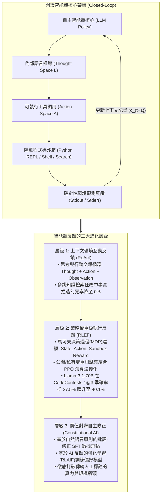
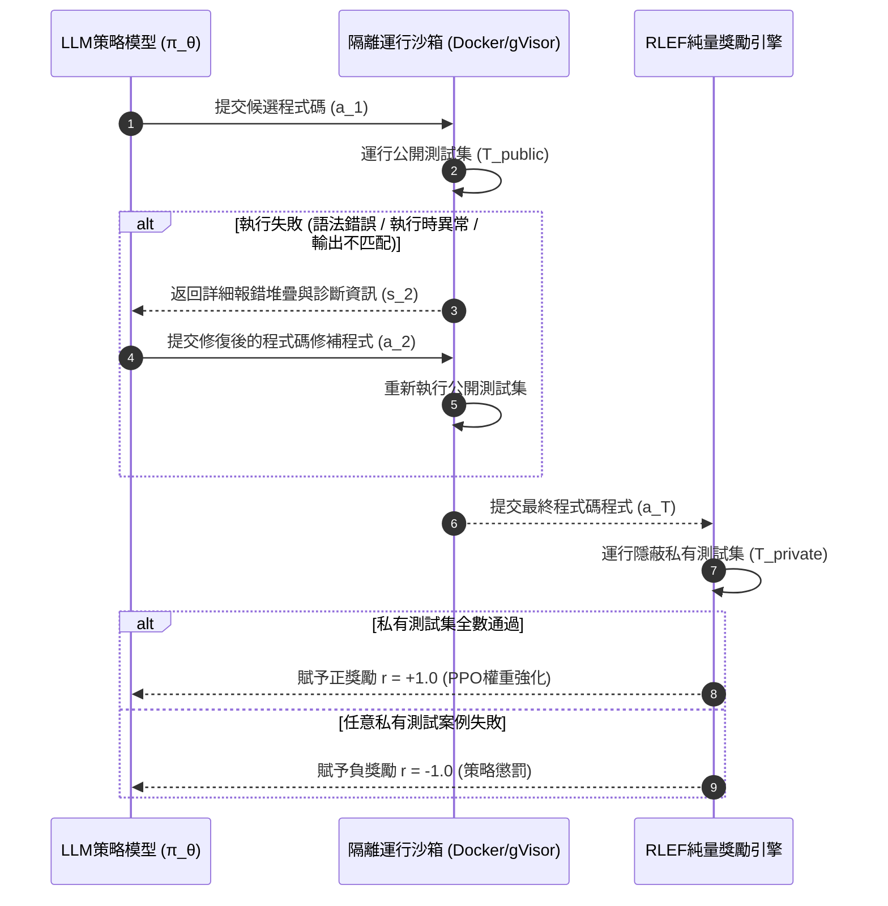
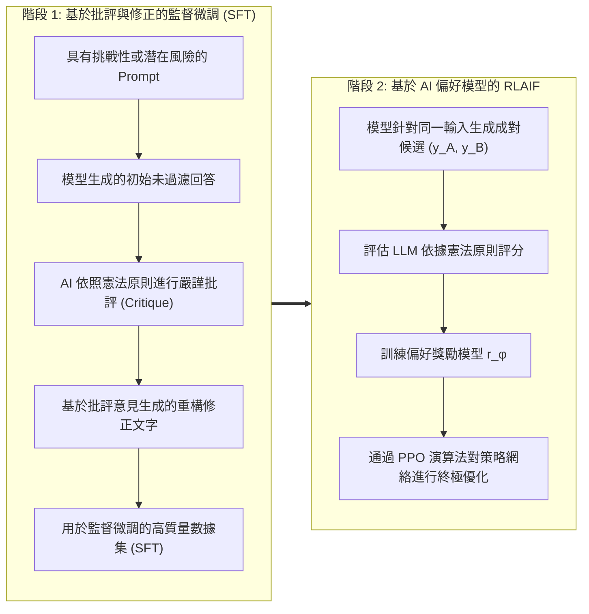

歡迎來到史丹佛大學2025秋季最新研究生課程——**CS329A: Self-Improving AI Agents（自主進化AI智能體）**的第四篇深度工程解析。

在第2講與第3講中，我們系統剖析了測試時計算擴展（Test-time Compute Scaling）與過程獎勵模型（PRM），掌握了語言模型如何展開推理搜尋樹並驗證中間數學推導的內在邏輯。然而，無論思維鏈（CoT）推理多麼精妙，僅僅局限於純文字生成的模型本質上依然是**「被關在封閉考場內答卷的考生」**。它們只能依賴預訓練階段寫入神經網絡的靜態、凍結參數記憶（Parametric Memory）。面對即時演變的世界現實、動態Web API或語法要求嚴苛的程式碼執行環境，與外部物理隔離的模型不可避免地會陷入以假亂真的「幻覺（Hallucination）」。

今天的**第4講**正是帶領智能體走出封閉考場的決定性轉折點：**工具調用（Tool Use）與程式碼執行反饋循環（Feedback Loops）**。

現代自主智能體不再將程式碼或API調用僅僅視作最終的文字輸出，而是將其轉化為與外部環境進行互動的**感知器（Sensor）與執行器（Actuator）**。本講中，我們將深入拆解將靜態語言模型升級為自主閉環智能體的三大核心反饋層級：
1. **提示詞層面的環境互動反饋：** 思維與行動協同並進的 **ReAct**（Yao et al., 2022）
2. **策略網絡層面的執行診斷反饋：** 將編譯器與測試集報錯直接刻入模型權重的 **RLEF**（Reinforcement Learning from Execution Feedback, 2024）
3. **自主監督層面的價值對齊修正：** 以自然語言憲法原則替代高昂人工標註的 **Constitutional AI**（Anthropic, 2022）



{/* truncate */}

---

### 1. 思維與行動的協同：ReAct 架構 (Yao et al., 2022)

在 2022 年 ReAct（普林斯頓大學與 Google Research）發表之前，學術界在智能體構建路線上存在兩大截然對立的流派：
1. **純推理派（Chain-of-Thought / CoT）：** 引導模型「一步一步進行推理」。在封閉數學推導中效果顯著，但由於缺乏與外部環境的互動，一旦中間產生虛假假設，模型便會在錯誤的前提下不斷展開推演，導致最終結論徹底失真。
2. **純行動派（Action-only / WebGPT, Act）：** 直接讓模型生成 API 搜尋或環境互動指令。但由於缺乏內部工作記憶（Working Memory）來追蹤「為什麼發起這次檢索」以及「下一步子目標是什麼」，模型極易迷失方向或陷入無窮迴圈。

#### 行動空間的數學擴展

ReAct 的核心洞察在於，將智能體的整體行動空間形式化為**物理環境行動空間 $A$** 與 **自然語言思維空間 $L$** 的聯集：

```text
A_hat = A ∪ L
```

其中：
* `A` 表示在外部環境中可實際執行的動作集合（如 `Search[query]`、`ExecuteCode[script]`、`Click[element]`）。
* `L` 表示自由的自然語言思維（Thought）空間。

在數學上極為關鍵的特性是，思考動作 `a_t \in L` **不會引起外部物理環境發生任何狀態轉移**。它僅僅更新智能體自身的內部上下文歷史：

```text
c_{t+1} = ( c_t, a_t )   (當 a_t ∈ L 時)
```

而當智能體發出物理執行動作 `a_t \in A` 時，外部環境執行該動作並返回確定性的觀測結果（Observation）：

```text
c_{t+1} = ( c_t, a_t, o_t )   (當 a_t ∈ A, o_t = Env(a_t) 時)
```

#### ReAct 互動循環的實際執行軌跡

在標準 ReAct 範式下，推理、行動與環境觀測緊密交織：

```text
Thought 1: 將使用者的問題拆解為兩個子目標。首先需要檢索圖靈的出生年份。
Action 1: Search["艾倫·圖靈 出生日期"]
Observation 1: 艾倫·麥席森·圖靈（1912年6月23日 - 1954年6月7日）是英國數學家...
Thought 2: 圖靈出生於1912年。接下來需要檢索1912年倫敦的官方統計人口數據。
Action 2: Search["倫敦 1912年 人口數據"]
Observation 2: 1912年倫敦行政郡的官方統計人口約為452萬人...
Thought 3: 兩個關鍵數值均已通過外部權威數據核實，最終答案為452萬人。
Action 3: Finish["452萬人"]
```

#### 實驗驗證：幻覺的戲劇性歸零

Yao 等人的基準評測展現了顯著的可靠性提升：
* **多跳問答檢索基準（HotpotQA）：**
  * 在對 CoT 模型的錯誤歸因分析中，**56% 的失敗案例直接源於事實捏造（憑空創造不存在的人物或年份）**。
  * 引入 ReAct 閉環後，模型的事實捏造率直接**降為 0%**。因為面對未知領域時，模型必須調用檢索動作獲取客觀事實。
* **互動式文字任務（ALFWorld）：**
  * 在多房間漫遊與物品互動任務中，純行動派模型因目標漂移成功率僅為 45%，而 ReAct 躍升至 **71%**。
* **生產工程必須遵守的硬性規則（停止序列 / Stop Sequence）：**
  * 自回歸語言模型具有自主預測後續文字的本能。如果不加以限制，它會在輸出 `Action:` 後迫不及待地自己偽造虛假的 `Observation:`。
  * **工程規範：** 在推理引擎中必須設置顯式停止詞（`stop=["\nObservation:"]`）。模型輸出行動指令後立即強行掛起，由宿主系統調用真實沙箱，並將真實的物理輸出作為字串拼接後再喚醒模型進入下一輪。

---

### 2. 將執行反饋刻入權重：RLEF (Reinforcement Learning from Execution Feedback)

如果說 ReAct 解決了基於上下文提示的環境互動，那麼在軟體工程領域，智能體還需要更深層的能力：**根據編譯器的堆疊報錯與測試案例失敗資訊，自主修改邏輯缺陷的自癒調試（Self-Debugging）能力**。

#### 上下文自我調試的悖論

當開發者將報錯資訊（Traceback）貼給凍結的預訓練大模型（Frozen LLM）並要求其修復程式碼時，實證研究（Olausson et al., 2024; Kapoor et al., 2024）揭示了一個反直覺的普遍現象：

> **「將報錯資訊餵給未微調的模型要求其調試程式碼，其成功率往往顯著低於直接丟棄報錯、從頭獨立重新採樣（Independent Sampling）全新程式碼的做法！」**

這是因為預訓練大模型從未接受過將行號堆疊資訊與程式碼邏輯漏洞進行因果綁定的專項訓練。面對報錯，模型往往手足無措，僅做無意義的變數重新命名，或在換行微調後再次生成一模一樣的 Bug。

2024 年底發表的 **RLEF (arxiv:2410.02089)** 放棄了單薄的提示詞工程，改用**強化學習（PPO）**從根本上攻克了這一難題。

#### 多輪程式碼合成的形式化建模（MDP）

RLEF 將「編寫程式碼 `\to` 運行獲取反饋 `\to` 生成修補程式」的最多 $T$ 輪互動過程形式化為離散時間馬可夫決策過程（MDP）：
* **狀態空間（$S$）：** 包含問題描述、過往嘗試程式碼以及編譯器/測試集報錯診斷歷史：
  ```text
  s_t = ( Problem_Spec, Code_1, Err_1, ..., Code_{t-1}, Err_{t-1} )
  ```
* **行動空間（$A$）：** 模型在當前輪次輸出的程式碼修補程式或全新程式 $a_t$。
* **環境轉移：** 程式碼在配備自動化測試腳手架的隔離沙箱中編譯並執行。



#### 雙重測試集設計：杜絕獎勵作弊（Reward Hacking）

RLEF 架構最核心的安全設計在於**公開測試集與私有測試集的嚴格物理隔離**：
1. **公開測試集（`T_public`）：** 在調試過程中向模型開放，編譯器報錯、斷言失敗以及標準錯誤輸出構成環境狀態 $s_t$。
2. **私有測試集（`T_private`）：** 對模型的輸入上下文徹底隱蔽，僅在互動結束時由環境在後端獨立運行，用於計算最終的純量獎勵。

如果模型試圖通過硬編碼查詢表（`if input == test_1: return val_1`）作弊蒙混過關，它將在私有測試集上徹底全軍覆沒，遭受極其嚴厲的策略懲罰。

#### 目標函數與環境獎勵設計

策略模型 `\pi_\theta` 採用 PPO 演算法進行訓練，並施加針對參考模型 `\rho` 的詞元級 KL 散度懲罰：

```text
R(s_t, a_t) = r(s_t, a_t) - β * log( π_θ(a_t | s_t) / ρ(a_t | s_t) )
```

環境純量獎勵函數 $r(s_t, a_t)$ 設計如下：

```text
r(s_t, a_t) = {
    +1.0,  互動終止時通過 T_private 的全部測試案例
    -1.0,  耗盡最大重試次數 T 依然存在未通過案例
    -0.2,  當 a_t 包含無法編譯的嚴重語法錯誤時的中間懲罰
}
```

#### 基準評測：在 CodeContests 上超越 AlphaCodium

在包含高難度演算法競賽題目的 **CodeContests** 基準測試中，RLEF 展現了驚人的工程爆發力：
* 在開源模型 `Llama-3.1-70B-Instruct` 上應用 RLEF 後，僅給予 3 次重試機會（$1@3$），解題通過率便從 **27.5% 躍升至 40.1%**。
* 作為對比，基於 GPT-4 並進行 100 次平行大批量採樣的 **AlphaCodium（$pass@100$, 29.0%）被 RLEF 僅用 3 輪互動就超越了整整 11.1 個百分點**。

#### 隨機報錯消融實驗（Ablation Study）

為驗證模型是否真正理解了報錯，研究團隊設計了消融實驗：
* 故意向智能體餵入與當前問題無關的其他題目報錯資訊，模型的成功率瞬間暴跌至基準線以下。
* 這從數學上充分證明：經由 RLEF 訓練的模型並非盲目亂猜，而是**在神經網絡權重中建立了精準的因果映射，能根據報錯行號與異常類型直接定位程式碼缺陷並實施有效重構**。

---

### 3. AI 對齊自主監督：Constitutional AI 與 RLAIF

ReAct 依賴外部檢索，RLEF 依賴確定性編譯器。但在缺乏自動化編譯器的開放式、主觀性領域中，我們該如何提供反饋？
* 這篇系統架構方案是否符合微服務解耦與可擴展性原則？
* 這份程式碼審查意見是否既指出了嚴重安全漏洞，又保持了專業建設性的溝通風格？
* 這段技術回答是否能夠防禦對抗性越獄提示詞的攻擊？

傳統的人類反饋強化學習（RLHF）依賴成千上萬名人類標註員對比評估成對回覆。這種模式面臨巨大的局限性：成本極度高昂、標註人員之間存在主觀偏差、認知疲勞以及評判標準難以統一。

2022 年，Anthropic 提出了 **Constitutional AI（RLAIF：基於 AI 反饋的強化學習）**，確立了完全依託自然語言原則（即「憲法」，Constitution）實現自主對齊的全新範式。



#### 雙階段憲法級訓練流水線

1. **第一階段：批評與修正（Critique `\to` Revision `\to` SFT）**
   * 向基座模型輸入高難度或誘導性問題。
   * 模型輸出初始回答 $y_0$ 後，系統從憲法清單中抽取原則並下達指令：
     * **批評指令：** *「請根據憲法原則（『嚴格防範注入漏洞並強制推行靜態型別安全性』）審視上一條回覆，逐條指出具體違規之處。」*
     * **修正指令：** *「請根據上述批評重寫該回覆，消除所有缺陷並保持最高度的技術深度。」*
   * 將經過反覆自我批評與修正的高質量樣本 ``(y*)`` 收集成庫，對模型進行第一輪監督微調（SFT）。

2. **第二階段：AI 反饋強化學習（RLAIF）**
   * 微調後的高質量模型針對輸入 $x$ 生成成對選項 $(y_A, y_B)$。
   * 由獨立的 AI 裁判模型根據憲法原則評估兩者的優劣分佈：
     ```text
     P( y_A > y_B | x, Constitution )
     ```
   * 利用 AI 裁判生成的軟標籤訓練偏好獎勵模型 `r_\phi(x, y)`，並結合 PPO 演算法對目標智能體策略展開端到端強化學習。

#### 核心意義：可擴展監督（Scalable Oversight）

Constitutional AI 證明，人類成千上萬小時的繁重標註勞動可以被高度濃縮為**一紙清晰明確的自然語言原則（憲法）**。人類架構師只需把控頂層規範的制定，AI 評估集群即可將高質量監督無縫擴展至數十億 Token 的訓練規模。

---

### 4. 企業級架構設計：高防程式碼執行沙箱藍圖

要在企業生產環境中安全承載自主工具調用與程式碼執行反饋，必須構建完備的縱深防禦基礎設施。史丹佛 CS329A 推薦的企業級架構藍圖如下：

```text
┌────────────────────────────────────────────────────────────────────────┐
│             企業級智能體工具與程式碼執行沙箱架構                        │
├────────────────────────────────────────────────────────────────────────┤
│                                                                        │
│  [ 客戶端業務需求 / PRD 文件 ]                                          │
│          │                                                             │
│          ▼                                                             │
│  ┌──────────────────────────────────────────────────────────────────┐  │
│  │                    編排智能體核心引擎                            │  │
│  │  • 嚴格綁定停止序列（Stop Sequence）的 ReAct 提示詞引擎          │  │
│  │  • 上下文管理器（滑動工作記憶 + AST 程式碼索引庫）               │  │
│  │  • 基於 JSON-RPC 規範的工具調度驗證器                           │  │
│  └───────────────────┬──────────────────────────────▲───────────────┘  │
│                      │ 結構化工具調用指令           │ 淨化後的遙測反饋  │
│                      ▼                              │ (Stdout/Stderr)  │
│  ┌──────────────────────────────────────────────────┴───────────────┐  │
│  │                     安全沙箱接入閘道                             │  │
│  │  • MicroVM / gVisor 容器隔離（徹底切斷宿主機檔案系統存取）       │  │
│  │  • 出站網路防火牆攔截（僅放行白名單安全網域）                    │  │
│  │  • 嚴格資源定額：2.0 CPU 核心、2GB 記憶體、5 秒逾時強制熔斷       │  │
│  ├──────────────────────────────────────────────────────────────────┤  │
│  │                     隔離執行執行階段環境                         │  │
│  │  ┌─────────────────────────┐     ┌────────────────────────────┐  │  │
│  │  │ 臨時 Python REPL 實例   │     │ 受限 Bash 互動終端         │  │  │
│  │  │ • Pytest 公開測試套件   │     │ • AST 靜態語法檢查器       │  │  │
│  │  │ • 報錯堆疊脫敏淨化器    │     │ • Semgrep 程式碼安全掃描器 │  │  │
│  │  └─────────────────────────┘     └────────────────────────────┘  │  │
│  └──────────────────────────────────────────────────────────────────┘  │
│                                                                        │
└────────────────────────────────────────────────────────────────────────┘
```

#### 生產落地的三大核心安全原則
1. **純臨時沙箱（Ephemeral Sandboxing）：** 所有的程式碼執行必須在 gVisor 容器或 Firecracker 驅動的 MicroVM 中即用即啟，任務結束立即徹底銷毀。
2. **出站流量硬隔離（Egress Isolation）：** 嚴防提示詞注入攻擊將宿主機的環境變數或資料庫憑證通過外部網路外洩，預設切斷所有未授權的出站網路流量。
3. **報錯堆疊脫敏（Traceback Sanitization）：** 在將終端的報錯資訊回傳給模型前，必須對伺服器絕對實體路徑、敏感環境變數等資訊進行脫敏過濾。

---

### 5. 資深工程師核心 Q&A

**Q: 如何從根本上防止 ReAct 智能體不等工具返回，就自己編造虛假的 Observation？**
**A:** 這是構建智能體系統時最常見的深坑。自回歸模型具有預測對話下文的慣性，輸出完 `Action: Search[...]` 後往往會自說自話地接著寫 `Observation: 搜尋成功...`。唯一的根治方法是在模型推理配置中顯式註冊停止序列：`stop=["\nObservation:"]`。一旦大模型輸出完 `Action:` 行，推理引擎會立即強行剎車。後端系統接管控制權，在沙箱中真正運行工具，獲取真實環境輸出後再將其拼接到輸入提示詞中，喚醒模型進入下一個思考步。

**Q: 為什麼 RLEF 強化學習的泛化能力顯著優於直接用靜態報錯日誌進行監督微調（SFT）？**
**A:** 靜態 SFT 數據集存在致命的**分佈偏移（Distributional Shift）**。在真實運行環境中，一旦智能體寫出了一個過去訓練集裡從未出現過的冷門語法錯誤，它就會陷入未見過的狀態空間從而徹底崩潰。而 RLEF 是在 MDP 環境中讓智能體親身探索自己獨有的程式碼編寫缺陷，在真實碰撞中感受失敗懲罰，並通過 PPO 自行探索出修復路徑，因而具備極強的強韌性與自癒力。

---

### 6. 核心總結與技術要點

1. **環境互動構建智能基石：** 僅依賴靜態參數記憶的模型必然產生幻覺。ReAct 將思考與行動空間深度融合（`\hat = A \cup L`），在多跳檢索任務中將事實捏造率清零。
2. **執行反饋寫入神經權重：** 停留在凍結模型上的提示詞技巧已達天花板。RLEF 將編譯器與測試集抽象為 MDP，使 70B 開源模型在演算法競賽基準上全面超越百次採樣的 GPT-4 架構。
3. **自主憲法對齊：** Constitutional AI 用自然語言原則替代了勞動密集型的人工標註，打通了自發批評-修正與大規模 AI 偏好對齊（RLAIF）的演進通路。
4. **縱深防禦沙箱：** 工業級智能體落地離不開嚴格的工程保障：停止詞截斷、臨時微虛擬機隔離以及公開/私有測試套件分離是系統可靠運行的支柱。

---

### 史丹佛 CS329A 下期預告：
在接下來的**第5講**中，我們將由單步工具調用正式邁向跨越多個維度的宏觀戰略規劃：**《多步規劃與樹搜尋：ADaPT、LATS、SPRINT 以及面向語言智能體的蒙特卡洛樹搜尋（MCTS）》**。我們將剖析智能體如何像西洋棋特級大師一樣洞察未來數十步變化、自主構建探索樹並進行回溯。敬請期待！