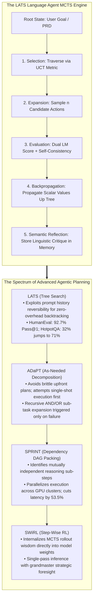
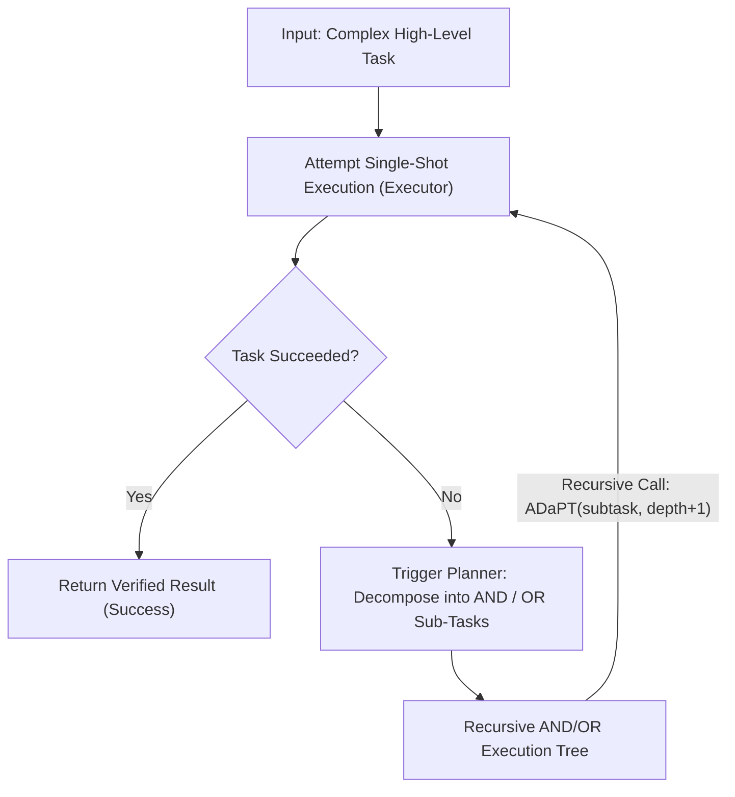
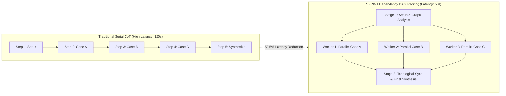

Welcome to the fifth installment of our deep-dive engineering breakdown of **Stanford University's CS329A: Self-Improving AI Agents (Autumn 2025)**.

In Lecture 4, we witnessed how agents step outside their closed rooms to interact with external tools and debug code via compiler feedback loops. However, fixing local syntax bugs or querying an API is a far cry from architecting a complex 100,000-line distributed software system or resolving long-horizon scientific problems.

Standard ReAct and Chain-of-Thought approaches are fundamentally **greedy, single-path searchers**: they inspect the immediate next step and march forward irreversibly. Like an amateur chess player who only evaluates the next move and falls into a checkmate three turns later, a greedy language model that commits to a suboptimal early derivation becomes hopelessly trapped in a dead end, unable to recover.

Today's **Lecture 5** serves as the grand finale of **Part 1 (Foundation)** of the Stanford curriculum: **Multi-Step Planning and Tree Search**.

By transplanting the mathematical engine of DeepMind's AlphaGo—**Monte Carlo Tree Search (MCTS)**—into autoregressive language models, we transform reactive text predictors into strategic chess grandmasters. We explore systems that anticipate consequences dozens of steps ahead, dynamically prune dead ends, backtrack across history branches, and parallelize reasoning pipelines:
1. **Unifying Reasoning, Acting, and Planning:** Language Agent Tree Search (**LATS**, Zhou et al., 2023).
2. **As-Needed Recursive Decomposition:** Breaking down complex objectives only upon failure via **ADaPT** (Allen AI, 2023).
3. **Parallel Dependency DAG Packing:** Slashing multi-step inference latency by 53.5% via **SPRINT** (Stanford Future Data, 2025).
4. **Adaptive Branching via Thompson Sampling:** Solving the Wider vs. Deeper dilemma with **AB-MCTS** (Sakana AI, 2025).
5. **Internalizing Planning into Synaptic Weights:** **SWiRL** (Step-Wise RL, 2025).



{/* truncate */}

---

### 1. The Greedy Trap: Why Single-Path Reasoning Fails Long-Horizon Tasks

In elementary problem-solving, greedy autoregressive decoding (`argmax ∏ P(w_t | w_{<t})`) or Chain-of-Thought (CoT) prompting suffices because the solution manifold is dense and forgiving. However, as the horizon of interdependent decisions extends ($H > 10$), standard generation suffers from exponential **Error Propagation**:

```text
P(Success) = ∏_{t=1}^H P(Correct_Action_t | History_{<t})
```

If each individual reasoning or tool-call step exhibits a 90% probability of soundness, an agent executing a 15-step software engineering task retains a dismal overall success rate:

```text
P(Success) = 0.90^{15} ≈ 0.2059  (20.6% Success Rate)
```

In standard autoregressive architectures, once an erroneous decision is made at $t=3$, the tokens are permanently appended to the prompt context. The model possesses no native mechanism to rewind time, discard the sub-tree, and try alternative branches. To achieve robust autonomy, agents must operate over a **Search Tree of States**.

---

### 2. Language Agent Tree Search: LATS (Zhou et al., 2023)

In classical reinforcement learning games like Go or Chess, MCTS relies on a deterministic game engine (the World Model) to simulate hypothetical futures. How can an agent simulate hypothetical futures in open-ended domains like programming or research where no complete world simulator exists?

The breakthrough insight of **LATS (Zhou et al., 2023, UIUC & Google DeepMind)** was recognizing an intrinsic superpower of Large Language Models:

> **"In a language agent, any environment state is completely captured by its prompt history. Backtracking to an earlier point in time requires no complex physics engine: you simply restore the text prompt from that prior timestep and prompt the model to branch in a new direction."**

LLMs provide **perfect state reversibility for free**.

#### The 5-Stage LATS Cycle

LATS deploys a single LLM across three distinct roles—**Agent (Actor)**, **Value Evaluator (Critic)**, and **Reflector (Retrospective Diagnostician)**—iterating through a five-stage loop:

```text
                            [ Root: User Task ]
                                     │
                     1. Selection (UCT Formula)
                                     ▼
                            [ Promising Node s ]
                                     │
                     2. Expansion (Sample n actions)
                                     ▼
                        [ Sandbox Execution & Obs ]
                                     │
                     3. Evaluation (LM Score + SC)
                                     ▼
                     4. Backpropagation (Value Update)
                                     │
                     5. Reflection (On Failure: Semantic Critique)
```

#### 1. Selection via UCT (Upper Confidence Bound for Trees)
Starting from the root, LATS navigates child nodes by maximizing the UCT score, balancing exploitation of high-reward trajectories with exploration of under-visited nodes:

```text
UCT(s) = V(s) + w * sqrt( ln N(p) / N(s) )
```

Where:
* $V(s)$ represents the estimated average value of state $s$.
* $N(s)$ is the visit count of state $s$.
* $N(p)$ is the visit count of parent node $p$.
* $w$ is the exploration weight coefficient (typically $w = sqrt(2)$).

#### 2. Expansion
Upon reaching a leaf node $s$, the agent samples $n$ diverse candidate actions $`a^(1), ..., a^(n)`$ from the policy. Each action is dispatched to the execution environment (e.g., Python REPL or terminal), returning corresponding observations $`o^(1), ..., o^(n)`$.

#### 3. Value Evaluation
The scalar reward $V(s)$ is synthesized using an ensemble of qualitative scoring and self-consistency:

```text
V(s) = λ * LM_Score(s) + (1 - λ) * Self_Consistency(s)
```

* **`LM_Score(s)`:** The LLM inspects the problem context and environment observation, outputting a calibrated score from 1 to 10.
* **`Self_Consistency(s)`:** Frequency with which stochastic rollouts from state $s$ converge onto identical conclusion states.

#### 4. Backpropagation
The terminal reward $r$ is propagated upward along the traversal path back to the root, iteratively updating visit counters and running value averages:

```text
N(s_i) = N(s_i) + 1
V(s_i) = ( V(s_i)_old * N(s_i)_old + r ) / N(s_i)_new
```

#### 5. Semantic Reflection
When a search branch results in failure (e.g., test suite failure or environmental deadlock), standard MCTS simply assigns a negative numeric scalar ($r = -1$). LATS augments this with **Semantic Reflection**:
The model prompts itself to diagnose the root cause: *"Why did this branch fail? What false assumption led to this bug?"*
This diagnostic text is stored in an episodic memory cache and dynamically injected into the system prompt of future rollouts, preventing identical mistakes across search iterations.

#### Benchmark Triumphs
* **HotpotQA (Multi-Hop Complex Reasoning):** Standard ReAct scored 32.0%. LATS propelled accuracy to **71.0%** (a 2.2x increase).
* **HumanEval (Python Code Generation):** LATS achieved a record-shattering **92.7% Pass@1**, outperforming standard Reflexion (91.0%) and base models (80.1%).
* **Ablation Findings:** Replacing MCTS with simple Depth-First Search (DFS) collapsed performance to 42%, demonstrating that deliberate UCT exploration is non-negotiable.

---

### 3. As-Needed Recursive Decomposition: ADaPT (Allen AI, 2023)

While LATS focuses on horizontal exploration across candidate trajectories, **ADaPT (As-Needed Decomposition and Planning with Tools, Allen AI, 2023)** pioneers vertical hierarchical planning.

Classical "Plan-and-Execute" frameworks generate an elaborate 10-step schedule prior to execution. However, in stochastic environments, if step 2 encounters unexpected behavior, the remaining 8 steps immediately become obsolete.

ADaPT mirrors human pragmatic problem solving:

> **"Never over-plan upfront. Dispatch the entire high-level task to a single Executor. Only when the Executor explicitly reports failure does the Planner intervene to recursively decompose the task into 3 to 5 modular sub-tasks."**



#### The AND / OR Recursive Execution Engine

ADaPT formulates task breakdown using logical AND/OR nodes:
* **AND Nodes:** Represent sequential sub-tasks that must all succeed in order (e.g., `Fetch Data` `\to` `Transform Schema` `\to` `Write DB`).
* **OR Nodes:** Represent alternative exploratory hypotheses where succeeding in any branch fulfills the parent requirement (e.g., `Search Local Cache` OR `Query Remote API`).

#### Empirical Efficiency
* On ALFWorld multi-object manipulation tasks (e.g., *Pick2*), standard ReAct agents collapsed to < 12% success. ADaPT achieved **52.9%**.
* By solving straightforward tasks in a single pass and decomposing only upon demonstrated failure, ADaPT reduced total token expenditure by **over 40%** compared to rigid upfront planning engines.

---

### 4. SPRINT: Parallel Dependency DAG Packing (Stanford Future Data, 2025)

In early 2025, long-horizon Chain-of-Thought models (such as DeepSeek-R1 and OpenAI o-series) proved that massive test-time compute unlocks unprecedented reasoning power. However, enterprise adoption hit a wall: **prohibitive inference latency**. Waiting 120 seconds for a sequential token stream is unacceptable for production user interfaces.

The **SPRINT** research group at Stanford Future Data Labs dissected long-horizon reasoning traces and identified profound architectural waste:

> **"Autoregressive models emit thousands of reasoning tokens in a strict serial line. Yet, logically, verifying Lemma A, searching case B, and reviewing critique C are completely independent computations. Why force them to execute in serial order when they can be packed into a parallel DAG?"**



#### The Topological Packing Algorithm

SPRINT models reasoning as a Directed Acyclic Graph (DAG) where each step $S_i$ consists of a planning token block $P_i$ and execution block $E_i$. Given causal dependencies $D$, SPRINT assigns each step a topological stage number `\sigma(S_i)`:

```text
σ(S_i) = {
    1,                                                         if Parents(S_i) = ∅
    max_{S_p ∈ Parents(S_i)} ( σ(S_p) + 1[ E_p ≠ ∅ ] ),        otherwise
}
```

All reasoning steps sharing the identical topological level `\sigma` are dispatched concurrently across distributed GPU worker nodes. Once all parallel threads complete, an aggregation synchronization barrier fuses the intermediate findings, and the planner computes the subsequent parallel horizon:

```text
Plan  ──►  Parallel Dispatch  ──►  Topological Sync  ──►  Re-Plan
```

#### Results: Latency Slashed in Half, Accuracy Boosted
* On **MATH-500**, SPRINT increased benchmark accuracy from **89.1% to 92.5%** over sequential execution (due to cross-branch verification benefits).
* Simultaneously, wall-clock generation latency was cut by **53.5%**, reducing 2-minute complex mathematical derivations to under 50 seconds.

---

### 5. Adaptive Exploration and Learning: AB-MCTS & SWiRL

As tree-search agent architectures mature, two final frontiers emerge:

#### 1. AB-MCTS: The Wider vs. Deeper Dilemma (Sakana AI, 2025)
Standard MCTS algorithms rely on rigid, pre-set branching factors. But should an agent branch horizontally to explore fresh ideas (*Wider*) or deepen its existing derivation (*Deeper*)?
**AB-MCTS (Adaptive Branching MCTS)** introduces a synthetic `GEN` meta-action evaluated via **Thompson Sampling**:
* Selecting an existing child node delves deeper down an established derivation path.
* Selecting the `GEN` action instructs the LLM to generate an entirely new sibling branch, expanding tree width on the fly.
* By modeling branch value distributions as posterior distributions, AB-MCTS traverses simple reasoning phases in 1 to 2 turns, reserving deep tree exploration exclusively for critical conceptual bottlenecks.

#### 2. SWiRL: Internalizing Grandmaster Intuition into Synaptic Weights (2025)
Running external MCTS rollouts during runtime inference is computationally expensive. **SWiRL (Step-Wise Reinforcement Learning)** bridges search with training:
* It breaks long-horizon agent trajectories into step-level transitions.
* Generative reward models assign dense credit not merely to final problem success, but to the logical validity of intermediate sub-plans.
* By optimizing policy weights via Step-Wise PPO, the model learns to **simulate search trees implicitly in its internal activations**, achieving grandmaster-level planning foresight in a single forward pass without external tree harnesses.

---

### 6. Production Blueprint: Enterprise Hierarchical MCTS Planning Mesh

Building an enterprise-ready planning engine requires strict cost governance, process isolation, and fallback protections:

```text
┌────────────────────────────────────────────────────────────────────────┐
│             Production Multi-Step Planning Mesh Architecture            │
├────────────────────────────────────────────────────────────────────────┤
│                                                                        │
│  [ Enterprise Objective / Spec PRD ]                                   │
│          │                                                             │
│          ▼                                                             │
│  ┌──────────────────────────────────────────────────────────────────┐  │
│  │                    Adaptive Planning Orchestrator                │  │
│  │  • Phase 1: Direct Single-Shot Executor Attempt (Zero MCTS Cost) │  │
│  │  • Phase 2: On Failure -> ADaPT Dynamic AND/OR Task Decomposition │  │
│  │  • Phase 3: High-Ambiguity Tasks -> LATS Monte Carlo Tree Search │  │
│  └───────────────────┬──────────────────────────────▲───────────────┘  │
│                      │ Parallel Sub-Task DAG        │ Evaluated State  │
│                      ▼                              │ Value Signals    │
│  ┌──────────────────────────────────────────────────┴───────────────┐  │
│  │                     SPRINT Distributed Dispatcher                │  │
│  │  • Topological Sort & Dependency Analysis Engine                 │  │
│  │  • Asynchronous GPU Worker Pool (7B/8B Lightweight Sampling)      │  │
│  │  • Concurrency Synchronization & Context Packing Barrier         │  │
│  ├──────────────────────────────────────────────────────────────────┤  │
│  │                     Verification & Safeguard Layer               │  │
│  │  • UCT Node Pruning Engine (Prune branches with V < 0.2)         │  │
│  │  • Early-Stop Circuit Breaker (Halt on 100% verified test pass)   │  │
│  │  • Episodic Semantic Reflection Memory Buffer                     │  │
│  └──────────────────────────────────────────────────────────────────┘  │
│                                                                        │
└────────────────────────────────────────────────────────────────────────┘
```

#### Production Safeguard Rules
1. **Early-Stopping Circuit Breakers:** The instant any single search branch passes all deterministic validation criteria (e.g., unit test suite passes 100%), immediately terminate all active MCTS exploration threads and return the winning candidate.
2. **Hierarchical Model Serving:** Never use frontier 70B+ models for trivial leaf rollouts. Deploy sub-8B models to sample candidate actions and reserve frontier models exclusively for high-stakes node value evaluations.
3. **Budget Quotas:** Enforce hard constraints on tree depth (``d_max` \le 6`) and maximum rollout iterations (``N_rollouts` \le 30`) to prevent runaway cloud inference costs.

---

### 7. Technical Deep Dive: Practical Engineering Q&A

**Q: In SPRINT, if independent reasoning branches run in parallel, couldn't a bug in Branch A poison the downstream synthesis?**
**A:** This is the core architectural beauty of SPRINT's dependency DAG. SPRINT does not parallelize blindly; it only dispatches sub-steps that share **zero causal data dependencies**. If Branch B requires data generated by Branch A, the topological sorting algorithm guarantees that Branch B will not execute until Branch A has concluded and passed its verification barrier. Furthermore, parallel branches provide mutual redundancy: downstream aggregators compare findings across workers, acting as an implicit multi-agent ensemble that actually boosts accuracy.

**Q: How does Semantic Reflection differ from standard scalar backpropagation in MCTS?**
**A:** Standard MCTS only updates numeric statistics ($N(s)$ and $V(s)$). While effective in finite state spaces like board games, numeric scalars fail to convey *why* a particular line of Python code failed or *which* mathematical premise was violated. Semantic Reflection converts runtime errors into natural language post-mortems stored in working memory. When the agent revisits that conceptual state, the reflection text acts as an active constraint in the prompt, steering the policy away from known pitfalls.

---

### 8. Summary and Core Technical Takeaways

1. **Escaping the Greedy Trap:** Autoregressive models suffer catastrophic error compounding over long horizons. MCTS elevates agents into strategic planners by enabling dynamic exploration, pruning, and backtracking.
2. **Reversibility via Prompt History:** LATS proves that language models offer cost-free state reversibility, allowing full MCTS implementation without external world simulators.
3. **As-Needed Decomposition:** ADaPT avoids brittle upfront schedules by attempting direct execution first and decomposing into recursive AND/OR sub-tasks only upon failure.
4. **Parallel DAG Acceleration:** SPRINT breaks the sequential token barrier, packing independent reasoning steps into parallel execution DAGs that slash latency by 53.5%.
5. **From Search to Weights:** SWiRL uses Step-Wise RL to internalize MCTS search wisdom into neural weights, delivering grandmaster-level planning in single-pass inference.

---

### Congratulations: Part 1 (Foundation) Complete!
With the conclusion of Lecture 5, we have officially completed **Part 1: Foundation (Lectures 1–5)** of Stanford CS329A:
* **L1:** The Macro Paradigm Shift from LLMs to Self-Improving Autonomous Agents
* **L2:** Test-Time Compute Scaling Laws and Coverage Power Laws
* **L3:** Step-by-Step Robust Verification (PRMs) and Multi-Verifier Ensembles (Weaver)
* **L4:** Closed-Loop Tool Execution (ReAct), Compiler Feedback (RLEF), and Constitutional AI
* **L5:** Multi-Step Planning, Tree Search (LATS), and Parallel DAG Packing (SPRINT)

We have mastered how agents reason, interact, verify, and plan.

Starting in our next episode, we enter **Part 2: Training & Evolution (Lectures 6–9)**, moving beyond inference-time heuristics into the frontier of autonomous machine learning: **how models update their own weights via reinforcement learning and open-ended evolution**.

Our next lecture kicks off with:
**《Lecture 6: Train-Time Scaling & RL: DeepSeekMath, GRPO, and Large-Scale Reasoning Optimization》**. 
We will dismantle the mathematical architecture of Group Relative Policy Optimization (GRPO) and reveal how frontier reasoning models achieve state-of-the-art capability without costly critic models. Stay tuned!