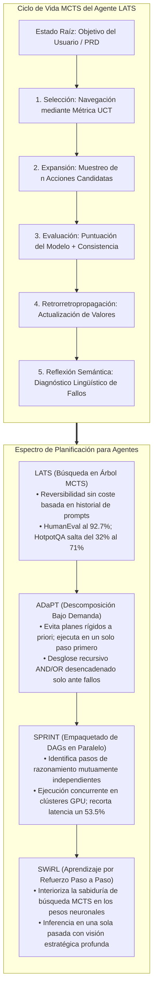
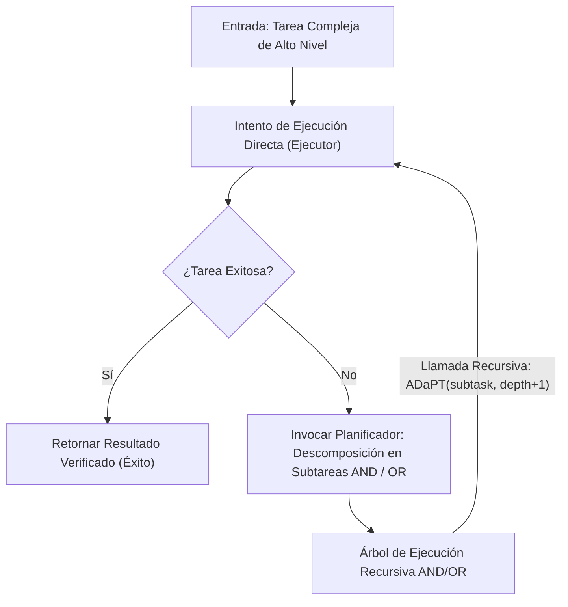
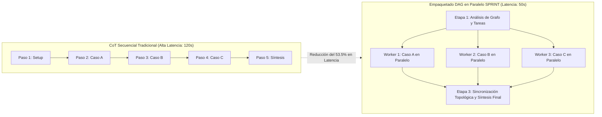

Bienvenidos a la quinta entrega de nuestro análisis técnico del curso de posgrado de la **Universidad de Stanford, CS329A: Self-Improving AI Agents (Agentes de IA que se Perfeccionan a Sí Mismos, Otoño 2025)**.

En la Clase 4 exploramos cómo los agentes escapan del confinamiento de la memoria estática mediante el uso de herramientas y bucles de retroalimentación de compiladores (ReAct, RLEF). Sin embargo, reparar un error puntual de sintaxis dista enormemente de diseñar un sistema de software distribuido de 100.000 líneas o resolver problemas científicos de largo horizonte.

Los enfoques estándar basados en ReAct o Chain-of-Thought (CoT) son intrínsecamente **buscadores codiciosos (Greedy) de ruta única**: evalúan el paso inmediato siguiente y avanzan de forma irreversible. Al igual que un principiante de ajedrez que solo contempla el siguiente movimiento y cae en jaque mate tres turnos después, un modelo autorregresivo que comete un error en una derivación inicial queda irremediablemente atrapado en un callejón sin salida.

La **Clase 5** constituye el gran cierre de la **Parte 1 (Fundamentos)** del plan de estudios: **la Planificación Multietapa (Multi-Step Planning) y la Búsqueda en Árbol (Tree Search)**.

Al trasladar el motor matemático de AlphaGo—la **Búsqueda en Árbol de Monte Carlo (MCTS)**—a los modelos autorregresivos, convertimos a los generadores de texto en grandes maestros estratégicos. Analizamos arquitecturas que anticipan consecuencias decenas de pasos por adelantado, podan ramas infructuosas, retroceden sobre árboles de decisión y paralelizan flujos de razonamiento:
1. **Unificación de razonamiento, acción y planificación:** Language Agent Tree Search (**LATS**, Zhou et al., 2023).
2. **Descomposición recursiva bajo demanda:** Desglose modular activado únicamente ante el fallo mediante **ADaPT** (Allen AI, 2023).
3. **Empaquetado de DAGs de dependencias en paralelo:** Reducción de la latencia de inferencia en un 53.5% mediante **SPRINT** (Stanford Future Data, 2025).
4. **Bifurcación adaptativa mediante Muestreo de Thompson:** Resolución del dilema entre amplitud y profundidad con **AB-MCTS** (Sakana AI, 2025).
5. **Interiorización de la planificación en los pesos:** **SWiRL** (Step-Wise RL, 2025).



{/* truncate */}

---

### 1. La Trampa Codiciosa: Por Qué la Ruta Única Fracasa en Horizontes Largos

En problemas simples, la decodificación codiciosa estándar o las cadenas de pensamiento (CoT) son suficientes porque el espacio de soluciones es denso. Sin embargo, en horizontes decisionales extensos ($H > 10$), los métodos lineales sufren una **propagación exponencial del error**:

```text
P(Éxito) = ∏_{t=1}^H P(Acción_Correcta_t | Historial_{<t})
```

Incluso si la probabilidad de éxito de cada paso individual de razonamiento o llamada a herramienta alcanza un respetable 90%, la tasa global de éxito para una tarea de 15 pasos se desploma a niveles críticos:

```text
P(Éxito) = 0.90^{15} ≈ 0.2059  (20.6% de Éxito Global)
```

En los modelos autorregresivos estándar, una vez tomada una decisión errónea en $t=3$, los tokens defectuosos quedan anexados permanentemente al contexto. El modelo carece de un mecanismo nativo para rebobinar el tiempo y descartar ramas improductivas. Para lograr una verdadera autonomía, los agentes deben operar sobre un **Árbol de Búsqueda de Estados (Search Tree of States)**.

---

### 2. Búsqueda en Árbol para Agentes de Lenguaje: LATS (Zhou et al., 2023)

En juegos clásicos como el Go o el Ajedrez, MCTS se apoya en un motor determinista del juego (el Modelo del Mundo) para simular futuros hipotéticos. ¿Cómo puede un agente simular futuros en dominios abiertos como el desarrollo de software o la investigación científica sin un simulador formal?

La revelación de **LATS (Zhou et al., 2023, UIUC y Google DeepMind)** fue identificar una propiedad inherente a los modelos de lenguaje:

> **"En un agente de lenguaje, cualquier estado del entorno está completamente definido por su historial de texto en el prompt. Regresar a un punto de decisión anterior no requiere un motor de física: basta con reinyectar el texto correspondiente a ese paso previo y permitir que el modelo explore una rama distinta."**

Los LLMs proporcionan **reversibilidad de estado perfecta y sin coste computacional adicional**.

#### El Ciclo de 5 Fases de LATS

LATS asigna a un único modelo de lenguaje tres roles cooperativos—**Agente (Actor)**, **Evaluador de Valor (Crítico)** y **Reflector (Diagnosticador Retrospectivo)**—ejecutando un bucle de cinco fases:

```text
                            [ Raíz: Tarea del Usuario ]
                                         │
                         1. Selección (Fórmula UCT)
                                         ▼
                            [ Nodo Prometedor s ]
                                         │
                         2. Expansión (n acciones candidatas)
                                         ▼
                         [ Ejecución en Sandbox & Obs ]
                                         │
                         3. Evaluación (Score LM + SC)
                                         ▼
                         4. Retropropagación (Actualización)
                                         │
                         5. Reflexión (En Fallo: Crítica Semántica)
```

#### 1. Selección Mediante UCT (Upper Confidence Bound for Trees)
Partiendo de la raíz, LATS desciende por el árbol seleccionando el nodo hijo que maximiza el valor UCT, equilibrando la explotación de trayectorias de alta recompensa con la exploración de nodos poco visitados:

```text
UCT(s) = V(s) + w * sqrt( ln N(p) / N(s) )
```

Donde:
* $V(s)$ representa el valor medio estimado del estado $s$.
* $N(s)$ es el número de visitas al estado $s$.
* $N(p)$ es el número de visitas al nodo padre $p$.
* $w$ es el factor de ponderación de la exploración (habitualmente $w = sqrt(2)$).

#### 2. Expansión
Al alcanzar un nodo hoja $s$, el agente genera $n$ acciones alternativas $`a^(1), ..., a^(n)`$. Cada una se ejecuta en el entorno (p. ej., un sandbox de Python o terminal), recopilando las observaciones correspondientes $`o^(1), ..., o^(n)`$.

#### 3. Evaluación de Valor
La recompensa escalar $V(s)$ se obtiene mediante la combinación ponderada de una evaluación cualitativa y la consistencia estadística:

```text
V(s) = λ * LM_Score(s) + (1 - λ) * Self_Consistency(s)
```

* **`LM_Score(s)`:** El modelo califica de 1 a 10 la solidez lógica del estado basándose en la observación del entorno.
* **`Self_Consistency(s)`:** Frecuencia con la que múltiples trayectorias muestreadas desde el estado $s$ convergen en una misma conclusión.

#### 4. Retropropagación
La recompensa $r$ obtenida en el nodo hoja se propaga hacia arriba por todos los nodos ancestros hasta la raíz, actualizando los contadores de visita y las medias acumuladas:

```text
N(s_i) = N(s_i) + 1
V(s_i) = ( V(s_i)_old * N(s_i)_old + r ) / N(s_i)_new
```

#### 5. Reflexión Semántica (Semantic Reflection)
Si una rama culmina en fallo (p. ej., error en una prueba de código), MCTS clásico se limita a penalizar numéricamente ($r = -1$). LATS introduce la **Reflexión Semántica**:
El modelo se interroga a sí mismo: *«¿Por qué ha fallado este camino? ¿Qué suposición inicial era incorrecta?»*.
El diagnóstico resultante se almacena en memoria episódica y se inyecta dinámicamente en el prompt de futuras exploraciones, impidiendo que el agente tropiece con la misma piedra.

#### Logros en Benchmarks
* **HotpotQA (Razonamiento Complejo Multietapa):** ReAct obtuvo un 32.0%. LATS elevó la precisión al **71.0%** (un incremento de más del doble).
* **HumanEval (Generación de Código Python):** LATS alcanzó un récord de **92.7% Pass@1**, superando a técnicas previas como Reflexion (91.0%) y modelos base (80.1%).
* **Experimentos de Ablación:** Reemplazar MCTS por búsqueda simple en profundidad (DFS) hundió el rendimiento al 42%, confirmando la necesidad del balance sistemático de UCT.

---

### 3. Descomposición Recursiva Bajo Demanda: ADaPT (Allen AI, 2023)

Mientras que LATS aborda la exploración horizontal a través de trayectorias concurrentes, **ADaPT (Allen Institute for AI, 2023)** lidera la planificación jerárquica vertical.

Los esquemas tradicionales de "Planificar y Ejecutar" diseñan calendarios rígidos de 10 pasos antes de comenzar. No obstante, si en el paso 2 surge un imprevisto, los 8 pasos restantes quedan inmediatamente invalidados.

ADaPT adopta el método de trabajo pragmático de un ingeniero humano:

> **«No desglose tareas complejas de antemano. Encomiende la tarea completa a un único Ejecutor (Executor). Solo cuando este informe explícitamente de que ha fracasado, intervendrá el Planificador (Planner) para subdividir el objetivo en 3 a 5 subtareas modulares.»**



#### Motor de Ejecución Recursiva AND / OR

ADaPT estructura los planes mediante nodos lógicos:
* **Nodos AND:** Subtareas secuenciales que deben completarse en su totalidad (ej.: `Extracción` `\to` `Transformación` `\to` `Carga en DB`).
* **Nodos OR:** Hipótesis alternativas donde basta con que una rama tenga éxito (ej.: `Consultar Caché Local` OR `Llamar a API Externa`).

#### Eficiencia Operativa
* En tareas de manipulación compuesta en ALFWorld (*Pick2*), los agentes ReAct colapsaron a menos del 12% de éxito, mientras que ADaPT alcanzó el **52.9%**.
* Al resolver los casos sencillos de forma directa y profundizar solo ante fallos reales, ADaPT redujo el consumo de tokens en **más de un 40%** frente a arquitecturas de planificación previa rígida.

---

### 4. La Autovía Paralela del Pensamiento: SPRINT (Stanford Future Data, 2025)

A principios de 2025, los modelos de razonamiento extenso (como DeepSeek-R1 y la serie o de OpenAI) demostraron que escalar el cómputo en inferencia multiplica la capacidad deductiva. Sin embargo, la industria se topó con un obstáculo insalvable: **la latencia de respuesta (esperas de hasta 2 minutos)**.

El laboratorio **SPRINT** de Stanford Future Data analizó estas cadenas de razonamiento y detectó un enorme desperdicio arquitectónico:

> **«Los modelos autorregresivos emiten miles de tokens de forma estrictamente secuencial. No obstante, verificar el Lema A, buscar el Caso B y revisar la Crítica C son cálculos enteramente independientes. ¿Por qué procesarlos en fila india cuando pueden empaquetarse en un DAG concurrente?»**



#### Algoritmo de Empaquetado Topológico

SPRINT modela el flujo de razonamiento como un Grafo Acíclico Dirigido (DAG). Con base en el conjunto de dependencias $D$, se calcula el nivel topológico `\sigma(S_i)` de cada paso:

```text
σ(S_i) = {
    1,                                                         (si Parents(S_i) = ∅)
    max_{S_p ∈ Parents(S_i)} ( σ(S_p) + 1[ E_p ≠ ∅ ] ),        (en otro caso)
}
```

Todos los pasos que comparten el mismo nivel topológico `\sigma` se distribuyen simultáneamente entre múltiples nodos de cálculo GPU. Al finalizar la ejecución paralela, una barrera de sincronización consolida los hallazgos antes de planificar la siguiente etapa:

```text
Planificación  ──►  Despacho Paralelo  ──►  Sincronización  ──►  Re-Planificación
```

#### Resultados: Mayor Precisión y Latencia Reducida a la Mitad
* En el benchmark de matemáticas **MATH-500**, la precisión subió del **89.1% al 92.5%** frente a la ejecución secuencial (gracias a la verificación cruzada entre ramas paralelas).
* Simultáneamente, la latencia de generación se redujo un **53.5%**, comprimiendo procesos deductivos de 2 minutos a menos de 50 segundos.

---

### 5. Exploración Adaptativa e Interiorización: AB-MCTS y SWiRL

El avance de los agentes de búsqueda en árbol ha dado lugar a dos fronteras clave:

#### 1. AB-MCTS: El Dilema entre Amplitud y Profundidad (Sakana AI, 2025)
MCTS convencional utiliza factores de ramificación prefijados. **AB-MCTS (Adaptive Branching MCTS)** resuelve dinámicamente si conviene profundizar en una idea existente o explorar nuevas ramas mediante **Muestreo de Thompson**:
* Seleccionar un nodo existente profundiza en la derivación actual (*Deeper*).
* Seleccionar la meta-acción `GEN` instruye al modelo para generar una nueva rama hermana, ensanchando el árbol (*Wider*).
* Al calibrar las recompensas mediante distribuciones posteriores, AB-MCTS supera pasos sencillos en apenas 1 o 2 iteraciones y reserva el despliegue profundo para cuellos de botella reales.

#### 2. SWiRL: Grabando la Estrategia en los Pesos Neuronales (2025)
Ejecutar MCTS externo durante la inferencia resulta costoso. **SWiRL (Step-Wise Reinforcement Learning)** transfiere la capacidad de búsqueda directamente a los pesos del modelo:
* Divide las trayectorias en transiciones paso a paso y evalúa la coherencia lógica de las decisiones intermedias mediante modelos de recompensa generativos.
* Mediante optimización PPO por etapas, el modelo aprende a **simular internamente árboles de búsqueda en sus propias activaciones**, alcanzando una notable visión estratégica en una única pasada de inferencia.

---

### 6. Arquitectura Empresarial: Malla de Planificación Jerárquica MCTS

La implementación segura y rentable de motores de planificación MCTS en producción requiere una infraestructura modular con salvaguardas estrictas:

```text
┌────────────────────────────────────────────────────────────────────────┐
│             Arquitectura Empresarial de Planificación Jerárquica        │
├────────────────────────────────────────────────────────────────────────┤
│                                                                        │
│  [ Requerimiento de Negocio / Especificación PRD ]                     │
│          │                                                             │
│          ▼                                                             │
│  ┌──────────────────────────────────────────────────────────────────┐  │
│  │                  Orquestador Adaptativo de Planificación         │  │
│  │  • Fase 1: Intento Directo en un Solo Paso (Coste MCTS = 0)      │  │
│  │  • Fase 2: Ante Fallo -> Descomposición ADaPT AND/OR             │  │
│  │  • Fase 3: Casos de Alta Incertidumbre -> Búsqueda MCTS LATS     │  │
│  └───────────────────┬──────────────────────────────▲───────────────┘  │
│                      │ DAG de Subtareas Paralelas   │ Señales de       │
│                      ▼                              │ Valor Evaluadas  │
│  ┌──────────────────────────────────────────────────┴───────────────┐  │
│  │                     Despachador Distribuido SPRINT               │  │
│  │  • Motor de Ordenación Topológica y Análisis de Dependencias     │  │
│  │  • Grupo de Workers GPU Asíncronos (Modelos 7B/8B para Muestreo) │  │
│  │  • Barrera de Sincronización y Empaquetado de Contexto           │  │
│  ├──────────────────────────────────────────────────────────────────┤  │
│  │                     Capa de Salvaguardas y Circuit Breakers      │  │
│  │  • Poda de Nodos UCT (Eliminación de ramas con V < 0.2)          │  │
│  │  • Parada Temprana (Detención al alcanzar 100% de éxito en tests)│  │
│  │  • Búfer de Memoria Episódica para Reflexión Semántica           │  │
│  └──────────────────────────────────────────────────────────────────┘  │
│                                                                        │
└────────────────────────────────────────────────────────────────────────┘
```

#### Reglas Esenciales de Salvaguarda
1. **Parada Temprana (Early-Stopping):** En cuanto una sola rama supere la totalidad de los criterios de validación deterministas (ej.: suite de pruebas al 100%), se interrumpe de inmediato la exploración y se devuelve la solución para evitar gastos superfluos.
2. **Servicio Jerárquico de Modelos:** Asignar la generación masiva de acciones candidatas a modelos compactos y veloces (7B/8B), reservando los modelos avanzados (70B+) exclusivamente para la evaluación de valor en bifurcaciones críticas.
3. **Límites de Presupuesto:** Fijar topes rígidos a la profundidad del árbol (``d_max` \le 6`) y al número máximo de iteraciones (`N \le 30`) para blindar los costes operativos.

---

### 7. Preguntas Técnicas Clave y Lecciones de Ingeniería

**P: En SPRINT, si las ramas de razonamiento operan en paralelo, ¿no podría un error en una rama viciar la síntesis global?**
**A:** Esa es precisamente la fortaleza del diseño de dependencias en SPRINT. No se paraleliza de forma indiscriminada; únicamente se ejecutan en simultáneo **aquellos pasos que no comparten dependencias causales de datos**. Si el paso B precisa de los resultados del paso A, el ordenamiento topológico garantiza que B esperará la finalización y verificación de A. Además, la redundancia entre ramas paralelas actúa como un mecanismo de consenso que incrementa la precisión global.

**P: ¿En qué se diferencia la Reflexión Semántica de la retropropagación numérica habitual en MCTS?**
**A:** El MCTS tradicional solo actualiza contadores y valores numéricos ($N, V$). Sin embargo, en programación o deducción lógica, un número no explica *por qué* falló un script ni *qué* premisa causó el error. La Reflexión Semántica formula diagnósticos en lenguaje natural y los almacena en memoria de trabajo. Cuando el agente visita un estado conceptual análogo, dicha reflexión actúa como una restricción explícita en el prompt para eludir errores recurrentes.

---

### 8. Resumen y Puntos Técnicos Clave

1. **Superación de la Trampa Codiciosa:** Los modelos autorregresivos sufren una acumulación crítica de errores en horizontes prolongados. MCTS les proporciona capacidad de exploración, poda y retroceso estratégico.
2. **Reversibilidad Nativa en Prompts:** LATS demuestra que el historial de texto equivale al estado del entorno, permitiendo implementar MCTS completo sin simuladores físicos externos.
3. **Descomposición Bajo Demanda:** ADaPT prescinde de calendarios rígidos y prueba primero la ejecución directa, subdividiendo tareas en esquemas AND/OR únicamente ante fallos reales.
4. **Aceleración Mediante DAGs en Paralelo:** SPRINT rompe la linealidad de los tokens, empaquetando pasos independientes en DAGs concurrentes que recortan la latencia un 53.5% mientras aumentan la precisión.
5. **Interiorización de la Búsqueda:** SWiRL traslada la inteligencia de planificación de MCTS directamente a los pesos del modelo mediante refuerzo paso a paso, logrando alta visión táctica en una sola pasada.

---

### ¡Enhorabuena: Parte 1 (Fundamentos) Completada!
Con la conclusión de esta Clase 5, cerramos formalmente la **Parte 1: Fundamentos (Clases 1 a 5)** de Stanford CS329A:
* **L1:** La gran transición de los LLMs hacia agentes autónomos que se perfeccionan a sí mismos.
* **L2:** Leyes de escala de cómputo en inferencia y leyes de potencia de cobertura.
* **L3:** Verificación robusta mediante modelos PRM y conjuntos Weaver.
* **L4:** Integración de herramientas (ReAct), retroalimentación de código (RLEF) e IA Constitucional.
* **L5:** Planificación multietapa, búsqueda en árbol (LATS) y empaquetado concurrente (SPRINT).

Dominamos ya los cimientos matemáticos de cómo razonan, interactúan, verifican y planifican los agentes.

En nuestra próxima sesión inauguramos la **Parte 2: Entrenamiento y Evolución (Clases 6 a 9)**, adentrándonos en la frontera del aprendizaje automático autónomo: **cómo los modelos actualizan sus propios pesos mediante aprendizaje por refuerzo y algoritmos evolutivos**.

Iniciamos con:
**《Clase 6: Escalado en Entrenamiento y RL: DeepSeekMath, GRPO y Optimización Masiva del Razonamiento》**.
Analizaremos la arquitectura matemática de Group Relative Policy Optimization (GRPO) y descubriremos cómo los modelos punteros prescinden de redes críticas costosas. ¡Nos vemos en la siguiente etapa!