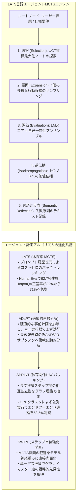
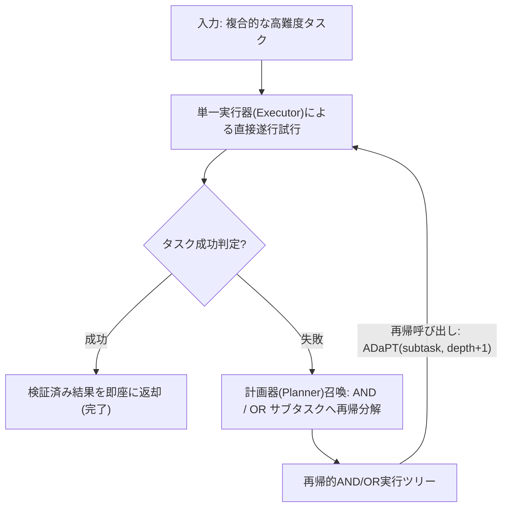
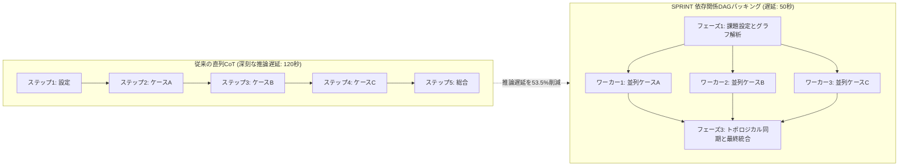

スタンフォード大学の2025年秋学期最新大学院講義、**CS329A: Self-Improving AI Agents（自己進化型AIエージェント）**の第5回エンジニアリング解説へようこそ。

第4講において、私たちは言語モデルがターミナル上でコードを実行し、コンパイラエラーを解析しながら自律的にバグを修正するツール利用と実行フィードバックループ（ReAct、RLEF）を学びました。しかし、ジュニアエンジニアが局所的なシンタックスエラーを修正することと、リードアーキテクトが10万行規模の分散ソフトウェアを設計し、長期的な課題を完遂することは全く別次元の課題です。

従来のReActや思考連鎖（CoT）アプローチは、本質的に**「目の前の一歩だけを見て前進する貪欲的（Greedy）な単一パス探索」**です。チェスにおいて直後の1手だけを見て駒を動かす初心者が3手先でチェックメイト（詰み）に陥るのと同様に、貪欲な言語モデルも複雑な多段階タスクにおいて序盤で誤った決定を下すと、後戻りできずに袋小路に閉じ込められてしまいます。

本日の**第5講**は、カリキュラムの前半部である**Part 1（Foundation · 基礎理論）**を締めくくる壮大なフィナーレです。テーマは**「多段階計画（Multi-Step Planning）と木探索（Tree Search）」**です。

囲碁で世界王者を破ったAlphaGoの数学的心臓部である**モンテカルロ木探索（MCTS）**を自己回帰型言語モデルに移植し、チェスのグランドマスターのように数十手先を見据えて自律的に計画を立案し、失敗した場合には過去の分岐点へとバックトラック（Backtracking）して別の可能性を探索する知的アーキテクチャを解体・再構築します：
1. **推論・行動・計画の完全統合:** 言語エージェント木探索 **LATS**（Zhou et al., 2023）
2. **失敗時のみ賢く分解する適応的タスク細分化:** **ADaPT**（Allen AI, 2023）
3. **推論遅延を53.5%圧縮する並列DAGパッキング:** **SPRINT**（Stanford Future Data, 2025）
4. **トンプソン抽出に基づく適応的分岐:** 探索を横に広げるか深く掘るかを解決する **AB-MCTS**（Sakana AI, 2025）
5. **計画能力をモデル重みへと直接焼き付ける:** **SWiRL**（Step-Wise RL, 2025）



{/* truncate */}

---

### 1. 貪欲生成の罠: なぜ単一パス推論は長期的タスクで崩壊するのか

単純な質疑応答では、貪欲な自己回帰デコードや単一のChain-of-Thought（CoT）プロンプトでも十分な成果が得られます。しかし、決定のステップ数が深まる長期的な課題（$H > 10$）において、単一パス方式は壊滅的な**誤差蓄積（Error Propagation）**に直面します：

```text
P(Success) = ∏_{t=1}^H P(Correct_Action_t | History_{<t})
```

たとえ個々の推論ステップやツール呼び出しの成功率が90%と極めて高かったとしても、15ステップに及ぶ複合的なソフトウェア開発タスクを遂行する場合、全体の成功確率は絶望的な水準まで低下します：

```text
P(Success) = 0.90^{15} ≈ 0.2059  (全体成功率 約20.6%)
```

標準的な自己回帰言語モデルでは、$t=3$ の時点でわずかな論理的破綻が生じても、その誤ったトークン列がプロンプトコンテキストへ永続的に追加されてしまいます。モデルには時間を巻き戻して過去の状態に復帰したり、行き詰まった枝を破棄したりするネイティブな仕組みが存在しません。真の自律性を実現するためには、単一パスではなく**状態探索木（Search Tree of States）**の上で思考を展開しなければなりません。

---

### 2. 言語エージェントとMCTSの融合: LATS (Zhou et al., 2023)

囲碁やチェスのような古典的強化学習では、MCTSが仮想的な未来をシミュレートするための決定論的ゲームエンジン（World Model）が存在しました。しかし、プログラミングや学術研究のように規則エンジンが存在しないオープンな領域において、仮想的な未来をどのようにシミュレートすればよいのでしょうか？

2023年末に発表された **LATS（Language Agent Tree Search、UIUCおよびGoogle DeepMind）** の核心的な洞察は極めて鮮やかでした：

> **「言語エージェントにおけるあらゆる環境状態は、プロンプトテキスト履歴そのものである。過去の特定の決定時点へ巻き戻したいなら、複雑な物理エンジンは不要である。単にその過去時点のテキストプロンプトをモデルに再入力するだけでよい！」**

言語モデルの性質そのものが、MCTSが要求する**「完全な状態可逆性（Reversibility / Backtracking）」を追加コストゼロで提供していた**のです。

#### LATSの5段階循環サイクル

LATSは単一の大規模言語モデルに対し、**エージェント（行動者）**、**価値評価者（批評家）**、**反省者（回顧録作成者）**の3つの役割を付与し、以下のループを反復します：

```text
                            [ ルート: ユーザー課題 ]
                                     │
                     1. 選択 (Selection, UCT公式)
                                     ▼
                            [ 有望なリーフノード s ]
                                     │
                     2. 展開 (Expansion, n個の行動抽出)
                                     ▼
                         [ サンドボックス実行 & 観測 ]
                                     │
                     3. 評価 (Evaluation, LMスコア + SC)
                                     ▼
                     4. 逆伝播 (Backpropagation, 価値更新)
                                     │
                     5. 反省 (Reflection, 失敗時の言語的内省)
```

#### 1. UCT公式によるノード選択 (Selection)
ルートノードから出発し、UCT（Upper Confidence Bound for Trees）スコアが最大となる子ノードを辿って探索を進めます。これにより、すでに高い評価を得ている有望な経路（活用、Exploitation）と、訪問回数の少ない未知の経路（探索、Exploration）との最適なバランスを保ちます：

```text
UCT(s) = V(s) + w * sqrt( ln N(p) / N(s) )
```

ここで：
* $V(s)$ は状態 $s$ の推定平均価値です。
* $N(s)$ は状態 $s$ の訪問回数です。
* $N(p)$ は親ノード $p$ の訪問回数です。
* $w$ は探索の積極性を制御する重み係数です（通常 $w = sqrt(2)$）。

#### 2. 展開フェーズ (Expansion)
リーフノードに到達すると、モデルから $n$ 個の多様な候補アクション $`a^(1), ..., a^(n)`$ をサンプリングします。各アクションは隔離されたPython REPLやシェル環境で実行され、現実の観測結果 $`o^(1), ..., o^(n)`$ を取得します。

#### 3. 価値評価 (Value Evaluation)
到達した状態の価値 $V(s)$ は、定性評価と統計的一貫性のアンサンブルによって算出されます：

```text
V(s) = λ * LM_Score(s) + (1 - λ) * Self_Consistency(s)
```

* **`LM_Score(s)`:** 言語モデル自身が環境の観測結果を読み解き、1〜10点で採点した論理的健全性スコア。
* **`Self_Consistency(s)`:** その状態から複数回のロールアウトを行った際、同一の帰結に収束する頻度。

#### 4. 価値の逆伝播 (Backpropagation)
リーフノードで得られたスカラー報酬 $r$ を経路上のすべての親ノードへと遡らせ、訪問回数と累積平均価値を更新します：

```text
N(s_i) = N(s_i) + 1
V(s_i) = ( V(s_i)_old * N(s_i)_old + r ) / N(s_i)_new
```

#### 5. 言語的反省 (Semantic Reflection)
特定の探索枝がテスト失敗やデッドロックに終わった場合、単なる数値ペナルティ（$r = -1$）にとどまらず、**言語的反省（Semantic Reflection）**を発動します。
モデルに「なぜこの経路は失敗したのか？どの前提が誤っていたのか？」を自問自答させ、自然言語の反省文としてメモリバッファに保存します。このテキストは後続のロールアウトのシステムプロンプトに動的注入され、同一ミスの再発を根絶します。

#### 圧倒的なベンチマーク成果
* **HotpotQA（複合推論課題）:** 単一ReActの正答率は32.0%でしたが、LATSは**71.0%（2.2倍以上）**へと急上昇しました。
* **HumanEval（コード生成）:** LATSは**92.7% Pass@1**を叩き出し、既存の自己修正手法（Reflexion 91.0%、Base LM 80.1%）を打破して世界一のSOTAを樹立しました。
* **アブレーション解析:** MCTSを単純な深さ優先探索（DFS）に置き換えると正答率は42%へと半減し、MCTSによるUCT探索の絶対的な優位性が立証されました。

---

### 3. 失敗時のみ賢く分解する: ADaPT (Allen AI, 2023)

LATSが水平方向に候補経路を展開する探索であるのに対し、**ADaPT（Allen Institute for AI, 2023）**は垂直方向にタスクの複雑度を下げる**適応的タスク分解**の最高峰です。

従来の計画型エージェント（Plan-and-Execute）は、着手直後に硬直した10段階の計画を作成します。しかし動的な実世界では、第2ステップで予期せぬエラーが発生すると、残る8ステップの計画は即座に無意味化します。

ADaPTは、人間の熟練エンジニアの作業スタイルを直接模倣します：

> **「最初から大げさにタスクを細分化してはならない。まずタスク全体を単一の実行器（Executor）に丸ごと任せてみよ。実行器が自ら試行し『これ以上は自力で遂行できない』と白旗を揚げた時のみ、計画器（Planner）を呼び出して3〜5個のサブタスクへ柔軟に再帰分解せよ！」**



#### AND / OR 論理再帰実行エンジン

ADaPTはサブタスクを論理AND/OR演算子を用いて構造化します：
* **ANDノード:** すべてのサブタスクが順次成功しなければならないシーケンス（例: `データ取得` `\to` `スキーマ変換` `\to` `DB格納`）。
* **ORノード:** 複数の代替仮説のうちいずれか1つが成功すればよい探索タスク（例: `ローカルキャッシュ確認` OR `外部API問い合わせ`）。

#### 実証された効率性
* ALFWorldの複合操作タスク（Pick2）において、ReAct系モデルは成功率12%未満と壊滅したのに対し、ADaPTは**52.9%（4倍以上）**を達成しました。
* 平易なタスクは単発で完了し、難解なタスクでのみ深掘りするため、事前計画型フレームワークと比較してトークン消費量を**40%以上削減**することに成功しました。

---

### 4. 思考の並列ハイウェイ: SPRINT (Stanford Future Data, 2025)

2025年初頭、DeepSeek-R1などの長文推論（Long CoT）モデルの登場により推論能力は飛躍しました。しかし現場のエンジニアにとって、それは深刻な悪夢の始まりでもありました。すなわち、**「1つの回答を得るのに2分間も待たされる極端な推論遅延（Latency）」**です。

スタンフォード大学Future Data研究室の**SPRINT**チームは、長い推論チェーンを詳細に解析し、構造的な巨大な無駄を発見しました：

> **「モデルは数千トークンを一列に並べて順次生成しているが、論理的に分析すれば『補題Aの検証』『ケースBの探索』『反論Cの精査』は相互に完全に独立している。なぜこれらを直列に並べて待たせているのか？ 独立したステップを並列DAGにパックして同時に計算できないのか？」**



#### トポロジカルパッキングアルゴリズム

SPRINTは推論プロセスを有向非巡回グラフ（DAG）として定式化します。各ステップ $S_i$ の因果依存関係集合 $D$ に基づき、トポロジカル段数 `\sigma(S_i)` を算出します：

```text
σ(S_i) = {
    1,                                                         (Parents(S_i) = ∅ の場合)
    max_{S_p ∈ Parents(S_i)} ( σ(S_p) + 1[ E_p ≠ ∅ ] ),        (その他の場合)
}
```

同一のトポロジカル段数 `\sigma` を割り当てられたすべての独立した推論ブランチは、複数のGPUワーカーに分散されて**同時に並列実行**されます。全ワーカーの計算が完了すると同期バリアで中間知見が統合され、計画器が次段階の並列地平を算出します：

```text
計画 (Plan)  ──►  並列ディスパッチ  ──►  トポロジカル同期  ──►  再計画 (Re-Plan)
```

#### 測定結果: 正答率の向上と遅延の半減
* 難関数学ベンチマーク（MATH-500）において、直列実行と比較して**正答率は89.1%から92.5%へと向上**しました（並列ブランチ間の相互検証効果）。
* 同時に、ユーザーが体感するエンドツーエンドの生成遅延は**53.5%削減**され、2分かかっていた重厚な推論が50秒台へと大幅に短縮されました。

---

### 5. 自律探索と内面化: AB-MCTSとSWiRL

木探索技術の進展に伴い、最新の2大フロンティアが開拓されています：

#### 1. AB-MCTS: 横に広げるか、縦に掘るか？ (Sakana AI, 2025)
従来のMCTSは分岐係数（Branching Factor）が固定されていたため、探索の非効率が生じていました。**AB-MCTS（Adaptive Branching MCTS）**はこれを**トンプソン抽出（Thompson Sampling）**に基づくオンライン意思決定で解決しました：
* 既存の子ノードを選択した場合 `\to` その解法を深く掘り進めます（Deeper）。
* 仮想の `GEN` アクションを選択した場合 `\to` 即座に新たな子ブランチを動的生成し、木を横へと拡張します（Wider）。
* 各選択肢の期待報酬を事後確率分布としてモデル化することで、容易な局面は瞬時に通過し、難解な核心ボトルネックにのみ数多くの枝を自律的に伸ばす有機的な木探索が完成しました。

#### 2. SWiRL: 計画知能を神経シナプスへ直接刻み込む (2025)
推論実行時に毎回重厚なMCTS木を展開するのは高コストです。**SWiRL（Step-Wise Reinforcement Learning）**は、木探索の叡智をモデル重みへと内面化させます：
* 長期的軌跡をステップ単位に分解し、最終回答の成否だけでなく**「各ステップにおける計画とツール呼び出しの論理的妥当性」**を採点する生成的報酬モデルを構築します。
* ステップ単位のPPOでモデルを強化学習させた結果、モデルは推論時に外部MCTS木を起動せずとも、単一パス推論の内部で自発的に計画を立案・検証する**内面化された計画知能（Internalized Planning）**を獲得しました。

---

### 6. エンタープライズアーキテクチャ: 階層型MCTS計画基盤の設計図

商用本番環境においてMCTS計画エンジンを安全かつコスト効率よく運用するための標準設計図は以下の通りです：

```text
┌────────────────────────────────────────────────────────────────────────┐
│             エンタープライズ階層型MCTS計画基盤アーキテクチャ            │
├────────────────────────────────────────────────────────────────────────┤
│                                                                        │
│  [ ビジネス要求 / PRD仕様書 ]                                           │
│          │                                                             │
│          ▼                                                             │
│  ┌──────────────────────────────────────────────────────────────────┐  │
│  │                    適応型計画オーケストレーター                  │  │
│  │  • フェーズ1: 単一実行器による直接試行（探索コストゼロ）         │  │
│  │  • フェーズ2: 失敗時にADaPTによるAND/ORサブタスク動的分解        │  │
│  │  • フェーズ3: 高難度・高不確実性課題に対してLATS MCTSを起動      │  │
│  └───────────────────┬──────────────────────────────▲───────────────┘  │
│                      │ 並列サブタスクDAG            │ 評価済み状態      │
│                      ▼                              │ 価値シグナル      │
│  ┌──────────────────────────────────────────────────┴───────────────┐  │
│  │                     SPRINT分散ディスパッチャー                   │  │
│  │  • トポロジカルソートおよび依存関係解析エンジン                  │  │
│  │  • 非同期GPUワーカープール（軽量7B/8Bモデルによる高速展開）      │  │
│  │  • 並行同期バリアおよびコンテキストパッキング層                  │  │
│  ├──────────────────────────────────────────────────────────────────┤  │
│  │                     検証およびサーキットブレーカー防護壁         │  │
│  │  • UCTノード枝刈りエンジン（V < 0.2の低品質ブランチを早期破棄）  │  │
│  │  • 早期終了サーキットブレーカー（全テスト合格ノード発見で即完了）│  │
│  │  • エピソード言語的反省（Reflection）メモリバッファ              │  │
│  └──────────────────────────────────────────────────────────────────┘  │
│                                                                        │
└────────────────────────────────────────────────────────────────────────┘
```

#### プロダクションにおける3大防護壁
1. **早期終了サーキットブレーカー（Early-Stopping）:** いずれか1つの探索ブランチが決定論的検証（単体テスト100%合格等）を達成した瞬間、直ちに全MCTSループを中断して解を返却し、トークン浪費を防ぎます。
2. **階層型モデル協調サービング:** 末端リーフでの単純な行動サンプリングには7B〜8Bの軽量高速モデルを配備し、重要分岐点での価値評価にのみ70B+のフロンティアモデルを投入することで、サービングコストを80%以上削減します。
3. **探索予算クォータ制限:** 木の最大探索深度（``d_max` \le 6`）およびロールアウト上限回数（`N \le 30`）をハードリミットとして定め、クラウド費用の暴走を完全に遮断します。

---

### 7. エンジニアリングQ&A: 実践的技術課題の克服

**Q: SPRINTのように推論ブランチを並列実行すると、ある枝の誤りが他の枝へ悪影響を及ぼす懸念はありませんか？**
**A:** これこそがSPRINTの依存関係DAGの最大の強みです。SPRINTは無差別な並列化を行うのではなく、ステップ間の依存グラフを厳格に解析し、**「先行データを一切必要としない完全に独立した計算ステップ」のみを抽出して並列化**します。もしステップBがステップAの出力を必要とする場合、トポロジカルソートによりステップBはステップAが完了・検証されるまで決して実行されません。また、並列ブランチ間で相互検証が行われるため、単一パスよりも全体精度が向上します。

**Q: LATSにおける言語的反省（Semantic Reflection）は、従来の数値バックプロパゲーションと何が本質的に異なるのですか？**
**A:** 従来のMCTSは訪問回数と平均値という単純な数値（$N, V$）のみを更新します。しかしコード生成や論理推論において、単なるスカラー値は「なぜコードが動かなかったのか」「どの前提が誤っていたのか」という因果情報を伝達できません。言語的反省は、失敗の根本原因を自然言語の診断記録としてメモリに保持します。後続の試行においてエージェントが類似の状態へ到達した際、この反省テキストがシステムプロンプトの制約条件として機能し、モデルが既知の罠を回避するよう誘導します。

---

### 8. まとめと技術的要点

1. **貪欲生成の限界突破:** 自己回帰モデルは長期的タスクにおいて指数関数的な誤差蓄積を起こします。MCTSは探索・枝刈り・バックトラッキングを可能にし、エージェントを戦略的思考者へと引き上げます。
2. **プロンプト履歴による可逆性:** LATSは言語モデルのテキスト履歴がそのまま状態を表す点に着目し、外部シミュレータなしに完全な状態復元とMCTS探索を実現しました。
3. **適応的タスク再帰分解:** ADaPTは硬直的な事前計画を排し、単一実行器でまず試行し、失敗時のみAND/ORサブタスクへ動的に分解することでトークン効率を最大化します。
4. **並列DAGによる遅延短縮:** SPRINTは長文推論チェーン内の独立ステップをDAGとしてトポロジカルパッキングし、推論遅延を53.5%削減すると同時に正答率を高めました。
5. **探索知能の内面化:** SWiRLはステップ単位強化学習（Step-Wise RL）により、MCTSの計画知見をモデル重みへと直接焼き付け、単一パス推論での優れた先見性を獲得させます。

---

### 祝: Part 1（基礎理論）完結と Part 2 の予告！
第5講をもって、私たちはスタンフォード大学CS329A講義の第1大単元である**Part 1: Foundation（第1講〜第5講）**を完遂しました！
* **L1:** LLMから自律型自己進化エージェントへのパラダイムシフト
* **L2:** 推論時計算量スケーリング（Test-time Compute）とカバレッジ法則
* **L3:** プロセス報酬モデル（PRM）と弱検証器アンサンブル（Weaver）
* **L4:** ツール実行（ReAct）、コンパイラフィードバック（RLEF）、憲法型AI
* **L5:** MCTS木探索（LATS）、適応的分解（ADaPT）、並列DAG実行（SPRINT）

私たちはエージェントがいかに思考し、行動し、検証し、自律的に計画を立てるかという数学的・工学的基盤を完全にマスターしました。

次回から開幕する**Part 2: Training & Evolution（訓練と自己進化、第6講〜第9講）**では、テスト時探索の枠組みを超え、**「強化学習と進化アルゴリズムを通じてAIが自らのモデル重みを恒久的に自律更新する真の自己進化のフロンティア」**へと突入します。

次回第6講のテーマは以下の通りです：
**《Lecture 6: Train-Time Scaling & RL: 強化学習と訓練時スケーリング（DeepSeekMath, GRPO, DAPO）》**
DeepSeekがいかに高コストなCriticモデルを排除し、オープンソース強化学習だけで世界最高峰の推論モデルを構築したのか、その数理的秘密を解き明かします。次の講義でお会いしましょう！