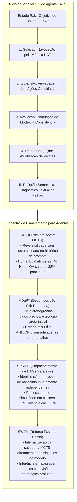
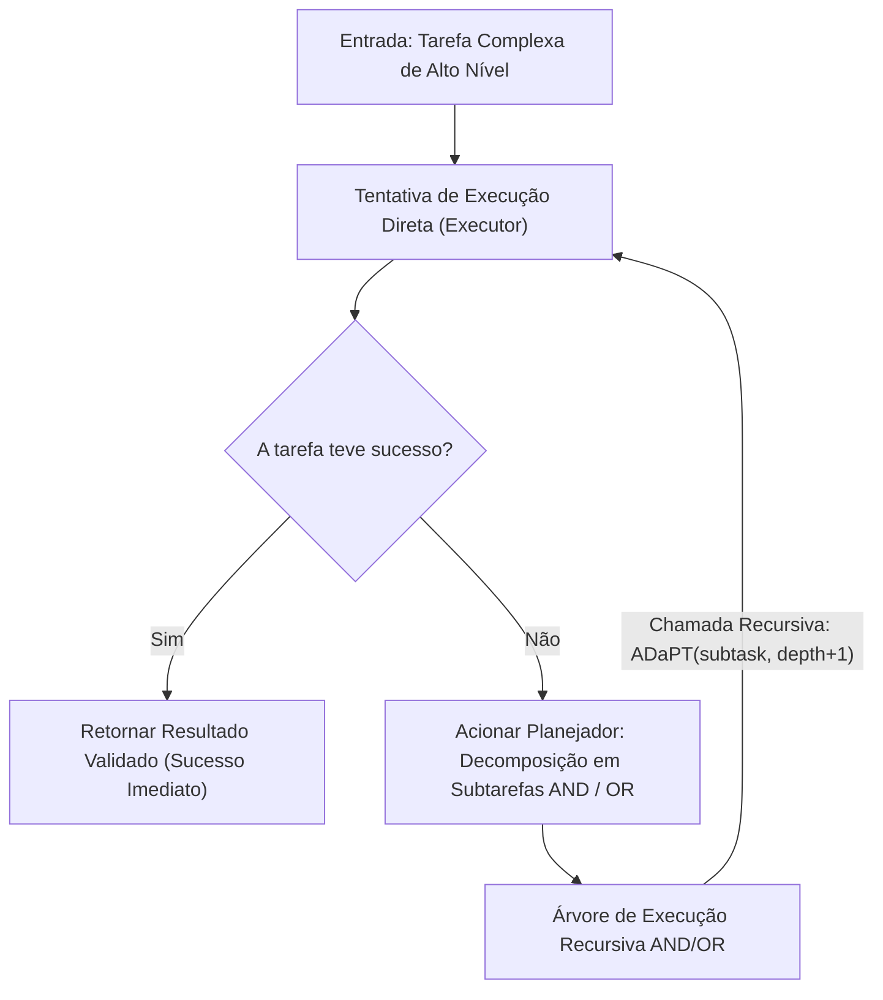
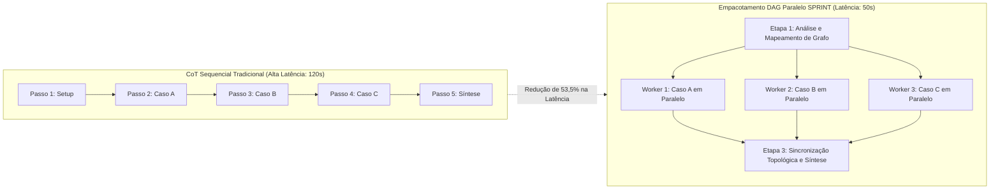

Boas-vindas ao quinto volume de nossa análise técnica detalhada do curso de pós-graduação da **Universidade de Stanford, CS329A: Self-Improving AI Agents (Agentes de IA que se Autoaperfeiçoam, Outono de 2025)**.

Na Aula 4, testemunhamos como os agentes rompem o confinamento da memória estática ao interagir com ferramentas do mundo real e depurar código por meio de ciclos de feedback de compiladores (ReAct, RLEF). No entanto, sanar pequenos erros sintáticos locais em um terminal difere substancialmente de planejar arquiteturas distribuídas de 100.000 linhas ou solucionar investigações científicas de longo horizonte.

As abordagens convencionais como ReAct ou Chain-of-Thought (CoT) são, em essência, **pesquisadores gulosos de caminho único (Greedy Single-Path)**: avaliam o próximo passo imediato e avançam de forma irreversível. Semelhante a um enxadrista iniciante que só prevê o lance seguinte e sofre xeque-mate três jogadas depois, um modelo autorregressivo que comete um deslize inicial fica irremediavelmente preso em um beco sem saída.

A **Aula 5** representa o grande encerramento da **Parte 1 (Fundamentos)** da grade de Stanford: **o Planejamento Multietapas (Multi-Step Planning) e a Busca em Árvore (Tree Search)**.

Ao transplantar o núcleo algorítmico do AlphaGo — a **Busca em Árvore de Monte Carlo (MCTS)** — para modelos autorregressivos, transformamos geradores de texto em grandes mestres estratégicos. Analisamos sistemas que antecipam desfechos com dezenas de passos de antecedência, podam caminhos inviáveis, realizam retrocesso histórico (Backtracking) e paralelizam o fluxo dedutivo:
1. **Unificação de raciocínio, ação e planejamento:** Language Agent Tree Search (**LATS**, Zhou et al., 2023).
2. **Decomposição recursiva sob demanda:** Fracionamento modular ativado apenas perante falhas via **ADaPT** (Allen AI, 2023).
3. **Empacotamento de DAGs de dependência em paralelo:** Redução da latência de inferência em 53,5% via **SPRINT** (Stanford Future Data, 2025).
4. **Bifurcação adaptativa via Amostragem de Thompson:** Solução do dilema entre largura e profundidade com **AB-MCTS** (Sakana AI, 2025).
5. **Internalização do planejamento nos pesos neurais:** **SWiRL** (Step-Wise RL, 2025).



{/* truncate */}

---

### 1. A Armadilha Gulosa: Por Que a Rota Única Falha em Horizontes Longos

Em consultas simples, a decodificação autorregressiva direta ou uma cadeia de pensamento (CoT) isolada bastam porque o espaço de soluções é denso e tolerante. No entanto, quando a profundidade de decisões interdependentes se estende ($H > 10$), o processamento linear enfrenta uma **propagação exponencial de erros**:

```text
P(Sucesso) = ∏_{t=1}^H P(Ação_Correta_t | Histórico_{<t})
```

Ainda que a probabilidade individual de cada etapa de dedução ou uso de ferramenta atinja sólidos 90%, a chance global de êxito em uma tarefa de engenharia de software de 15 etapas despenca criticamente:

```text
P(Sucesso) = 0.90^{15} ≈ 0.2059  (Taxa Global de Sucesso de apenas 20,6%)
```

Nos modelos autorregressivos convencionais, após uma decisão equivocada em $t=3$, os tokens incorretos passam a fazer parte definitiva do contexto. O modelo não dispõe de um mecanismo intrínseco para retroceder no tempo e descartar ramificações infrutíferas. Para alcançar autonomia real, os agentes devem navegar sobre uma **Árvore de Busca de Estados (Search Tree of States)**.

---

### 2. A Fusão entre Agentes de Linguagem e MCTS: LATS (Zhou et al., 2023)

Em jogos clássicos como Go e Xadrez, o MCTS utiliza motores determinísticos (o Modelo do Mundo) para simular o futuro. Como um agente pode simular desfechos hipotéticos em domínios abertos como programação ou pesquisa científica sem dispor de um simulador formal de física?

A grande percepção de **LATS (Zhou et al., 2023, UIUC e Google DeepMind)** consistiu em reconhecer uma propriedade nativa dos modelos de linguagem:

> **"Em um agente de linguagem, qualquer estado do ambiente é integralmente capturado pelo histórico de texto do seu prompt. Retornar a uma decisão passada não requer motores de física: basta reapresentar ao modelo o texto do prompt daquele momento anterior e orientá-lo a explorar uma nova direção!"**

Os LLMs oferecem **reversibilidade perfeita de estados (Backtracking) sem nenhum custo computacional adicional**.

#### O Ciclo de 5 Fases do LATS

O LATS divide um único LLM em três papéis cooperativos — **Ator (Agent)**, **Avaliador de Valor (Critic)** e **Refletor (Diagnosticador Retrospectivo)** — executando cinco fases iterativas:

```text
                           [ Raiz: Tarefa do Usuário ]
                                        │
                        1. Seleção (Fórmula UCT)
                                        ▼
                           [ Nó Promissor s ]
                                        │
                        2. Expansão (n ações candidatas)
                                        ▼
                        [ Execução em Sandbox & Obs ]
                                        │
                        3. Avaliação (Score LM + SC)
                                        ▼
                        4. Retropropagação (Atualização)
                                        │
                        5. Reflexão (Na Falha: Crítica Semântica)
```

#### 1. Seleção via UCT (Upper Confidence Bound for Trees)
Partindo da raiz, o LATS desce pela árvore selecionando o nó filho com maior pontuação UCT, equilibrando o aproveitamento de caminhos de alta recompensa (Exploitation) com o desbravamento de nós pouco visitados (Exploration):

```text
UCT(s) = V(s) + w * sqrt( ln N(p) / N(s) )
```

Em que:
* $V(s)$ é a estimativa média de valor do estado $s$.
* $N(s)$ é a contagem de visitas ao estado $s$.
* $N(p)$ é a contagem de visitas ao nó pai $p$.
* $w$ é o coeficiente de ponderação de exploração (geralmente $w = sqrt(2)$).

#### 2. Expansão
Ao alcançar um nó folha $s$, o agente amostra $n$ ações candidatas distintas $`a^(1), ..., a^(n)`$. Cada ação é processada em um ambiente isolado (ex.: sandbox Python ou terminal), retornando as observações reais correspondentes $`o^(1), ..., o^(n)`$.

#### 3. Avaliação de Valor
A recompensa escalar $V(s)$ é combinada a partir de julgamento qualitativo e consistência estatística:

```text
V(s) = λ * LM_Score(s) + (1 - λ) * Self_Consistency(s)
```

* **`LM_Score(s)`:** O modelo avalia a robustez lógica de 1 a 10 a partir dos dados observados no ambiente.
* **`Self_Consistency(s)`:** Frequência com que múltiplas trajetórias estocásticas partindo do estado $s$ convergem ao mesmo resultado final.

#### 4. Retropropagação
A recompensa escalar $r$ alcançada na folha é propagada de volta por todos os nós ancestrais até a raiz, atualizando os contadores de visita e as médias de valor acumuladas:

```text
N(s_i) = N(s_i) + 1
V(s_i) = ( V(s_i)_old * N(s_i)_old + r ) / N(s_i)_new
```

#### 5. Reflexão Semântica (Semantic Reflection)
Caso um ramo culmine em falha (ex.: erro de compilação ou impasse no ambiente), o MCTS convencional limita-se a atribuir uma penalidade fria ($r = -1$). O LATS agrega a **Reflexão Semântica**:
O modelo indaga a si próprio: *“Por que este caminho falhou? Qual premissa adotada estava incorreta?”*.
O diagnóstico textual resultante é registrado em memória episódica e injetado nos prompts das iterações posteriores, impedindo que o agente repita o mesmo engano.

#### Conquistas Expressivas em Benchmarks
* **HotpotQA (Raciocínio Complexo Multietapas):** O ReAct clássico registrou 32,0%. O LATS elevou o índice para **71,0%** (aumento superior a 2,2 vezes).
* **HumanEval (Geração de Código Python):** O LATS cravou **92,7% Pass@1**, superando abordagens como Reflexion (91,0%) e modelos base (80,1%).
* **Experimentos de Ablação:** Trocar o MCTS por uma busca em profundidade pura (DFS) derrubou a eficácia para 42%, atestando a indispensabilidade do balanceamento via UCT.

---

### 3. Decomposição Recursiva Sob Demanda: ADaPT (Allen AI, 2023)

Enquanto o LATS lidera a exploração horizontal de trajetórias alternativas, o **ADaPT (Allen Institute for AI, 2023)** destaca-se na redução hierárquica vertical da complexidade das tarefas.

Estruturas convencionais de "Planejar e Executar" estipulam planos rígidos de 10 passos logo de início. Contudo, se no passo 2 surgir um imprevisto, os 8 passos seguintes tornam-se de pronto inúteis.

O ADaPT reproduz a atitude pragmática de engenheiros seniores:

> **“Não planeje excessivamente de antemão. Encaminhe a tarefa integral a um único Executor. Somente quando este falhar comprovadamente e relatar incapacidade, acione o Planejador (Planner) para subdividir o objetivo em 3 a 5 subtarefas modulares.”**



#### Mecanismo Recursivo AND / OR

O ADaPT esquematiza os subplanos por meio de nós lógicos:
* **Nós AND:** Subtarefas sequenciais interdependentes em que todas devem ter êxito (ex.: `Coleta` `\to` `Transformação` `\to` `Persistência em BD`).
* **Nós OR:** Hipóteses exploratórias alternativas em que o sucesso de um único ramo satisfaz a meta (ex.: `Checar Cache Local` OR `Consultar API Remota`).

#### Eficiência Prática
* Em tarefas compostas de manipulação no ALFWorld (*Pick2*), modelos ReAct fracassaram abaixo de 12% de sucesso, enquanto o ADaPT obteve **52,9%**.
* Resolvendo casos simples em tiro único e aprofundando-se apenas nos desafios reais, o ADaPT reduziu o gasto de tokens em **mais de 40%** frente a métodos de planejamento prévio rígido.

---

### 4. A Autoestrada Paralela do Raciocínio: SPRINT (Stanford Future Data, 2025)

No início de 2025, os modelos de raciocínio extenso (como DeepSeek-R1) comprovaram que o aumento de computação na inferência impulsiona a dedução analítica. Porém, a viabilidade industrial esbarrou em um problema severo: **tempos de espera de até dois minutos por resposta**.

O laboratório **SPRINT** de Stanford Future Data investigou essas longas sequências de tokens e desvendou uma ineficiência estrutural:

> **“Modelos autorregressivos geram milhares de tokens de maneira estritamente linear. Todavia, validar o Lema A, testar o Caso B e examinar o Contra-argumento C são passos inteiramente independentes. Por que enfileirá-los em série quando podem ser agrupados em um DAG paralelo?”**



#### O Algoritmo de Empacotamento Topológico

O SPRINT formaliza o processo de dedução como um Grafo Acíclico Dirigido (DAG). Avaliando as dependências causais $D$, o algoritmo calcula o nível topológico `\sigma(S_i)` de cada etapa:

```text
σ(S_i) = {
    1,                                                         (se Parents(S_i) = ∅)
    max_{S_p ∈ Parents(S_i)} ( σ(S_p) + 1[ E_p ≠ ∅ ] ),        (caso contrário)
}
```

Todas as etapas que partilham o mesmo nível `\sigma` são atribuídas simultaneamente a diferentes nós de GPU e **processadas em paralelo**. Ao final dos cálculos simultâneos, uma barreira de sincronização sintetiza os achados antes de despachar o ciclo seguinte:

```text
Planejamento  ──►  Despacho Paralelo  ──►  Sincronização  ──►  Replanejamento
```

#### Resultados: Ganho de Exatidão com Metade da Espera
* No referencial matemático **MATH-500**, a exatidão subiu de **89,1% para 92,5%** comparada à execução em série (devido à checagem cruzada entre ramificações simultâneas).
* Paralelamente, o tempo físico percebido pelo usuário caiu **53,5%**, abreviando cadeias de 120 segundos para menos de 50 segundos.

---

### 5. Exploração Dinâmica e Internalização: AB-MCTS e SWiRL

A maturação dos agentes orientados a árvores abriu duas frentes arrojadas:

#### 1. AB-MCTS: O Dilema entre Largura e Profundidade (Sakana AI, 2025)
O MCTS habitual trabalha com fatores de ramificação constantes. O **AB-MCTS (Adaptive Branching MCTS)** equilibra a busca entre aprofundamento ou ampliação utilizando a **Amostragem de Thompson**:
* Selecionar um nó existente aprofunda a linha de dedução (*Deeper*).
* Selecionar a meta-ação `GEN` instrui o modelo a criar uma nova ramificação irmã, expandindo a árvore lateralmente (*Wider*).
* Ao representar as recompensas como distribuições posteriores, o AB-MCTS supera etapas banais com agilidade e aloca esforço profundo estritamente nos nós decisórios cruciais.

#### 2. SWiRL: Gravando Estratégia nos Pesos Sinápticos (2025)
Operar MCTS exaustivo em cada inferência gera custos expressivos. O **SWiRL (Step-Wise Reinforcement Learning)** converte a capacidade de busca em instinto do modelo:
* Fragmenta trajetórias em passos únicos e emprega modelos de recompensa generativos para avaliar a coerência dos planos intermediários.
* Treinado via PPO por etapas, o modelo passa a **simular árvores de busca internamente em suas próprias ativações**, demonstrando visão estratégica de alto nível em uma única passagem.

---

### 6. Arquitetura Corporativa: Malha Hierárquica de Planejamento MCTS

A estruturação segura e econômica de motores de planejamento MCTS em ambientes de produção exige defesas em profundidade:

```text
┌────────────────────────────────────────────────────────────────────────┐
│             Arquitetura Empresarial para Planejamento MCTS             │
├────────────────────────────────────────────────────────────────────────┤
│                                                                        │
│  [ Demanda Corporativa / Especificação PRD ]                           │
│          │                                                             │
│          ▼                                                             │
│  ┌──────────────────────────────────────────────────────────────────┐  │
│  │                  Orquestrador de Planejamento Adaptativo         │  │
│  │  • Fase 1: Tentativa Direta de Passo Único (Custo MCTS = 0)      │  │
│  │  • Fase 2: Perante Falha -> Decomposição ADaPT AND/OR            │  │
│  │  • Fase 3: Casos Complexos -> Inicialização de Árvore MCTS LATS │  │
│  └───────────────────┬──────────────────────────────▲───────────────┘  │
│                      │ DAG de Subtarefas Paralelas  │ Sinais de Valor  │
│                      ▼                              │ dos Estados      │
│  ┌──────────────────────────────────────────────────┴───────────────┐  │
│  │                     Despachador Distribuído SPRINT               │  │
│  │  • Mecanismo de Ordenação Topológica e Dependência Causal        │  │
│  │  • Pool de Workers GPU Assíncronos (Modelos 7B/8B para Amostras) │  │
│  │  • Barreira de Sincronização e Empacotamento de Contexto         │  │
│  ├──────────────────────────────────────────────────────────────────┤  │
│  │                     Camada de Blindagem e Circuit Breakers       │  │
│  │  • Poda UCT (Eliminação precoce de ramos com V < 0.2)            │  │
│  │  • Parada Imediata (Término ao atingir 100% de sucesso em testes)│  │
│  │  • Buffer de Memória Episódica para Reflexão Semântica           │  │
│  └──────────────────────────────────────────────────────────────────┘  │
│                                                                        │
└────────────────────────────────────────────────────────────────────────┘
```

#### Três Salvaguardas Essenciais de Operação
1. **Disjuntor de Parada Precoce (Early-Stopping):** Se qualquer ramo de busca atender plenamente às validações formais (ex.: 100% de acerto em testes unitários), interrompe-se de imediato toda a busca MCTS para retornar o resultado sem ônus adicional.
2. **Distribuição Hierárquica de Modelos:** Evitar modelos de grande porte (70B+) para amostragem repetitiva de nós folha; direcionar essa tarefa para modelos ágeis (7B/8B) e reservar os modelos de ponta apenas para a pontuação de nós estratégicos.
3. **Limites de Recursos:** Fixar tetos rígidos para a profundidade da árvore (``d_max` \le 6`) e para o total de iterações (`N \le 30`) para blindar o orçamento de nuvem.

---

### 7. Perguntas Técnicas Essenciais e Práticas de Engenharia

**P: No SPRINT, se tarefas independentes rodam em simultâneo, o erro em uma não contaminaria a consolidação final?**
**A:** Esse é o mérito do design de dependências do SPRINT. A paralelização nunca é arbitrária: executam-se juntos **apenas passos sem nenhuma dependência causal de dados**. Se a etapa B necessita dos dados produzidos pela etapa A, o ordenamento topológico assegura que B só iniciará após a validação de A. Além disso, a confrontação de múltiplos ramos atua como um comitê de consenso que ampliou a assertividade final.

**P: Em que a Reflexão Semântica supera a retropropagação escalar tradicional do MCTS?**
**A:** O MCTS numérico habitual computa unicamente números médios ($N, V$). Porém, perante uma rotina defeituosa, escalares não indicam *por que* houve quebra ou *qual* premissa falhou. A Reflexão Semântica redige pareceres em texto claro no contexto do agente. Quando o sistema alcança novamente estados conceituais próximos, esse texto atua como restrição explícita no prompt, contornando desvios documentados.

---

### 8. Resumo e Conclusões Técnicas

1. **Rompendo com a Miopia Gulosa:** Modelos autorregressivos acumulam erros continuamente em horizontes longos. O MCTS capacita os agentes com exploração, poda e retrocesso deliberados.
2. **Reversibilidade Nativa por Prompts:** O LATS demonstra que o histórico de prompts personifica o estado do ambiente, autorizando um MCTS pleno sem simuladores físicos externos.
3. **Decomposição Sob Demanda:** O ADaPT descarta cronogramas rígidos, tenta primeiro a execução direta e só divide o desafio em árvores AND/OR perante impedimentos comprovados.
4. **Agilidade com DAGs Paralelos:** O SPRINT quebra o gargalo sequencial ao empacotar passos autônomos em DAGs concorrentes, diminuindo a latência em 53,5% com ganhos na exatidão.
5. **Busca Convertida em Peso Sináptico:** O SWiRL transfere a aptidão tática do MCTS diretamente para as sinapses do modelo via reforço passo a passo, conferindo visão de longo alcance em inferência direta.

---

### Parabéns: Parte 1 (Fundamentos) Concluída!
Com o término da Aula 5, encerramos vitoriosamente a **Parte 1: Fundamentos (Aulas 1 a 5)** de Stanford CS329A:
* **L1:** O salto de paradigma dos LLMs estáticos para agentes autônomos evolutivos.
* **L2:** Leis de escala no tempo de inferência e leis de potência de cobertura.
* **L3:** Verificação robusta passo a passo com modelos PRM e comitês Weaver.
* **L4:** Uso de ferramentas (ReAct), feedback de compiladores (RLEF) e IA Constitucional.
* **L5:** Planejamento MCTS (LATS), decomposição sob demanda (ADaPT) e DAGs paralelos (SPRINT).

Consolidamos os alicerces analíticos sobre como agentes pensam, interagem, conferem e planejam.

No próximo episódio daremos a partida na **Parte 2: Treinamento e Evolução (Aulas 6 a 9)**, ultrapassando os artifícios de inferência para adentrar na essência do aprendizado contínuo: **como modelos atualizam seus próprios pesos por meio de aprendizado por reforço e algoritmos evolutivos**.

A próxima aula abordará:
**《Aula 6: Train-Time Scaling & RL: DeepSeekMath, GRPO e Otimização Massiva de Raciocínio》**.
Abriremos o mecanismo do Group Relative Policy Optimization (GRPO) para revelar como arquiteturas de vanguarda dispensam modelos de crítica onerosos. Até a próxima etapa!