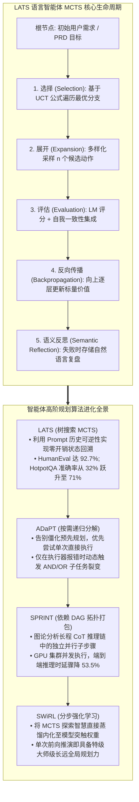
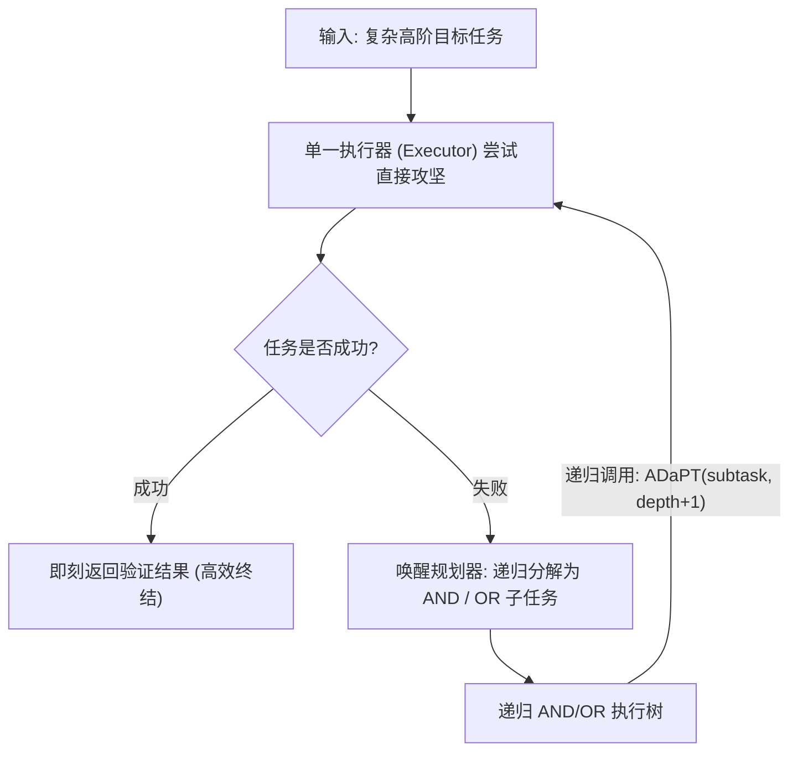
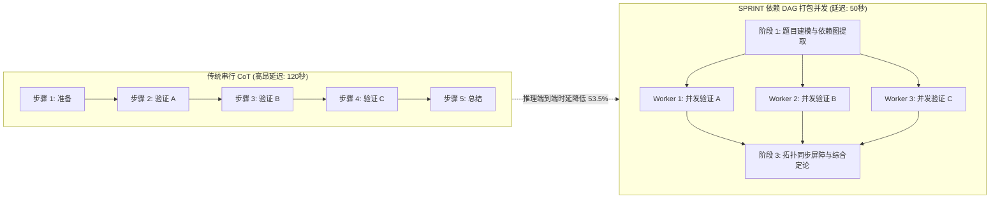

欢迎来到斯坦福大学2025秋季最新研究生课程——**CS329A: Self-Improving AI Agents（自主进化AI智能体）**的第五篇深度工程解析。

在第4讲中，我们见证了语言模型如何走出封闭考场，利用终端运行代码、解读编译器报错并实施自我修复（ReAct与RLEF）。然而，对于智能体而言，修复局部代码语法错误与架构师设计十万行级的复杂分布式系统、完成跨越数小时的长期任务相比，存在着根本性的认知鸿沟。

传统的ReAct与思维链（CoT）方法在本质上属于**“只看眼前一步的贪婪单路径搜索”**。就像国际象棋初学者只看下一步走法而在三步后惨遭将死（Checkmate）一样，贪婪的语言模型一旦在早期推演中走入歧途，便再也无法回头，只能在错误的死胡同中越陷越深。

今天的**第5讲**迎来了本课程前半程——**Part 1 (Foundation · 基础理论)**的宏大收官之作：**多步规划（Multi-Step Planning）与树搜索（Tree Search）**。

我们将AlphaGo击败人类围棋冠军的核心数学引擎——**蒙特卡洛树搜索（MCTS）**正式移植至自回归语言模型中。通过赋能智能体像特级大师一样洞察未来数十步变化、动态剪枝无效路径、在历史决策树中自如回溯（Backtracking）并实现并行计算，全面解构这一顶尖架构：
1. **统一推理、行动与规划的完备框架：** 语言智能体树搜索 **LATS**（Zhou et al., 2023）
2. **仅在失败时动态拆解的按需递归规划：** **ADaPT**（Allen AI, 2023）
3. **将长程推理延迟缩减53.5%的依赖DAG打包引擎：** **SPRINT**（Stanford Future Data, 2025）
4. **基于汤普森采样的自适应分支决策：** 破解“加宽还是挖深”的 **AB-MCTS**（Sakana AI, 2025）
5. **将规划直觉直接刻入神经网络权重的分步强化学习：** **SWiRL**（Step-Wise RL, 2025）



{/* truncate */}

---

### 1. 贪婪生成的陷阱：为何单路径推理在长程任务中必然崩溃

在简单的单回合问答中，贪婪自回归解码或单条思维链（CoT）足以胜任，因为解空间密集且容错率高。然而，随着决策层级加深（$H > 10$），单路径推演将遭遇灾难性的**误差累积效应（Error Propagation）**：

```text
P(Success) = ∏_{t=1}^H P(Correct_Action_t | History_{<t})
```

即便每个单步推理或工具调用的准确率高达 90%，在跨越 15 步的复杂软件开发任务中，智能体的总体成功概率也会惨烈跌落：

```text
P(Success) = 0.90^{15} ≈ 0.2059  (总体成功率仅约 20.6%)
```

在标准的自回归架构中，一旦在 $t=3$ 时发生逻辑偏差，错误的 Token 就会永久性地追加到上下文之中。模型缺乏任何原生的时间倒流机制来回滚状态并尝试替代方案。要获得真正的自主性，智能体必须在**状态搜索树（Search Tree of States）**中进行决策。

---

### 2. 语言智能体与 MCTS 的融合：LATS (Zhou et al., 2023)

在围棋或国际象棋等传统强化学习环境中，MCTS 依赖确定性的游戏规则引擎（世界模型，World Model）来仿真推演未来棋局。但在编程或科学研究等缺乏刚性物理模拟器的开放领域中，智能体该如何推演未来的状态？

2023 年底发布的 **LATS（Language Agent Tree Search，UIUC 与 Google DeepMind）** 揭示了一个直击大模型本质的关键洞察：

> **“在语言智能体中，外部环境的所有状态本质上就是 Prompt 文本历史本身。如果我们想回到过去的某个决策点，根本不需要复杂的时间机器模拟器；只需将过去的文本 Prompt 重新投喂给模型，即可让其向全新的方向展开分支！”**

大语言模型的文本生成机制，**天然无偿地提供了 MCTS 算法所必需的“完美状态可逆性（State Reversibility / Backtracking）”**。

#### LATS 的五阶段循环生命周期

LATS 将单一的大语言模型拆分为三重协同角色——**行动者（Agent/Actor）**、**评估者（Critic）**与**反思者（Reflector）**，持续循环以下五阶段：

```text
                            [ 根节点: 用户复杂任务 ]
                                       │
                       1. 选择 (Selection, UCT 公式)
                                       ▼
                            [ 最具潜力叶节点 s ]
                                       │
                       2. 展开 (Expansion, 采样 n 个动作)
                                       ▼
                           [ 沙箱真实执行与环境观测 ]
                                       │
                       3. 评估 (Evaluation, LM 评分 + SC)
                                       ▼
                       4. 反向传播 (Backprop, 价值更新)
                                       │
                       5. 语义反思 (Reflection, 失败自然语言复盘)
```

#### 1. 基于 UCT 公式的节点选择 (Selection)
从根节点出发，LATS 沿着最大化 UCT（Upper Confidence Bound for Trees）分数的子节点逐层下潜，精妙平衡已有高分路径的“利用（Exploitation）”与低频访问节点的“探索（Exploration）”：

```text
UCT(s) = V(s) + w * sqrt( ln N(p) / N(s) )
```

其中：
* $V(s)$ 表示节点状态 $s$ 的估计平均价值。
* $N(s)$ 表示状态 $s$ 的历史访问计数。
* $N(p)$ 表示父节点 $p$ 的访问计数。
* $w$ 为平衡探索强度的权重系数（经典取值为 $w = sqrt(2)$）。

#### 2. 动作空间展开 (Expansion)
抵达叶节点 $s$ 后，策略模型发散式采样 $n$ 个不同的候选动作 $`a^(1), ..., a^(n)`$。每个动作被派发至隔离的代码沙箱（如 Python REPL 或终端）真实执行，获得客观观测结果 $`o^(1), ..., o^(n)`$。

#### 3. 价值综合评估 (Value Evaluation)
叶节点的奖励估值 $V(s)$ 由定性推理评分与统计一致性双重加权合成：

```text
V(s) = λ * LM_Score(s) + (1 - λ) * Self_Consistency(s)
```

* **`LM_Score(s)`:** 大模型基于问题目标与当前观测结果输出的 1 至 10 分逻辑质量评分。
* **`Self_Consistency(s)`:** 从当前状态发散多次采样时，推演结论收敛至一致结果的统计概率。

#### 4. 标量价值反向传播 (Backpropagation)
在叶节点结算出环境奖励 $r$ 后，该数值沿当前访问路径向上传递，逐级刷新所有祖先节点的访问频次与累计平均分：

```text
N(s_i) = N(s_i) + 1
V(s_i) = ( V(s_i)_old * N(s_i)_old + r ) / N(s_i)_new
```

#### 5. 语义反思机制 (Semantic Reflection)
若某个分支因断言崩溃或死循环而终结，传统 MCTS 仅会返还一个冰冷的负标量（$r = -1$）。LATS 则在此基础上触发**语义反思**：
系统要求大模型复盘：*“该分支为何走向失败？哪一项初始假设出现了逻辑硬伤？”*。
生成的自然语言复盘报告被存入情节记忆库中，并在后续轮次的系统提示词中动态注入，从认知源头彻底杜绝智能体“重蹈覆辙”。

#### 卓越的基准战果
* **多跳复杂问答（HotpotQA）：** 单路径 ReAct 仅取得 32.0% 的通过率，而 LATS 暴力拉升至 **71.0%**（提升超 2.2 倍）。
* **代码生成（HumanEval）：** LATS 斩获 **92.7% Pass@1**，全面超越 Reflexion（91.0%）与基础大模型（80.1%），创下当时的世界纪录。
* **消融实验：** 若将 MCTS 降级为朴素的深度优先搜索（DFS），模型成功率瞬间腰斩至 42%，强力证实了 UCT 算法在长程推演中不可或缺的平衡价值。

---

### 3. 按需智能分解：ADaPT (Allen AI, 2023)

如果说 LATS 是横向发散探索解空间的代表，那么由艾伦人工智能研究所（AI2）推出的 **ADaPT** 则是纵向降低任务复杂度的**自适应分层规划**典范。

传统的“预先规划并执行（Plan-and-Execute）”框架习惯在任务一开始就拟定一份长达十余步的刚性日程。然而在真实环境中，一旦第 2 步遭遇意外，后续的 8 个步骤将全部沦为废纸。

ADaPT 深刻汲取了人类资深工程师的高效工作哲学：

> **“切忌在着手前过度规划。先将完整目标全盘交付给单一执行器（Executor）尝试直接攻坚。只有当执行器亲自尝试并报告‘无法独立完成’时，系统才唤醒规划器（Planner），将其按需解构为 3 至 5 个模块化子任务！”**



#### AND / OR 逻辑递归执行机制

ADaPT 借助逻辑算子结构化拆解子任务：
* **AND 节点：** 必须按顺序全部成功执行的流水线任务（如 `拉取数据` `\to` `清洗转换` `\to` `入库持久化`）。
* **OR 节点：** 具有多条并行假设、只需任意一条成功的探索任务（如 `检索本地缓存` OR `调用远端实时接口`）。

#### 实证效率
* 在 ALFWorld 复合物品操作任务（Pick2）中，传统 ReAct 阵营因逻辑迷航成功率不足 12%，而 ADaPT 取得了 **52.9%** 的高通过率。
* 由于简单任务单发搞定、仅在困难任务上纵深拆解，ADaPT 相比静态预先规划方案**节省了 40% 以上的 Token 消耗**。

---

### 4. 思考的并发高速路：SPRINT (Stanford Future Data, 2025)

2025 年初，以 DeepSeek-R1 为代表的长程思考（Long CoT）模型震撼业界。但随之而来的是工程落地的致命梦魇：**生成一段高智商回复往往需要用户苦等两分钟（极高的首字与尾字延迟）**。

斯坦福 Future Data 实验室的 **SPRINT** 研究团队深入剖析长程推理序列后，指出了巨大的算力调度浪费：

> **“模型为了得出结论，在单个进程中线性排队输出了数千 Token。但从因果图分析，‘证明引理 A’、‘排查边界案例 B’与‘论证反驳论点 C’三者在数据流上完全独立。为什么非要逼它们串行排队？难道不能将独立的思考步骤打包成并发有向无环图（DAG）吗？”**



#### 拓扑排序打包调度算法

SPRINT 将推演历程建模为有向无环图（DAG）。依据因果依赖集 $D$，算法为每一个子步骤 $S_i$ 确定其拓扑层级序号 `\sigma(S_i)`：

```text
σ(S_i) = {
    1,                                                         (当 Parents(S_i) = ∅ 时)
    max_{S_p ∈ Parents(S_i)} ( σ(S_p) + 1[ E_p ≠ ∅ ] ),        (其他情况)
}
```

凡具有相同拓扑序号 `\sigma` 的推演步骤，均被视为彼此无数据冲突，系统将它们并发分发至分布式 GPU 集群中**同时执行**。各节点完成后进入同步屏障整合信息，规划器再动态调度下一层并发视界：

```text
规划拆解  ──►  并发派发执行  ──►  拓扑状态同步  ──►  动态再规划
```

#### 性能突破：精度提升的同时延迟腰斩
* 在 **MATH-500** 权威数学评测中，相较于纯串行基线，其准确率逆势**从 89.1% 跃升至 92.5%**（得益于并发分支间的交叉比对与冗余校验）。
* 同时，端到端实际物理耗时（Wall-clock Time）**暴跌 53.5%**，原先耗时两分钟的极难推理被全面压进 50 秒大关。

---

### 5. 自适应搜索与突触内化：AB-MCTS 与 SWiRL

伴随树搜索技术走向工业化，学术界开辟了两大前沿演进方向：

#### 1. AB-MCTS：横向展宽还是纵向挖深？ (Sakana AI, 2025)
传统 MCTS 的分支因子（Branching Factor）通常为固定常数，极易在无意义的分支上虚耗算力。**AB-MCTS（自适应分支 MCTS）**通过**汤普森采样（Thompson Sampling）**实现了动态在线博弈：
* 若算法选中已有子节点，则顺着既有思路继续纵深推演（*Deeper*）；
* 若算法选中虚构的 `GEN` 元动作，则令大模型现场萌发全新思路分支，横向扩宽搜索面（*Wider*）。
* 通过将分支回报建模为后验贝叶斯分布，AB-MCTS 能够以极快速度滑过平庸推演，将宝贵的计算资源精准集火于最具悬念的战略决策瓶颈。

#### 2. SWiRL：将规划智慧熔铸入神经网络突触 (2025)
在实际生产中，每一次推理都跑一遍完整的 MCTS 树代价高昂。**SWiRL（分步强化学习）**旨在完成从“搜索算法”到“模型本能”的终极跃迁：
* 将长程交互轨迹精准切片为单步转换对，训练生成式奖励模型对**“每一步子规划与工具调用的逻辑合理性”**给出高密度的中间评分。
* 借助分步 PPO 进行权重强化后，大模型不再依赖外挂的繁复 MCTS 调度脚本，便能在单次前向传播中**内生性地展现特级大师般的深度预判力**。

---

### 6. 企业级架构设计：分层 MCTS 规划网格蓝图

在生产级智能体集群中安全部署 MCTS 规划引擎，需要严密考虑成本熔断、环境隔离与容错回退机制：

```text
┌────────────────────────────────────────────────────────────────────────┐
│             企业级分层 MCTS 智能规划网格架构                           │
├────────────────────────────────────────────────────────────────────────┤
│                                                                        │
│  [ 业务核心目标 / 需求文档 PRD ]                                       │
│          │                                                             │
│          ▼                                                             │
│  ┌──────────────────────────────────────────────────────────────────┐  │
│  │                    自适应规划编排中心                            │  │
│  │  • 阶段 1: 单一执行器直连速击（零额外 MCTS 算力成本）            │  │
│  │  • 阶段 2: 遇阻即触发 ADaPT 动态 AND/OR 任务解构                 │  │
│  │  • 阶段 3: 高度不确定/复杂博弈任务 -> 启动 LATS MCTS 树搜索     │  │
│  └───────────────────┬──────────────────────────────▲───────────────┘  │
│                      │ 并发子任务 DAG               │ 状态价值评估     │
│                      ▼                              │ 遥测回传         │
│  ┌──────────────────────────────────────────────────┴───────────────┐  │
│  │                     SPRINT 分布式调度网关                        │  │
│  │  • 拓扑排序与因果数据依赖分析引擎                                │  │
│  │  • 异步 GPU 工作池（基于 7B/8B 轻量级模型进行高速动作采样）      │  │
│  │  • 并发同步栅栏与长上下文拼装分发模块                            │  │
│  ├──────────────────────────────────────────────────────────────────┤  │
│  │                     安全校验与熔断护栏层                         │  │
│  │  • UCT 弱枝剪枝引擎（自动清理 V < 0.2 的劣质推演树）             │  │
│  │  • 快速收敛熔断器（任一分支 100% 通过单测即刻提前返回）          │  │
│  │  • 语义反思（Semantic Reflection）情节记忆缓存池                 │  │
│  └──────────────────────────────────────────────────────────────────┘  │
│                                                                        │
└────────────────────────────────────────────────────────────────────────┘
```

#### 生产落地的三大核心铁律
1. **早停熔断机制（Early-Stopping Circuit Breaker）：** 只要任何一个探索分支达成了绝对确定性的成功判据（例如单元测试 100% 全绿），立即终止其余所有并发搜索线程，瞬间交付结果以杜绝算力浪费。
2. **模型分层混合部署（Hierarchical Model Serving）：** 严禁动用 70B+ 超大模型去跑边缘叶节点的机械化采样；应将采样重任交由 7B~8B 小模型分流，大模型仅驻守关键决策节点的价值打分位，削减 80% 以上的部署成本。
3. **搜索预算硬配额：** 必须在平台层为搜索深度（``d_max` \le 6`）与单题最大展开轮数（`N \le 30`）设立硬性阈值，严防遭遇恶性循环引发账单失控。

---

### 7. 资深架构师核心 Q&A

**Q: SPRINT 搞并发推理，万一某个独立分支算出了错误结论，岂不是会污染最后汇总的主干？**
**A:** 这正是 SPRINT 依赖 DAG 设计的精妙所在。SPRINT 绝非无脑并发，而是基于符号依赖分析**“仅并发数据流完全无关的计算步骤”**。如果步骤 B 必须要消费步骤 A 的变量结果，拓扑排序会强制保证步骤 B 在步骤 A 彻底跑通并验真前绝不启动。此外，多路并发产生的信息在汇聚点由大模型进行交叉审阅，本质上构建了一套多智能体投票集成机制，反而使整体推理准确率提升了 3.4 个百分点。

**Q: LATS 引入的语义反思（Semantic Reflection）相比传统数值反向传播的核心优势是什么？**
**A:** 传统 MCTS 仅更新访问频次与平均值这类冰冷的数字（$N, V$）。但在代码生成或逻辑推理中，纯数字完全无法告诉后人“这段代码到底为什么死锁”或“哪一条代数公理被错误引用了”。语义反思要求模型撰写自然语言复盘笔记并封存在工作记忆中。当智能体下次再度推演至相近的问题状态时，这段反思文字将作为提示词的前置约束，精确规避曾经踩过的陷阱。

---

### 8. 核心总结与技术要点

1. **破除贪婪生成的短视：** 自回归模型在长程任务中必受误差累积的困扰。MCTS 赋予了模型探索、剪枝与回溯的能力，使其从初学者跃升为全局布局的棋局大师。
2. **Prompt 历史即状态的零开销回溯：** LATS 抓住大模型“上下文即世界状态”的特性，无需外置物理模拟器即可完美支持 MCTS 任意节点的无缝回滚。
3. **按需自适应分解：** ADaPT 摈弃了僵化呆板的前置规划，优先以单发模式直面挑战，仅在触壁报错时才自适应拆解为 AND/OR 逻辑子树，大幅优化 Token 效益。
4. **并发 DAG 打破延迟瓶颈：** SPRINT 将串行思维链解构为并发 DAG，在将推理延迟斩断 53.5% 的同时，依靠交叉校验反哺了准确率。
5. **从外挂搜索到权重内化：** SWiRL 借助分步强化学习（Step-Wise RL），将复杂的 MCTS 规划直觉直接注入神经网络权重，实现单次推理即可展现高瞻远瞩的战略视野。

---

### 热烈祝贺：Part 1（基础理论）完结与 Part 2 预告！
伴随着第 5 讲的落幕，我们正式完成了斯坦福大学 CS329A 课程的第一宏大篇章——**Part 1: Foundation（基础理论篇，第1讲~第5讲）**的全量攻坚！
* **L1:** 宏观范式跃迁：从基础 LLM 到自我进化的自主智能体
* **L2:** 推理时计算扩展定律（Test-time Compute）与覆盖率幂律
* **L3:** 步骤级过程监督模型（PRM）与弱验证器集成（Weaver）
* **L4:** 闭环代码执行（ReAct）、编译器反馈强化学习（RLEF）与宪法级 AI
* **L5:** MCTS 树搜索规划（LATS）、按需递归分解（ADaPT）与并发 DAG（SPRINT）

我们已经完整掌握了智能体如何思考、行动、验证与自主规划的全部数理基石。

从下一讲开始，我们将正式进入波澜壮阔的 **Part 2: Training & Evolution（训练与自主进化篇，第6讲~第9讲）**。我们将彻底跨越测试时工程技巧，深入到**“AI 如何依托强化学习与进化算法自主更新自身神经网络权重，迈向永不停歇的自驱进化世界”**。

下一讲的主题是：
**《Lecture 6: Train-Time Scaling & RL: 训练期扩展与强化学习（DeepSeekMath, GRPO, DAPO）》**
我们将深度拆解 DeepSeek 如何舍弃高成本 Critic 价值模型、仅靠纯粹的开源强化学习便登顶全球推理巅峰的算法奥秘。下一讲不见不散！