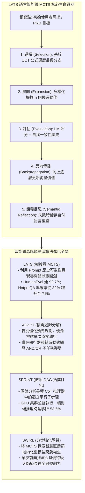
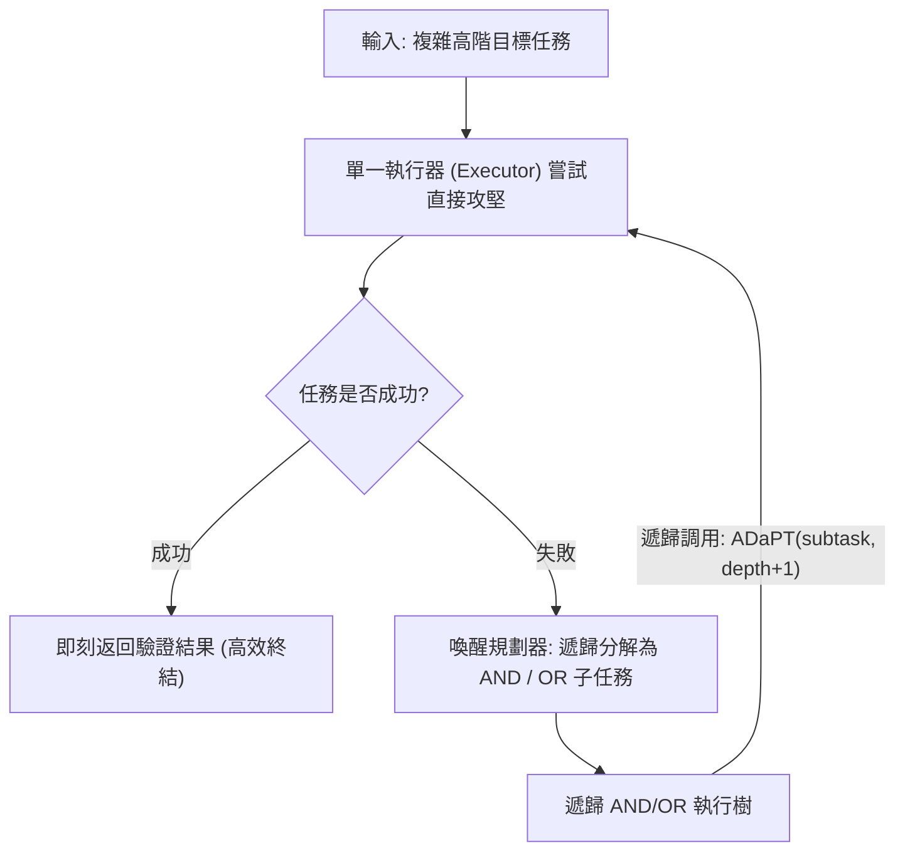
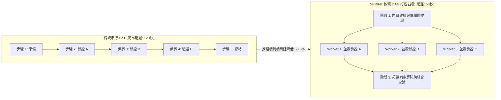

歡迎來到史丹佛大學2025秋季最新研究生課程——**CS329A: Self-Improving AI Agents（自主進化AI智能體）**的第五篇深度工程解析。

在第4講中，我們見證了語言模型如何走出封閉考場，利用終端運行程式碼、解讀編譯器報錯並實施自我修復（ReAct與RLEF）。然而，對於智能體而言，修復局部程式碼語法錯誤與架構師設計十萬行級的複雜分散式系統、完成跨越數小時的長期任務相比，存在著根本性的認知鴻溝。

傳統的ReAct與思維鏈（CoT）方法在本質上屬於**「只看眼前一步的貪婪單路徑搜尋」**。就像西洋棋初學者只看下一步走法而在三步後慘遭將死（Checkmate）一樣，貪婪的語言模型一旦在早期推演中走入歧途，便再也無法回頭，只能在錯誤的死胡同中越陷越深。

今天的**第5講**迎來了本課程前半程——**Part 1 (Foundation · 基礎理論)**的宏大收官之作：**多步規劃（Multi-Step Planning）與樹搜尋（Tree Search）**。

我們將AlphaGo擊敗人類圍棋冠軍的核心數學引擎——**蒙地卡羅樹搜尋（MCTS）**正式移植至自回歸語言模型中。通過賦能智能體像特級大師一樣洞察未來數十步變化、動態剪枝無效路徑、在歷史決策樹中自如回溯（Backtracking）並實現平行計算，全面解構這一頂尖架構：
1. **統一推理、行動與規劃的完備框架：** 語言智能體樹搜尋 **LATS**（Zhou et al., 2023）
2. **僅在失敗時動態拆解的按需遞歸規劃：** **ADaPT**（Allen AI, 2023）
3. **將長程推理延遲縮減53.5%的依賴DAG打包引擎：** **SPRINT**（Stanford Future Data, 2025）
4. **基於湯普森採樣的自適應分支決策：** 破解「加寬還是挖深」的 **AB-MCTS**（Sakana AI, 2025）
5. **將規劃直覺直接刻入神經網絡權重的分步強化學習：** **SWiRL**（Step-Wise RL, 2025）



{/* truncate */}

---

### 1. 貪婪生成的陷阱：為何單路徑推理在長程任務中必然崩潰

在簡單的單回合問答中，貪婪自回歸解碼或單條思維鏈（CoT）足以勝任，因為解空間密集且容錯率高。然而，隨著決策層級加深（$H > 10$），單路徑推演將遭遇災難性的**誤差累積效應（Error Propagation）**：

```text
P(Success) = ∏_{t=1}^H P(Correct_Action_t | History_{<t})
```

即便每個單步推理或工具調用的準確率高達 90%，在跨越 15 步的複雜軟體開發任務中，智能體的總體成功機率也會慘烈跌落：

```text
P(Success) = 0.90^{15} ≈ 0.2059  (總體成功率僅約 20.6%)
```

在標準的自回歸架構中，一旦在 $t=3$ 時發生邏輯偏差，錯誤的 Token 就會永久性地追加到上下文之中。模型缺乏任何原生的時間倒流機制來回滾狀態並嘗試替代方案。要獲得真正的自主性，智能體必須在**狀態搜尋樹（Search Tree of States）**中進行決策。

---

### 2. 語言智能體與 MCTS 的融合：LATS (Zhou et al., 2023)

在圍棋或西洋棋等傳統強化學習環境中，MCTS 依賴確定性的遊戲規則引擎（世界模型，World Model）來仿真推演未來棋局。但在編程或科學研究等缺乏剛性物理模擬器的開放領域中，智能體該如何推演未來的狀態？

2023 年底發布的 **LATS（Language Agent Tree Search，UIUC 與 Google DeepMind）** 揭示了一個直擊大模型本質的關鍵洞察：

> **「在語言智能體中，外部環境的所有狀態本質上就是 Prompt 文字歷史本身。如果我們想回到過去的某個決策點，根本不需要複雜的時間機器模擬器；只需將過去的文字 Prompt 重新投餵給模型，即可讓其向全新的方向展開分支！」**

大語言模型的文字生成機制，**天然無償地提供了 MCTS 演算法所必需的「完美狀態可逆性（State Reversibility / Backtracking）」**。

#### LATS 的五階段循環生命週期

LATS 將單一的大語言模型拆分為三重協同角色——**行動者（Agent/Actor）**、**評估者（Critic）**與**反思者（Reflector）**，持續循環以下五階段：

```text
                            [ 根節點: 使用者複雜任務 ]
                                       │
                       1. 選擇 (Selection, UCT 公式)
                                       ▼
                            [ 最具潛力葉節點 s ]
                                       │
                       2. 展開 (Expansion, 採樣 n 個動作)
                                       ▼
                           [ 沙箱真實執行與環境觀測 ]
                                       │
                       3. 評估 (Evaluation, LM 評分 + SC)
                                       ▼
                       4. 反向傳播 (Backprop, 價值更新)
                                       │
                       5. 語義反思 (Reflection, 失敗自然語言複盤)
```

#### 1. 基於 UCT 公式的節點選擇 (Selection)
從根節點出發，LATS 沿著最大化 UCT（Upper Confidence Bound for Trees）分數的子節點逐層下潛，精妙平衡已有高分路徑的「利用（Exploitation）」與低頻訪問節點的「探索（Exploration）」：

```text
UCT(s) = V(s) + w * sqrt( ln N(p) / N(s) )
```

其中：
* $V(s)$ 表示節點狀態 $s$ 的估計平均價值。
* $N(s)$ 表示狀態 $s$ 的歷史訪問計數。
* $N(p)$ 表示父節點 $p$ 的訪問計數。
* $w$ 為平衡探索強度的權重係數（經典取值為 $w = sqrt(2)$）。

#### 2. 動作空間展開 (Expansion)
抵達葉節點 $s$ 後，策略模型發散式採樣 $n$ 個不同的候選動作 $`a^(1), ..., a^(n)`$。每個動作被派發至隔離的程式碼沙箱（如 Python REPL 或終端）真實執行，獲得客觀觀測結果 $`o^(1), ..., o^(n)`$。

#### 3. 價值綜合評估 (Value Evaluation)
葉節點的獎勵估值 $V(s)$ 由定性推理評分與統計一致性雙重加權合成：

```text
V(s) = λ * LM_Score(s) + (1 - λ) * Self_Consistency(s)
```

* **`LM_Score(s)`:** 大模型基於問題目標與當前觀測結果輸出的 1 至 10 分邏輯品質評分。
* **`Self_Consistency(s)`:** 從當前狀態發散多次採樣時，推演結論收斂至一致結果的統計機率。

#### 4. 純量價值反向傳播 (Backpropagation)
在葉節點結算出環境獎勵 $r$ 後，該數值沿當前訪問路徑向上傳遞，逐級刷新所有祖先節點的訪問頻次與累計平均分：

```text
N(s_i) = N(s_i) + 1
V(s_i) = ( V(s_i)_old * N(s_i)_old + r ) / N(s_i)_new
```

#### 5. 語義反思機制 (Semantic Reflection)
若某個分支因斷言崩潰或死循環而終結，傳統 MCTS 僅會返還一個冰冷的負純量（$r = -1$）。LATS 則在此基礎上觸發**語義反思**：
系統要求大模型複盤：*「該分支為何走向失敗？哪一項初始假設出現了邏輯硬傷？」*。
生成的自然語言複盤報告被存入情節記憶庫中，並在後續輪次的系統提示詞中動態注入，從認知源頭徹底杜絕智能體「重蹈覆轍」。

#### 卓越的基準戰果
* **多跳複雜問答（HotpotQA）：** 單路徑 ReAct 僅取得 32.0% 的通過率，而 LATS 暴力拉升至 **71.0%**（提升超 2.2 倍）。
* **程式碼生成（HumanEval）：** LATS 斬獲 **92.7% Pass@1**，全面超越 Reflexion（91.0%）與基礎大模型（80.1%），創下當時的世界紀錄。
* **消融實驗：** 若將 MCTS 降級為樸素的深度優先搜尋（DFS），模型成功率瞬間腰斬至 42%，強力證實了 UCT 演算法在長程推演中不可或缺的平衡價值。

---

### 3. 按需智能分解：ADaPT (Allen AI, 2023)

如果說 LATS 是橫向發散探索解空間的代表，那麼由艾倫人工智慧研究所（AI2）推出的 **ADaPT** 則是縱向降低任務複雜度的**自適應分層規劃**典範。

傳統的「預先規劃並執行（Plan-and-Execute）」框架習慣在任務一開始就擬定一份長達十餘步的剛性日程。然而在真實環境中，一旦第 2 步遭遇意外，後續的 8 個步驟將全部淪為廢紙。

ADaPT 深刻汲取了人類資深工程師的高效工作哲學：

> **「切忌在著手前過度規劃。先將完整目標全盤交付給單一執行器（Executor）嘗試直接攻堅。只有當執行器親自嘗試並報告『無法獨立完成』時，系統才喚醒規劃器（Planner），將其按需解構為 3 至 5 個模組化子任務！」**



#### AND / OR 邏輯遞歸執行機制

ADaPT 借助邏輯算子結構化拆解子任務：
* **AND 節點：** 必須按順序全部成功執行的流水線任務（如 `拉取數據` `\to` `清洗轉換` `\to` `入庫持久化`）。
* **OR 節點：** 具有多條平行假設、只需任意一條成功的探索任務（如 `檢索本地快取` OR `調用遠端即時接口`）。

#### 實證效率
* 在 ALFWorld 複合組件操作任務（Pick2）中，傳統 ReAct 陣營因邏輯迷航成功率不足 12%，而 ADaPT 取得了 **52.9%** 的高通過率。
* 由於簡單任務單發搞定、僅在困難任務上縱深拆解，ADaPT 相比靜態預先規劃方案**節省了 40% 以上的 Token 消耗**。

---

### 4. 思考的並發高速路：SPRINT (Stanford Future Data, 2025)

2025 年初，以 DeepSeek-R1 為代表的長程思考（Long CoT）模型震撼業界。但隨之而來的是工程落地的致命夢魘：**生成一段高智商回覆往往需要使用者苦等兩分鐘（極高的首字與尾字延遲）**。

史丹佛 Future Data 實驗室的 **SPRINT** 研究團隊深入剖析長程推理序列後，指出了巨大的算力調度浪費：

> **「模型為了得出結論，在單個進程中線性排隊輸出了數千 Token。但從因果圖分析，『證明引理 A』、『排查邊界案例 B』與『論證反駁論點 C』三者在數據流上完全獨立。為什麼非要逼它們串行排隊？難道不能將獨立的思考步驟打包成並發有向無環圖（DAG）嗎？」**



#### 拓撲排序打包調度演算法

SPRINT 將推演歷程建模為有向無環圖（DAG）。依據因果依賴集 $D$，演算法為每一個子步驟 $S_i$ 確定其拓撲層級序號 `\sigma(S_i)`：

```text
σ(S_i) = {
    1,                                                         (當 Parents(S_i) = ∅ 時)
    max_{S_p ∈ Parents(S_i)} ( σ(S_p) + 1[ E_p ≠ ∅ ] ),        (其他情況)
}
```

凡具有相同拓撲序號 `\sigma` 的推演步驟，均被視為彼此無數據衝突，系統將它們並發分發至分散式 GPU 集群中**同時執行**。各節點完成後進入同步屏障整合資訊，規劃器再動態調度下一層並發視界：

```text
規劃拆解  ──►  並發派發執行  ──►  拓撲狀態同步  ──►  動態再規劃
```

#### 性能突破：精度提升的同時延遲腰斬
* 在 **MATH-500** 權威數學評測中，相較於純串行基準，其準確率逆勢**從 89.1% 躍升至 92.5%**（得益於並發分支間的交叉比對與冗餘校驗）。
* 同時，端到端實際物理耗時（Wall-clock Time）**暴跌 53.5%**，原先耗時兩分鐘的極難推理被全面壓進 50 秒大關。

---

### 5. 自適應搜尋與突觸內化：AB-MCTS 與 SWiRL

伴隨樹搜尋技術走向工業化，學術界開闢了兩大前沿演進方向：

#### 1. AB-MCTS：橫向展寬還是縱向挖深？ (Sakana AI, 2025)
傳統 MCTS 的分支因子（Branching Factor）通常為固定常數，極易在無意義的分支上虛耗算力。**AB-MCTS（自適應分支 MCTS）**通過**湯普森採樣（Thompson Sampling）**實現了動態線上博弈：
* 若演算法選中已有子節點，則順著既有思路繼續縱深推演（*Deeper*）；
* 若演算法選中虛構的 `GEN` 元動作，則令大模型現場萌發全新思路分支，橫向擴寬搜尋面（*Wider*）。
* 通過將分支回報建模為後驗貝葉斯分佈，AB-MCTS 能夠以極快速度滑過平庸推演，將寶貴的計算資源精準集火於最具懸念的戰略決策瓶頸。

#### 2. SWiRL：將規劃智慧熔鑄入神經網絡突觸 (2025)
在實際生產中，每一次推理都跑一遍完整的 MCTS 樹代價高昂。**SWiRL（分步強化學習）**旨在完成從「搜尋演算法」到「模型本能」的終極躍遷：
* 將長程互動軌跡精準切片為單步轉換對，訓練生成式獎勵模型對**「每一步子規劃與工具調用的邏輯合理性」**給出高密度的中間評分。
* 借助分步 PPO 進行權重強化後，大模型不再依賴外掛的繁複 MCTS 調度腳本，便能在單次前向傳播中**內生性地展現特級大師般的深度預判力**。

---

### 6. 企業級架構設計：分層 MCTS 規劃網格藍圖

在生產級智能體集群中安全部署 MCTS 規劃引擎，需要嚴密考慮成本熔斷、環境隔離與容錯回退機制：

```text
┌────────────────────────────────────────────────────────────────────────┐
│             企業級分層 MCTS 智能規劃網格架構                           │
├────────────────────────────────────────────────────────────────────────┤
│                                                                        │
│  [ 業務核心目標 / 需求文件 PRD ]                                       │
│          │                                                             │
│          ▼                                                             │
│  ┌──────────────────────────────────────────────────────────────────┐  │
│  │                    自適應規劃編排中心                            │  │
│  │  • 階段 1: 單一執行器直連速擊（零額外 MCTS 算力成本）            │  │
│  │  • 階段 2: 遇阻即觸發 ADaPT 動態 AND/OR 任務解構                 │  │
│  │  • 階段 3: 高度不確定/複雜博弈任務 -> 啟動 LATS MCTS 樹搜尋     │  │
│  └───────────────────┬──────────────────────────────▲───────────────┘  │
│                      │ 並發子任務 DAG               │ 狀態價值評估     │
│                      ▼                              │ 遙測回傳         │
│  ┌──────────────────────────────────────────────────┴───────────────┐  │
│  │                     SPRINT 分散式調度閘道                        │  │
│  │  • 拓撲排序與因果數據依賴分析引擎                                │  │
│  │  • 異步 GPU 工作池（基於 7B/8B 輕量級模型進行高速動作採樣）      │  │
│  │  • 並發同步柵欄與長上下文拼裝分發模組                            │  │
│  ├──────────────────────────────────────────────────────────────────┤  │
│  │                     安全校驗與熔斷護欄層                         │  │
│  │  • UCT 弱枝剪枝引擎（自動清理 V < 0.2 的劣質推演樹）             │  │
│  │  • 快速收斂熔斷器（任一分支 100% 通過單測即刻提前返回）          │  │
│  │  • 語義反思（Semantic Reflection）情節記憶快取池                 │  │
│  └──────────────────────────────────────────────────────────────────┘  │
│                                                                        │
└────────────────────────────────────────────────────────────────────────┘
```

#### 生產落地的三大核心鐵律
1. **早停熔斷機制（Early-Stopping Circuit Breaker）：** 只要任何一個探索分支達成了絕對確定性的成功判據（例如單元測試 100% 全綠），立即終止其餘所有並發搜尋線程，瞬間交付結果以杜絕算力浪費。
2. **模型分層混合部署（Hierarchical Model Serving）：** 嚴禁動用 70B+ 超大模型去跑邊緣葉節點的機械化採樣；應將採樣重任交由 7B~8B 小模型分流，大模型僅駐守關鍵決策節點的價值打分位，削減 80% 以上的部署成本。
3. **搜尋預算硬配額：** 必須在平台層為搜尋深度（``d_max` \le 6`）與單題最大展開輪數（`N \le 30`）設立硬性閾值，嚴防遭遇惡性循環引發帳單失控。

---

### 7. 資深架構師核心 Q&A

**Q: SPRINT 搞並發推理，萬一某個獨立分支算出了錯誤結論，豈不是會污染最後彙總的主幹？**
**A:** 這正是 SPRINT 依賴 DAG 設計的精妙所在。SPRINT 絕非無腦並發，而是基於符號依賴分析**「僅並發數據流完全無關的計算步驟」**。如果步驟 B 必須要消費步驟 A 的變數結果，拓撲排序會強制保證步驟 B 在步驟 A 徹底跑通並驗真前絕不啟動。此外，多路並發產生的資訊在匯聚點由大模型進行交叉審閱，本質上構建了一套多智能體投票集成機制，反而使整體推理準確率提升了 3.4 個百分點。

**Q: LATS 引入的語義反思（Semantic Reflection）相比傳統數值反向傳播的核心優勢是什麼？**
**A:** 傳統 MCTS 僅更新訪問頻次與平均值這類冰冷的數字（$N, V$）。但在程式碼生成或邏輯推理中，純數字完全無法告訴後人「這段程式碼到底為什麼死鎖」或「哪一條代數公理被錯誤引用了」。語義反思要求模型撰寫自然語言複盤筆記並封存在工作記憶中。當智能體下次再度推演至相近的問題狀態時，這段反思文字將作為提示詞的前置約束，精確規避曾經踩過的陷阱。

---

### 8. 核心總結與技術要點

1. **破除貪婪生成的短視：** 自回歸模型在長程任務中必受誤差累積的困擾。MCTS 賦予了模型探索、剪枝與回溯的能力，使其從初學者躍升為全局布局的棋局大師。
2. **Prompt 歷史即狀態的零開銷回溯：** LATS 抓住大模型「上下文即世界狀態」的特性，無需外置物理模擬器即可完美支援 MCTS 任意節點的無縫回滾。
3. **按需自適應分解：** ADaPT 擯棄了僵化呆板的前置規劃，優先以單發模式直面挑戰，僅在觸壁報錯時才自適應拆解為 AND/OR 邏輯子樹，大幅優化 Token 效益。
4. **並發 DAG 打破延遲瓶頸：** SPRINT 將串行思維鏈解構為並發 DAG，在將推理延遲斬斷 53.5% 的同時，依靠交叉校驗反哺了準確率。
5. **從外掛搜尋到權重內化：** SWiRL 借助分步強化學習（Step-Wise RL），將複雜的 MCTS 規劃直覺直接注入神經網絡權重，實現單次推理即可展現高瞻遠矚的戰略視野。

---

### 熱烈祝賀：Part 1（基礎理論）完結與 Part 2 預告！
伴隨著第 5 講的落幕，我們正式完成了史丹佛大學 CS329A 課程的第一宏大篇章——**Part 1: Foundation（基礎理論篇，第1講~第5講）**的全量攻堅！
* **L1:** 宏觀範式躍遷：從基礎 LLM 到自我進化的自主智能體
* **L2:** 推理時計算擴展定律（Test-time Compute）與覆蓋率冪律
* **L3:** 步驟級過程監督模型（PRM）與弱驗證器集成（Weaver）
* **L4:** 閉環程式碼執行（ReAct）、編譯器反饋強化學習（RLEF）與憲法級 AI
* **L5:** MCTS 樹搜尋規劃（LATS）、按需遞歸分解（ADaPT）與並發 DAG（SPRINT）

我們已經完整掌握了智能體如何思考、行動、驗證與自主規劃的全部數理基石。

從下一講開始，我們將正式進入波瀾壯闊的 **Part 2: Training & Evolution（訓練與自主進化篇，第6講~第9講）**。我們將徹底跨越測試時工程技巧，深入到**「AI 如何依託強化學習與進化演算法自主更新自身神經網絡權重，邁向永不停歇的自驅進化世界」**。

下一講的主題是：
**《Lecture 6: Train-Time Scaling & RL: 訓練期擴展與強化學習（DeepSeekMath, GRPO, DAPO）》**
我們將深度拆解 DeepSeek 如何捨棄高成本 Critic 價值模型、僅靠純粹的開源強化學習便登頂全球推理巔峰的演算法奧秘。下一講不見不散！