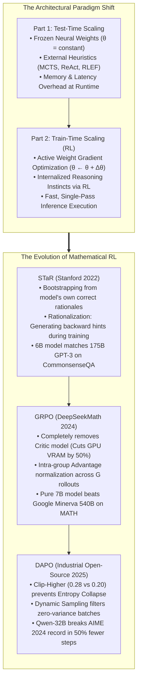
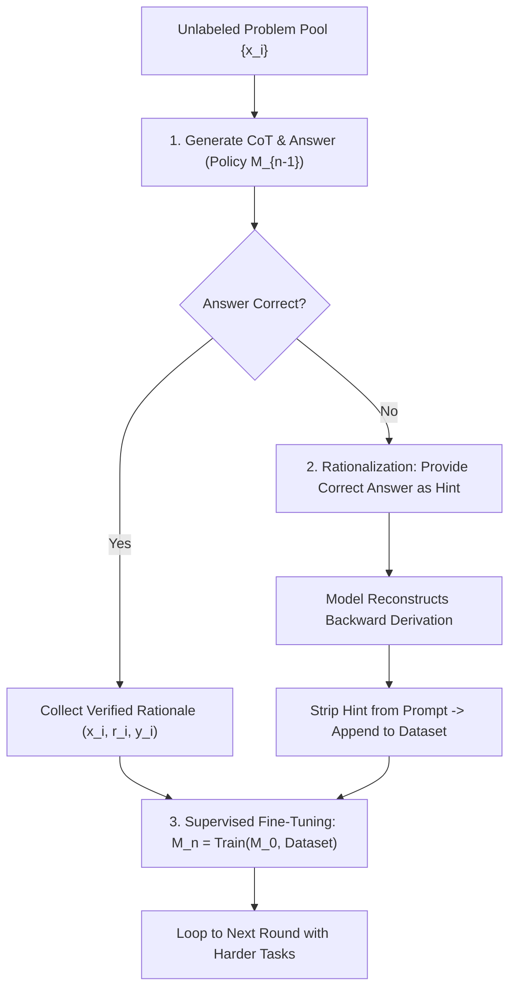
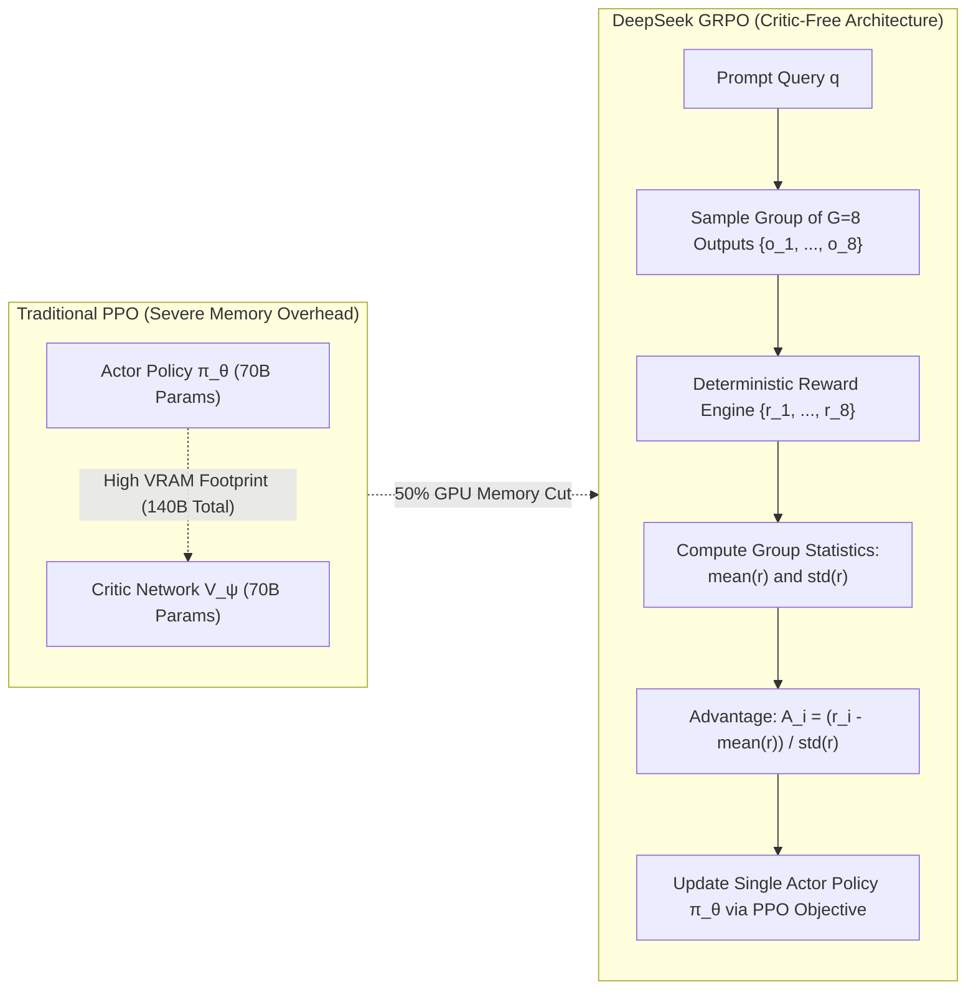

Welcome to the sixth installment of our definitive engineering breakdown of **Stanford University's CS329A: Self-Improving AI Agents (Autumn 2025)**.

In Lectures 1 through 5 (Part 1: Foundation), we examined how agents push the limits of frozen, pre-trained models by allocating test-time compute: exploring search trees with MCTS, gathering runtime compiler diagnostics, and pruning dead ends. 

Yet, we must confront a sober mathematical reality:
If an elementary school student has never been taught the principles of calculus, giving them ten additional minutes to think during an exam will not produce a valid integration proof. Similarly, if an autoregressive model lacks the foundational representations within its frozen synaptic weights, sampling 10,000 rollouts or executing greedy beam search does not yield genuine intelligence—it produces stochastic luck.

Today marks the launch of **Part 2: Training & Evolution (Lectures 6–9)**. We pivot from inference heuristics to fundamental neural weight updates:
> **"Instead of burning inference compute at runtime, how can we invest massive compute during training time to permanently rewrite the neural synapses of the model into an elite reasoner?"**

In **Lecture 6**, we dismantle the core mathematical engine driving frontier reasoning models: **Post-Training Reinforcement Learning (RL)**. We analyze three foundational paradigms that eliminated human labeling bottlenecks and scaled mathematical reasoning:
1. **Autonomous Reasoning Bootstrapping:** Self-Taught Reasoner (**STaR**, Zelikman et al., Stanford 2022).
2. **The Death of the Critic:** Group Relative Policy Optimization (**GRPO**, DeepSeekMath 2024).
3. **Scaling to 1,000 GPUs:** Decoupled Clipping and Dynamic Sampling (**DAPO**, 2025).



{/* truncate */}

---

### 1. Train-Time vs. Test-Time Scaling: Shifting the Compute Frontier

To understand why modern AI research shifted toward post-training reinforcement learning, we must distinguish between the two compute frontiers:

```text
Compute_Total = Compute_Train + Compute_Inference
```

1. **Test-Time Scaling (Inference-Time Search):** The model parameter vector `\theta` is fixed. Compute is allocated to exploring candidate paths (Best-of-N, MCTS, PRM search). While effective for isolated queries, it imposes severe latency and operational compute costs on every downstream user interaction.
2. **Train-Time Scaling (Synaptic Gradient Updates):** Compute is expended during training to permanently adjust `\theta` via reinforcement learning:

```text
θ* = argmax_θ E_{x ~ D, y ~ π_θ(·|x)} [ R(x, y) ]
```

When an agent discovers a superior multi-step deduction pattern during RL, gradient ascent bakes that strategy directly into the attention and feed-forward weight matrices. At inference time, the model exhibits grandmaster-level planning **in a single forward pass without external tree harnesses**.

---

### 2. Autonomous Reasoning Bootstrapping: STaR (Zelikman et al., Stanford 2022)

Supervised Fine-Tuning (SFT) requires tens of thousands of expert-crafted step-by-step solutions (Problem `\to` Rationale `\to` Answer). However, hiring PhD mathematicians or software architects to write granular reasoning traces for millions of edge cases is economically infeasible.

In 2022, Eric Zelikman and his Stanford collaborators proposed an audacious hypothesis:
> **"If a system can deterministically verify whether a final answer is correct, why not let the language model draft its own rationales, filter out the paths that stumbled upon the correct answer, and fine-tune itself on its own successful thoughts?"**

This gave birth to the **Self-Taught Reasoner (STaR)**.



#### Mathematical Equivalence: Approximating the Policy Gradient

STaR is not merely an empirical data trick; it is mathematically grounded as a discrete approximation of policy gradient reinforcement learning under an indicator reward function $`1(y_hat = y*)`$:

```text
∇_θ J(θ) = ∑_i E_{r_hat, y_hat ~ π_θ(·|x_i)} [ 1(y_hat = y_i*) * ∇_θ log π_θ(r_hat, y_hat | x_i) ]
```

For incorrect completions where $`1(y_hat = y*)` = 0$, the gradient evaluates to zero and the rollout is discarded. For correct completions where `\mathbb(1) = 1`, the gradient performs standard maximum likelihood estimation (MLE), pulling the policy distribution toward verified reasoning paths.

#### The Magic of Rationalization

A core flaw of naive self-filtering is that a model cannot bootstrap from problems it never solves. If an agent fails 100% of its rollouts on a difficult calculus question, it produces zero positive training data.

To overcome this, STaR introduced **Rationalization**:
1. When the model generates an incorrect answer, the system appends the true ground-truth answer as a hint: *"Hint: The final answer is 42. Work backward to explain why 42 is mathematically required."*
2. Knowing the destination, the model constructs a valid deductive bridge backward to the premise.
3. Crucially, **the hint is stripped from the prompt** before adding the pair to the training dataset:

```text
Dataset Entry: Prompt [ x_i ] ──► Target Rationale [ r_backward ] + Answer [ y_i* ]
```

The model is fine-tuned as though it produced the solution unassisted, internalizing the causal intuition required to bridge similar conceptual gaps in future rounds.

#### Empirical Breakthrough
* On the **CommonsenseQA** benchmark, applying STaR to a compact **6B-parameter GPT-J** model elevated accuracy from **60.0% to 72.5%**.
* This enabled the 6B model to match the performance of a **175B-parameter fine-tuned GPT-3 (73.0%)**, matching a model nearly 30 times its size.

---

### 3. The Death of the Critic: DeepSeekMath & GRPO (2024)

While STaR demonstrated self-bootstrapping via iterative SFT, open-ended mathematical mastery requires true online reinforcement learning.

#### The Collapse of Standard PPO in Mathematical Reasoning

When OpenAI developed ChatGPT, they relied on standard **Proximal Policy Optimization (PPO)**. PPO requires deploying two co-equal neural networks concurrently:
1. **Policy Network (Actor, `\pi_\theta`):** Generates output tokens.
2. **Value Network (Critic, `V_\psi`):** Evaluates expected scalar rewards from intermediate token states.

This architecture creates severe bottlenecks:
* **Memory Explosion:** Training a 70B Actor requires hosting a 70B Critic model, doubling GPU VRAM requirements.
* **Credit Assignment Failure:** In complex mathematical reasoning where a scalar reward ($+1$ or $-1$) arrives only after 4,000 tokens of deduction, training an accurate per-token Value Critic `V_\psi(s_t)` is mathematically intractable, causing policy gradient variance to destabilize training.

#### The GRPO Formulation: Eliminating the Value Network

In early 2024, the DeepSeek research team published **DeepSeekMath**, introducing **Group Relative Policy Optimization (GRPO)**:

> **"Why train a costly multi-billion-parameter Critic model? For any given query `q`, sample a group of `G` distinct completions ``(o_1, ..., o_G)`` from the current policy. Compute the mean and standard deviation of their scalar rewards across the group, and normalize via z-score. That relative statistical rank is your exact advantage!"**



#### The Mathematical Objective of GRPO

The GRPO objective optimizes the policy `\pi_\theta` against a reference policy $`pi_ref`$ without maintaining an explicit value baseline:

```text
J_GRPO(θ) = E_{q, {o_i}_{i=1}^G} [ 
    (1 / G) * ∑_{i=1}^G (1 / |o_i|) * ∑_{t=1}^{|o_i|} {
        min(
            ( π_θ(o_{i,t}) / π_old(o_{i,t}) ) * A_hat_{i,t},
            clip( π_θ(o_{i,t}) / π_old(o_{i,t}), 1 - ε, 1 + ε ) * A_hat_{i,t}
        )
    } - β * D_KL( π_θ || π_ref )
]
```

Where the advantage `A_hat_{i,t}` for completion `o_i` is computed purely from group reward statistics:

```text
A_hat_{i,t} = r_tilde_i = ( r_i - mean({r_1, ..., r_G}) ) / ( std({r_1, ..., r_G}) + δ )
```

#### Credit Assignment: Outcome vs. Process Supervision
1. **Outcome-Supervised GRPO:** If the final answer inside completion $o_i$ matches ground truth, $r_i = +1$; otherwise, $r_i = -1$. The resulting standardized advantage `r_tilde_i` is copied uniformly across all tokens `t \in [1, |o_i|]`.
2. **Process-Supervised GRPO:** Intermediate derivation steps are assigned partial rewards, and the cumulative discounted future reward sum from token $t$ onward is normalized across the group.

#### Benchmark Triumphs: 7B Surpasses 540B
* `DeepSeekMath-Base 7B`, pre-trained on 120B mathematical tokens, **surpassed Google's 540B Minerva model**.
* Applying GRPO reinforcement learning boosted MATH benchmark accuracy from **46.8% to 51.7%**, marking the first time in open-source AI history that a pure 7B model crossed the 50% threshold on MATH without calculator assistance.
* Combining GRPO with 64-sample Self-Consistency propelled accuracy to **60.9%**.

---

### 4. Industrial Large-Scale RL Engineering: DAPO (2025)

When academic labs implemented DeepSeek's raw GRPO formulation on frontier benchmarks like **AIME 2024 (American Invitational Mathematics Examination)**, they ran into a wall:
* While DeepSeek-R1-Zero scored 47 points on AIME, open implementations using standard GRPO plateaued at **only 30 points**.

In March 2025, researchers released **DAPO (Decoupled Clip and Dynamic Sampling Policy Optimization)**, revealing four critical engineering safeguards required to stabilize large-scale reasoning RL across thousands of GPUs:

```text
Naive GRPO (30 pts) 
  ──► + Length Filter (36 pts) 
  ──► + Clip-Higher (38 pts) 
  ──► + Token-Level Loss (42 pts) 
  ──► DAPO (50 pts, Exceeding DeepSeek-R1-Zero)
```

#### Secret 1: Asymmetric Clip-Higher ($`eps_low = 0.20, eps_high = 0.28`$)
* **The Failure:** Symmetric PPO clipping (`\pm 0.2`) penalizes positive probability shifts equally. When a model discovers an innovative, rare reasoning token with an initial probability of $p = 0.01$, a standard upper bound of `1 + 0.2 = 1.2` caps its update at $p = 0.012$. Meanwhile, predictable tokens with $p = 0.90$ easily scale to $1.08$.
* **The Consequence:** The model abandons exploratory thoughts, causing **Entropy Collapse** into brief, repetitive patterns.
* **The DAPO Fix:** Maintain $`eps_low = 0.20`$ to penalize bad trajectories, but raise the upper bound by 40% to **$`eps_high = 0.28`$**, allowing high-value exploratory tokens to surge in likelihood.

#### Secret 2: Dynamic Sampling (Filtering Degenerate Batches)
* **The Failure:** If a math problem is too easy, all $G$ completions succeed (`r_i = 1 \ \forall i`). If a problem is too hard, all $G$ completions fail (`r_i = 0 \ \forall i`).
* In both cases, `std({r_1, ..., r_G}) = 0`. The advantage evaluates to `0`, and **thousands of GPUs waste petaFLOPs calculating zero gradients**.
* **The DAPO Fix:** Dynamically discard batches unless `0 < Correct Rollouts < G`, ensuring that 100% of compute generates high-purity gradients from meaningful variance.

#### Secret 3: Token-Level Loss Normalization
Standard GRPO computes sample-averaged losses, which dilutes a toxic token inside a 2,000-token derivation compared to a concise 50-token response. DAPO normalizes loss strictly across the aggregate token count `\sum_i |o_i|`, preventing models from gaming rewards via redundant token stuffing.

#### Secret 4: Overlong Reward Shaping
When models expand their depth of thought, rollouts occasionally clip against hard context windows (e.g., 16,384 tokens). Naive RL penalizes clipped sequences with a harsh $-1$ reward, killing promising long-horizon derivations. DAPO applies a smooth, linear soft penalty across the final 4,096 tokens, gently training the model to conclude proofs within the allotted context.

---

### 5. Enterprise Architecture: Industrial Distributed RL Training Pipeline

Scaling post-training reasoning RL to enterprise production environments requires a decoupled, high-throughput compute topology:

```text
┌────────────────────────────────────────────────────────────────────────┐
│             Production Distributed GRPO/DAPO Infrastructure            │
├────────────────────────────────────────────────────────────────────────┤
│                                                                        │
│  [ Curriculum Task Bank (Formal Math / Code Compilers / Tool APIs) ]   │
│          │                                                             │
│          ▼                                                             │
│  ┌──────────────────────────────────────────────────────────────────┐  │
│  │                    Dynamic Batching & Sampling Engine            │  │
│  │  • Difficulty Balancer: Filter 100% Pass / 100% Fail batches     │  │
│  │  • Prompt Packing with Context Window Binning                    │  │
│  └───────────────────┬──────────────────────────────────────────────┘  │
│                      │ Dispatched Batches                              │
│                      ▼                                                 │
│  ┌──────────────────────────────────────────────────────────────────┐  │
│  │                   vLLM / TensorRT-LLM Rollout Fleet              │  │
│  │  • Dedicated Inference Worker Nodes (Asynchronous G=8 Sampling)  │  │
│  │  • High-throughput KV-Cache PagedAttention Clustering           │  │
│  └───────────────────┬──────────────────────────────▲───────────────┘  │
│                      │ Rollout Traces {o_1..o_G}    │ Synchronized     │
│                      ▼                              │ Weights θ        │
│  ┌──────────────────────────────────────────────────┴───────────────┐  │
│  │                   Deterministic Rule-Based Verifiers             │  │
│  │  • Isolated Docker/gVisor Python & Math SymPy Verification       │  │
│  │  • Strict Format Compliance Verifier (XML Thinking Tags)         │  │
│  │  • Standardized Group Advantage Calculation: A_i = (r - μ) / σ   │  │
│  └───────────────────┬──────────────────────────────────────────────┘  │
│                      │ Token Advantage Streams                         │
│                      ▼                                                 │
│  ┌──────────────────────────────────────────────────────────────────┐  │
│  │                   Megatron-LM / DeepSpeed Train Cluster          │  │
│  │  • Single Policy Model (Critic-Free VRAM Allocation)             │  │
│  │  • Asymmetric Clip-Higher Gradient Engine (ε_high = 0.28)        │  │
│  │  • Token-Level Aggregated Loss Optimization via FlashAttention-3 │  │
│  └──────────────────────────────────────────────────────────────────┘  │
│                                                                        │
└────────────────────────────────────────────────────────────────────────┘
```

#### Production Engineering Rules
1. **Zero Human in the Evaluation Loop:** Only train on objectives with deterministic ground truth (formal code compilers, symbolic math engines like SymPy, unit test execution suites). Never train reasoning RL against subjective human feedback.
2. **Decoupled Rollout & Training Fleets:** Never share GPU memory between inference generation and backward gradient passes. Use specialized inference engines (vLLM) to stream rollouts into training nodes (Megatron-LM) via high-speed RDMA networks.
3. **Strict Formatting Guardrails:** Impose rule-based formatting penalties (e.g., verifying `<think> ... </think>` structure) to prevent agents from bypassing explicit reasoning steps to guess raw answers.

---

### 6. Technical Deep Dive: Practical Engineering Q&A

**Q: Why is the KL divergence penalty still necessary in GRPO, and when should it be relaxed?**
**A:** The KL divergence penalty (`\beta `D_KL`(\pi_\theta \parallel `pi_ref`)`) acts as an essential safety constraint against **Reward Hacking**. Without it, an RL agent will quickly discover degenerate patterns—such as repeating identical punctuation or producing unreadable pseudo-code that happens to trick the parser. However, when inducing emergent long-horizon reasoning (as observed in DeepSeek-R1-Zero), researchers deliberately dial `\beta \to 0` in initial training phases, allowing the model to explore radical, non-standard linguistic trajectories before re-introducing mild KL regularization during final alignment.

**Q: In STaR, how does Rationalization prevent the model from learning to cheat using hints?**
**A:** The protection lies in the strict temporal separation between data synthesis and weight updates. The hint is provided **exclusively to facilitate backward causal deduction during generation**. Before that trace is committed to the training corpus, the input prompt is sanitized, stripping the hint entirely. From the perspective of the policy network during gradient descent, it appears as though the model formulated the comprehensive deductive bridge unprompted.

---

### 7. Summary and Core Technical Takeaways

1. **The Train-Time Frontier:** Test-time search cannot extract knowledge that does not exist in synaptic weights. Train-time scaling uses reinforcement learning to bake strategic reasoning directly into the neural network.
2. **Autonomous Bootstrapping:** STaR proves that models can self-train by filtering their own valid rationales and bridging gaps via backward rationalization, matching models 30 times their size.
3. **Critic-Free Scalability:** DeepSeekMath's GRPO eliminated the multi-billion-parameter Critic model, cutting memory overhead by 50% and computing advantages from intra-group statistical variance.
4. **Industrial Stabilization:** DAPO demonstrated that scaling GRPO to frontier performance requires asymmetric Clip-Higher (`\epsilon=0.28`), dynamic batch filtering, and token-level loss attribution, surpassing DeepSeek-R1-Zero in half the compute steps.

---

### What's Coming Next in Stanford CS329A:
In **Lecture 7**, we step beyond solving fixed human benchmarks and venture into open-ended autonomous discovery: **《Open-Ended Evolution: ADAS, The AI Scientist, AlphaEvolve, and Self-Improving Agent Architectures》**. We will explore how agents write their own research papers, discover novel ML architectures, and design their own successor models. Stay tuned!