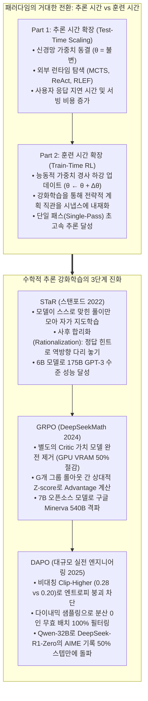
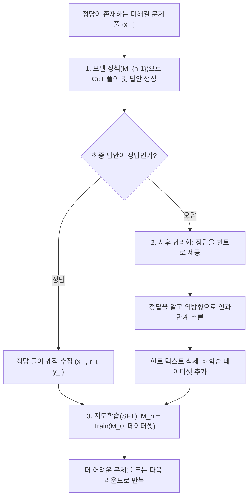
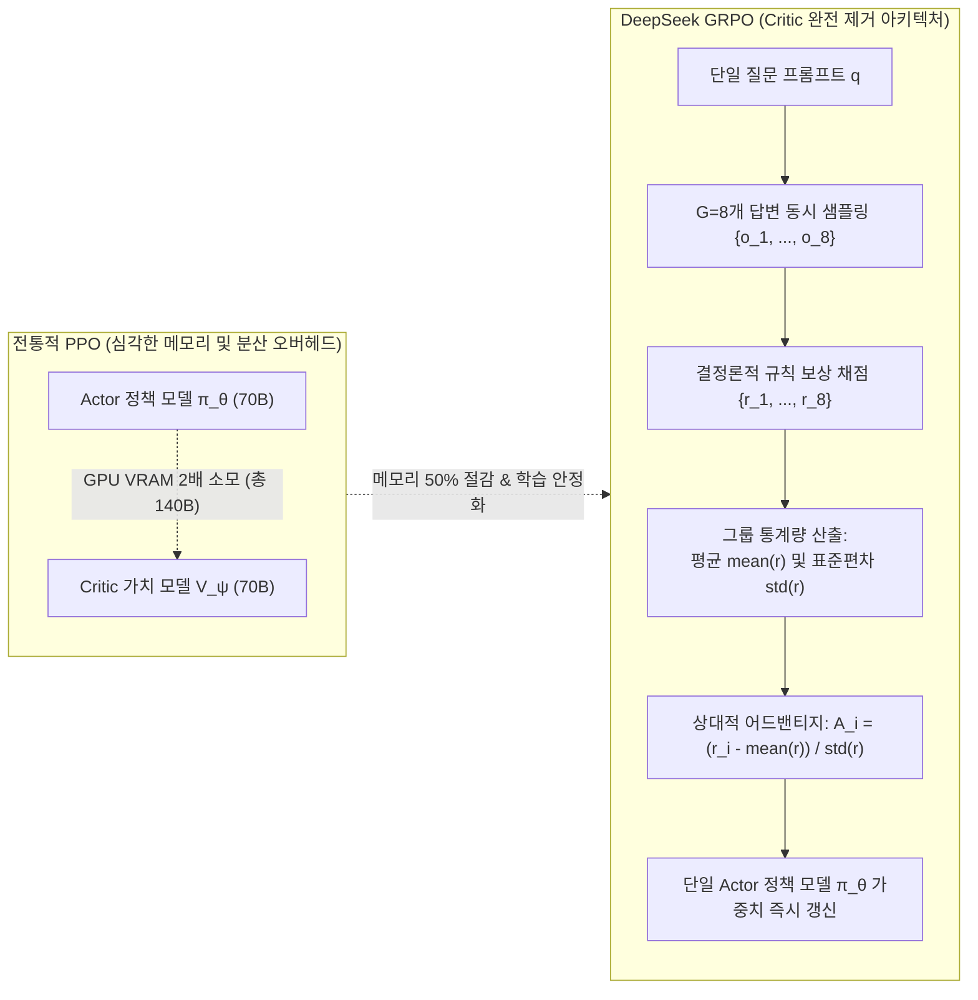

스탠포드 대학교의 2025 가을학기 최신 대학원 강좌, **CS329A: Self-Improving AI Agents (스스로 발전하는 AI 에이전트)** 여섯 번째 기술 해설에 오신 것을 환영합니다.

지난 제1강부터 제5강까지의 **Part 1 (Foundation · 기초 이론)**을 통해, 우리는 이미 훈련이 완료되어 동결된 언어 모델에 추론 시간 연산(Test-time Compute)을 쏟아부어 성능을 한계까지 끌어올리는 법을 배웠습니다. MCTS 트리 탐색을 돌리고, 터미널 실행 에러를 주입하며, 약한 검증기 앙상블로 오답을 걸러냈습니다.

하지만 이제 냉정하게 현실적인 한계를 직시해야 합니다:
초등학생에게 시험 시간을 10분 더 준다고 해서 대학 미적분학의 복잡한 증명을 풀어낼 수 있을까요? 모델 자체의 동결된 신경망 시냅스(가중치 파라미터, `\theta`) 내부에 해당 수학적 개념과 논리 체계가 전혀 존재하지 않는다면, 수천 번의 주사위를 굴리고 빔 서치를 돌려본들 그것은 진정한 지능이 아니라 확률적 요행수에 불과합니다.

오늘부터 시작되는 **Part 2: Training & Evolution (훈련 및 자가 진화, 제6강~제9강)**은 바로 이 근본적인 질문에 답하는 대장정입니다:
> **"추론 시간에 비싼 탐색 꼼수를 쓰는 대신, 훈련 시간(Train-time)에 대규모 연산량을 투입하여 모델의 두뇌 가중치 자체를 영구히 똑똑하게 진화시킬 수는 없는가?"**

오늘 **제6강**에서는 인간의 라벨링 병목을 깨부수고 최첨단 추론 모델을 탄생시킨 **사후 강화학습(Post-Training RL)**의 핵심 알고리즘 3가지를 깊이 있게 해체하고 재설계합니다:
1. **자가 생성 추론으로 자기를 가르치는:** **STaR** (Self-Taught Reasoner, Zelikman et al., Stanford 2022)
2. **크리틱(Critic)을 제거한 강화학습 혁명:** **DeepSeekMath와 GRPO** (Group Relative Policy Optimization, 2024)
3. **천 개 GPU 규모의 산업용 엔지니어링 기법:** **DAPO** (Decoupled Clip & Dynamic Sampling, 2025)



{/* truncate */}

---

### 1. 훈련 시간 확장 vs 추론 시간 확장: 연산 지평의 전환

현대 인공지능 연구가 왜 사후 강화학습(Post-Training RL)으로 급격히 전환되었는지를 이해하려면, 총 연산 자원(FLOPs)의 배분 방정식을 살펴보아야 합니다:

```text
Compute_Total = Compute_Train + Compute_Inference
```

1. **추론 시간 확장 (Inference-Time Scaling):** 모델의 파라미터 벡터 `\theta`는 고정되어 있습니다. 연산량을 다회차 샘플링, 빔 서치, MCTS 탐색 트리에 투입합니다. 단일 질의에는 효과적이지만, 서비스에 접속하는 모든 사용자에게 천문학적인 지연 시간과 GPU 서빙 비용을 전가합니다.
2. **훈련 시간 확장 (Train-Time Scaling):** 훈련 단계에서 대규모 연산량을 투입하여 가중치 `\theta` 자체를 최적화합니다:

```text
θ* = argmax_θ E_{x ~ D, y ~ π_θ(·|x)} [ R(x, y) ]
```

강화학습을 통해 모델이 우수한 다단계 연역 패턴을 스스로 발견하면, 역전파를 통해 그 전략적 지혜가 어텐션 레이어와 피드포워드 가중치에 영구적으로 각인됩니다. 그 결과, 배포 시에는 **복잡한 외부 탐색기 없이도 단 한 번의 순방향 전파(Single Forward Pass)만으로 그랜드마스터급 직관**을 발휘하게 됩니다.

---

### 2. 생각의 자가 발전: STaR (Self-Taught Reasoner, Stanford 2022)

언어 모델을 지도 미세조정(SFT)시키려면 사람이 정성스럽게 작성한 수만 건의 '문제 + 단계별 풀이 과정(Rationale) + 정답' 데이터셋이 필요합니다. 그러나 고난도 올림피아드 수학이나 복잡한 소프트웨어 아키텍처의 풀이를 인간 전문가가 일일이 써주는 것은 천문학적인 비용이 듭니다.

2022년 스탠포드 대학교 Eric Zelikman 연구팀은 놀라운 질문을 던졌습니다:
> **"정답이 맞았는지 틀렸는지를 기계적으로 검증할 수 있다면, 풀이 과정(Rationale)은 모델 스스로 상상해서 쓰게 하고, 우연히 정답에 도달한 훌륭한 풀이만 선별해 다시 자기 자신을 훈련시키면 되지 않을까?"**

이것이 바로 자가 학습 추론기 **STaR**의 탄생입니다.



#### 수학적 정당성: 정책 경사(Policy Gradient)의 정밀한 근사

STaR는 단순한 데이터 수집 트릭이 아닙니다. 수학적으로 이것은 **지시 함수 보상 $`1(y_hat = y*)`$을 사용한 강화학습 정책 경사(Policy Gradient)의 우아한 이산 근사**입니다:

```text
∇_θ J(θ) = ∑_i E_{r_hat, y_hat ~ π_θ(·|x_i)} [ 1(y_hat = y_i*) * ∇_θ log π_θ(r_hat, y_hat | x_i) ]
```

오답을 낸 샘플은 `\mathbb(1) = 0`이 되어 그래디언트가 소멸하고 버려지며, 정답을 맞힌 샘플에 대해서만 최대우도추정(MLE) 경사 상승이 이루어지므로, 정책 분포가 자연스럽게 검증된 추론 경로로 수렴하게 됩니다.

#### 사후 합리화(Rationalization)의 묘수

여기서 중요한 의문이 생깁니다: "모델이 원래 실력으로는 전혀 풀지 못하는 고난도 문제는 계속 틀릴 텐데, 어떻게 새로운 지식을 배울 수 있는가?"

Zelikman 교수는 **사후 합리화(Rationalization)**라는 기가 막힌 해법을 도입했습니다:
1. 모델이 오답을 내면, 프롬프트 끝에 진짜 정답을 힌트로 살짝 보여줍니다: *"힌트: 이 문제의 정답은 42이다. 왜 42가 나오는지 중간 과정을 역으로 설명해 보라."*
2. 결론을 알고 있기에 모델은 거꾸로 추론의 다리를 놓을 수 있게 됩니다.
3. **핵심 트릭:** 학습 데이터셋에 넣을 때는 **힌트 텍스트를 완전히 삭제**합니다!

```text
학습 데이터: 입력 [ x_i ] ──► 목표 풀이 [ r_역방향추론 ] + 정답 [ y_i* ]
```

모델은 자신이 힌트 없이 스스로 이 아름다운 논리를 전개하여 정답을 맞힌 것처럼 착각하며 학습하므로, 미지의 문제에서도 자발적으로 정답으로 수렴하는 논리적 직관을 획득하게 됩니다.

#### 벤치마크 결과: 6B 모델이 175B 거인을 잡다
* 상식 추론 벤치마크(CommonsenseQA)에서 단 **6B 파라미터 크기의 GPT-J**에 STaR를 적용하자, 정확도가 60.0%에서 **72.5%**로 수직 상승했습니다.
* 이는 무려 30배 거대한 **175B 파라미터의 GPT-3 정밀 튜닝 버전(73.0%)과 대등한 수준**이었습니다.

---

### 3. 크리틱(Critic)의 죽음과 강화학습의 대중화: DeepSeekMath & GRPO (2024)

STaR가 지도학습의 외피를 쓴 부트스트래핑이었다면, 진정한 대규모 온라인 강화학습의 지평을 연 것은 2024년 DeepSeek 팀이 발표한 **DeepSeekMath와 GRPO (Group Relative Policy Optimization)**입니다.

#### 기존 PPO의 치명적 한계: Critic 모델의 재앙

OpenAI가 ChatGPT를 훈련할 때 사용한 표준 PPO(Proximal Policy Optimization)는 두 개의 거대한 모델을 동시에 GPU 메모리에 띄워야 했습니다:
1. 행동을 방출하는 **정책 네트워크 (Actor, `\pi_\theta`)**
2. 매 순간 상태의 기대 가치를 예측하는 **가치 네트워크 (Critic, `V_\psi`)**

70B 모델을 훈련하려면 70B 크기의 Critic 모델이 하나 더 필요하므로 GPU VRAM 소모량이 2배로 폭증했습니다.
더 심각한 문제는 수학이나 코딩처럼 수천 토큰의 긴 추론 끝에 정답/오답 스칼라($+1 / -1$) 하나만 주어지는 환경에서는, **중간 토큰 하나하나의 가치(`V_\psi`)를 정확히 학습시키는 것이 수학적으로 불가능에 가까워 학습이 극도로 불안정했다는 점**입니다.

#### GRPO의 혁명적 수식: "Critic을 완전히 제거하라"

DeepSeek 연구진의 발상은 파괴적이었습니다:
> **"왜 쓸데없이 수십억 파라미터짜리 가치 네트워크를 따로 학습시키는가? 하나의 질문 `q`에 대해 현재 정책으로 `G`개의 답변 ``(o_1, ..., o_G)``을 동시에 뽑아라. 그리고 그 `G`개 답변의 보상 평균과 표준편차를 내어 z-score로 정규화하면, 그것이 바로 완벽한 상대적 어드밴티지(Advantage)가 아닌가!"**



#### GRPO의 수학적 목적 함수

GRPO는 별도의 가치 네트워크 없이 기준 정책 $`pi_ref`$과의 KL 발산 규제항을 포함하여 정책 `\pi_\theta`를 최적화합니다:

```text
J_GRPO(θ) = E_{q, {o_i}_{i=1}^G} [ 
    (1 / G) * ∑_{i=1}^G (1 / |o_i|) * ∑_{t=1}^{|o_i|} {
        min(
            ( π_θ(o_{i,t}) / π_old(o_{i,t}) ) * A_hat_{i,t},
            clip( π_θ(o_{i,t}) / π_old(o_{i,t}), 1 - ε, 1 + ε ) * A_hat_{i,t}
        )
    } - β * D_KL( π_θ || π_ref )
]
```

여기서 각 답변 `o_i`의 토큰별 어드밴티지 `A_hat_{i,t}`는 오직 **그룹 내 보상 통계량**만으로 깔끔하게 결정됩니다:

```text
A_hat_{i,t} = r_tilde_i = ( r_i - mean({r_1, ..., r_G}) ) / ( std({r_1, ..., r_G}) + δ )
```

#### 신용 할당 방식: 결과 감독 vs 과정 감독
1. **결과 감독 (Outcome Supervision):** 최종 답안이 맞으면 $r_i = +1$, 틀리면 $-1$을 부여합니다. 산출된 상대적 어드밴티지 `r_tilde_i`는 해당 답변 내부의 모든 토큰에 균등하게 복사됩니다.
2. **과정 감독 (Process Supervision):** 각 추론 단계마다 부분 보상을 주고, 특정 토큰 이후에 등장하는 모든 미래 스텝의 정규화 보상 합을 해당 토큰의 어드밴티지로 역전파합니다.

#### 벤치마크 쾌거: 7B 모델이 540B 거인을 꺾다
* `DeepSeekMath-Base 7B`는 고품질 120B 수학 코퍼스 사전 훈련만으로 이미 **구글의 540B 초대형 모델 Minerva를 제쳤습니다**.
* 여기에 GRPO 사후 강화학습을 결합하자 MATH 벤치마크 점수가 46.8%에서 **51.7%로 상승**하며, 오픈소스 역사상 최초로 계산기 도구 없이 순수 7B 모델로 MATH 50%의 벽을 돌파했습니다.
* 64개 자가 일관성(Self-Consistency)을 결합했을 때 정답률은 **60.9%**까지 치솟았습니다.

---

### 4. 수식에서 천 개 GPU 실전으로: DAPO (2025)

그러나 전 세계 수많은 AI 연구진이 논문 속 GRPO 수식을 그대로 코드에 구현했을 때, 참담한 실패를 겪었습니다:
* 미국 수학 올림피아드 AIME 2024 평가에서 DeepSeek-R1-Zero는 47점을 기록한 반면, 기본 GRPO로 학습시킨 Qwen2.5-32B는 **겨우 30점에 머물며 정체**되었습니다.

2025년 3월 공개된 **DAPO (Decoupled Clip and Dynamic Sampling Policy Optimization)**는 논문 수식 이면에 숨겨져 있던 **대규모 강화학습의 4대 실전 엔지니어링 비밀**을 밝혀냈습니다:

```text
기본 Naive GRPO (30점) 
  ──► + 길이 필터 (36점) 
  ──► + Clip-Higher (38점) 
  ──► + 토큰 손실 정규화 (42점) 
  ──► DAPO 완성 (50점, DeepSeek-R1-Zero 돌파!)
```

#### 비법 1: 비대칭 클리핑 Clip-Higher ($`eps_low = 0.20, eps_high = 0.28`$)
* **원인:** PPO의 대칭적 `\pm 0.2` 클리핑은 탐색을 억압합니다. 모델이 혁신적인 추론 토큰을 발견했을 때, 초기 확률이 0.01에 불과한 희귀 토큰은 $1 + 0.2 = 1.2$배 상승해 봤자 확률이 겨우 0.012로 묶여 버립니다. 반면 뻔한 토큰(0.9)은 쉽게 확률을 높입니다.
* **결과:** 모델이 과감한 사고를 멈추고 안전한 단답형만 반복하는 **엔트로피 붕괴(Entropy Collapse)**가 발생합니다.
* **DAPO의 해법:** 하단 클립은 $`eps_low`=0.20$으로 유지해 나쁜 행동은 확실히 누르되, 상단 클립을 **$`eps_high`=0.28$로 40% 높여** 유망한 탐색 토큰이 확률을 폭발적으로 끌어올릴 수 있도록 허용했습니다.

#### 비법 2: 다이내믹 샘플링 (Dynamic Sampling)
* **원인:** 문제가 너무 쉬워서 $G$개가 **전부 맞거나**, 반대로 너무 어려워서 $G$개가 **전부 틀리는 경우**가 발생합니다.
* 이 경우 그룹 표준편차가 $0$이 되어 어드밴티지가 정확히 $0$이 됩니다. 즉, **GPU 수천 장이 연산을 돌렸는데 그래디언트가 $0$이 되어 학습이 완전히 공회전**합니다.
* **DAPO의 해법:** 배치를 구성할 때 `0 < Correct Rollouts < G` 조건을 만족하는, 즉 **"정답과 오답이 공존하여 진짜 배울 점이 있는 문제들"만 동적으로 남기고 나머지는 과감히 필터링**하여 매 스텝마다 100% 순도의 유의미한 그래디언트를 보장했습니다.

#### 비법 3: 토큰 레벨 손실 정규화 (Token-Level Loss)
기존 GRPO는 샘플 단위로 평균을 내어, 2,000토큰 장문 답변 속의 헛소리 토큰 1개와 50토큰 단문 답변 속의 토큰 1개가 불공평하게 희석되었습니다. DAPO는 전체 배치의 총 토큰 수 합산(`\sum_i |o_i|`)으로 손실을 완전 정규화하여, 모델이 분량만 늘리는 꼼수를 원천 차단했습니다.

#### 비법 4: 초장문 소프트 보상 형성 (Overlong Reward Shaping)
모델이 사고의 깊이를 넓히다 보면 컨텍스트 한계(예: 16,384 토큰) 직전에서 잘리는(Truncation) 경우가 생깁니다. 이때 무조건 $-1$점의 징벌을 주면 장기 추론 능력이 꺾여 버립니다. DAPO는 한계점 직전 4,096 토큰 구간에 **선형 소프트 감점**을 적용하여 모델이 자연스럽게 길이를 조절하며 스스로 증명을 마무리하도록 유도했습니다.

---

### 5. 엔터프라이즈 아키텍처: 대규모 분산 GRPO/DAPO 훈련 인프라

엔터프라이즈 환경에서 수천 장의 GPU로 대규모 강화학습을 구동하기 위한 표준 분산 파이프라인 설계도는 다음과 같습니다:

```text
┌────────────────────────────────────────────────────────────────────────┐
│             엔터프라이즈 대규모 분산 GRPO/DAPO 강화학습 인프라          │
├────────────────────────────────────────────────────────────────────────┤
│                                                                        │
│  [ 커리큘럼 태스크 뱅크 (정형 수학 / 코드 컴파일러 / 유닛 테스트) ]     │
│          │                                                             │
│          ▼                                                             │
│  ┌──────────────────────────────────────────────────────────────────┐  │
│  │                    동적 배치 및 다이내믹 샘플링 엔진             │  │
│  │  • 난이도 밸런서: 100% 성공 / 100% 실패 무효 배치 실시간 필터링 │  │
│  │  • 컨텍스트 윈도우 길이에 따른 패킹 최적화                       │  │
│  └───────────────────┬──────────────────────────────────────────────┘  │
│                      │ 선별된 고순도 배치                              │
│                      ▼                                                 │
│  ┌──────────────────────────────────────────────────────────────────┐  │
│  │                    vLLM / TensorRT-LLM 롤아웃 플릿               │  │
│  │  • 독립된 고속 추론 노드 클러스터 (G=8 비동기 샘플링)            │  │
│  │  • PagedAttention 기반 대규모 KV-Cache 분산 관리                 │  │
│  └───────────────────┬──────────────────────────────▲───────────────┘  │
│                      │ 롤아웃 트레이스 {o_1..o_G}   │ 동기화된         │
│                      ▼                              │ 가중치 θ         │
│  ┌──────────────────────────────────────────────────┴───────────────┐  │
│  │                    결정론적 규칙 기반 검증 엔진                  │  │
│  │  • Docker/gVisor 파이썬 REPL 및 SymPy 수식 무결성 검증           │  │
│  │  • 사고 과정 XML 태그 `<think>` 규격 준수 여부 판정              │  │
│  │  • 그룹 통계 기반 어드밴티지 표준화: A_i = (r - μ) / σ           │  │
│  └───────────────────┬──────────────────────────────────────────────┘  │
│                      │ 토큰별 어드밴티지 스트림                        │
│                      ▼                                                 │
│  ┌──────────────────────────────────────────────────────────────────┐  │
│  │                    Megatron-LM / DeepSpeed 훈련 클러스터         │  │
│  │  • 단일 Policy 정책 모델 구동 (Critic 제거로 VRAM 50% 절감)      │  │
│  │  • 비대칭 Clip-Higher 경사 엔진 (ε_high = 0.28, ε_low = 0.20)     │  │
│  │  • FlashAttention-3 기반 토큰 레벨 통합 손실 역전파             │  │
│  └──────────────────────────────────────────────────────────────────┘  │
│                                                                        │
└────────────────────────────────────────────────────────────────────────┘
```

#### 프로덕션 핵심 3대 운영 원칙
1. **평가 루프에서 인간의 완전한 배제:** 수학 올림피아드, 컴파일러 검증, 단위 테스트 등 결정론적으로 채점 가능한 목표만을 강화학습에 사용합니다. 주관적인 인간 평가를 추론 강화학습 보상으로 사용해서는 안 됩니다.
2. **추론 플릿과 훈련 플릿의 완전 분리:** 롤아웃을 생성하는 추론 엔진(vLLM)과 가중치를 업데이트하는 훈련 엔진(Megatron-LM)을 물리적으로 분리하여 GPU 메모리 단편화를 방지하고 고속 RDMA 네트워크로 연결합니다.
3. **엄격한 포맷 가드레일:** `<think> ... </think>` 구조 준수 여부를 검증 보상에 포함하여, 모델이 중간 사고 과정을 생략하고 단답만 찍어 맞추는 편법을 원천 차단합니다.

---

### 6. 엔지니어링 Q&A 및 기술 심층 분석

**Q: GRPO에서 KL 발산(KL Divergence) 규제항은 왜 여전히 필요한가요?**
**A:** 강화학습을 돌리다 보면 모델이 보상 함수의 사소한 허점을 파고들어 의미 없는 문장을 난사하는 **리워드 해킹(Reward Hacking)**이나, 기존의 자연스러운 대화 능력을 상실하는 **치명적 망각(Catastrophic Forgetting)**이 발생할 수 있습니다. 기준 모델($`pi_ref`$)로부터 정책이 너무 멀어지지 않도록 제어하는 안전벨트가 바로 KL 발산 규제항입니다. (단, DeepSeek-R1-Zero처럼 장거리 추론의 창발을 유도할 때는 초기 학습 단계에서 의도적으로 `\beta \to 0`으로 낮추어 과감한 탐색을 장려하기도 합니다.)

**Q: STaR의 사후 합리화(Rationalization)에서 정답 힌트를 주면 모델이 커닝하는 법만 배우지 않나요?**
**A:** 핵심은 **데이터 생성 시점과 가중치 업데이트 시점의 철저한 분리**에 있습니다. 정답 힌트는 오직 역방향으로 인과적 다리를 놓는 텍스트를 생성할 때만 일시적으로 주어집니다. 그 풀이를 실제 학습 데이터셋에 등록할 때는 **프롬프트에서 힌트를 완전히 삭제**합니다. 따라서 경사 하강법 단계에서 모델은 자신이 힌트 없이 스스로 이 완벽한 연역 과정을 도출해 냈다고 인식하며, 미지의 문제에서도 자력으로 정답으로 수렴하는 추론 직관을 학습하게 됩니다.

---

### 7. 핵심 요약 및 테이크어웨이

1. **훈련 시간 연산 확장의 필연성:** 추론 시간 탐색은 시냅스에 없는 지식을 창조할 수 없습니다. 훈련 시간 확장은 강화학습을 통해 모델의 가중치에 전략적 추론 본능을 영구히 각인합니다.
2. **자가 부트스트래핑의 성립:** STaR는 정답 궤적 필터링과 사후 합리화(Rationalization)를 결합하여, 6B 모델로 175B 거대 모델의 추론 성능을 따라잡을 수 있음을 증명했습니다.
3. **크리틱 제거의 혁명:** DeepSeek의 GRPO는 수십억 파라미터짜리 가치 모델을 제거하여 메모리를 50% 절감하고, 그룹 내 통계적 상대 비교로 안정적인 어드밴티지를 산출했습니다.
4. **산업용 강화학습 안정화:** DAPO는 비대칭 Clip-Higher(`\epsilon=0.28`), 다이내믹 샘플링, 토큰 레벨 손실을 통해 엔트로피 붕괴를 해결하고 50%의 스텝만으로 DeepSeek-R1-Zero를 추월했습니다.

---

### 다음 강의 예고
다음 **제7강**에서는 단순히 인간이 준 시험 문제를 푸는 것을 넘어, AI가 스스로 과학적 가설을 세우고 연구를 수행하는 자가 진화의 세계로 들어갑니다:
**《Lecture 7: Open-Ended Evolution: ADAS, The AI Scientist, AlphaEvolve, 그리고 자가 개선 에이전트의 개방형 진화》**
인공지능이 스스로 새로운 머신러닝 아키텍처를 발명하고 연구 논문을 작성하는 자율 진화의 미래를 파헤칩니다. 기대해 주세요!