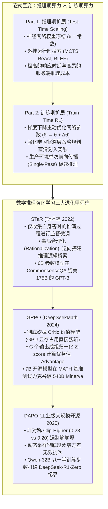
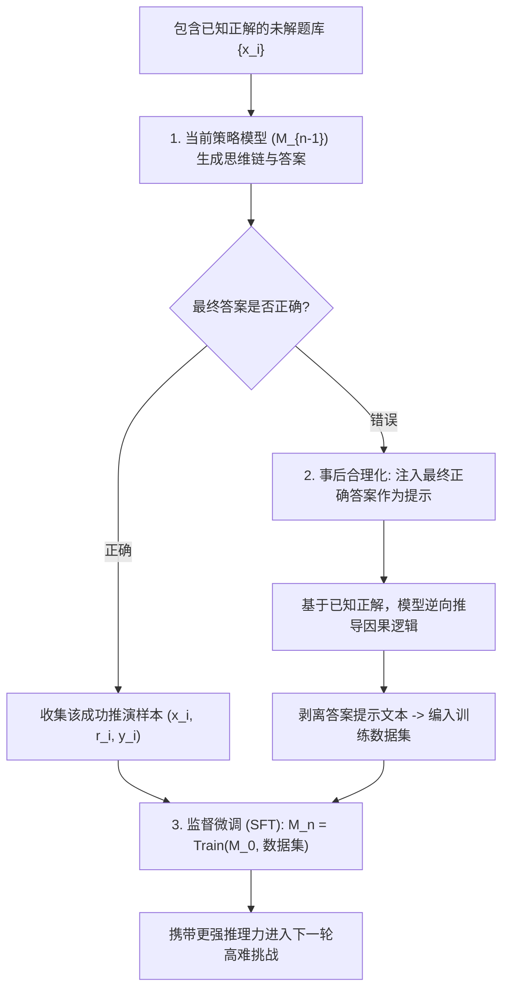
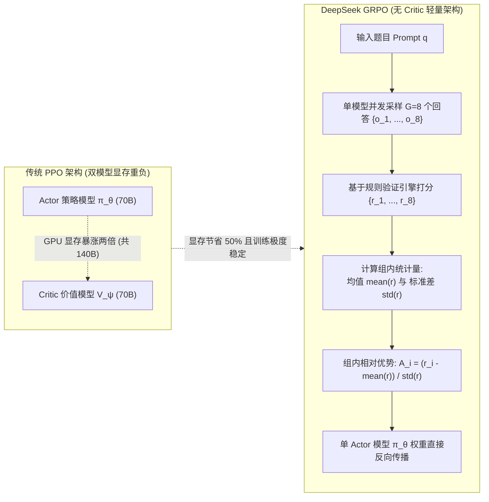

欢迎来到斯坦福大学2025秋季最新研究生课程——**CS329A: Self-Improving AI Agents（自主进化AI智能体）**的第六篇深度工程解析。

在第1讲至第5讲（Part 1: 基础理论篇）中，我们全面剖析了如何对已经预训练完成并处于冻结状态的模型，通过注入测试期算力（Test-time Compute）来榨取性能极限：构建 MCTS 搜索树、结合编译器报错自纠错，以及使用弱验证器集成过滤最优答案。

然而，我们必须直面残酷的数学现实：
给一个小学生在考场上多留十分钟思考，他能够证明大学高等微积分中的定理吗？如果模型本身的神经网络突触（权重参数，`\theta`）内部从未编码过该概念与推理逻辑，那么无论是采样一万次还是展开庞大的波束搜索，产出的都不是真正的智能，而仅仅是随机概率下的侥幸。

今天正式开启的 **Part 2: Training & Evolution（训练与自主进化篇，第6讲~第9讲）**，正是直击这一核心命题：
> **“与其在每次推理时耗费昂贵算力进行外挂搜索，为什么不在训练期（Train-time）倾注海量算力，将模型的神经突触与参数权重永久性地淬炼为顶尖推理专家？”**

在**第6讲**中，我们将深度解构破除人工标注枷锁、催生现代顶尖推理模型的**后训练强化学习（Post-Training RL）**三大核心支柱：
1. **用自我生成的推演过程教会自己的自举范式：** **STaR**（Self-Taught Reasoner, Zelikman et al., Stanford 2022）
2. **彻底消灭 Critic 价值网络的强化学习革命：** **DeepSeekMath 与 GRPO**（Group Relative Policy Optimization, 2024）
3. **千卡 GPU 集群实战工程秘诀：** **DAPO**（Decoupled Clip & Dynamic Sampling, 2025）



{/* truncate */}

---

### 1. 训练期扩展 vs 推理期扩展：算力前沿的战略重构

理解全球前沿实验室为何全面转向后训练强化学习（Post-Training RL），关键在于剖析总算力（FLOPs）的配置方程：

```text
Compute_Total = Compute_Train + Compute_Inference
```

1. **推理期扩展（Inference-Time Scaling）：** 参数向量 `\theta` 保持恒定。算力消耗在重复采样、束搜索与 MCTS 树展开上。虽然对特定复杂问题有效，但这将漫长的高延迟与巨额算力账单全盘转嫁给了生产环境的每一个终端用户。
2. **训练期扩展（Train-Time Scaling）：** 在训练阶段集中消耗海量算力，通过强化学习彻底更新参数 `\theta`：

```text
θ* = argmax_θ E_{x ~ D, y ~ π_θ(·|x)} [ R(x, y) ]
```

当智能体在强化学习过程中探索出高明的演绎推导范式时，反向传播会将该思维本能直接写入自注意力与前馈层的权重矩阵中。最终，在部署上线后，**模型无需任何沉重外挂搜索，在单次前向传播（Single Forward Pass）中即可展现出特级大师般的宏观布局直觉**。

---

### 2. 推理能力的自主进阶：STaR (Zelikman et al., Stanford 2022)

对大语言模型进行监督微调（SFT）需要数以万计由人类专家手写的“题目 ＋ 详细推演过程（Rationale） ＋ 最终答案”数据集。然而，雇佣数学博士或资深架构师编写海量高难解题过程，在成本上是不可承受的。

2022 年，斯坦福大学 Eric Zelikman 团队提出了一个极富洞察力的设想：
> **“只要我们能够机械化、确定性地验证最终答案的对错，为什么不让模型自己天马行空地构思中间推导步骤，筛选出那些碰巧得出正确答案的优秀逻辑链，回过头来重新训练自己？”**

这就是自主学习推演器 **STaR** 的诞生契机。



#### 数学严密性：对策略梯度的离散逼近

STaR 并非简单的工程小伎俩。从数学角度分析，它是**基于指示函数奖励 $`1(y_hat = y*)`$ 的策略梯度（Policy Gradient）离散逼近**：

```text
∇_θ J(θ) = ∑_i E_{r_hat, y_hat ~ π_θ(·|x_i)} [ 1(y_hat = y_i*) * ∇_θ log π_θ(r_hat, y_hat | x_i) ]
```

对于推导错误的样本，指示函数为 `\mathbb(1) = 0`，其梯度完全归零并被丢弃；仅对答对的样本执行对数似然极大化（MLE）梯度上升，从而牵引模型的概率分布稳步向经验证的严密逻辑链收敛。

#### 事后合理化（Rationalization）的妙招

这里面临一个致命痛点：“如果遇到模型原本能力绝对无法企及的高难题目，模型会持续输出错误，它该如何学到新知识？”

Zelikman 教授创新性地引入了**事后合理化（Rationalization）**：
1. 当模型给出错误答案时，系统在提示词末尾悄悄注入真正的答案作为提示：*“提示：本题正确答案为 42。请反向阐述为何结果必定是 42 的完整推导逻辑。”*
2. 获知结论后，模型便拥有了搭建逆向演绎逻辑桥梁的能力。
3. **最关键的魔法：** 在将这套自圆其说的推导过程存入训练集前，**系统将提示文本彻底剥除**：

```text
数据集条目: 输入 [ x_i ] ──► 目标思维链 [ r_逆向推演 ] + 最终答案 [ y_i* ]
```

模型在梯度下降阶段会“误以为”是自己在无提示状态下独立攻克了该难题，从而在神经网络中沉淀出攻克未知复杂问题的直觉模式。

#### 评测突破：6B 参数轻量模型逼平 175B 庞然大物
* 在常识推理评测（CommonsenseQA）中，仅有 **6B 参数的 GPT-J** 引入 STaR 迭代后，解题准确率从 60.0% 暴增至 **72.5%**。
* 这一成绩直接逼平了参数量高达近 30 倍的 **GPT-3 175B 定制微调版（73.0%）**。

---

### 3. Critic 价值模型的终结：DeepSeekMath 与 GRPO (2024)

如果说 STaR 是借用监督微调外壳实现的自举，那么真正拉开大规模在线强化学习帷幕的，是 2024 年春 DeepSeek 团队发布的 **DeepSeekMath 与 GRPO（Group Relative Policy Optimization，组相对策略优化）**。

#### 传统 PPO 架构的阿喀琉斯之踵

OpenAI 早期训练 ChatGPT 所使用的标准 PPO 算法，必须在 GPU 显存中并行挂载两个超大规模模型：
1. 生成动作 Token 的**策略网络（Actor, `\pi_\theta`）**；
2. 预测每一时刻状态预期收益的**价值网络（Critic, `V_\psi`）**。

如果要训练一个 70B 的 Actor，就必须配备一个 70B 的 Critic，导致显存直接翻倍。
更为致命的是，在数学与编程等长程推理任务中，往往经过数千 Token 的推导后才能在末尾得到一个对或错的标量（$+1$ 或 $-1$）。**在如此稀疏的信号下，想让 Critic 模型准确预估中间某一个 Token 的精确分值，在数学上极度不稳定，极易导致策略崩塌**。

#### GRPO 的破局构想：“彻底移除 Critic”

DeepSeek 团队提出了化繁为简的颠覆性设计：
> **“为什么非要耗费数十亿参数维护一个价值模型？针对一个提问 `q`，让当前模型直接并发采样 `G` 个候选回答 ``(o_1, ..., o_G)``。直接计算这 `G` 个输出得分的组内均值和标准差，通过 Z-score 标准化，这组相对排名不就是最纯粹、最无偏的优势值（Advantage）吗！”**



#### GRPO 的严谨数学目标函数

GRPO 在没有额外价值模型辅助的情况下，通过参考基线模型 $`pi_ref`$ 施加 KL 散度约束，优化策略模型 `\pi_\theta`：

```text
J_GRPO(θ) = E_{q, {o_i}_{i=1}^G} [ 
    (1 / G) * ∑_{i=1}^G (1 / |o_i|) * ∑_{t=1}^{|o_i|} {
        min(
            ( π_θ(o_{i,t}) / π_old(o_{i,t}) ) * A_hat_{i,t},
            clip( π_θ(o_{i,t}) / π_old(o_{i,t}), 1 - ε, 1 + ε ) * A_hat_{i,t}
        )
    } - β * D_KL( π_θ || π_ref )
]
```

每一个候选回答 `o_i` 中各 Token 的优势值 `A_hat_{i,t}`，仅由**组内统计量**简洁导出：

```text
A_hat_{i,t} = r_tilde_i = ( r_i - mean({r_1, ..., r_G}) ) / ( std({r_1, ..., r_G}) + δ )
```

#### 信用分配方式：结果监督 vs 过程监督
1. **结果监督（Outcome Supervision）：** 若最终答案正确，赋予 $r_i = +1$，反之赋予 $-1$。组内归一化得到的标量优势值 `r_tilde_i` 被均等地赋值给该回答内的每一个 Token。
2. **过程监督（Process Supervision）：** 针对每个推导步骤给予局部奖励，将特定 Token 之后未来所有步骤的加权奖励和作为该 Token 的优势值进行回传。

#### 战绩：7B 开源小模型超越 540B 巨兽
* `DeepSeekMath-Base 7B` 仅凭 120B 数学语料预训练，**便超越了谷歌 540B 的超大模型 Minerva**。
* 叠加上 GRPO 强化学习后，MATH 评测成绩从 46.8% 跃迁至 **51.7%**，成为开源界首个无需任何外挂计算器即可突破 MATH 50% 大关的纯 7B 模型。
* 在 64 路自我一致性（Self-Consistency）加持下，正确率更是飞跃至 **60.9%**。

---

### 4. 走向千卡 GPU 工业实战：DAPO (2025)

然而，当学术界尝试将论文公式原封不动地搬进 AIME 2024 等高难竞赛时，却遭遇了普遍的挫败：
* DeepSeek-R1-Zero 在 AIME 2024 上拿下 47 分，而开源社区用朴素 GRPO 训练的 Qwen2.5-32B 却**长期被锁死在 30 分出头**。

2025 年 3 月发布的 **DAPO（解耦截断与动态采样策略优化）** 彻底揭示了大规模强化学习的四大工程定海神针：

```text
朴素 GRPO (30分) 
  ──► + 长度过滤 (36分) 
  ──► + Clip-Higher (38分) 
  ──► + Token 级损失归一化 (42分) 
  ──► 完整版 DAPO (50分, 全面超越 DeepSeek-R1-Zero!)
```

#### 秘诀 1：非对称截断 Clip-Higher ($`eps_low = 0.20, eps_high = 0.28`$)
* **症结：** PPO 对称的 `\pm 0.2` 截断极大挫伤了探索欲。若模型探索出了一个先验概率仅有 0.01 的罕见创新推理词，由于上限被锁死在 $1 + 0.2 = 1.2$ 倍，其提升后概率仅为 0.012；而原概率为 0.9 的平庸词汇却能轻松爬升。
* **后果：** 模型彻底放弃深思熟虑，陷入**熵崩塌（Entropy Collapse）**，只敢输出毫无建设性的短平快套话。
* **DAPO 解法：** 下限保持 $`eps_low = 0.20`$ 坚决惩罚劣质推演，但将上限大幅上调至 **$`eps_high = 0.28`$**（提升 40%），给予高价值创新探索 Token 爆发性增长的通道。

#### 秘诀 2：动态采样（Dynamic Sampling）
* **症结：** 题目过于简单导致 $G$ 个候选**全数做对**，或题目过于刁钻导致 $G$ 个候选**全军覆没**。
* 两种情况下，组内标准差 `formula`，导致优势值全为 0。**数千块顶级 GPU 疯狂推演，最终算出的梯度却是一堆无意义的 0，训练陷入空转**。
* **DAPO 解法：** 动态过滤批次，严密锁定满足 `0 < Correct Rollouts < G` 的题目，即**仅保留那些“既有成功经验又有失败教训、具备最高信息熵”的试题**，确保每一步反向传播都带有 100% 高纯度有效梯度。

#### 秘诀 3：Token 级损失归一化（Token-Level Loss）
传统 GRPO 采用样本级平均，这导致 2000 Token 长文里的单个错误，与 50 Token 短文里的单个错误被极其不公地稀释。DAPO 将损失按全批次实际 Token 总数（`\sum_i |o_i|`）进行严格归一化，断绝了模型靠注水扩写来逃避惩罚的可能。

#### 秘诀 4：超长文本软平滑惩罚（Overlong Reward Shaping）
当模型深入思考时，偶发性触碰到上下文上限（如 16,384 Token）发生截断（Truncation）。若机械地判为 $-1$ 负分，将毁灭模型正在萌发的深度长程推理力。DAPO 在极限前 4096 Token 区间施加**线性软衰减**，引导模型自主拿捏篇幅并优雅结题。

---

### 5. 企业级架构设计：大规模分布式 GRPO/DAPO 训练流水线

在工业生产环境中调度千卡集群进行推理强化学习，必须采用推训解耦的高并发拓扑架构：

```text
┌────────────────────────────────────────────────────────────────────────┐
│             企业级分布式 GRPO/DAPO 强化学习基础设施                    │
├────────────────────────────────────────────────────────────────────────┤
│                                                                        │
│  [ 严密教研题库 (符号数学 / 代码编译器 / 确定性测试脚手架) ]           │
│          │                                                             │
│          ▼                                                             │
│  ┌──────────────────────────────────────────────────────────────────┐  │
│  │                    动态打包与高纯度采样引擎                      │  │
│  │  • 难度动态调度器: 实时过滤全对/全错的零方差废弃批次             │  │
│  │  • 依据上下文长度实施多桶箱打包 (Bin-Packing)                   │  │
│  └───────────────────┬──────────────────────────────────────────────┘  │
│                      │ 纯净训练批次                                    │
│                      ▼                                                 │
│  ┌──────────────────────────────────────────────────────────────────┐  │
│  │                   vLLM / TensorRT-LLM 独立推理集群               │  │
│  │  • 高并发分布式采样节点 (G=8 组内异步展开)                       │  │
│  │  • 依托 PagedAttention 显存优化技术实现海量 KV 缓存调度          │  │
│  └───────────────────┬──────────────────────────────▲───────────────┘  │
│                      │ 采样生成轨迹 {o_1..o_G}      │ 定期同步         │
│                      ▼                              │ 权重参数 θ       │
│  ┌──────────────────────────────────────────────────┴───────────────┐  │
│  │                   确定性规则验证与评估沙箱                       │  │
│  │  • Docker/gVisor 隔离环境运行 Python REPL 及 SymPy 符号代数验证 │  │
│  │  • 严格校验思考格式 `<think> ... </think>` 标签完整性            │  │
│  │  • 基于组内统计学实施优势值标准化: A_i = (r - μ) / σ             │  │
│  └───────────────────┬──────────────────────────────────────────────┘  │
│                      │ Token 优势值流                                  │
│                      ▼                                                 │
│  ┌──────────────────────────────────────────────────────────────────┐  │
│  │                   Megatron-LM / DeepSpeed 梯度训练集群           │  │
│  │  • 纯粹 Actor 策略网络反向传播 (无 Critic 节约 50% 显存)          │  │
│  │  • 非对称 Clip-Higher 梯度优化引擎 (ε_high = 0.28, ε_low = 0.20) │  │
│  │  • 结合 FlashAttention-3 执行 Token 级归一化损失优化             │  │
│  └──────────────────────────────────────────────────────────────────┘  │
│                                                                        │
└────────────────────────────────────────────────────────────────────────┘
```

#### 工业生产核心三大法则
1. **彻底将人类主观评分移出强化学习循环：** 仅在具备确定性判据的任务（编译器、数学符号证明、单元测试）上使用强化学习，切忌将模糊的人类主观偏好用于逻辑推理强化。
2. **推理推断与梯度训练物理集群强行解耦：** 杜绝在同一组显存中混用生成推理（vLLM）与反向传播（Megatron-LM），通过专用 RDMA 网络传输交互轨迹，最大化吞吐性能。
3. **格式硬约束机制：** 将思维标签 `<think>` 的合规性作为前置奖励规则，彻底杜绝模型投机取巧跳过推导直接蒙猜答案。

---

### 6. 资深架构师核心 Q&A

**Q: GRPO 既然去掉了 Critic，为什么目标函数中依然需要 KL 散度约束项？**
**A:** KL 散度项（`\beta `D_KL`(\pi_\theta \parallel `pi_ref`)`）是防止**奖励作弊（Reward Hacking）**与灾难性遗忘的护栏。没有这个针锚，强化学习策略会在短期内钻营判题规则的漏洞，例如狂吐重复标点或无意义语法来欺骗解析器。不过，在想要激发涌现长程思考的冷启动初期（如 DeepSeek-R1-Zero），研究者往往有意将 `\beta \to 0` 彻底放开限制，待其摸索出深思熟虑形态后再重新收紧。

**Q: STaR 在事后合理化（Rationalization）中给模型提供了正确答案，不会导致模型学会作弊依赖吗？**
**A:** 关键在于**数据生成环节与权重反向传播环节的物理割裂**。答案提示仅在模型逆向构建因果逻辑的瞬间存在。在将该推演样本编入 SFT 训练集前，**提示词内的答案早已被物理剔除**。在反向传播看来，模型是在无任何外力下独立完成了这一精妙推演，因此学到的是真正能够在未知环境下通用的逆向演绎直觉。

---

### 7. 核心总结与技术要点

1. **训练期扩展的必然性：** 运行时搜索无法凭空创造突触中本不存在的认知。训练期扩展利用强化学习将战略推导本能永久性沉淀在权重之中。
2. **自我进化的闭环：** STaR 证明模型无需人类撰写复杂过程，通过正确轨迹过滤与事后合理化，6B 小模型即可比肩 175B 旗舰大模型。
3. **砍掉 Critic 的工业突破：** DeepSeek GRPO 移除了数十亿参数的价值网络，节约了 50% 显存，依托组内相对 Z-score 确立了稳定的优势值估计。
4. **大规模工程定海神针：** DAPO 借助非对称 Clip-Higher（`\epsilon=0.28`）、动态采样与 Token 级损失，消解了熵崩塌难题，仅用一半算力步数即超越 DeepSeek-R1-Zero。

---

### 斯坦福 CS329A 下期预告：
在接下来的**第7讲**中，我们将由解决既定人类试卷，迈向自主从事科学发现与技术探索的无界新大陆：
**《Lecture 7: Open-Ended Evolution: ADAS, The AI Scientist, AlphaEvolve 与自我进化的开放式演进》**
我们将探究 AI 如何自主提出科研假说、自主发明全新机器学习架构，并撰写投递顶级学术论文。敬请期待！