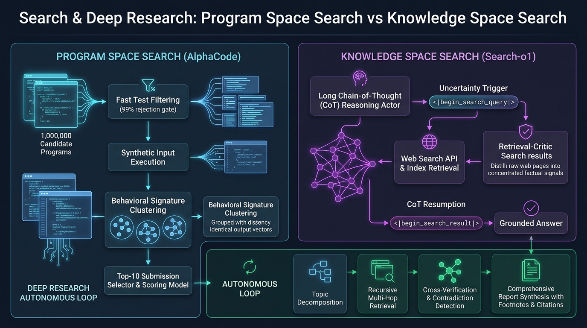

# Stanford CS329A (Ép 8) : Recherche et Deep Research — Exploration dans l'Espace des Programmes (AlphaCode) et dans l'Espace des Connaissances avec Search-o1

Dans l'ingénierie logicielle comme dans la recherche scientifique de pointe, la véritable maîtrise ne s'évalue jamais à la seule mémorisation passive. Même l'architecte logiciel le plus réputé ne produit pas un système distribué hautement concurrent de plusieurs milliers de lignes sans aucune anomalie dès sa première frappe. De même, aucun lauréat du prix Nobel ne formule la synthèse d'un principe actif novateur à partir de sa seule mémoire biologique, sans consulter les publications et brevets existants.

La force de l'intelligence humaine réside dans sa capacité d'exploration méthodique :
> **« L'aptitude à explorer des millions d'hypothèses plausibles, à élaguer rigoureusement les impasses, à interroger activement des réservoirs de connaissances externes pour combler des lacunes cognitives et à synthétiser des signaux disparates en déductions étayées. »**

Dans cette huitième leçon du cours **Stanford CS329A : Self-Improving AI Agents (Agents d'IA Auto-Évolutifs)**, nous analysons comment le concept de **Recherche (Search)** décuple les performances de l'intelligence artificielle sur deux axes complémentaires :
1. **Recherche dans l'Espace des Programmes (Program Space Search) :** Échantillonnage massif et regroupement par signatures comportementales à l'exécution avec **AlphaCode Competitive Programming (Programmation Compétitive AlphaCode)** de Google DeepMind.
2. **Recherche dans l'Espace des Connaissances (Knowledge Space Search) :** Entrelacement de raisonnements longs et d'extraction active d'informations via **Search-o1 Autonomous Investigation (Enquête Autonome Search-o1)** et **Self-Reflective Search Loops (Boucles de Recherche Autoréflexives)**.
3. **Pipelines d'Agents de Deep Research (Deep Research Workflows) :** L'architecture de l'**Information Synthesis Agent (Agent de Synthèse d'Informations)**, capable de décomposer des requêtes complexes, d'explorer le web de façon récursive et de rédiger des rapports techniques sourcés.

{/* truncate */}



---

## 1. La Double Nature de la Recherche Agentique

En IA classique, la recherche était confinée à des espaces discrets (comme la recherche de chemin A* ou le minimax aux échecs). Chez les agents autonomes modernes, elle s'étend sur deux fronts majeurs : l'espace probabiliste continu des séquences de tokens et l'environnement ouvert du web mondial :

```
                          ┌─────────────────────────────────────┐
                          │   Les Deux Frontières de la Recherche│
                          └──────────────────┬──────────────────┘
                                             │
             ┌───────────────────────────────┴───────────────────────────────┐
             ▼                                                               ▼
┌─────────────────────────────────────────┐     ┌─────────────────────────────────────────┐
│     Recherche dans l'Espace des Codes   │     │  Recherche dans l'Espace des Connaissances│
├─────────────────────────────────────────┤     ├─────────────────────────────────────────┤
│ • AlphaCode 1 & 2 (Google DeepMind)     │     │ • Search-o1 et RAG Agentique            │
│ • Récompenses binaires rares (0 ou 1)   │     │ • Connaissances web ouvertes et infinies│
│ • 1 000 000 de programmes candidats     │     │ • Détection des lacunes cognitives      │
│ • Signatures comportementales runtime   │     │ • Filtrage "Reason-in-Documents"        │
│ • Regroupement d'invariants de sortie   │     │ • Enquête récursive et rapports sourcés │
└─────────────────────────────────────────┘     └─────────────────────────────────────────┘
```

Le défi commun réside dans le **Compromis Précision-Rappel (Precision-Recall Tradeoff) sous Contrainte de Calcul** :
- En génération de code, échantillonner des millions de solutions garantit une forte couverture théorique ($pass@k$), mais les règles officielles limitent les soumissions à 10 tentatives ($10@k$).
- En recherche documentaire ouverte, interroger le web draine des milliers de tokens de texte HTML brut, de publicités et d'affirmations divergentes qui, injectées sans épuration, polluent le contexte d'attention du modèle (Context Pollution).

---

## 2. Recherche dans l'Espace des Programmes : AlphaCode (Science, 2022)

Les concours de programmation sur Codeforces mettent à l'épreuve l'élite des ingénieurs. Les épreuves exigent de formaliser mathématiquement des énoncés en langage naturel et de coder en C++ des algorithmes respectant des limites strictes de temps (`O(N \log N)`) et de mémoire (`256 256 MB`) face à des jeux de tests masqués. Une simple erreur d'indice entraîne un verdict impitoyable de `Wrong Answer`.

**AlphaCode** de Google DeepMind a surmonté cet obstacle en démontrant qu'un calcul massif d'inférence combiné à un clustering comportemental permettait à une IA d'intégrer le top 54 % des compétiteurs humains.

```
                  [Énoncé du Problème en Langage Naturel]
                                     │
                                     ▼
           1. Échantillonnage Massif et Diversifié (1 000 000 de Codes C++/Python)
              (Tags de difficulté aléatoires, DP/Graphes ; Température : 0,25)
                                     │
                                     ▼
           2. Filtrage Primaire par les Tests d'Exemple (Sample Tests)
              (Exécution sur les cas de base -> élimine >99 % du code défectueux)
                                     │
                                     ▼
           3. Entrées Synthétiques & Clustering par Signatures de Comportement
              (Génération de 10 entrées aléatoires ; regroupement par vecteur de sortie)
                                     │
                                     ▼
           4. Sélection des Représentants des 10 Plus Grands Clusters
              (Extraction d'un candidat d'élite par cluster principal)
                                     │
                                     ▼
                    [10 Soumissions Officielles au Concours]
                 (Classement supérieur à 54,3 % de 5 000+ experts humains)
```

### La Puissance des Signatures de Comportement (Behavior Signatures)
Comment isoler, parmi 5 000 programmes ayant réussi les exemples initiaux, les 10 plus susceptibles de valider l'ensemble des cas de test cachés ?

Se fier à la ressemblance syntaxique (scores BLEU ou plongements CodeBERT) est voué à l'échec :
- Deux programmes identiques à 99 % peuvent diverger sur un opérateur de comparaison (`<` contre `<=`), transformant un algorithme optimal en boucle infinie.
- Inversement, une implémentation itérative et une approche récursive peuvent différer totalement sur le plan syntaxique tout en matérialisant exactement la même logique mathématique valide.

DeepMind a établi que **le code doit être évalué selon son comportement effectif** :
1. Un modèle auxiliaire conçoit 10 entrées de test valides et aléatoires.
2. Les 5 000 programmes exécutent ces 10 entrées au sein d'un bac à sable sécurisé.
3. Chaque programme se voit attribuer un vecteur de signature correspondant à ses sorties :
```text
Signature(P_i) = [ P_i(input_1), P_i(input_2), ..., P_i(input_10) ]
```
4. **L'Invariant Fondamental :** Les programmes bogués génèrent des erreurs erratiques et se dispersent ; en revanche, **tous les programmes dotés de la bonne logique algorithmique renvoient exactement les mêmes sorties pour des entrées identiques, formant ainsi le cluster prédominant**.
5. AlphaCode retient un représentant issu de chacun des 10 plus grands clusters pour la soumission finale.

### AlphaCode 2 : Efficacité Échantillonnaire Décuplée par 10 000 grâce à Gemini
Fin 2023, DeepMind a dévoilé **AlphaCode 2**, articulé autour de Gemini Pro :
- Intégration d'un **Modèle de Notation (Scoring Model)** spécialisé pour départager les programmes au sein des clusters selon leur concision et leur complexité algorithmique.
- Progression du taux de résolution de 25 % à **43 %**, atteignant le **85e percentile (niveau Candidate Master)**.
- **Révélation Majeure :** AlphaCode 2 a égalé les résultats d'AlphaCode 1 avec seulement **100 échantillons contre 1 000 000**, soit **un gain d'efficacité de 10 000x**, attestant qu'une capacité de raisonnement accrue réduit drastiquement l'espace de recherche nécessaire.

---

## 3. Recherche dans l'Espace des Connaissances : Search-o1 (2025)

En observant le déroulement des chaînes de pensée longues (Long CoT comme chez o1 ou DeepSeek-R1), on constate que des marqueurs d'incertitude (*« peut-être »*, *« attends »*, *« probablement »*) surviennent en moyenne **30,4 fois par question scientifique complexe**. Les architectures RAG statiques n'interrogent le web qu'au tout début de la requête, restant incapables de résoudre une incertitude factuelle survenant à la 8e étape d'un raisonnement.

**Search-o1** a introduit le paradigme de la **Récupération Dynamique Autoréflexive** :

```mermaid
sequenceDiagram
    autonumber
    participant LLM as Acteur de Raisonnement (QwQ-32B)
    participant Engine as Contrôleur de Recherche
    participant Web as API de Recherche Web
    participant Critic as Critique de Récupération (Reason-in-Docs)

    LLM->>LLM: Progression du raisonnement Long CoT...
    Note over LLM: Lacune factuelle : "Quelle est la séquence exacte du récepteur CXCR4 ?"
    LLM->>Engine: Émission de balise : <|begin_search_query|> human CXCR4 sequence <|end_search_query|>
    Note over LLM: Pause du raisonnement (État préservé dans le KV Cache)
    Engine->>Web: Requête web en temps réel
    Web-->>Engine: 10 documents HTML bruts (50 000 tokens)
    Engine->>Critic: Transmission de l'HTML brut + Contexte en cours
    Critic->>Critic: Filtrage des éléments superflus, extraction du fait clé (Reason-in-Docs)
    Critic-->>Engine: "CXCR4 est un GPCR de 352 acides aminés ; le résidu 28 lie le ligand."
    Engine->>LLM: Injection du fait : <|begin_search_result|> Synthèse factuelle <|end_search_result|>
    Note over LLM: Reprise du raisonnement
    LLM->>LLM: Finalisation de la déduction sur une base factuelle validée
```

### Les Deux Piliers de Search-o1
1. **Acteur de Raisonnement (Reasoning-Actor) :** Dès que le modèle détecte une incertitude dans ses paramètres internes, il suspend son exécution via une balise dédiée (`<|begin_search_query|>`) et fige son cache d'attention.
2. **Critique de Récupération (« Reason-in-Documents ») :** Évite d'insérer des dizaines de milliers de tokens de texte brut dans le raisonnement principal. Un modèle critique secondaire parcourt les pages web et **condense strictement les 2 ou 3 lignes d'informations indispensables** au pas de raisonnement immédiat.

```text
Performances sur GPQA Diamond (Raisonnement Scientifique de Niveau Doctorat) :
========================================================================================
Architecture                 Précision Globale  Chimie          Biologie        Physique
----------------------------------------------------------------------------------------
Experts Humains (Titulaires de PhD) 65,4 %       48,9 %          37,2 %          39,9 %
Modèle de Raisonnement (QwQ-32B)   58,1 %       45,2 %          41,5 %          43,2 %
Agent RAG Statique Standard        61,6 %       51,0 %          44,8 %          47,0 %
Search-o1 (Recherche CoT Active)   63,6 % (+5,5p) 56,4 % (+7,5p) 50,2 % (+13,0p) 52,8 % (+12,9p)
========================================================================================
```

Sur le banc GPQA Diamond, Search-o1 a nettement surpassé le RAG conventionnel tout en **dépassant la moyenne des docteurs spécialistes humains en chimie, biologie et physique**.

---

## 4. Pipeline des Agents de Deep Research

En associant le filtrage par cluster d'AlphaCode et la recherche en cours d'inférence de Search-o1, on obtient l'architecture des agents modernes de **Deep Research Agent LLM** :

```
                       [Question de Recherche Complexe]
                                      │
                                      ▼
                   ┌──────────────────────────────────────┐
                   │    Décomposition Hiérarchique du Plan│
                   │ (Fractionnement en 5 à 8 sous-thèmes)│
                   └──────────────────┬───────────────────┘
                                      │
          ┌───────────────────────────┼───────────────────────────┐
          ▼                           ▼                           ▼
┌──────────────────┐        ┌──────────────────┐        ┌──────────────────┐
│  Sous-Hypothèse A│        │  Sous-Hypothèse B│        │  Sous-Hypothèse C│
│  Recherche Multihop│      │  Recherche Multihop│      │  Recherche Multihop│
└─────────┬────────┘        └─────────┬────────┘        └─────────┬────────┘
          │                           │                           │
          └───────────────────────────┼───────────────────────────┘
                                      │
                                      ▼
                   ┌──────────────────────────────────────┐
                   │   Critique de Cohérence & Sources    │
                   │(Détection des contradictions croisées│
                   └──────────────────┬───────────────────┘
                                      │
                                      ▼
                   ┌──────────────────────────────────────┐
                   │  Synthèse de Rapport Argumenté       │
                   │(15 pages étayées par des liens sources)│
                   └──────────────────────────────────────┘
```

### Les Quatre Phases de la Recherche Autonome Approfondie
1. **Décomposition des Hypothèses :** Transformation d'un mandat global en sous-interrogations techniques spécifiques.
2. **Exploration Récursive Multidirectionnelle :** Navigation au sein des références citées dans les documents initiaux pour remonter aux sources primaires (brevets, données brutes).
3. **Résolution des Divergences :** Mise en balance des annonces promotionnelles et des mesures indépendantes avec indication explicite des marges d'incertitude.
4. **Attribution Traçable :** Association systématique d'une URL de référence à chaque énoncé factuel pour supprimer toute hallucination.

---

## 5. Tableau Comparatif des Paradigmes de Recherche

```text
=========================================================================================================
Dimension              RAG Statique Classique         AlphaCode (Espace Programme) Search-o1 (Espace Cognitif)
---------------------------------------------------------------------------------------------------------
Espace d'Exploration   Base Vectorielle Documentaire  Séquences de Code Brutes    Web Mondial et APIs en Ligne
Déclenchement          Unique au lancement            Inférence par tirage massif Détection interne du doute
Critère de Sélection   Similarité Cosinus Top-K       Signatures comportementales Distillation Reason-in-Docs
Ancrage de Vérification Distance d'Embedding          Résultat d'exécution réels  Rigueur logique et croisement
Faiblesse Principale   Dérive lors d'étapes longues   Coût de calcul considérable Latence des accès réseau
=========================================================================================================
```

---

## 6. Questions & Réponses Techniques Approfondies

### Q1 : Pourquoi le regroupement par signatures de comportement surpasse-t-il l'analyse syntaxique dans AlphaCode ?
La justesse logique d'un code ne se déduit pas de son apparence lexicale. Deux programmes aux arbres syntaxiques (AST) presque superposables peuvent produire des résultats opposés en raison d'une simple inversion d'opérateur. À l'inverse, des syntaxes récursives et itératives dissemblables peuvent être mathématiquement équivalentes. Mesurer le **vecteur effectif des valeurs de sortie** permet de rassembler sans équivoque tous les codes fonctionnellement corrects dans un même cluster dominant.

### Q2 : Pourquoi le mécanisme « Reason-in-Documents » est-il indispensable face aux documents web bruts ?
C'est la parade contre la **dispersion attentionnelle (Attention Distraction)**. Un modèle de raisonnement maintient une tension cognitive étroite sur des milliers de tokens. Si l'on déverse brutalement des pages web entières avec leurs bandeaux et menus parasites, l'attention se dissipe et le fil de la déduction se rompt. Un agent critique intermédiaire extrait la **substance factuelle épurée (2 à 3 lignes)** pour préserver la netteté du raisonnement.

---

## Conclusion et Prochaine Étape

La recherche permet aux modèles de langage de passer du statut de générateurs fermés à celui d'explorateurs actifs. **AlphaCode** a illustré la maîtrise de la programmation compétitive via l'exploration dans l'espace des programmes ; **Search-o1** et **Deep Research** prouvent que la recherche d'informations en cours de déduction permet de franchir le seuil d'expertise doctorale.

Dans la **Leçon 9**, nous conclurons la Partie 2 (Entraînement et Évolution) avec une vue d'ensemble : **Post-Training Evolution — De l'Agent Conversationnel à la Flotte Autonome (SFT, RLHF, Tool Grounding et Alignement des Systèmes)**.

---

### Points Clés
- **Efficacité de l'Exploration Calculatoire :** L'échantillonnage large couplé à un filtrage strict (AlphaCode) surpasse la génération directe à tir unique.
- **Primauté du Comportement sur la Forme :** La signature d'un programme s'évalue à ses résultats d'exécution, seul critère pertinent pour identifier les algorithmes valides.
- **Recherche Dynamique en Cours de Déduction :** Combler les lacunes factuelles pendant la réflexion (Search-o1) constitue le standard incontournable pour le raisonnement de haut niveau.