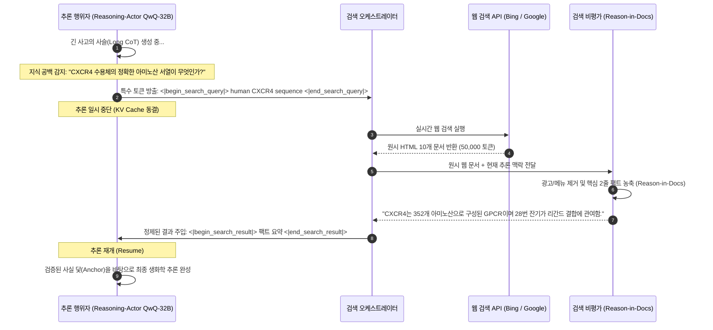

# 스탠포드 CS329A (8강): 검색과 딥 리서치 — 프로그램 공간 탐색(AlphaCode)과 Search-o1의 지식 공간 탐색

소프트웨어 엔지니어링이나 최첨단 학술 연구 현장에서 인간 전문가의 진정한 역량은 단 한 번의 암기력으로 증명되지 않습니다. 아무리 뛰어난 전설적인 수석 개발자라도 수천 줄에 달하는 복잡한 분산 동시성 시스템을 첫 번째 타이핑에서 단 하나의 버그도 없이 완성할 수는 없습니다. 노벨상을 수상한 석학이라도 복잡한 유전자 치료제의 분자 구조나 각국의 최신 조세 법안을 검토할 때 머릿속 기억에만 의존해 논문을 쓰지 않습니다.

인간 지능의 진정한 힘은 체계적인 탐색 능력에서 발현됩니다:
> **"수백만 개의 잠재적 가설을 폭넓게 탐색하고(Search), 불필요한 노이즈를 과감히 가지치기하며(Filter), 추론 도중 발생하는 지식 공백을 외부 데이터베이스에서 실시간으로 보충하여(Retrieve), 분산된 정보들을 엄밀한 통찰로 종합해 내는 역량."**

오늘 **스탠포드 CS329A: Self-Improving AI Agents (스스로 발전하는 AI 에이전트)** 제8강에서는 '검색(Search)'이라는 개념이 어떻게 두 개의 서로 다른 차원에서 인공지능의 성능을 폭발적으로 도약시키는지 살펴봅니다:
1. **프로그램 공간 탐색 (Program Space Search):** 수백만 개의 코드 후보를 생성하고 런타임 행동 시그니처로 압축하는 **AlphaCode Competitive Programming(알파코드 경쟁 프로그래밍)**
2. **지식 공간 탐색 (Knowledge Space Search):** 장거리 생각의 사슬(Long CoT) 도중 능동적으로 검색을 트리거하는 **Search-o1 Autonomous Investigation(자율 탐사)** 및 **Self-Reflective Search Loops(자가 반성적 검색 루프)**
3. **심층 리서치 에이전트 워크플로 (Deep Research Workflows):** 복잡한 질의를 다단계 하위 가설로 분해하고 수백 편의 웹 문서를 정독하여 전문 보고서를 합성하는 **Information Synthesis Agent(정보 종합 에이전트)**의 아키텍처

{/* truncate */}


---

## 1. 에이전틱 탐색의 이중 지평 (The Dual Nature of Search)

전통적인 고전 인공지능에서 탐색은 격자 지도(A* 탐색)나 체스판(Minimax)과 같은 이산적인 상태 공간에 국한되었습니다. 그러나 현대의 자율 에이전트 아키텍처에서 탐색은 연속적인 토큰 확률 공간과 무한히 열린 외부 웹 환경이라는 두 축으로 확장되었습니다:

```
                          ┌─────────────────────────────────────┐
                          │     에이전틱 탐색의 이중 지평       │
                          └──────────────────┬──────────────────┘
                                             │
             ┌───────────────────────────────┴───────────────────────────────┐
             ▼                                                               ▼
┌─────────────────────────────────────────┐     ┌─────────────────────────────────────────┐
│         프로그램 공간 탐색 (Code)       │     │         지식 공간 탐색 (Knowledge)      │
├─────────────────────────────────────────┤     ├─────────────────────────────────────────┤
│ • AlphaCode 1 & 2 (Google DeepMind)     │     │ • Search-o1 & Agentic RAG               │
│ • 극도로 희소한 보상 (Pass / Fail 이진) │     │ • 무한한 웹 지식과 동적 질의 생성       │
│ • 1,000,000개 후보 코드 대규모 병렬 생성│     │ • 추론 중간 지식 공백(Uncertainty) 감지 │
│ • 런타임 행동 시그니처 (Output Vector)  │     │ • Reason-in-Documents 컨텍스트 농축    │
│ • 동일 정답 코드의 거대 클러스터링 형성 │     │ • 재귀적 심층 탐색 및 리포트 종합 합성  │
└─────────────────────────────────────────┘     └─────────────────────────────────────────┘
```

두 영역 모두에서 핵심 과제는 **한정된 연산 예산 하에서의 정밀도-재현율 트레이드오프(Precision-Recall Tradeoff)**입니다:
- 프로그램 합성에서는 수백만 개의 코드를 뽑으면 정답이 포함될 확률($pass@k$)은 매우 높아지지만, 실제 공식 대회에서는 오직 10번($10@k$)의 제출 기회만 주어집니다.
- 오픈엔드 심층 조사에서는 웹 검색을 통해 수만 줄의 원시 HTML, 광고, 상충되는 주장이 쏟아져 들어오며, 이를 무분별하게 모델 컨텍스트에 욱여넣으면 추론의 흐름이 완전히 교란(Context Pollution)됩니다.

---

## 2. 프로그램 공간 탐색: AlphaCode (Science 표지 논문, 2022)

Codeforces와 같은 전 세계 알고리즘 경시대회 문제는 인간 프로그래머에게도 지적 극한의 도전입니다. 문제를 읽고 수식을 유도하여 엄격한 시간 복잡도(`O(N \log N)`)와 메모리 제한(`256 256 MB`)을 통과하는 C++ 코드를 짜야 합니다. 부등호 하나만 잘못 써도 채점 서버는 가차 없이 `Wrong Answer`를 띄웁니다.

구글 딥마인드의 **AlphaCode**는 이 불가능해 보이던 문제를 순수한 **'대규모 추론 연산 탐색(Scale Inference Search)'**으로 정복했습니다.

```
                  [자연어 알고리즘 문제 명세]
                              │
                              ▼
        1. 대규모 다양성 샘플링 (문제당 1,000,000개 C++/Python 코드 생성)
           (무작위 난이도 태그, DP/Greedy/Graph 분류, 온도 0.25)
                              │
                              ▼
        2. 기본 예제 테스트(Sample Tests) 기반 1차 필터링
           (지문에 주어진 입출력 실행 -> 문법 오류 및 99% 무효 코드 제거)
                              │
                              ▼
        3. 합성 입력 생성 & 행동 시그니처(Behavior Signature) 클러스터링
           (무작위 유효 입력 10개 실행 -> 출력 결과 벡터별 군집화)
                              │
                              ▼
        4. 상위 10개 클러스터 대표 코드 추출
           (가장 거대한 상위 10개 클러스터에서 각 1개씩 최우수 후보 엄선)
                              │
                              ▼
               [공식 대회에 최종 10회 제출]
               (인간 참가자 5,000명 중 상위 54.3% 중위권 돌파)
```

### 행동 시그니처(Behavior Signature) 클러스터링의 천재적 원리
기본 예제 테스트를 통과하고 살아남은 5,000개의 코드 중에서, 수천 개의 숨겨진 비공개 테스트 케이스(Hidden Test Suite)를 모두 통과할 진짜 정답 코드 10개를 어떻게 골라낼 수 있을까요?

코드의 문법적 유사도(BLEU나 CodeBERT 임베딩)를 기반으로 묶는 것은 완전히 실패합니다:
- 겉모습이 99% 똑같아도 비교 연산자 하나(`<` vs `<=`) 차이로 무한 루프에 빠지는 치명적인 오답 코드가 존재합니다.
- 반대로 한 코드는 반복문(Iterative)으로 짜고 다른 코드는 재귀(Recursive)로 짜서 겉모습이 180도 달라도, 내부 수학적 알고리즘은 완벽히 동일한 정답일 수 있습니다.

딥마인드는 **"코드는 말이 아니라 행동으로 평가해야 한다"**는 불변의 진리를 적용했습니다:
1. 별도의 테스트 생성 모델을 이용해 해당 문제 규격에 맞는 유효한 무작위 입력 10개를 합성합니다.
2. 5,000개의 생존 프로그램에 이 10개 입력을 먹이고, 출력 결과 벡터(행동 시그니처)를 측정합니다:
```text
Signature(P_i) = [ P_i(input_1), P_i(input_2), ..., P_i(input_10) ]
```
3. **핵심 발견:** 오답 코드들은 각자 엉뚱한 엣지 케이스에서 서로 다른 에러를 내며 뿔뿔이 흩어지지만, **올바른 정답 로직을 구현한 프로그램들은 코드가 제아무리 다르게 생겼어도 동일한 입력에 대해 정확히 똑같은 정답 출력을 내놓기 때문에 가장 거대한 단 하나의 클러스터를 형성**합니다!
4. AlphaCode는 **가장 크기가 큰 상위 10개의 클러스터에서 딱 하나씩의 코드를 추출하여 10번 제출**합니다.

### AlphaCode 2: Gemini 기반 10,000배 샘플 효율성 개선
2023년 말 발표된 **AlphaCode 2**는 기저 모델을 강력한 Gemini Pro로 업그레이드하고, 클러스터링 후단에 **전문 채점 모델(Scoring Model)**을 도입했습니다:
- 거대 클러스터 내부에서 무작위로 뽑는 대신, 파인튜닝된 채점 모델이 코드의 구조적 우아함과 시간 복잡도를 정밀 채점하여 최우수 후보를 선택.
- Codeforces 해결률을 25%에서 **43%로 수직 상승**시키며 **상위 85 백분위수 (Candidate Master급)** 달성.
- **가장 충격적인 성과:** AlphaCode 2는 단 **100개의 샘플**만으로 AlphaCode 1이 100만 개를 생성해 달성했던 성능을 완전히 추월했습니다. **샘플 효율성이 10,000배(10,000x)** 향상된 것으로, 모델의 추론 지능이 높아질수록 필요한 탐색 연산량이 기하급수적으로 압축됨을 입증했습니다.

---

## 3. 지식 공간 탐색: Search-o1 (2025)

이제 프로그램 코드를 벗어나 **인간의 언어와 지식 공간**으로 눈을 돌려봅시다.

OpenAI의 o1이나 DeepSeek-R1과 같은 자율 장문 추론(Long CoT) 모델의 사고 과정을 분석해 보면, 고난도 과학 문제를 풀 때 모델 내부에서 *"perhaps(아마도)"*, *"wait(잠깐만)"*, *"likely(그럴듯한)"* 같은 불확실성 단어가 답변 하나당 평균 **30.4회**나 빈번하게 출현합니다. 기존의 정적 RAG는 사용자가 프롬프트를 입력할 때 단 한 번만 검색하므로, 7단계나 10단계 추론 도중 마주치는 예상치 못한 사실적 지식 공백을 메울 수 없습니다.

2025년 발표된 **Search-o1**은 추론과 능동적 웹 검색을 유기적으로 결합한 혁신적인 프레임워크입니다:



### Search-o1의 2대 핵심 기둥
1. **Reasoning-Actor (추론 행위자):** 추론 도중 모델 스스로 자신의 파라미터 메모리에 확신이 없을 때, 독자적인 검색 쿼리 태그(`<|begin_search_query|>`)를 방출하며 추론을 즉시 멈추고 KV 캐시를 보존합니다.
2. **Retrieval-Critic ("Reason-in-Documents" 문서 내 추론):** 검색된 50,000토큰짜리 원시 웹 문서를 추론 체인에 무식하게 집어넣으면 모델의 주의 집중이 분산(Attention Distraction)됩니다. 별도의 경량 비평가 모델이 문서를 먼저 읽고, **현재 질문 단계에 딱 필요한 2~3줄의 순수한 핵심 팩트만을 추출**하여 메인 추론 체인에 공급합니다.

```text
GPQA Diamond (박사급 고난도 과학 추론 벤치마크) 성적 비교:
========================================================================================
아키텍처                     전체 정확도      화학            생물학          물리학
----------------------------------------------------------------------------------------
실제 인간 박사 전문가 그룹      65.4%          48.9%          37.2%           39.9%
기본 추론 모델 (QwQ-32B)       58.1%          45.2%          41.5%           43.2%
기존 정적 RAG 에이전트          61.6%          51.0%          44.8%           47.0%
Search-o1 (능동 추론 검색)      63.6% (+5.5p)  56.4% (+7.5p)  50.2% (+13.0p)  52.8% (+12.9p)
========================================================================================
```

Search-o1은 GPQA Diamond 벤치마크에서 기존 정적 RAG를 큰 격차로 제쳤을 뿐만 아니라, **화학, 생물학, 물리학 전 과목에서 실제 인간 박사 전문가들의 평균 정답률을 완벽하게 압도**했습니다.

---

## 4. 자율 딥 리서치(Deep Research) 에이전트 파이프라인

AlphaCode의 다단계 가지치기 탐색과 Search-o1의 능동 검색 메커니즘을 결합하면, 최근 OpenAI나 Google이 선보인 **Deep Research Agent LLM**의 완전한 청사진이 완성됩니다:

```
                       [복합 사용자 연구 과제 입력]
                                     │
                                     ▼
                   ┌──────────────────────────────────────┐
                   │       연구 계획 수립 및 과제 분해    │
                   │ (거대 주제를 5~8개의 하위 가설로 분할)│
                   └──────────────────┬───────────────────┘
                                      │
          ┌───────────────────────────┼───────────────────────────┐
          ▼                           ▼                           ▼
┌──────────────────┐        ┌──────────────────┐        ┌──────────────────┐
│  하위 가설 A     │        │  하위 가설 B     │        │  하위 가설 C     │
│  재귀적 심층 검색│        │  재귀적 심층 검색│        │  재귀적 심층 검색│
└─────────┬────────┘        └─────────┬────────┘        └─────────┬────────┘
          │                           │                           │
          └───────────────────────────┼───────────────────────────┘
                                      │
                                      ▼
                   ┌──────────────────────────────────────┐
                   │    교차 검증 및 상충 정보 비평가    │
                   │ (출처 간 모순 탐지 및 신뢰도 판별)   │
                   └──────────────────┬───────────────────┘
                                      │
                                      ▼
                   ┌──────────────────────────────────────┐
                   │     근거 기반 학술/전문 보고서 합성  │
                   │ (원문 URL 출처 각주 완비, 15쪽 분량) │
                   └──────────────────────────────────────┘
```

### 자율 심층 조사의 4대 단계
1. **가설 분해 (Hypothesis Decomposition):** "2026년 차세대 전고체 배터리 상용화 병목과 토요타/퀀텀스케이프 특허 비교"와 같은 거대한 과제를 구체적인 기술적 하위 질문들로 계층화합니다.
2. **재귀적 다중 홉 탐색 (Recursive Multi-Hop Traversal):** 1차 검색에서 발견된 기술 백서 내의 인용 링크나 규제 기관 공시 자료를 타고 들어가 원천 데이터를 심층 추적합니다.
3. **모순 판별 및 신뢰도 교차 검증:** 기업의 홍보성 보도자료 수치와 독립 연구소의 실측 벤치마크가 충돌할 때, 비평가 에이전트가 실험 조건의 엄밀성을 비교하여 상충 관계를 명시합니다.
4. **추적 가능한 출처 각주 합성:** 보고서의 모든 정량적 수치와 주장에 원본 웹 URL 각주를 강제 결합함으로써 환각(Hallucination)을 원천 차단합니다.

---

## 5. 탐색 패러다임 비교 분석

```text
=========================================================================================================
비교 차원              고전 정적 RAG (Single-Hop)     AlphaCode (프로그램 공간)  Search-o1 (지식 공간 추론)
---------------------------------------------------------------------------------------------------------
탐색 공간              고정된 문서 벡터 DB            코드 토큰 시퀀스 공간      공개 웹 및 실시간 API
트리거 방식            사용자 프롬프트 시작 시 단 1회  추론 시 대규모 샘플링      추론 중 불확실성 자율 감지
가지치기 기준          Top-K 코사인 유사도            실행 행동 시그니처         Reason-in-Docs 팩트 농축
검증 메커니즘          임베딩 거리                    샌드박스 런타임 결과       형식 논리 및 출처 교차검증
주요 한계점            다단계 추론 시 맥락 오염       막대한 추론 연산 비용      검색 지연시간(Latency) 발생
=========================================================================================================
```

---

## 6. 심화 기술 Q&A

### Q1. AlphaCode에서 코드 텍스트 유사도가 아닌 '행동 시그니처'로 묶어야만 하는 이유는 무엇인가요?
코드의 기능적 정답 여부는 겉모습의 문법 구조와 완전히 독립적입니다.

추상 구문 트리(AST)가 99% 동일해도 부등호 하나 오류로 무한 루프를 도는 치명적인 오답 코드가 있으며, 반대로 반복문과 재귀 함수처럼 AST가 완전히 달라도 수학적으로 정확히 동일한 정답 알고리즘이 존재합니다. 따라서 임의의 합성 입력을 실행했을 때 나오는 **'출력값들의 벡터(행동)'**를 기준으로 묶어야만, 문법적 노이즈를 걷어내고 정답 코드가 하나의 거대한 클러스터로 응집되는 현상을 수학적으로 포착할 수 있습니다.

### Q2. Search-o1에서 검색된 웹 문서를 그대로 넣지 않고 'Reason-in-Documents' 필터링을 거치는 이유는?
이를 **'주의력 분산(Attention Distraction)과 컨텍스트 오염'**이라고 부릅니다. 
장문 추론 모델은 수천 토큰 동안 정밀한 논리의 끈을 팽팽하게 유지하며 나아갑니다. 그런데 검색된 수만 토큰의 웹 문서에 포함된 광고, 내비게이션 바, 무관한 배경 설명이 그대로 쏟아져 들어오면 모델의 어텐션 메커니즘이 교란되어 직전의 추론 논리를 망각하게 됩니다. 별도의 비평기 모델이 50,000토큰의 문서를 정독하고 오직 질문에 필요한 **순도 100%의 2~3줄 팩트로 농축하여 주입**해야만 추론의 일관성이 완벽히 유지됩니다.

---

## 요약 및 다음 강의 예고

검색은 인공지능을 폐쇄적인 예측기에서 동적인 자율 탐험가로 격상시킵니다. **AlphaCode**는 프로그램 공간에서 대규모 샘플링과 행동 클러스터링으로 경시대회 알고리즘을 정복했고, **Search-o1**과 **Deep Research**는 지식 공간에서 추론과 능동 검색을 결합해 박사급 과학 난제를 돌파했습니다.

이어지는 **제9강**에서는 Part 2(훈련과 진화)를 집대성하며, 단순한 텍스트 완성 모델이 어떻게 도구와 자가 진화를 갖춘 자율 에이전트로 진화했는지를 다루는 **《Post-Training Evolution — 사후 훈련의 진화: 챗봇에서 에이전트로 (SFT, RLHF, Tool Grounding)》**를 살펴봅니다!

---

### 핵심 요약 노트
- **연산 최적 탐색의 힘:** 대규모 샘플링과 엄격한 검증 필터(AlphaCode)를 결합하면 단일 세대 모델보다 훨씬 뛰어난 성능을 발휘한다.
- **문법 대신 행동 중심 클러스터링:** 프로그램의 본질은 토큰이 아니라 실행 결과이며, 행동 시그니처만이 진정한 정답 코드를 군집화할 수 있다.
- **능동적 추론 중 검색:** 긴 생각 도중 불확실성을 감지하고 정제된 팩트를 주입받는 Search-o1 방식이 지식 집약적 추론의 표준이 된다.