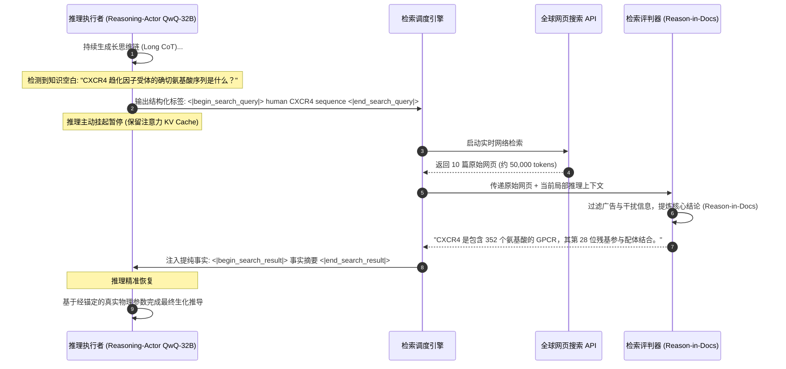

# 斯坦福 CS329A (第8讲): 搜索与深度研究 — 程序空间搜索 (AlphaCode) 与 Search-o1 的知识空间搜索

在软件工程与前沿学术研究的现实世界中，专家的真正水平绝不取决于单次静态死记硬背的能力。即便是业界最顶尖的首席软件架构师，也无法在敲击键盘的第一遍就写出数千行完全无缺陷的高并发分布式系统；即便是诺贝尔奖得主，在研究最新的生物靶向药物结构或跨国税收法规时，也必须借助外部文献与严谨考证，而无法单凭生物大脑记忆撰写论文。

人类智慧的真正源泉在于系统的探索能力：
> **“广泛探索数以百万计的潜在假设（Search），果断剪除无效的错误分支（Filter），在长逻辑推理遇到知识真空时主动调用外部数据库进行实时补全（Retrieve），并将碎片化的嘈杂观察严密综合为可验证的洞察。”**

在**斯坦福 CS329A: Self-Improving AI Agents（自我提升型 AI 智能体）**第8讲中，我们将深入探讨“搜索（Search）”如何从两个截然不同却高度互补的维度实现人工智能的智能跃迁：
1. **程序空间搜索 (Program Space Search):** Google DeepMind 的 **AlphaCode Competitive Programming（算法竞赛编程）** 如何生成百万候选程序并通过运行时行为特征聚类锁定正解。
2. **知识空间搜索 (Knowledge Space Search):** **Search-o1 Autonomous Investigation（自主调研）** 与 **Self-Reflective Search Loops（自我反思检索循环）** 如何在长链思维推理（Long CoT）中实时感知知识空白并动态触发检索。
3. **全自主深度研究智能体架构 (Deep Research Workflows):** 现代 **Information Synthesis Agent（信息综合智能体）** 如何实现复杂命题的假设分解、多跳递归网络爬取、跨源事实交叉验证与万字学术报告合成。

{/* truncate */}


---

## 1. 智能体搜索的双重地平 (The Dual Nature of Search)

在传统经典 AI 中，搜索局限于离散的状态空间（如 A* 网格寻路、象棋 Minimax 决策树）。但在现代自主智能体中，搜索已拓展为连续 token 概率分布空间与开放式外部互联网环境的双重维度：

```
                          ┌─────────────────────────────────────┐
                          │       智能体搜索的双重前沿领域       │
                          └──────────────────┬──────────────────┘
                                             │
             ┌───────────────────────────────┴───────────────────────────────┐
             ▼                                                               ▼
┌─────────────────────────────────────────┐     ┌─────────────────────────────────────────┐
│          程序空间搜索 (Code)            │     │         知识空间搜索 (Knowledge)        │
├─────────────────────────────────────────┤     ├─────────────────────────────────────────┤
│ • AlphaCode 1 & 2 (Google DeepMind)     │     │ • Search-o1 与智能体 RAG 架构           │
│ • 极度稀疏的奖励信号 (通过 / 失败 二值) │     │ • 无限开放的全球互联网动态检索          │
│ • 1,000,000 个候选代码大规模并行采样    │     │ • 思维链推理中间不确定性 (Uncertainty)  │
│ • 运行时行为特征向量 (Output Vector)    │     │ • Reason-in-Documents 事实提纯过滤     │
│ • 正解程序的数学等价超大集群聚类        │     │ • 递归多跳深层穿透与综合研究报告合成    │
└─────────────────────────────────────────┘     └─────────────────────────────────────────┘
```

两者的核心技术挑战均是在**计算预算限制下的查准率与查全率权衡（Precision-Recall Tradeoff）**：
- 在程序生成中，抽取数百万样本能够提供极高的理论正确覆盖率（$pass@k$），但正式竞赛规则严格限制提交次数为极少的10次（$10@k$）。
- 在开放式研究中，全网搜索会返回大量杂乱无章的 HTML 原始文本、商业广告与互相矛盾的信息，直接灌入上下文会导致注意力严重涣散（Context Pollution）。

---

## 2. 程序空间搜索：AlphaCode (Science 封面论文, 2022)

Codeforces 等国际顶级算法竞赛即使对最优秀的人类程序员也是智力极限的考验。参赛者必须研读长篇自然语言题面，推导数学不变量，编写严格满足时间复杂度（`O(N \log N)`）和内存上限（`256 256 MB`）的 C++ 代码，以应对成千上万个恶意隐藏测试用例。哪怕漏掉一个等号，评测系统也会直接判定 `Wrong Answer`。

Google DeepMind 的 **AlphaCode** 证明，借助海量推理期计算与语义特征聚类，AI 系统能够达到人类中上游程序员（Top 54%）的水准。

```
                  [自然语言算法问题规格说明]
                              │
                              ▼
        1. 大规模多样性采样 (每道题生成 1,000,000 个 C++/Python 程序)
           (随机注入难度标签、DP/贪心/图论分类，采样温度 0.25)
                              │
                              ▼
        2. 基础示例测试 (Sample Tests) 首轮过滤
           (在题面公开的样例输入输出上运行 -> 淘汰 >99% 语法错误与平庸代码)
                              │
                              ▼
        3. 合成测试输入生成与行为特征 (Behavior Signature) 聚类
           (生成10个随机有效测试输入 -> 按程序实际输出结果向量聚类)
                              │
                              ▼
        4. 前 10 大核心集群代表代码提取
           (从规模最大的前 10 个聚类中各甄选 1 个最优候选程序)
                              │
                              ▼
                 [正式向比赛裁判系统提交 10 次]
             (在 5,000 余名人类顶尖选手中跻身前 54.3%)
```

### 行为特征 (Behavior Signature) 聚类的数学智慧
在通过题面基础样例的第一轮过滤后，通常仍有约 5,000 个程序存活。如何在不知道隐藏测试用例的前提下，从中挑出最可能完全正确的 10 个程序？

依据代码语法相似度（如 BLEU 分数或 CodeBERT 嵌入）进行聚类必然全面失败：
- 两个在语法上 99% 一致的代码，可能仅因循环边界判断符（`<` 与 `<=`）的微小差异，导致其中一个直接超时死循环；
- 反之，一个采用递归分治法，另一个采用迭代状态机，两者 AST 结构南辕北辙，但实现的数学算法逻辑完全一致。

DeepMind 确立了**“代码的本质不在于表象，而在于运行时行为”**的评估法则：
1. 辅助模型为该题自动生成 10 个合法的随机测试输入。
2. 5,000 个存活程序在沙箱中运行这 10 个输入，测量其输出结果向量（行为特征）：
```text
Signature(P_i) = [ P_i(input_1), P_i(input_2), ..., P_i(input_10) ]
```
3. **关键发现：** 存在漏洞的代码由于在边界情况下各自触发不同错误而分散孤立；而**所有正确实现了正确数学逻辑的程序，无论代码长相如何悬殊，针对相同的输入必定产生完全一致的输出，从而自然凝聚为规模最大的主集群**！
4. AlphaCode 从最大的前 10 个集群中各取一个代表提交裁判系统。

### AlphaCode 2：基于 Gemini 实现 10,000 倍采样效率飞跃
2023年底，DeepMind 推出搭载 Gemini Pro 的 **AlphaCode 2**：
- 在聚类后引入针对 Codeforces 评测历史微调的**专业评分模型（Scoring Model）**，对集群内部代码进行结构优雅性与时空复杂度打分。
- 竞赛题解率从 25% 飙升至 **43%**，达到人类参赛者 **前 15%（Candidate Master 候选特级大师级别）**。
- **里程碑突破：** AlphaCode 2 仅凭 **100 个样本**，便全面超越了 AlphaCode 1 消耗 100 万个样本才取得的成绩，**样本利用效率暴增 10,000 倍**，证明了基座推理能力的增强能够指数级压缩所需搜索的算力空间。

---

## 3. 知识空间搜索：Search-o1 (2025)

当我们从纯粹的代码逻辑转向**人类语言与全域科学知识空间**时，智能体该如何与外部世界互动？

深入分析长思维链推理模型（Long CoT，如 o1 或 DeepSeek-R1）的思考过程会发现：在求解复杂跨学科命题时，模型推理轨迹中平均每道题会出现 **30.4 次** 表明不确定的词汇（如 *"perhaps"*、*"wait"*、*"let me check"*）。传统静态 RAG 仅在提问初始阶段检索一次，根本无法填补模型在推导至第7步或第10步时意外遭遇的硬性事实空白。

2025年发表的 **Search-o1** 彻底重塑了这种交互方式：



### Search-o1 的两大核心机制
1. **推理执行者 (Reasoning-Actor)：** 当模型自检发现自身参数记忆不足以支撑推导时，自主输出检索标签（`<|begin_search_query|>`)，暂停当前生成并冻结上下文状态。
2. **检索评判器 (Retrieval-Critic / Reason-in-Documents)：** 坚决杜绝将数万词的杂乱网页直接倒进思维链中引发注意力污染（Context Distraction）。轻量化独立评判模型先阅读网页，**精准提取当前推导步骤所需的 2 至 3 行高纯度事实**，再注入推理主链。

```text
GPQA Diamond (博士级高难科学推理基准测试) 表现对比：
========================================================================================
测试架构                     总体准确率        化学            生物学          物理学
----------------------------------------------------------------------------------------
人类领域博士专家群体          65.4%           48.9%          37.2%           39.9%
基础推理模型 (QwQ-32B)        58.1%           45.2%          41.5%           43.2%
经典静态 RAG 智能体           61.6%           51.0%          44.8%           47.0%
Search-o1 (动态思维链检索)    63.6% (+5.5p)   56.4% (+7.5p)  50.2% (+13.0p)  52.8% (+12.9p)
========================================================================================
```

在严格的 GPQA Diamond 测试中，Search-o1 不仅大幅领先静态 RAG，更在**化学、生物学与物理学全科上全面击败了由人类领域博士专家构成的基准平均得分**。

---

## 4. 全自主深度研究 (Deep Research) 智能体流水线

将 AlphaCode 的并行剪枝聚类理念与 Search-o1 的推导检索机制相结合，便构成了以 OpenAI Deep Research 与 Gemini Deep Research 为代表的 **Deep Research Agent LLM** 工业级完整架构：

```
                       [复杂多维度用户深度研究命题]
                                     │
                                     ▼
                   ┌──────────────────────────────────────┐
                   │       分层研究计划与任务拆解         │
                   │ (将宏观命题解构为 5~8 个正交子假设)  │
                   └──────────────────┬───────────────────┘
                                      │
          ┌───────────────────────────┼───────────────────────────┐
          ▼                           ▼                           ▼
┌──────────────────┐        ┌──────────────────┐        ┌──────────────────┐
│   子假设 A       │        │   子假设 B       │        │   子假设 C       │
│   多跳递归检索   │        │   多跳递归检索   │        │   多跳递归检索   │
└─────────┬────────┘        └─────────┬────────┘        └─────────┬────────┘
          │                           │                           │
          └───────────────────────────┼───────────────────────────┘
                                      │
                                      ▼
                   ┌──────────────────────────────────────┐
                   │    跨源事实冲突比对与信度评判器      │
                   │ (识别商业宣传与学术评测的不一致性)   │
                   └──────────────────┬───────────────────┘
                                      │
                                      ▼
                   ┌──────────────────────────────────────┐
                   │      可溯源长篇学术/专业报告合成     │
                   │ (万字长文，附带严密的网页引用角标)   │
                   └──────────────────────────────────────┘
```

### 深度研究流水线的四大关键阶段
1. **假设分解 (Hypothesis Decomposition):** 将如“2026年全固态电池量产瓶颈与丰田/QuantumScape专利布局对比”等宏观需求拆解为具体的工程技术子项。
2. **多跳递归穿透 (Recursive Multi-Hop Traversal):** 顺着初级研报中的引用线索，逐层深挖至原始专利说明书、监管申报文件与实验室论文。
3. **冲突仲裁与交叉验证:** 当企业宣传材料与第三方测试数据矛盾时，智能体比对测试工况与评测严谨度，显式标明事实争议与可信区间。
4. **全可溯源证据链标注:** 报告中所有量化数据与核心论点均强制挂载原始网络 URL 角标，从根本上终结生成式幻觉。

---

## 5. 搜索技术范式全面横向对比

```text
=========================================================================================================
对比维度              传统静态 RAG (Single-Hop)      AlphaCode (程序空间搜索)  Search-o1 (知识空间思维检索)
---------------------------------------------------------------------------------------------------------
搜索空间              静态文档向量数据库             源码序列离散空间          开放互联网与动态 API
触发机制              仅在用户发问初始阶段触发一次   推理阶段大规模并行生成    思考过程中自省感知不确定性
过滤剪枝基准          Top-K 向量余弦相似度           实际运行时行为特征向量    Reason-in-Docs 提纯过滤
验证锚点              向量空间嵌入距离               沙箱环境真实执行输出      形式逻辑一致性与跨源校验
主要技术瓶颈          长周期多步骤推导易偏航失焦     搜索空间指数膨胀，算力高  网络 I/O 引起推理明显延迟
=========================================================================================================
```

---

## 6. 核心技术深度问答

### Q1: 在 AlphaCode 中，为什么必须依据“运行时行为特征”而非代码语法进行聚类？
代码的功能正确性与表层语法完全解耦。

在抽象语法树（AST）上重合度达到 99% 的两段代码，可能仅因循环条件中的一个等号差别而造成完全不同的死循环错误；相反，采用递归和迭代两套完全不同语法的代码，其底层数学逻辑与真实输出可能完全一致。只有通过真实测试输入测量**程序的实际输出结果向量**，才能准确剔除无效语法干扰，使真正正确的算法凝聚成无可撼动的主集群。

### Q2: 为什么不能把检索到的原始网页直接追加到思考上下文中，而必须经过“Reason-in-Docs”过滤？
这被称为**“注意力涣散与上下文污染（Attention Distraction）”**。
长思维链模型在推进复杂推理时，注意力分布处于极度紧绷的状态。若直接插入上万字包含广告、侧边栏和冗余客套话的网页源码，模型的自注意力机制将被严重扰乱，甚至遗忘前序推理目标。通过独立的评判器先提取**纯度 100% 的关键事实摘要**再注入，才能确保逻辑链条的绝对纯净与连贯。

---

## 总结与下期预告

搜索赋予了人工智能从封闭预测器向动态探求者跃迁的能力。**AlphaCode** 证明了程序空间中的大规模搜索与行为聚类能击败顶尖人类竞赛选手；**Search-o1** 与 **Deep Research** 证明了在思维链中融合能动搜索可以攻克博士级全域科学难题。

下一讲 **第9讲**，我们将迎来 Part 2（训练与进化）的收官集大成之作：**Post-Training Evolution — 从下一个词预测模型到自主行动舰队的进化之路 (SFT, RLHF, Tool Grounding)**。

---

### 本讲核心提炼
- **算力最优搜索扩展定律：** 大规模采样结合严格过滤剪枝（AlphaCode），其产出远超无引导的单次直接生成。
- **重行为而轻语法：** 代码的本质是执行结果而非字面标记，运行时行为特征是唯一可靠的代码等价度量。
- **推导过程中的动态能动检索：** 在长思维链内部自发识别知识盲区并精确引入经提纯的事实（Search-o1），是攻克复杂知识密集型任务的终极范式。