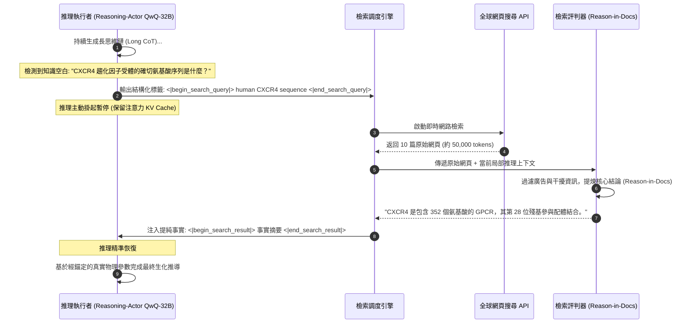

# 史丹佛 CS329A (第8講): 搜尋與深度研究 — 程式空間搜尋 (AlphaCode) 與 Search-o1 的知識空間搜尋

在軟體工程與尖端學術研究的現實世界中，專家的真正水準絕不取決於單次靜態死記硬背的能力。即便是業界最頂尖的首席軟體架構師，也無法在敲擊鍵盤的第一遍就寫出數千行完全無缺陷的高並發分散式系統；即便是諾貝爾獎得主，在研究最新的生物標靶藥物結構或跨國稅收法規時，也必須借助外部文獻與嚴謹考證，而無法單憑大腦記憶撰寫論文。

人類智慧的真正泉源在於系統性的探索能力：
> **「廣泛探索數以百萬計的潛在假設（Search），果斷剪除無效的錯誤分支（Filter），在長邏輯推理遇到知識真空時主動調用外部資料庫進行即時補全（Retrieve），並將碎片化的吵雜觀察嚴密綜合為可驗證的洞察。」**

在**史丹佛 CS329A: Self-Improving AI Agents（自我提升型 AI 代理人）**第8講中，我們將深入探討「搜尋（Search）」如何從兩個截然不同卻高度互補的維度實現人工智慧的智慧躍升：
1. **程式空間搜尋 (Program Space Search):** Google DeepMind 的 **AlphaCode Competitive Programming（演算法競賽編程）** 如何生成百萬候選程式並透過執行時行為特徵分群鎖定正解。
2. **知識空間搜尋 (Knowledge Space Search):** **Search-o1 Autonomous Investigation（自主調研）** 與 **Self-Reflective Search Loops（自我反思檢索循環）** 如何在長鏈思維推理（Long CoT）中即時感知知識空白並動態觸發檢索。
3. **全自主深度研究代理人架構 (Deep Research Workflows):** 現代 **Information Synthesis Agent（資訊綜合代理人）** 如何實現複雜命題的假設分解、多跳遞歸網路爬取、跨源事實交叉驗證與萬字學術報告合成。

{/* truncate */}


---

## 1. 代理人搜尋的雙重地平 (The Dual Nature of Search)

在傳統經典 AI 中，搜尋局限於離散的狀態空間（如 A* 尋路、西洋棋 Minimax 決策樹）。但在現代自主代理人中，搜尋已拓展為連續 token 機率分佈空間與開放式外部網際網路環境的雙重維度：

```
                          ┌─────────────────────────────────────┐
                          │       代理人搜尋的雙重前沿領域       │
                          └──────────────────┬──────────────────┘
                                             │
             ┌───────────────────────────────┴───────────────────────────────┐
             ▼                                                               ▼
┌─────────────────────────────────────────┐     ┌─────────────────────────────────────────┐
│          程式空間搜尋 (Code)            │     │         知識空間搜尋 (Knowledge)        │
├─────────────────────────────────────────┤     ├─────────────────────────────────────────┤
│ • AlphaCode 1 & 2 (Google DeepMind)     │     │ • Search-o1 與代理人 RAG 架構           │
│ • 極度稀疏的獎勵訊號 (通過 / 失敗 二值) │     │ • 無限開放的全球網際網路動態檢索        │
│ • 1,000,000 個候選程式大規模並行採樣    │     │ • 思維鏈推理中間不確定性 (Uncertainty)  │
│ • 執行時行為特徵向量 (Output Vector)    │     │ • Reason-in-Documents 事實提純過濾     │
│ • 正解程式的數學等價超大集群分群        │     │ • 遞歸多跳深層穿透與綜合研究報告合成    │
└─────────────────────────────────────────┘     └─────────────────────────────────────────┘
```

兩者的核心技術挑戰均是在**計算預算限制下的查準率與查全率權衡（Precision-Recall Tradeoff）**：
- 在程式生成中，抽取數百萬樣本能夠提供極高的理論正確覆蓋率（$pass@k$），但正式競賽規則嚴格限制提交次數為極少的10次（$10@k$）。
- 在開放式研究中，全網搜尋會返回大量雜亂無章的 HTML 原始文字、商業廣告與互相矛盾的資訊，直接灌入上下文會導致注意力嚴重渙散（Context Pollution）。

---

## 2. 程式空間搜尋：AlphaCode (Science 封面論文, 2022)

Codeforces 等國際頂級演算法競賽即使對最優秀的人類程式設計師也是智力極限的考驗。參賽者必須研讀長篇自然語言題目，推導數學不變量，編寫嚴格滿足時間複雜度（`O(N \log N)`）和記憶體上限（`256 256 MB`）的 C++ 代碼，以應對成千上萬個惡意隱藏測試案例。哪怕漏掉一個等號，評測系統也會直接判定 `Wrong Answer`。

Google DeepMind 的 **AlphaCode** 證明，借助海量推理期計算與語義特徵分群，AI 系統能夠達到人類中上游程式設計師（Top 54%）的水準。

```
                  [自然語言演算法問題規格說明]
                              │
                              ▼
        1. 大規模多樣性採樣 (每道題生成 1,000,000 個 C++/Python 程式)
           (隨機注入難度標籤、DP/貪心/圖論分類，採樣溫度 0.25)
                              │
                              ▼
        2. 基礎範例測試 (Sample Tests) 首輪過濾
           (在題目公開的樣例輸入輸出上運行 -> 淘汰 >99% 語法錯誤與平庸代碼)
                              │
                              ▼
        3. 合成測試輸入生成與行為特徵 (Behavior Signature) 分群
           (生成10個隨機有效測試輸入 -> 按程式實際輸出結果向量分群)
                              │
                              ▼
        4. 前 10 大核心集群代表程式提取
           (從規模最大的前 10 個分群中各甄選 1 個最優候選程式)
                              │
                              ▼
                 [正式向比賽裁判系統提交 10 次]
             (在 5,000 餘名人類頂尖選手中躋身前 54.3%)
```

### 行為特徵 (Behavior Signature) 分群的數學智慧
在通過題目基礎樣例的第一輪過濾後，通常仍有約 5,000 個程式存活。如何在不知道隱藏測試案例的前提下，從中挑出最可能完全正確的 10 個程式？

依據程式語法相似度（如 BLEU 分數或 CodeBERT 嵌入）進行分群必然全面失敗：
- 兩個在語法上 99% 一致的代碼，可能僅因迴圈邊界判斷符（`<` 與 `<=`）的微小差異，導致其中一個直接超時無窮迴圈；
- 反之，一個採用遞歸分治法，另一個採用迭代狀態機，兩者 AST 結構南轅北轍，但實現的數學演算法邏輯完全一致。

DeepMind 確立了**「代碼的本質不在於表象，而在於執行時行為」**的評估法則：
1. 輔助模型為該題自動生成 10 個合法的隨機測試輸入。
2. 5,000 個存活程式在沙箱中運行這 10 個輸入，測量其輸出結果向量（行為特徵）：
```text
Signature(P_i) = [ P_i(input_1), P_i(input_2), ..., P_i(input_10) ]
```
3. **關鍵發現：** 存在漏洞的代碼由於在邊界情況下各自觸發不同錯誤而分散孤立；而**所有正確實現了正確數學邏輯的程式，無論代碼長相如何懸殊，針對相同的輸入必定產生完全一致的輸出，從而自然凝聚為規模最大的主集群**！
4. AlphaCode 從最大的前 10 個集群中各取一個代表提交裁判系統。

### AlphaCode 2：基於 Gemini 實現 10,000 倍採樣效率飛躍
2023年底，DeepMind 推出搭載 Gemini Pro 的 **AlphaCode 2**：
- 在分群後引入針對 Codeforces 評測歷史微調的**專業評分模型（Scoring Model）**，對集群內部代碼進行結構優雅性與時空複雜度評分。
- 競賽題解率從 25% 飆升至 **43%**，達到人類參賽者 **前 15%（Candidate Master 候選特級大師級別）**。
- **里程碑突破：** AlphaCode 2 僅憑 **100 個樣本**，便全面超越了 AlphaCode 1 消耗 100 萬個樣本才取得的成績，**樣本利用效率暴增 10,000 倍**，證明了基座推理能力的增強能夠指數級壓縮所需搜尋的算力空間。

---

## 3. 知識空間搜尋：Search-o1 (2025)

當我們從純粹的代碼邏輯轉向**人類語言與全域科學知識空間**時，代理人該如何與外部世界互動？

深入分析長思維鏈推理模型（Long CoT，如 o1 或 DeepSeek-R1）的思考過程會發現：在求解複雜跨學科命題時，模型推理軌跡中平均每道題會出現 **30.4 次** 表明不確定的詞彙（如 *"perhaps"*、*"wait"*、*"let me check"*）。傳統靜態 RAG 僅在提問初始階段檢索一次，根本無法填補模型在推導至第7步或第10步時意外遭遇的硬性事實空白。

2025年發表的 **Search-o1** 徹底重塑了這種互動方式：



### Search-o1 的兩大核心機制
1. **推理執行者 (Reasoning-Actor)：** 當模型自檢發現自身參數記憶不足以支撐推導時，自主輸出檢索標籤（`<|begin_search_query|>`)，暫停當前生成並凍結上下文狀態。
2. **檢索評判器 (Retrieval-Critic / Reason-in-Documents)：** 堅決杜絕將數萬詞的雜亂網頁直接倒進思維鏈中引發注意力污染（Context Distraction）。輕量化獨立評判模型先閱讀網頁，**精準提取當前推導步驟所需的 2 至 3 行高純度事實**，再注入推理主鏈。

```text
GPQA Diamond (博士級高難科學推理基準測試) 表現對比：
========================================================================================
測試架構                     總體準確率        化學            生物學          物理學
----------------------------------------------------------------------------------------
人類領域博士專家群體          65.4%           48.9%          37.2%           39.9%
基礎推理模型 (QwQ-32B)        58.1%           45.2%          41.5%           43.2%
經典靜態 RAG 代理人           61.6%           51.0%          44.8%           47.0%
Search-o1 (動態思維鏈檢索)    63.6% (+5.5p)   56.4% (+7.5p)  50.2% (+13.0p)  52.8% (+12.9p)
========================================================================================
```

在嚴格的 GPQA Diamond 測試中，Search-o1 不僅大幅領先靜態 RAG，更在**化學、生物學與物理學全科上全面擊敗了由人類領域博士專家構成的基準平均得分**。

---

## 4. 全自主深度研究 (Deep Research) 代理人流水線

將 AlphaCode 的並行剪枝分群理念與 Search-o1 的推導檢索機制相結合，便構成了以 OpenAI Deep Research 與 Gemini Deep Research 為代表的 **Deep Research Agent LLM** 工業級完整架構：

```
                       [複雜多維度用戶深度研究命題]
                                     │
                                     ▼
                   ┌──────────────────────────────────────┐
                   │       分層研究計劃與任務拆解         │
                   │ (將宏觀命題解構為 5~8 個正交子假設)  │
                   └──────────────────┬───────────────────┘
                                      │
          ┌───────────────────────────┼───────────────────────────┐
          ▼                           ▼                           ▼
┌──────────────────┐        ┌──────────────────┐        ┌──────────────────┐
│   子假設 A       │        │   子假設 B       │        │   子假設 C       │
│   多跳遞歸檢索   │        │   多跳遞歸檢索   │        │   多跳遞歸檢索   │
└─────────┬────────┘        └─────────┬────────┘        └─────────┬────────┘
          │                           │                           │
          └───────────────────────────┼───────────────────────────┘
                                      │
                                      ▼
                   ┌──────────────────────────────────────┐
                   │    跨源事實衝突比對與信度評判器      │
                   │ (識別商業宣傳與學術評測的不一致性)   │
                   └──────────────────┬───────────────────┘
                                      │
                                      ▼
                   ┌──────────────────────────────────────┐
                   │      可溯源長篇學術/專業報告合成     │
                   │ (萬字長文，附帶嚴密的網頁引用角標)   │
                   └──────────────────────────────────────┘
```

### 深度研究流水線的四大關鍵階段
1. **假設分解 (Hypothesis Decomposition):** 將如「2026年全固態電池量產瓶頸與豐田/QuantumScape專利佈局對比」等宏觀需求拆解為具體的工程技術子項。
2. **多跳遞歸穿透 (Recursive Multi-Hop Traversal):** 順著初級研報中的引用線索，逐層深挖至原始專利說明書、監管申報文件與實驗室論文。
3. **衝突仲裁與交叉驗證:** 當企業宣傳材料與第三方測試數據矛盾時，代理人比對測試工況與評測嚴謹度，顯式標明事實爭議與可信區間。
4. **全可溯源證據鏈標註:** 報告中所有量化數據與核心論點均強制掛載原始網路 URL 角標，從根本上終結生成式幻覺。

---

## 5. 搜尋技術範式全面橫向對比

```text
=========================================================================================================
對比維度              傳統靜態 RAG (Single-Hop)      AlphaCode (程式空間搜尋)  Search-o1 (知識空間思維檢索)
---------------------------------------------------------------------------------------------------------
搜尋空間              靜態文件向量資料庫             源碼序列離散空間          開放網際網路與動態 API
觸發機制              僅在用戶發問初始階段觸發一次   推理階段大規模並行生成    思考過程中自省感知不確定性
過濾剪枝基準          Top-K 向量餘弦相似度           實際執行時行為特徵向量    Reason-in-Docs 提純過濾
驗證錨點              向量空間嵌入距離               沙箱環境真實執行輸出      形式邏輯一致性與跨源校驗
主要技術瓶頸          長週期多步驟推導易偏航失焦     搜尋空間指數膨脹，算力高  網路 I/O 引起推理明顯延遲
=========================================================================================================
```

---

## 6. 核心技術深度問答

### Q1: 在 AlphaCode 中，為什麼必須依據「執行時行為特徵」而非代碼語法進行分群？
代碼的功能正確性與表層語法完全解耦。

在抽象語法樹（AST）上重合度達到 99% 的兩段代碼，可能僅因迴圈條件中的一個等號差別而造成完全不同的無窮迴圈錯誤；相反，採用遞歸和迭代兩套完全不同語法的代碼，其底層數學邏輯與真實輸出可能完全一致。只有透過真實測試輸入測量**程式的實際輸出結果向量**，才能準確剔除無效語法干擾，使真正正確的演算法凝聚成無可撼動的主集群。

### Q2: 為什麼不能把檢索到的原始網頁直接追加到思考上下文中，而必須經過「Reason-in-Docs」過濾？
這被稱為**「注意力渙散與上下文污染（Attention Distraction）」**。
長思維鏈模型在推進複雜推理時，注意力分佈處於極度緊繃的狀態。若直接插入上萬字包含廣告、側邊欄和冗餘客套話的網頁源碼，模型的自注意力機制將被嚴重擾亂，甚至遺忘前序推理目標。透過獨立的評判器先提取**純度 100% 的關鍵事實摘要**再注入，才能確保邏輯鏈條的絕對純淨與連貫。

---

## 總結與下期預告

搜尋賦予了人工智慧從封閉預測器向動態探求者躍升的能力。**AlphaCode** 證明了程式空間中的大規模搜尋與行為分群能擊敗頂尖人類競賽選手；**Search-o1** 與 **Deep Research** 證明了在思維鏈中融合能動搜尋可以攻克博士級全域科學難題。

下一講 **第9講**，我們將迎來 Part 2（訓練與進化）的收官集大成之作：**Post-Training Evolution — 從下一個詞預測模型到自主行動艦隊的進化之路 (SFT, RLHF, Tool Grounding)**。

---

### 本講核心提煉
- **算力最優搜尋擴展定律：** 大規模採樣結合嚴格過濾剪枝（AlphaCode），其產出遠超無引導的單次直接生成。
- **重行為而輕語法：** 代碼的本質是執行結果而非字面標記，執行時行為特徵是唯一可靠的代碼等價度量。
- **推導過程中的動態能動檢索：** 在長思維鏈內部自發識別知識盲區並精確引入經提純的事實（Search-o1），是攻克複雜知識密集型任務的終極範式。