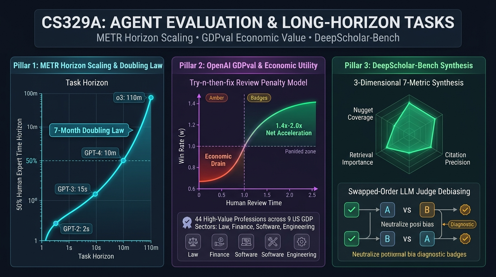

# Stanford CS329A (Ep 12): Agent Evaluation & Long Tasks — METR 시간 지평, OpenAI GDPval, DeepScholar-Bench

엔지니어링 팀이 자율 코딩 에이전트를 개발하여 경영진이나 투자자에게 보고할 때, "MMLU 시험에서 92점을 맞았습니다"라고 말하는 것은 아무런 실질적 감흥을 주지 못합니다. 비즈니스 현장에서 돌아오는 질문은 훨씬 더 냉혹하고 구체적입니다:
- *"이 에이전트가 우리 회사에서 실제로 인간 개입 없이 **몇 시간짜리 복잡한 업무**를 끝까지 해낼 수 있습니까?"*
- *"인간 시니어 엔지니어가 8시간 걸려 작성하는 프로덕션 리팩토링이나 재무 분석 리포트를 이 에이전트가 완벽히 대체할 수 있습니까? **그 경제적 순가치는 과연 몇 달러입니까?**"*

기존의 객관식 벤치마크(MMLU, GSM8K, HumanEval)는 이미 90점대를 넘기며 포화(Saturation)되었고, 웹 크롤링에 의한 데이터 오염(Contamination)으로 인해 단순 암기 시험으로 전락했습니다. 무엇보다 5초짜리 객관식 퀴즈를 푸는 것과 **수시간 동안 수백 단계의 상태적 결정을 이어가는 장거리 과제(Long-Horizon Agent Tasks)**는 차원이 다릅니다.

**Stanford CS329A: Self-Improving AI Agents**의 **Part 3: 에이전트 엔지니어링(Agent Engineering)**을 마무리하는 이번 **Lecture 12**에서는 **Agent Evaluation Benchmarks** — 인공지능의 지능을 무의미한 백분율 점수가 아니라 **인간의 시간(Human Time)**과 **경제적 달러($)**라는 현실의 물리적 척도로 측정하는 3대 혁신 평가 체계를 심층 분석합니다:
- **인간 시간 척도 지능 (METR, 2025):** 50% 성공률 시간 지평(h_agent)과 7개월 주기 배가 법칙.
- **실전 경제적 가치 평가 (OpenAI GDPval, 2025):** 미국 GDP 9대 산업 44개 전문직 블라인드 평가 및 현실적인 '수정 비용(Try-n-then-fix)' 경제학.
- **오염 없는 실시간 학술 리서치 평가 (DeepScholar-Bench, 2025):** 3차원 7대 지표와 LLM 판사(Judge)의 위치 편향 상쇄 기법.

{/* truncate */}



---

## 1. 평가의 위기: 객관식 벤치마크의 한계와 실전 과제의 본질

지난 5년간 AI 학계는 정적인 질문-응답 데이터셋에 의존해 왔습니다. 그러나 에이전트의 실전 배치 과정에서 이러한 평가 방식의 치명적인 구조적 맹점이 드러났습니다:
1. **포화와 오염:** 프런티어 모델들이 MMLU에서 90%를 넘겼으나, 인터넷에 유출된 테스트셋을 사전 학습 과정에서 통째로 외워버린 환각적 성과였습니다.
2. **시간 지평의 부재:** 4지 선다 문제는 단 2초, 1스텝에 끝납니다. 반면 실전 소프트웨어 엔지니어링은 수 시간 동안 100회 이상의 연속적인 도구 호출과 상태 유지를 요구합니다.
3. **'지저분한 현실(Task Messiness)'의 결여:** 시험 문제는 오타나 모호함이 없는 깨끗한 문장으로 주어집니다. 하지만 실무 환경은 모호한 요구사항, 실시간으로 변하는 네트워크 상태, 불친절한 에러 로그, 되돌릴 수 없는 파괴적 명령어 등 온갖 불확실성으로 가득 차 있습니다.

따라서 현대 인공지능 연구소들은 객관식 시험을 폐기하고, 물리적인 시간과 자본을 축으로 삼는 연속형 평가로 전면 전환했습니다.

```
┌─────────────────────────────────────────────────────────────────────────┐
│               현대 자율 에이전트 평가의 3대 핵심 기둥                  │
└────────────────────────────────────┬────────────────────────────────────┘
                                     │
       ┌─────────────────────────────┼─────────────────────────────┐
       ▼                             ▼                             ▼
┌──────────────────────────┐  ┌──────────────────────────┐  ┌──────────────────────────┐
│     METR 시간 지평       │  │    OpenAI GDPval ($)     │  │    DeepScholar-Bench     │
├──────────────────────────┤  ├──────────────────────────┤  ├──────────────────────────┤
│ • 척도: 인간 작업 시간 t │  │ • 척도: 실제 미국 달러   │  │ • 척도: 3차원 7대 지표  │
│ • 50% 성공률 지평 h_agent│  │ • 44개 고소득 디지털 직종│ │ • 매주 arXiv 논문 수집   │
│ • 7개월 주기 배가 법칙   │  │ • Try-n-then-fix 경제학  │  │ • 데이터 사전 오염 0%    │
│ • 작업 오염도(Messiness) │  │ • 14년 차 시니어 블라인드│  │ • 너깃 커버리지 (39.2%) │
│ • 2초(GPT-2) -> 110분(o3)│  │ • 승률 40% 임계값 돌파   │  │ • 순서 맞교환 편향 상쇄 │
└──────────────────────────┘  └──────────────────────────┘  └──────────────────────────┘
```

---

## 2. 지능을 시간으로 측정하다: METR (2025)

"이 모델은 벤치마크 88점입니다"라는 말은 에이전트가 얼마나 오래 스스로 작동할 수 있는지 전혀 설명해주지 못합니다. AI 평가 연구소 **METR (Model Evaluation and Threat Research)**는 인류 역사상 가장 직관적인 지표를 제안했습니다:
> **"단순 백분율 점수를 버려라. 대신 '숙련된 인간 전문가가 $t$시간 동안 수행해야 하는 과제'를 에이전트가 몇 퍼센트 확률로 성공하는지 측정하라. 그리고 50% 확률로 성공해 내는 인간의 작업 시간(h_agent)을 그 모델의 지능 척도로 정의하라!"**

```
    [170개 복합 소프트웨어 / 머신러닝 과제 (수초 ~ 8시간 소요 난이도)]
                               │
                ┌──────────────┴──────────────┐
                ▼                             ▼
       [인간 전문가 기준 시간 t]      [AI 에이전트 실제 성공률 p]
                │                             │
                └──────────────┬──────────────┘
                               ▼
        [아이템 반응 이론(IRT) 기반 로지스틱 회귀 모델]
           p = σ( (log h_agent - log t_task) × β_agent )
                               │
                               ▼
    [모델별 50% 시간 지평 h_agent: GPT-2 (2초) ──► OpenAI o3 (110분)]
```

### 시간 지평 로지스틱 모델의 수식
METR는 심리측정학의 아이템 반응 이론(IRT)을 응용하여, 모델의 성공 확률 $p$를 인간 소요 시간 `t_task`와 모델의 시간 지평 `h_agent`의 함수로 정립했습니다:

```text
========================================================================================
METR 시간 지평 성공 확률 수식:
========================================================================================
p_success(agent, task) = σ( (ln(h_agent) - ln(t_task)) * β_agent )

여기서:
  • t_task  : 검증된 인간 전문가가 해당 작업을 완수하는 데 걸리는 평균 시간
  • h_agent : 해당 에이전트의 50% 성공 시간 지평 (t_task = h_agent일 때 p = 0.5)
  • β_agent : 과제 난이도 상승에 따른 성공률 감소 기울기
  • σ(z)    : 표준 로지스틱 시그모이드 함수 1 / (1 + exp(-z))
========================================================================================
```

### 7개월 배가 법칙 (The 7-Month Doubling Law)
2019년부터 2025년까지 출시된 16개 프런티어 모델을 측정한 결과, 경이로운 지수함수적 법칙이 입증되었습니다:
- **2019년 (GPT-2):** 시간 지평 **2초** (단순 텍스트 완성).
- **2021년 (GPT-3):** 시간 지평 **15초**.
- **2023년 (GPT-4):** 시간 지평 **10분**.
- **2025년 (OpenAI o3):** 시간 지평 **110분 (약 2시간)**.
- **통계적 추세선:** 프런티어 AI의 50% 시간 지평은 **정확히 매 7개월(207일)마다 2배씩 폭발적으로 증가**하고 있습니다!
- **미래 전망:** 이 추세선이 유지된다면, AI 에이전트는 **2028년~2030년 사이에 '인간 전문가가 한 달(160시간) 내내 매달려야 하는 초대형 소프트웨어 프로젝트'를 50% 확률로 단번에 완수하는 지점**에 도달합니다.

---

## 3. 실전 경제적 가치를 평가하다: OpenAI GDPval (2025)

METR가 '시간'을 측정했다면, OpenAI가 2025년 가을 발표한 **GDPval**은 '실제 경제적 달러 가치($)'를 측정했습니다.

OpenAI는 미국 전체 국내총생산(GDP)을 견인하는 9대 핵심 산업(금융, 법률, 엔지니어링, IT, 의료 행정 등)에서 고소득을 올리는 **44개 핵심 디지털 전문직**을 선정했습니다. 그리고 평균 **14년 차 시니어 전문가들**을 채용하여 실제 현업에서 발생하는 220개의 골드 태스크(DCF 재무 모델링, 특허 명세서 분석, 복합 데이터 파이프라인 개발 등)를 설계했습니다:
- 과제당 평균 인간 소요 시간: **9.5시간 (중앙값 5시간)**.
- 과제당 평균 시장 외주 비용: **$398 달러 (약 55만 원)**.

### 전문가 블라인드 승률(Win Rate)의 진실
14년 차 시니어 전문가들이 모델의 제출물과 동료 인간 전문가의 제출물을 블라인드로 채점한 결과:
- **GPT-4o:** 승률 **12.5%** (인간 전문가의 기준에 크게 미치지 못함).
- **OpenAI o3:** 승률 **35.2%**.
- **Claude Opus 4.1:** 승률 **47.6% (승리 또는 동점)** 달성!
- 최신 프런티어 추론 모델들은 14년 차 베테랑이 보아도 인간 동료의 산출물과 동등하거나 우수한 결과물을 거의 절반에 가까운 확률로 제출하고 있습니다.

### 나이브한 속도(300배)의 함정과 현실 경제학 수식
AI 마케팅에서는 흔히 "인간이 9시간 걸릴 일을 2분 만에 끝냈으니 270배 빠르다!"고 주장합니다. 하지만 GDPval은 **인간의 검토 및 수정 시간(Try-n-then-fix)**을 반영한 냉혹한 현실 경제학 수식을 제시했습니다:

```text
========================================================================================
현실적 경제 시간 비용 수식 (Try-n-then-fix Model):
========================================================================================
E[T_real] = (M_T + R_T) * [ (1 - (1 - w)^n) / w ] + (1 - w)^n * H_T

여기서:
  • M_T : 모델 생성 시간 (수 분 이내)
  • R_T : 인간 전문가가 모델 산출물을 꼼꼼히 감사/검토하는 시간
  • H_T : 산출물이 엉망이라 인간이 처음부터 다시 직접 작성하는 시간
  • w   : 모델의 블라인드 승률 (품질 합격 확률)
  • n   : 인간이 포기하고 직접 쓰기 전까지 모델에게 재시도를 허용하는 횟수
========================================================================================
```

### 경제적 손익분기점: 적자에서 흑자로
- 모델 품질 $w$가 낮은 경우(GPT-4o, `w=12.5\%`): 인간 전문가는 모델의 교묘한 환각을 검토하느라 시간을 허비하고 결국 처음부터 자기가 다시 작성해야 합니다. 그 결과 **GPT-4o를 투입했을 때의 실제 업무 속도는 인간 혼자 일할 때보다 오히려 13% 느렸습니다(0.87배의 경제적 적자)!**
- 오직 승률이 **임계점인 `w \ge 40\%`를 돌파한 최신 모델(o3, Opus 4.1)**에 이르러서야 인간의 검토 비용을 상쇄하고 **실질 업무 속도를 1.3배~1.4배 가속하는 유의미한 경제적 흑자 구간**에 진입했습니다.

---

## 4. 오염 없는 실시간 학술 리서치 평가: DeepScholar-Bench (2025)

정답이 딱 떨어지지 않는 개방형 연구 보고서나 딥 리서치(Deep Research) 에이전트는 어떻게 평가해야 할까요?

2025년 8월 발표된 **DeepScholar-Bench**는 매주 arXiv에 새롭게 발표되는 최신 논문들을 바탕으로 벤치마크 문제를 실시간 자동 생성하는 **라이브 데이터 파이프라인(Live Pipeline)**을 구축하여, 사전에 문제를 외워버리는 오염(Contamination)을 원천 차단했습니다.

```
       [매주 arXiv 최신 논문 실시간 수집 (데이터 오염 0% 보장)]
                               │
                               ▼
┌─────────────────────────────────────────────────────────────────────────┐
│               DeepScholar-Bench 3차원 7대 평가 지표                      │
├─────────────────────────────────────────────────────────────────────────┤
│ 1. 지식 종합력 (Knowledge Synthesis)                                   │
│    • 조직성 및 일관성 (논리 구조, 가독성, 서식 완성도)                  │
│    • 너깃 커버리지 (필수 핵심 원자적 사실들의 포함 비율)                │
│ 2. 검색 품질 (Retrieval Quality)                                        │
│    • 관련성 비율 (인용된 문헌과 연구 주제의 밀접도)                     │
│    • 문헌 중요도 (해당 분야의 권위 있는 기념비적 논문 발굴력)           │
│ 3. 검증 가능성 (Verifiability)                                          │
│    • 인용 정밀도 (본문의 주장이 인용된 원문에 실제로 존재하는지 검증)    │
└────────────────────────────────────┬────────────────────────────────────┘
                                     │
                                     ▼
        [순서 맞교환 LLM 판사: 위치 편향(Position Bias) 수학적 상쇄]
```

### 30.9% 지표가 드러낸 차가운 현실
프런티어 자율 연구 에이전트(OpenAI DeepResearch 등)조차 7대 지표의 **기하평균 점수는 불과 30.9%**에 머물렀습니다:
- **화려한 문체 vs 빈약한 내용:** 에이전트들은 글의 조직성 및 가독성(**Organization: 85.7%**)에서는 높은 점수를 받았지만, 핵심 원자적 팩트를 놓치지 않는 너깃 커버리지(**Nugget Coverage: 39.2%**)와 분야의 핵심 권위 논문을 골라내는 문헌 중요도(**Document Importance: 12.4%**)에서는 심각하게 무너졌습니다.
- **오라클 검색기 실험의 교훈:** 시스템에게 정답 논문 목록을 미리 알려주어도(Oracle Retriever), 종합 점수는 **49%**에 머물렀습니다. 이는 현재 딥 리서치 에이전트의 진짜 병목이 '웹 검색'이 아니라 **'수많은 논문을 깊이 있게 읽고 통찰을 뽑아내는 종합력(Synthesis)'**에 있음을 증명합니다.

---

## 5. 현대 에이전트 평가 프레임워크 비교표

```text
=============================================================================================================
비교 차원             METR (2025)                   OpenAI GDPval (2025)          DeepScholar-Bench (2025)
-------------------------------------------------------------------------------------------------------------
주요 측정 단위        인간 작업 시간 (시간, 분, 초) 실제 미국 달러 ($ USD)        7대 다차원 품질 벡터
평가 대상 작업        소프트웨어 / ML 엔지니어링    44개 전문 화이트칼라 직무     개방형 학술 연구 보고서
정답 판정 방식        결정론적 테스트 스위트 통과   14년 차 시니어 블라인드 승률  원자적 정보 너깃 대조
오염 방지 기법        비공개 에어갭 과제 풀 운영    실제 기업용 비공개 업무 시나리오 매주 최신 arXiv 논문 자동 연동
검토 비용 모델링      미포함 (완전 자동 채점)       Try-n-then-fix 수정 페널티 수식 순서 맞교환(Swapped) 판사 편향제거
현재 프런티어 최고치  o3: 110분 시간 지평 (50% 성공)Opus 4.1: 47.6% 블라인드 승률 DeepResearch: 30.9% 기하평균
=============================================================================================================
```

---

## 6. 심화 기술 질의응답 (Q&A)

### Q1: METR에서 말하는 '작업 오염도(Task Messiness)'란 무엇이며, 성능에 어떤 영향을 주나요?
METR에서 정립한 **작업 오염도(Task Messiness)**는 현실 세계 업무가 지닌 16가지 마찰 요인을 정량화한 지표입니다:
- **동적 환경:** 에이전트가 실행되는 동안 네트워크 지연이나 DB 락이 발생하는 등 시스템 상태가 실시간으로 변함.
- **비가역적 실수:** 잘못된 SQL `DROP TABLE`이나 git push처럼 단순 되돌리기(Backtracking)가 불가능한 파괴적 위험.
- **능동적 정보 탐색:** 입력 데이터가 친절하게 주어지지 않고, 에이전트가 직접 grep으로 로그 파일을 뒤져 맥락을 파악해야 함.

METR 분석에 따르면, **작업 오염도 점수가 1점 상승할 때마다 에이전트의 과제 성공률은 약 8.1%씩 정직하게 급락**했습니다. 미래 에이전트의 진정한 승부처는 깔끔한 알고리즘이 아니라 이 '지저분한 현실'을 버텨내는 회복 탄력성에 있습니다.

### Q2: LLM 판사(Judge)의 '위치 편향(Position Bias)'을 없애는 '순서 맞교환(Swapped-Order)'의 원리는 무엇인가요?
LLM 판사에게 두 산출물 (A)와 (B)를 보여주고 우열을 가리게 하면, 모델은 내용의 질과 상관없이 **단지 프롬프트 앞쪽에 먼저 배치된 (A)를 60~70% 확률로 편애하는 위치 편향**을 보입니다.

이를 수학적으로 상쇄하기 위해 DeepScholar-Bench는 **순서 맞교환 평균(Swapped-Order Averaging)**을 적용합니다:
1. 1차 평가: `[A, B]` 순서로 판사에게 제시하고 점수 벡터 $S_1 = [s(A), s(B)]$를 기록합니다.
2. 2차 평가: `[B, A]` 순서로 배치를 뒤집어 동일한 판사에게 제시하고 점수 벡터 $S_2 = [s(B), s(A)]$를 기록합니다.
3. 최종 점수 도출:
```text
S_final(A) = ( S1(A) + S2(A) ) / 2
S_final(B) = ( S1(B) + S2(B) ) / 2
```
동일한 온도(Temperature) 조건에서 두 순열의 산술 평균을 취함으로써, 먼저 읽었기 때문에 발생하는 구조적 위치 편향을 대수적으로 완벽히 소거합니다.

---

## 축하합니다: Part 3 (에이전트 엔지니어링) 완결 및 Part 4 예고

오늘로써 우리는 Stanford CS329A 강좌의 세 번째 대단원인 **Part 3 · Agent Engineering (L10~L12)**을 완벽히 마쳤습니다!
- **Lecture 10:** 실제 깃허브 버그를 해결하는 **SWE-Agents**와 프로파일러 루프 기반 **KernelBench** GPU 커널 최적화
- **Lecture 11:** 영구적인 장단기 기억을 제공하는 **MemGPT**, **Cartridges**, **CacheBlend**
- **Lecture 12:** 인간의 시간(**METR**)과 경제적 달러 가치(**GDPval**)로 에이전트를 엄밀히 측정하는 평가학

우리는 이제 스스로 발전하는 에이전트를 설계하고, 학습시키며, 운영체제식 계층 메모리로 무장시키고, 엄밀한 현실 척도로 검증하는 완전한 엔지니어링 무기를 갖추었습니다.

---

## Part 4 · Frontiers (최전선)을 향하여

다음 강의부터는 인공지능이 도달할 수 있는 가장 깊은 지적 심연인 **Part 4 · Frontiers (Lectures 13 through 17)**가 시작됩니다!

그 장대한 서막인 **Lecture 13**의 주제는 **《LLM Reasoning: 언어 모델 추론의 본질과 생각의 사슬 (Chain-of-Thought, Self-Consistency, Emergent Cognitive Scaling)》**입니다. 구글 딥마인드의 세계적인 석학 데니 저우(Denny Zhou) 박사의 기념비적 연구를 바탕으로, 언어 모델 안에서 '추론'이라는 신비로운 불꽃이 어떻게 점화되는지 그 내면의 원리를 심층 해부하겠습니다.

---

### 핵심 요점 정리
- **점수 대신 시간을 보라:** 진정한 에이전트 지능은 50% 성공 시간 지평(h_agent)이며, 이는 GPT-2의 2초에서 o3의 110분까지 매 7개월마다 2배씩 성장하고 있습니다.
- **수정 비용이 경제성을 지배한다:** 에이전트의 블라인드 승률이 40%를 넘지 못하면 인간의 검토 및 재작업 비용으로 인해 오히려 업무 효율이 저하됩니다.
- **진짜 병목은 검색이 아니라 종합이다:** 개방형 리서치 과제에서 검색 엔진의 한계는 미미하며, 수많은 문헌에서 핵심 원자적 팩트를 추출하고 통합하는 지식 종합력이 진정한 프런티어입니다.