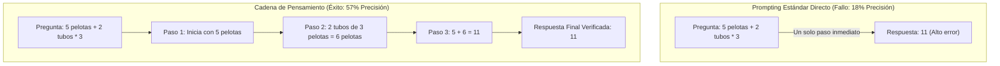
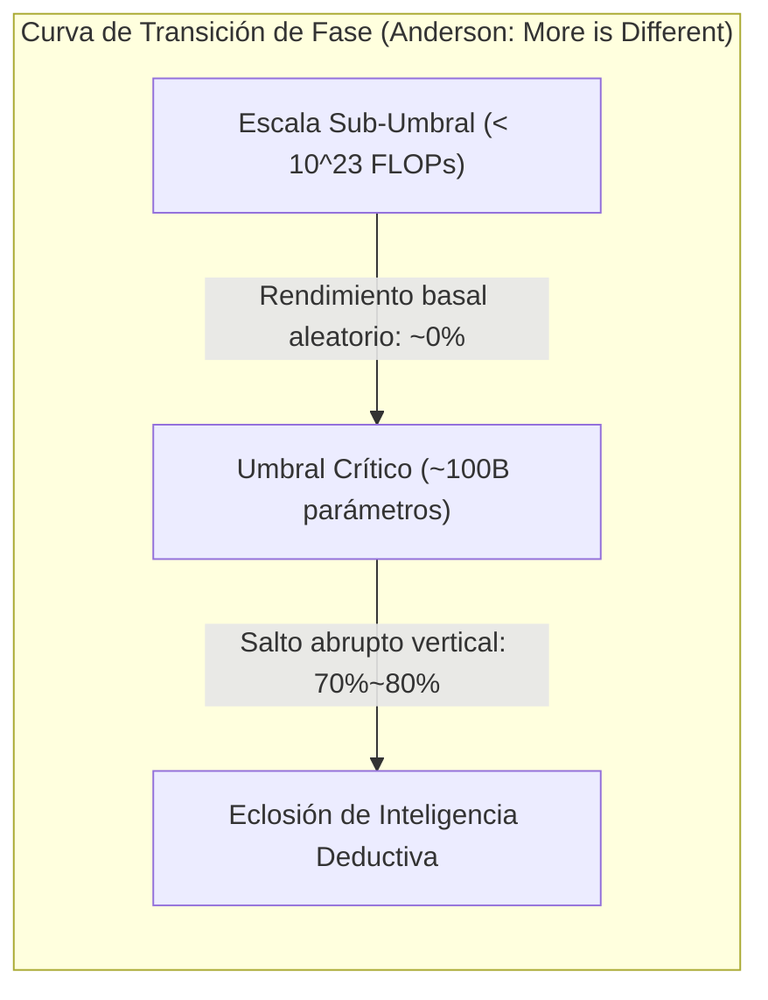

# Stanford CS329A (Ep 13): LLM Reasoning — Denny Zhou, Chain-of-Thought (CoT), Self-Consistency y Habilidades Emergentes

Durante décadas, los investigadores de inteligencia artificial operaron bajo un arraigado escepticismo respecto a las redes neuronales conexionistas:
> *"Un modelo de lenguaje autoregresivo no es más que un loro estocástico (Stochastic Parrot) que predice la siguiente palabra mediante probabilidades estadísticas. Al enfrentarse a problemas aritméticos de múltiples pasos, lógica formal o deducciones causales, produce alucinaciones superficiales porque el modelado de secuencias es incapaz por naturaleza de razonamiento deductivo genuino."*

De hecho, los primeros modelos de frontera fallaban de forma estrepitosa ante problemas matemáticos escolares de palabras, arrojando números incorrectos de inmediato sin desarrollar pasos lógicos intermedios.

Al inaugurar la esperada **Parte 4: Las Fronteras (Lecciones 13 a 17)** de **Stanford CS329A: Self-Improving AI Agents**, nos adentramos en la cumbre intelectual de la inteligencia artificial: **LLM Reasoning Foundations**. Guiados por las investigaciones seminales del **Dr. Denny Zhou** (Líder de Razonamiento en Google DeepMind), examinamos cómo se enciende la chispa del razonamiento en los modelos neuronales:
- **Chain of Thought CoT Prompting (NeurIPS 2022):** Cómo la descomposición en pasos de razonamiento en lenguaje natural elevó la precisión de PaLM 540B del 18% al 57% sin modificar un solo peso del modelo.
- **Self-Consistency Decoding LLM (ICLR 2023):** Basado en el principio de Anna Karenina de Tolstói — *"Los caminos lógicos válidos convergen en una verdad única, mientras que los erróneos divergen hacia el caos"* — muestreando múltiples trayectorias y filtrando el ruido por consenso mayoritario.
- **Emergent Cognitive Abilities AI (2022):** La física de las transiciones de fase ("More is Different") y el gran debate epistemológico: ¿es la emergencia un fenómeno físico real o un espejismo matemático creado por métricas no lineales?

{/* truncate */}


---

## 1. El Colapso del Mito del "Loro Estocástico"

Las primeras aproximaciones presentaban ejemplos en pocas tomas (Few-Shot Exemplars) que forzaban una correspondencia directa entre pregunta y respuesta:

```text
[Prompting Estándar Directo (Modo Fallido)]
-----------------------------------------------------------------------------------------
Q: Roger tiene 5 pelotas de tenis. Compra 2 tubos más de pelotas. 
   Cada tubo contiene 3 pelotas. ¿Cuántas pelotas de tenis tiene ahora?
A: La respuesta es 11.
-----------------------------------------------------------------------------------------
```

Este enfoque obligaba al modelo a comprimir todo el grafo de cómputo en un único paso de predicción. Al carecer de un bloc de notas mental (Scratchpad) para registrar estados intermedios, el modelo colapsaba en el error aritmético.

Denny Zhou y Jason Wei cambiaron una única línea en el formato de demostración, transformando la historia de la IA:

```text
[Prompting con Cadena de Pensamiento (Chain-of-Thought)]
-----------------------------------------------------------------------------------------
Q: Roger tiene 5 pelotas de tenis. Compra 2 tubos más de pelotas. 
   Cada tubo contiene 3 pelotas. ¿Cuántas pelotas de tenis tiene ahora?
A: Roger comenzó con 5 pelotas. 
   2 tubos de 3 pelotas cada uno son 2 * 3 = 6 pelotas. 
   5 + 6 = 11. 
   Por lo tanto, la respuesta es 11.
-----------------------------------------------------------------------------------------
```

```
┌─────────────────────────────────────────────────────────────────────────┐
│               Los 3 Pilares del Razonamiento Cognitivo en Máquinas      │
└────────────────────────────────────┬────────────────────────────────────┘
                                     │
       ┌─────────────────────────────┼─────────────────────────────┐
       ▼                             ▼                             ▼
┌──────────────────────────┐  ┌──────────────────────────┐  ┌──────────────────────────┐
│ Cadena de Pensam. (CoT)  │  │ Consistencia Propia (SC) │  │  Habilidades Emergentes  │
├──────────────────────────┤  ├──────────────────────────┤  ├──────────────────────────┤
│ • Tripletas <Q, Pasos, A>│  │ • Sample-and-Marginalize │  │ • Transición de fase     │
│ • Cero ajuste de pesos   │  │ • Convergencia tolstoyana│  │ • Umbral > 10^23 FLOPs   │
│ • GSM8K: Salto 18% -> 57%│  │ • Voto por mayoría (T=0.7│  │ • Debate del espejismo   │
│ • Lógica en lenguaje nat.│  │ • Precisión: 56% -> 74.4%│  │ • Escalamiento p^L       │
│ • Ablación de fórmulas   │  │ • Métrica de incertidum. │  │ • Salto cognitivo macro  │
└──────────────────────────┘  └──────────────────────────┘  └──────────────────────────┘
```

---

## 2. Chain-of-Thought (CoT) Prompting (Wei, Zhou et al., NeurIPS 2022)

Publicado a finales de 2022, **《Chain-of-Thought Prompting Elicits Reasoning in Large Language Models》** revolucionó la asignación de cómputo en inferencia.

Hasta entonces, se creía que para resolver razonamientos complejos era imprescindible realizar un ajuste fino supervisado con miles de ejemplos o entrenar modelos de recompensa externos:
- En el benchmark de aritmética escolar **GSM8K**, el colosal **PaLM 540B** alcanzaba un mediocre **18% de precisión** con prompting estándar.
- Al incluir **únicamente 8 ejemplos con cadenas de pensamiento en lenguaje natural**, la precisión **se disparó al 57%**.
- Esto superó el récord previo de OpenAI (33%) —que había requerido ajustar un modelo de 175B y añadir un verificador externo— **sin modificar un solo parámetro de la red neuronal**.



### Experimentos de Ablación: ¿Qué Hizo Posible el Razonamiento?
Los críticos argumentaron si CoT funcionaba meramente por añadir fórmulas matemáticas o por extender artificialmente el tiempo de cómputo con tokens adicionales. El equipo de Denny Zhou realizó minuciosos estudios de ablación:
1. **Ablación de Solo Fórmulas (Equation Only):** Proporcionar operaciones sin explicación en lenguaje natural (`5 + (2 * 3) = 11`) provocó que el rendimiento cayera nuevamente al **18%**.
2. **Ablación de Puntos Suspensivos (Dots Only):** Insertar secuencias de puntos (`......`) para otorgar tiempo de cómputo adicional no produjo ninguna mejora.
3. **Razonamiento Posterior a la Respuesta:** Forzar al modelo a emitir el número final primero y explicarlo después fracasó por completo.
- **Conclusión:** El motor que impulsa el razonamiento no es la sintaxis algebraica ni la demora temporal, sino **la lógica secuencial articulada en lenguaje natural (Natural Language Reasoning Steps)**, que permite a las cabezas de atención condicionar cada conclusión sobre premisas explícitas previas.

---

## 3. La Democracia del Pensamiento Diverso: Self-Consistency (Wang, Zhou et al., ICLR 2023)

A pesar del éxito de CoT, persistía una fragilidad inherente a la decodificación determinista (**Greedy Decoding**):
> *"La decodificación codiciosa elige en cada paso el token más probable. En una deducción de 10 pasos, si el modelo comete un error menor en el paso 3, los pasos 4 al 10 seguirán esa premisa defectuosa hacia una respuesta completamente errónea."*

En 2023, Denny Zhou y Xuezhi Wang formularon la **Self-Consistency Decoding LLM**, sustituyendo la rigidez determinista por un marco de consenso probabilístico.

### El Principio de Convergencia Tolstoyano
León Tolstói abre *Anna Karénina* con una célebre reflexión:
> *"Todas las familias felices se parecen unas a otras, pero cada familia infeliz lo es a su manera."*

Zhou observó que este principio rige con exactitud la topología del razonamiento:
- En problemas complejos, ya sea aplicando álgebra, geometría analítica o deducción inversa, **todas las trayectorias lógicamente correctas convergen hacia la misma verdad matemática ($Respuesta = 42$)**.
- En contraste, los caminos que cometen errores analíticos fallan por razones dispares, **dispersándose caóticamente en un espacio infinito de respuestas erróneas (ej. $-14, 108, 3.14$)**.

```text
                                [Pregunta del Problema]
                                          │
        ┌────────────────┬────────────────┼────────────────┬────────────────┐
        ▼                ▼                ▼                ▼                ▼
   [Ruta 1: Álgebra] [Ruta 2: Geom.]  [Ruta 3: Error]  [Ruta 4: Induc.] [Ruta 5: Desvío]
    ... pasos ...    ... pasos ...    ... pasos ...    ... pasos ...    ... pasos ...
        │                │                │                │                │
        ▼                ▼                ▼                ▼                ▼
     Resp: 42         Resp: 42         Resp: -14        Resp: 42         Resp: 108
     (¡Voto!)         (¡Voto!)                          (¡Voto!)
        │                │                                 │
        └────────────────┴────────────────┬────────────────┘
                                          ▼
                         [Voto por Mayoría Moda: 42]
                        (Respuesta Final Consensuada)
```

### Formulación de Sample-and-Marginalize
Self-Consistency muestrea $m$ trayectorias de razonamiento independientes asignando una temperatura moderada ($T = 0.7$) y selecciona la moda en el espacio final:

```text
========================================================================================
Formulación de Consenso por Mayoría en Self-Consistency:
========================================================================================
Final Answer = argmax_a  Σ_{i=1}^m  1[ a_i = a ]

Donde:
  • m   : Número de trayectorias muestreadas (generalmente entre 5 y 40)
  • a_i : Respuesta discreta extraída de la i-ésima trayectoria
  • 1[·]: Función indicadora que retorna 1 si la respuesta coincide con la opción a
========================================================================================
```

### Resultados y Calibración Intrínseca de Incertidumbre
- En `PaLM 540B`, combinar CoT (56.5%) con Self-Consistency elevó la precisión al **74.4% (+17.9 puntos porcentuales)**.
- **Detección de Incertidumbre sin Supervisión:** La proporción de votos capturada por la respuesta ganadora (ej. 38 de 40 votos frente a 12 de 40) exhibe una correlación positiva perfecta con la precisión real. Esto confiere al agente una **métrica de certeza metacognitiva intrínseca** sin necesidad de clasificadores externos.

---

## 4. "More is Different": Habilidades Emergentes y el Debate del Espejismo

¿Por qué CoT y Self-Consistency fallaban por completo en modelos pequeños de 1B o 7B parámetros?

En 1977, el premio Nobel Philip Anderson publicó *"More is Different"*, argumentando que los sistemas complejos no pueden entenderse extrapolando propiedades aisladas. No es posible predecir la dinámica de fluidos estudiando un átomo de hidrógeno solitario.

En **《Emergent Abilities of Large Language Models》**, Jason Wei y Denny Zhou demostraron que las redes neuronales experimentan **transiciones de fase (Phase Transitions)** equivalentes:
> **"Una habilidad emergente es una capacidad cognitiva que permanece latente y cercana al azar en modelos pequeños, pero que brota de forma abrupta y no lineal al cruzar un umbral crítico de cómputo (típicamente `10^(23)` FLOPs o ~100B parámetros)."**



### El Gran Debate Académico: ¿Es la Emergencia un Espejismo?
En 2024, un equipo de la Universidad de Stanford liderado por Sanjeev Arora publicó una réplica provocadora: **《Are Emergent Abilities of Large Language Models a Mirage? (¿Son las habilidades emergentes un espejismo?)》**

#### La Hipótesis de la Distorsión Métrica No Lineal
Arora y sus colaboradores señalaron el uso de métricas escalonadas y discontinuas como la **Exactitud de Coincidencia Exacta (Exact Match)**:
- Supongamos una deducción de $L$ pasos donde cada token tiene una probabilidad $p$ de acierto.
- Al aumentar la escala, la probabilidad básica $p$ crece de manera **completamente suave y lineal** (`0.6 \to 0.7 \to 0.8 \to 0.9`).
- Sin embargo, al exigir un acierto del 100% en los $L=5$ tokens consecutivos, la métrica reportada escala como $p^L$:
  $`0.6^5 = 0.07 \; (7\%) \quad \longrightarrow \quad 0.9^5 = 0.59 \; (59\%)`$
- **La Tesis del Espejismo:** La competencia interna evoluciona de forma lineal y predecible; la aparente discontinuidad es una distorsión generada por métricas no lineales.

```text
========================================================================================
Ecuación del Espejismo Métrico No Lineal:
========================================================================================
Accuracy_ExactMatch = ( p_token )^L

Donde:
  • p_token : Probabilidad subyacente por token (crece linealmente con la escala)
  • L       : Longitud de pasos interdependientes requeridos
  • Al crecer L, el progreso lineal en p se percibe visualmente como un salto brusco
========================================================================================
```

#### La Réplica de Denny Zhou y Síntesis Intelectual
El equipo de Denny Zhou presentó contraevidencias contundentes:
1. Al monitorear la pérdida continua de **Entropía Cruzada (Cross-Entropy Loss)** en problemas lógicos complejos, se verifica que la pérdida permanece plana hasta caer abruptamente en escalas específicas, validando la transición de fase real.
2. Incluso bajo métricas de similitud semántica continua (BLEU, ROUGE), las discontinuidades persisten en múltiples tareas cognitivas.

**Conclusión Equilibrada:**
> *"Si bien ciertas métricas acentúan visualmente el salto, el razonamiento lógico humano es intrínsecamente secuencial: la conclusión B carece de validez sin la certeza de la premisa A. En grafos causales complejos, mejoras marginales en precisión sináptica desencadenan de forma inevitable saltos macroscópicos en la inteligencia del sistema."*

---

## 5. Cuadro Comparativo de Paradigmas de Razonamiento

```text
=============================================================================================================
Dimensión             Prompting Directo Estándar    Cadena de Pensamiento (CoT)   Consistencia Propia (SC)
-------------------------------------------------------------------------------------------------------------
Estructura Lógica     Mapeo Directo (Q -> A)        Secuencia en Lenguaje Natural Múltiples Vías por Consenso
Estrategia Decodific. Greedy argmax                 Greedy argmax                 Sample-and-Marginalize Moda
Costo Computacional   1x Base FLOPs                 ~3x Tokens por Consulta       15x a 30x Cómputo Adicional
Precisión en GSM8K    18% (PaLM 540B)               57% (+39 puntos)              74.4% (+17.4 puntos extras)
Modo de Fallo         Alucinación Inmediata         Error en Cadena por Un Fallo  Consenso sobre Error Común
Medición IncertidumbreNinguna                       Ninguna                       Proporción de Votos de Moda
Umbral de Escala      Universal en cualquier tamaño Emerge en >100B / 10^23 FLOPs Requiere Modelos con CoT
=============================================================================================================
```

---

## 6. Preguntas y Respuestas Técnicas (Q&A)

### P1: ¿Es posible ejecutar razonamiento CoT en modelos abiertos pequeños (ej. 7B u 8B) en la actualidad?
En 2022, los modelos base preentrenados menores a 50B fracasaban rotundamente al intentar razonar mediante CoT.

No obstante, la evolución del postentrenamiento ha derribado esta limitación:
- **Destilación de Conocimiento:** Se entrena a modelos compactos con millones de trazas de razonamiento sintetizadas por modelos de frontera.
- **Aprendizaje por Refuerzo con Recompensas Verificables (RLVR):** Modelos modernos como `DeepSeek-R1-Distill-Qwen-7B` superan el 85% en GSM8K, batiendo holgadamente al PaLM 540B original.
- El umbral de emergencia no es fijo; la pureza algorítmica y la calidad de datos lo trasladan progresivamente a escalas más reducidas.

### P2: ¿Cuántas trayectorias se deben muestrear en Self-Consistency para optimizar costo y precisión?
Los datos experimentales muestran que la precisión crece de forma log-lineal con el número de muestras $m$, alcanzando rendimientos decrecientes:
- Entre **5 y 10 muestras** se captura más del **80% de la ganancia total posible**.
- Aumentar de 10 a 40 muestras cuadruplica los costos de API y solo aporta entre 1% y 2% de mejora adicional.
- **Recomendación Práctica:** Para entornos de producción, muestrear **entre 5 y 8 trayectorias con temperatura $T = 0.7$** representa el equilibrio óptimo de Pareto entre costo y exactitud.

---

## Conclusiones y Próxima Lección

El razonamiento de las máquinas no es una ilusión inalcanzable. Mediante **Chain-of-Thought (CoT)**, Denny Zhou demostró que el lenguaje natural es el medio a través del cual emergen las capacidades lógicas latentes. Con **Self-Consistency**, comprendimos cómo el consenso mayoritario purga los errores aleatorios. A través del **Debate sobre la Emergencia**, exploramos las transiciones de fase que rigen la cognición artificial.

Sin embargo, el razonamiento en lenguaje natural sigue sujeto a incertidumbres estocásticas. ¿Qué ocurre cuando nos enfrentamos a problemas de la **Olimpiada Internacional de Matemática (IMO)** donde la menor imprecisión descalifica la solución por completo?

En la **Clase 14**, exploraremos: **《AlphaProof & Mathematical Reasoning: Lean 4, Verificación Formal y Demostración de Teoremas de Nivel Medalla de Oro en la IMO》**.

---

### Puntos Clave
- **El Lenguaje como Motor Deductivo:** Desglosar problemas en etapas intermedias en lenguaje natural (CoT) aumentó la precisión en 39 puntos en PaLM 540B sin tocar sus pesos.
- **La Verdad Converge, el Error Diverge:** El voto mayoritario en Self-Consistency aprovecha la topología del razonamiento para elevar la precisión al 74.4%.
- **Transición de Fase Real:** Al superar `10^(23)` FLOPs, las mejoras locales en probabilidad sináptica detonan saltos cualitativos en la capacidad deductiva global.