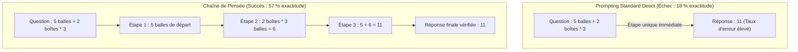
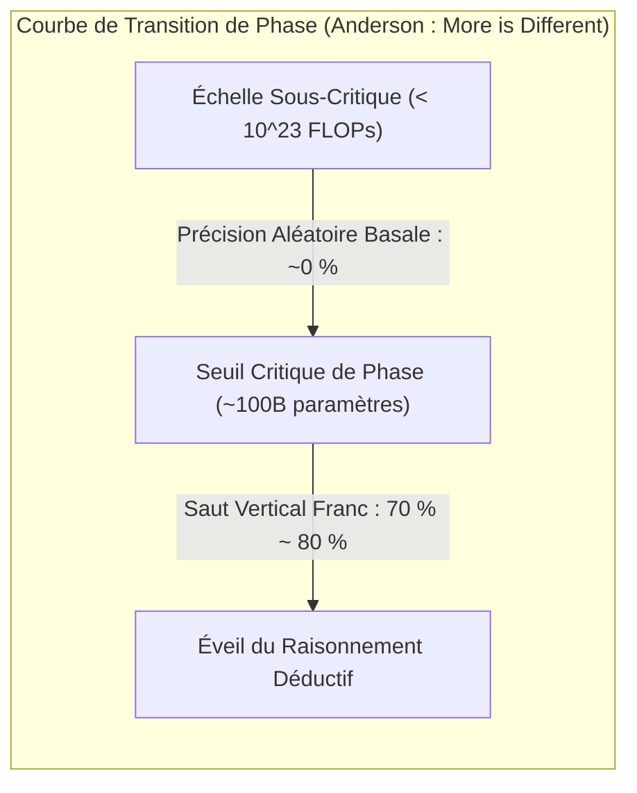

# Stanford CS329A (Ép 13) : LLM Reasoning — Denny Zhou, Chain-of-Thought (CoT), Self-Consistency et capacités émergentes

Pendant des décennies, les chercheurs en intelligence artificielle ont entretenu un scepticisme tenace à l'égard des réseaux de neurones connexionnistes :
> *« Un grand modèle de langage autorégressif n'est rien d'autre qu'un perroquet stochastique (Stochastic Parrot) qui enchaîne des mots statistiquement plausibles. Face à des problèmes arithmétiques à plusieurs étapes, de logique formelle ou de déductions causales, il produit des hallucinations séduisantes mais reste incapable de véritable raisonnement déductif. »*

De fait, les premiers modèles de pointe échouaient lourdement face à des énoncés mathématiques élémentaires, produisant d'emblée des résultats erronés faute de pouvoir décomposer leur réflexion.

En ouvrant la quatrième et ultime partie de notre cursus — **Part 4 : Les Frontières (Leçons 13 à 17)** de **Stanford CS329A : Self-Improving AI Agents** —, nous gravissons le sommet intellectuel de l'IA : les **LLM Reasoning Foundations**. Guidés par les travaux pionniers du **Dr Denny Zhou** (Directeur de la recherche sur le raisonnement chez Google DeepMind), nous explorons la genèse de l'étincelle cognitive au sein des modèles neuronaux :
- **Chaîne de pensée (Chain of Thought CoT Prompting, NeurIPS 2022) :** Comment la simple verbalisation des étapes logiques a propulsé l'exactitude mathématique de PaLM 540B de 18 % à 57 % sans modifier le moindre poids.
- **Décodage par auto-cohérence (Self-Consistency Decoding LLM, ICLR 2023) :** Fondé sur le principe tolstoïen d'Anna Karénine — *« Les raisonnements rigoureux convergent vers une vérité unique, tandis que les erreurs dérivent vers le chaos »* — éliminant le bruit stochastique par vote majoritaire.
- **Capacités cognitives émergentes (Emergent Cognitive Abilities AI, 2022) :** Les transitions de phase en physique (« More is Different ») et le grand débat épistémologique : l'émergence est-elle une réalité physique ou un mirage issu de métriques non linéaires ?

{/* truncate */}


---

## 1. L'effondrement du mythe du « perroquet stochastique »

Les approches initiales par quelques exemples (Few-Shot Prompting) liaient directement la question à la réponse finale :

```text
[Prompting Standard Direct (Mode d'échec)]
-----------------------------------------------------------------------------------------
Q: Roger a 5 balles de tennis. Il achète 2 boîtes supplémentaires de balles.
   Chaque boîte contient 3 balles. Combien de balles a-t-il maintenant ?
A: La réponse est 11.
-----------------------------------------------------------------------------------------
```

Cette formulation contraignait le modèle à compresser l'intégralité du calcul mental dans l'émission d'un unique token de réponse. Sans espace de travail transitoire (Scratchpad) pour stocker les états intermédiaires, le modèle échouait systématiquement.

Denny Zhou et Jason Wei ont modifié une seule ligne dans la formulation des démonstrations, bouleversant l'histoire de l'IA :

```text
[Prompting par Chaîne de Pensée (Chain-of-Thought)]
-----------------------------------------------------------------------------------------
Q: Roger a 5 balles de tennis. Il achète 2 boîtes supplémentaires de balles.
   Chaque boîte contient 3 balles. Combien de balles a-t-il maintenant ?
A: Roger a d'abord 5 balles de tennis.
   2 boîtes de 3 balles chacune font 2 * 3 = 6 balles.
   5 + 6 = 11.
   Par conséquent, la réponse est 11.
-----------------------------------------------------------------------------------------
```

```
┌─────────────────────────────────────────────────────────────────────────┐
│                 Les 3 piliers du raisonnement machine cognitif          │
└────────────────────────────────────┬────────────────────────────────────┘
                                     │
       ┌─────────────────────────────┼─────────────────────────────┐
       ▼                             ▼                             ▼
┌──────────────────────────┐  ┌──────────────────────────┐  ┌──────────────────────────┐
│ Chaîne de Pensée (CoT)   │  │ Auto-Cohérence (Self-Con)│  │   Capacités Émergentes   │
├──────────────────────────┤  ├──────────────────────────┤  ├──────────────────────────┤
│ • Triplet <Q, Étapes, R> │  │ • Sample-and-Marginalize │  │ • Transition de phase    │
│ • Zéro mise à jour poids │  │ • Convergence tolstoïenne│  │ • Seuil > 10^23 FLOPs    │
│ • GSM8K : saut 18% -> 57%│  │ • Vote majoritaire (T=0.7│  │ • Débat du mirage (p^L) │
│ • Logique séquentielle   │  │ • Précision : 56% -> 74% │  │ • Rupture macroscopique  │
│ • Ablation équation/point│  │ • Confiance intrinsèque  │  │ • Éveil de l'intelligence│
└──────────────────────────┘  └──────────────────────────┘  └──────────────────────────┘
```

---

## 2. Chaîne de pensée (CoT) Prompting (Wei, Zhou et al., NeurIPS 2022)

Publié fin 2022, l'article fondateur **《Chain-of-Thought Prompting Elicits Reasoning in Large Language Models》** a profondément redéfini l'allocation de calcul à l'inférence.

Jusqu'alors, la communauté pensait que résoudre des déductions complexes nécessitait un réentraînement supervisé sur des milliers d'exemples ou l'adjonction de modèles de vérification :
- Sur le banc d'essai d'arithmétique scolaire **GSM8K**, le modèle géant **PaLM 540B** ne dépassait pas **18 % d'exactitude** en mode standard.
- En intégrant simplement **8 exemples structurés avec des étapes en langage naturel**, l'exactitude a **bondi à 57 %** !
- Cette progression spectaculaire de 39 points a surclassé les meilleures performances antérieures d'OpenAI (33 %) — obtenues au prix d'un coûteux réentraînement supervisé et d'un vérificateur dédié — **sans recalculer un seul paramètre du modèle**.



### Études d'ablation : d'où provient le pouvoir de déduction ?
Certains critiques ont soutenu que CoT ne fonctionnait que grâce aux symboles d'équations ou au délai temporel conféré par la génération de tokens additionnels. L'équipe de Denny Zhou a réfuté ces doutes par des ablations systématiques :
1. **Ablation par équations pures (Equation Only) :** Fournir uniquement la formule mathématique sans texte explicatif (`5 + (2 * 3) = 11`) a fait rechuter la performance à **18 %**.
2. **Simulation par points (Dots Only) :** Remplacer les étapes par des suites de points (`......`) pour simuler un temps de calcul feedforward n'a apporté **aucun gain**.
3. **Explication a posteriori (Reasoning after Answer) :** Exiger la réponse chiffrée en premier puis l'explication a produit un échec complet.
- **Conclusion :** L'élément déclencheur du raisonnement n'est ni la formule algébrique ni l'étirement du calcul, mais **l'articulation logique pas-à-pas en langage naturel (Natural Language Reasoning Steps)**, permettant aux têtes d'attention d'ancrer chaque déduction sur les prémisses formulées en amont.

---

## 3. La démocratie des idées : Self-Consistency (Wang, Zhou et al., ICLR 2023)

Malgré sa puissance, CoT restait vulnérable à la rigidité du **décodage glouton (Greedy Decoding)** :
> *« Le décodage glouton retient stérilement le token le plus probable à chaque pas. Dans une démonstration en 10 étapes, si le modèle commet un infime dérapage arithmétique à l'étape 3, l'ensemble des étapes subséquentes (4 à 10) bascule inévitablement vers une conclusion fausse. »*

En 2023, Denny Zhou et Xuezhi Wang ont développé **Self-Consistency Decoding LLM**, substituant au déterminisme glouton un modèle d'agrégation statistique.

### Le principe de convergence tolstoïen
Léon Tolstoï débute *Anna Karénine* par cette maxime célèbre :
> *« Toutes les familles heureuses se ressemblent, chaque famille malheureuse l'est à sa manière. »*

Zhou a démontré que ce principe gouverne rigoureusement l'espace du raisonnement déductif :
- Face à une énigme complexe, qu'on emploie la substitution algébrique, l'analyse géométrique ou la récurrence, **toutes les trajectoires de pensée valides convergent vers une vérité mathématique unique ($Réponse = 42$)**.
- En revanche, les raisonnements erronés trébuchent sur des failles variées, **se dispersant chaotiquement dans l'espace infini des mauvaises réponses (ex. $-14, 108, 3.14$)**.

```text
                                [Énoncé du Problème]
                                         │
        ┌────────────────┬───────────────┼───────────────┬────────────────┐
        ▼                ▼               ▼               ▼                ▼
   [Voie 1 : Algèbre][Voie 2 : Géom.] [Voie 3 : Signe][Voie 4 : Induct.] [Voie 5 : Form.]
    ... étapes ...   ... étapes ...   ... étapes ...   ... étapes ...   ... étapes ...
        │                │               │               │                │
        ▼                ▼               ▼               ▼                ▼
     Rép : 42         Rép : 42        Rép : -14       Rép : 42         Rép : 108
     (1 voix !)       (1 voix !)                      (1 voix !)
        │                │                               │
        └────────────────┴───────────────┬───────────────┘
                                         ▼
                         [Vote Majoritaire : 42]
                        (Consensus Débarrassé du Bruit)
```

### Méthode Sample-and-Marginalize
Self-Consistency échantillonne $m$ trajectoires indépendantes en introduisant une température modérée ($T = 0,7$), puis isole le mode dominant dans l'espace des réponses finales :

```text
========================================================================================
Formulation du vote majoritaire par Self-Consistency :
========================================================================================
Final Answer = argmax_a  Σ_{i=1}^m  1[ a_i = a ]

Où :
  • m   : Nombre de trajectoires échantillonnées (généralement 5 à 40)
  • a_i : Réponse discrète issue de la i-ième trajectoire
  • 1[·]: Fonction indicatrice valant 1 si la trajectoire valide l'option a
========================================================================================
```

### Résultats et calibration de l'incertitude
- Sur `PaLM 540B`, associer CoT (56,5 %) à Self-Consistency a propulsé le score à **74,4 % (+17,9 points)**.
- **Métacognition non supervisée :** La proportion de voix recueillie par la réponse majoritaire (ex. 38 voix sur 40 contre 12 sur 40) est parfaitement corrélée à l'exactitude réelle, fournissant un **indicateur interne de confiance** sans modèle discriminateur annexe.

---

## 4. « More is Different » : Capacités émergentes et débat du mirage

Pourquoi CoT et Self-Consistency échouaient-ils sur les petits modèles de 1B ou 7B paramètres ?

En 1977, le lauréat du prix Nobel de physique Philip Anderson affirmait dans *« More is Different »* que les systèmes complexes ne se résument pas à la somme de leurs parties. On ne peut déduire la fluidité de l'eau en observant un atome d'hydrogène isolé.

Dans **《Emergent Abilities of Large Language Models》**, Jason Wei et Denny Zhou ont établi que les réseaux de neurones traversent de véritables **transitions de phase** :
> **« Une capacité émergente est une compétence cognitive quasi inexistante sur les petits modèles (au niveau du hasard), mais qui jaillit brutalement et verticalement dès lors que l'échelle de calcul franchit un seuil critique (typiquement `10^(23)` FLOPs ou ~100B paramètres). »**



### La grande controverse : l'émergence est-elle un mirage métrique ?
En 2024, une équipe de l'Université de Stanford emmenée par Sanjeev Arora a publié une étude contradictoire remarquée : **《Are Emergent Abilities of Large Language Models a Mirage? (Les capacités émergentes sont-elles un mirage ?)》**

#### L'objection d'Arora : l'effet trompeur des métriques non linéaires
L'équipe d'Arora s'est attaquée à la métrique de **correspondance exacte (Exact Match)** :
- Soit une déduction à $L$ étapes où chaque token a une probabilité $p$ d'être correctement prédit.
- À mesure que le modèle grandit, la précision élémentaire $p$ croît de manière **rigoureusement linéaire et continue** (`0,6 \to 0,7 \to 0,8 \to 0,9`).
- Mais si l'évaluation exige que l'ensemble des $L=5$ tokens consécutifs soient rigoureusement exacts, la note globale évolue comme $p^L$ :
  $`0,6^5 = 0,07 \; (7 \%) \quad \longrightarrow \quad 0,9^5 = 0,59 \; (59 \%)`$
- **La thèse du mirage :** La compétence sous-jacente progresse de façon continue ; la prétendue discontinuité n'est qu'une illusion mathématique produite par des critères d'évaluation en échelon.

```text
========================================================================================
Formule de l'hypothèse du mirage métrique :
========================================================================================
Accuracy_ExactMatch = ( p_token )^L

Où :
  • p_token : Probabilité par token (progression linéaire régulière avec l'échelle)
  • L       : Longueur de la chaîne de déduction interdépendante
  • Lorsque L est élevé, la progression linéaire est perçue comme un saut abrupt !
========================================================================================
```

#### La réponse de Denny Zhou et la synthèse dialectique
L'équipe de Denny Zhou a répliqué avec des preuves solides :
1. En observant la métrique continue de la **perte d'entropie croisée (Cross-Entropy Loss)** sur des tâches de logique pure, on observe bien que la perte stagne avant de s'effondrer subitement à une échelle précise, confirmant une transition de phase réelle.
2. Même sous des métriques continues de similarité (BLEU, ROUGE), les sauts qualitatifs persistent sur de multiples tâches cognitives.

**La vision synthétique :**
> *« Si les métriques en échelon accentuent visuellement la pente du saut, la logique humaine est par nature séquentielle : la proposition B ne tient pas si la prémisse A est fausse. Dans les graphes causaux complexes, le franchissement d'un seuil probabiliste local engendre inévitablement une transition de phase macroscopique dans l'intelligence globale du système. »*

---

## 5. Synthèse comparative des paradigmes de raisonnement

```text
=============================================================================================================
Dimension             Prompting Standard Direct     Chaîne de Pensée (CoT)        Auto-Cohérence (Self-Cons.)
-------------------------------------------------------------------------------------------------------------
Trajectoire Déductive Mappage Direct (Q -> R)       Développement Séquentiel      Exploration Multiple & Vote
Mode de Décodage      Glouton (Greedy argmax)       Glouton (Greedy argmax)       Échantillonnage et Mode
Surcoût de Calcul     1x FLOPs                      ~3x Tokens par Requête        15x à 30x Volume de Calcul
Précision sur GSM8K   18 % (PaLM 540B)              57 % (+39 points)             74,4 % (+17,4 points suppl.)
Mécanisme d'Échec     Hallucination Immédiate       Cascade d'Erreurs sur 1 FailleConsensus sur Erreur Commune
Mesure d'Incertitude  Nulle (Softmax Trop Confiant) Nulle                         Mesurée par la Fraction de Voix
Seuil d'Émergence     Universel                     Émerge à >100B / 10^23 FLOPs  Requiert un Modèle avec CoT
=============================================================================================================
```

---

## 6. Questions-Réponses Techniques Approfondies (Q&A)

### Q1 : Les modèles compacts actuels (7B ou 8B) sont-ils désormais capables de raisonner avec CoT ?
En 2022, les modèles bruts de moins de 50B étaient totalement inaptes à déployer CoT.

Toutefois, les avancées du post-entraînement ont bouleversé ce paradigme :
- **Distillation de connaissances :** Des modèles compacts sont directement entraînés sur des millions de traces CoT de haute qualité issues de modèles géants.
- **Apprentissage par renforcement avec récompenses vérifiables (RLVR) :** Des architectures modernes telles que `DeepSeek-R1-Distill-Qwen-7B` dépassent aujourd'hui 85 % sur GSM8K, surclassant largement le PaLM 540B originel.
- Le seuil physique d'émergence n'est pas immuable : la pureté des données et le perfectionnement des algorithmes le repoussent continuellement vers des échelles plus légères.

### Q2 : Quel nombre d'échantillons (m) privilégier en pratique pour Self-Consistency ?
Les données expérimentales montrent que les gains suivent une courbe log-linéaire qui sature rapidement :
- **Entre 5 et 10 échantillons**, on capture plus de **80 % du gain de précision maximal**.
- Passer de 10 à 40 échantillons quadruple les factures d'API pour un gain minime de 1 à 2 %.
- **Recommandation industrielle :** Échantillonner **5 à 8 trajectoires à $T = 0,7$** constitue le compromis de Pareto optimal entre coût de fonctionnement et exactitude.

---

## Résumé & Prochaine Étape

Le raisonnement des machines n'est pas une illusion inaccessible. Grâce à **Chain-of-Thought (CoT)**, Denny Zhou a démontré que le langage naturel est le support par excellence par lequel s'éveillent les facultés logiques. Grâce à **Self-Consistency**, nous avons constaté comment le consensus majoritaire purge le bruit des déductions erronées. À travers le **débat sur l'émergence**, nous avons cerné les transitions de phase physiques propres à l'intelligence artificielle.

Toutefois, le raisonnement CoT en langage naturel demeure probabiliste et susceptible d'hallucinations insidieuses. Que faire lorsqu'une rigueur absolue est exigée — comme lors des épreuves de l'**Olympiade Internationale de Mathématiques (IMO)** ?

Lors de la **Leçon 14**, nous explorerons : **《AlphaProof & Mathematical Reasoning : Vérification Formelle, Lean 4 et Démonstrations Olympiques Médaille d'Or》**.

---

### Points Clés
- **Le Langage comme Véhicule de la Pensée :** Décomposer les problèmes en étapes naturelles (CoT) a fait bondir l'exactitude de PaLM 540B de 39 points sans modifier ses poids.
- **La Vérité Converge, l'Erreur Diverge :** Le vote majoritaire de Self-Consistency exploite la topologie logique pour porter la précision à 74,4 %.
- **La Réalité des Transitions de Phase :** Au-delà de `10^(23)` FLOPs, l'accumulation de probabilités locales débloque une véritable faculté de déduction macroscopique.