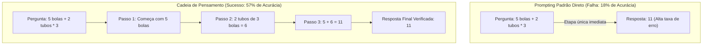
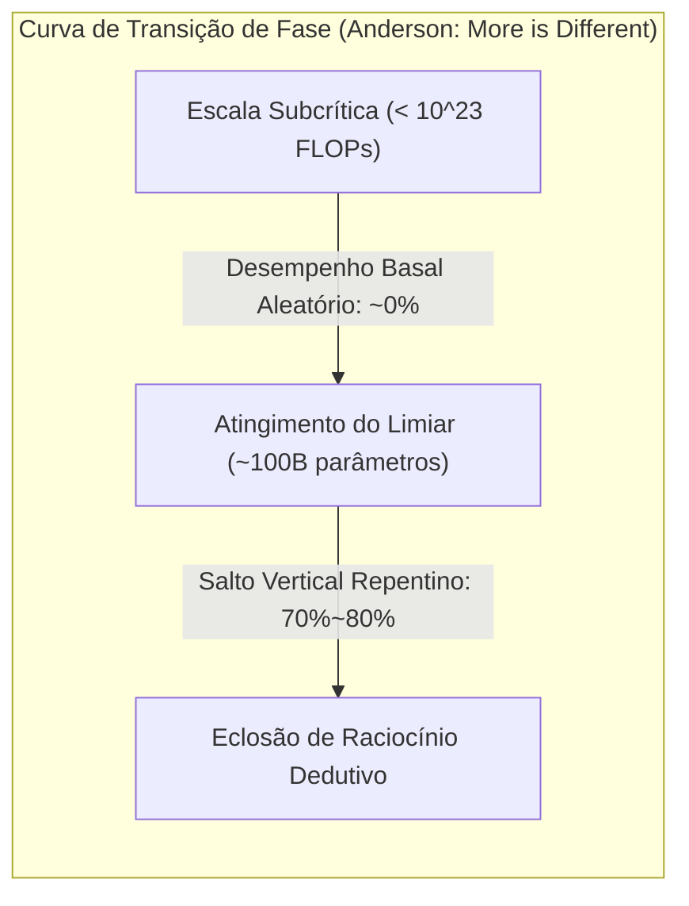

# Stanford CS329A (Ep 13): LLM Reasoning — Denny Zhou, Chain-of-Thought (CoT), Self-Consistency e Habilidades Emergentes

Durante décadas, a comunidade de inteligência artificial conviveu com um profundo ceticismo em relação às redes neurais conexionistas:
> *"Um modelo autorregressivo de linguagem nada mais é do que um papagaio estocástico (Stochastic Parrot), que concatena palavras estatisticamente prováveis. Ao se deparar com cálculos de múltiplos passos, lógica formal ou deduções causais, ele produz apenas alucinações vazias, sendo incapaz de raciocínio dedutivo genuíno."*

De fato, os primeiros modelos de ponta fracassavam diante de problemas matemáticos escolares expressos em palavras, devolvendo respostas numéricas incorretas de imediato, sem estruturar qualquer cadeia lógica intermediária.

Inaugurando a quarta e conclusiva etapa do nosso curso — **Part 4: As Fronteiras (Aulas 13 a 17)** de **Stanford CS329A: Self-Improving AI Agents** —, adentramos o ápice intelectual da inteligência artificial: as **LLM Reasoning Foundations**. Guiados pelos estudos inaugurais do **Dr. Denny Zhou** (Líder de Raciocínio no Google DeepMind), investigamos como a centelha do raciocínio cognitivo se acende nos modelos neurais:
- **Chain of Thought CoT Prompting (NeurIPS 2022):** Como a decomposição em etapas de raciocínio em linguagem natural elevou a acurácia de PaLM 540B de 18% para 57% sem alterar um único peso do modelo.
- **Self-Consistency Decoding LLM (ICLR 2023):** Inspirado no princípio de Anna Karenina de Tolstói — *"Os caminhos corretos convergem para uma verdade única, enquanto os erros divergem para o caos"* — filtrando o ruído estocástico através do voto por consenso da maioria.
- **Emergent Cognitive Abilities AI (2022):** A física das transições de fase ("More is Different") e o grande debate epistemológico: a emergência é uma propriedade física autêntica ou uma miragem matemática provocada por métricas não lineares?

{/* truncate */}


---

## 1. O Fim do Mito do "Papagaio Estocástico"

As primeiras técnicas apresentavam exemplos diretos (Few-Shot Prompting) que vinculavam imediatamente a pergunta ao resultado final:

```text
[Prompting Padrão Direto (Modo de Falha)]
-----------------------------------------------------------------------------------------
Q: Roger tem 5 bolas de tênis. Ele compra mais 2 tubos de bolas. 
   Cada tubo contém 3 bolas de tênis. Quantas bolas de tênis ele tem agora?
A: A resposta é 11.
-----------------------------------------------------------------------------------------
```

Essa abordagem forçava o modelo a sintetizar todo o grafo de cálculo em um único passo de geração. Sem uma área de rascunho (Scratchpad) para calcular estados intermediários, o modelo colapsava em alucinações numéricas.

Denny Zhou e Jason Wei alteraram uma única linha nas demonstrações, redirecionando o rumo da inteligência artificial:

```text
[Prompting por Cadeia de Pensamento (Chain-of-Thought)]
-----------------------------------------------------------------------------------------
Q: Roger tem 5 bolas de tênis. Ele compra mais 2 tubos de bolas. 
   Cada tubo contém 3 bolas de tênis. Quantas bolas de tênis ele tem agora?
A: Roger começou com 5 bolas de tênis. 
   2 tubos de 3 bolas cada equivalem a 2 * 3 = 6 bolas de tênis. 
   5 + 6 = 11. 
   Portanto, a resposta é 11.
-----------------------------------------------------------------------------------------
```

```
┌─────────────────────────────────────────────────────────────────────────┐
│                 Os 3 Pilares do Raciocínio Cognitivo em Máquinas        │
└────────────────────────────────────┬────────────────────────────────────┘
                                     │
       ┌─────────────────────────────┼─────────────────────────────┐
       ▼                             ▼                             ▼
┌──────────────────────────┐  ┌──────────────────────────┐  ┌──────────────────────────┐
│ Cadeia de Pensam. (CoT)  │  │ Autoconsistência (SC)    │  │  Habilidades Emergentes  │
├──────────────────────────┤  ├──────────────────────────┤  ├──────────────────────────┤
│ • Triplet <P, Passos, R> │  │ • Sample-and-Marginalize │  │ • Transição de fase     │
│ • Zero ajuste de pesos   │  │ • Convergência tolstoyana│  │ • Limiar > 10^23 FLOPs   │
│ • GSM8K: Salto 18% -> 57%│  │ • Voto por maioria (T=0.7│  │ • Debate da miragem (p^L)│
│ • Lógica sequencial nat. │  │ • Acurácia: 56% -> 74,4% │  │ • Salto cognitivo macro  │
│ • Ablação de fórmulas/pts│  │ • Métrica de incerteza   │  │ • Não linearidade real   │
└──────────────────────────┘  └──────────────────────────┘  └──────────────────────────┘
```

---

## 2. Chain-of-Thought (CoT) Prompting (Wei, Zhou et al., NeurIPS 2022)

Publicado no final de 2022, o artigo **《Chain-of-Thought Prompting Elicits Reasoning in Large Language Models》** revolucionou a alocação de computação em tempo de inferência.

Até aquele momento, acreditava-se que para induzir raciocínios sofisticados era mandatório realizar ajuste fino supervisionado em dezenas de milhares de problemas ou treinar modelos adicionais de verificação:
- No benchmark escolar de matemática **GSM8K**, o colossal **PaLM 540B** atingia modestos **18% de acurácia** com prompting padrão.
- Ao inserir **apenas 8 exemplos contendo passos de raciocínio intermediários em linguagem natural**, a acurácia **saltou para 57%**!
- Essa melhora de 39 pontos percentuais superou o recorde anterior da OpenAI (33%) — que havia demandado fine-tuning em larga escala e modelos de recompensa — **sem atualizar um único parâmetro da rede neural**.



### Estudos de Ablação: De onde surge a força do raciocínio?
Críticos cogitaram se o CoT funcionava apenas pela presença de equações matemáticas ou pelo tempo adicional de processamento provido por tokens extras. A equipe de Denny Zhou respondeu com experimentos rigorosos de ablação:
1. **Ablação de Apenas Fórmulas (Equation Only):** Fornecer apenas as operações matemáticas sem explicações em linguagem natural (`5 + (2 * 3) = 11`) fez o desempenho regredir aos **18%**.
2. **Ablação de Reticências (Dots Only):** Substituir as etapas por sequências de pontos (`......`) para simular tempo extra de cálculo não gerou **nenhum ganho**.
3. **Explicação Posterior:** Obrigar o modelo a enunciar a resposta primeiro e explicá-la em seguida levou a falhas sistemáticas.
- **Conclusão:** O núcleo propulsor do raciocínio não é a álgebra nem o atraso no processamento, mas **o encadeamento dedutivo em linguagem natural (Natural Language Reasoning Steps)**, permitindo que a atenção do transformador condicione cada dedução subsequente nas premissas enunciadas anteriormente.

---

## 3. A Democracia dos Pensamentos Diversos: Self-Consistency (Wang, Zhou et al., ICLR 2023)

Apesar do salto promovido pelo CoT, persistia uma vulnerabilidade ligada ao determinismo do **Greedy Decoding**:
> *"O Greedy Decoding escolhe rigidamente o token mais provável em cada ponto. Em uma demonstração de 10 etapas, caso ocorra um deslize no passo 3, os passos 4 a 10 seguirão essa premissa incorreta rumo a um resultado completamente falso."*

Em 2023, Denny Zhou e Xuezhi Wang apresentaram a **Self-Consistency Decoding LLM**, substituindo a rota única pela agregação probabilística de múltiplos caminhos.

### O Princípio de Convergência Tolstoyano
Liev Tolstói inicia *Anna Karenina* com a famosa frase:
> *"Todas as famílias felizes se parecem; cada família infeliz é infeliz à sua maneira."*

Zhou constatou que a topologia do raciocínio matemático segue esse mesmo padrão:
- Em problemas complexos, seja por substituição algébrica, geometria analítica ou indução, **todas as trilhas dedutivas válidas convergem para uma verdade matemática única ($Resposta = 42$)**.
- Por outro lado, as deduções que cometem equívocos lógicos se perdem em falhas variadas, **dispersando-se caoticamente em um espaço infinito de números incorretos (ex.: $-14, 108, 3.14$)**.

```text
                                [Enunciado da Questão]
                                          │
        ┌────────────────┬────────────────┼────────────────┬────────────────┐
        ▼                ▼                ▼                ▼                ▼
   [Trilha 1: Álg.] [Trilha 2: Geom.] [Trilha 3: Sinal] [Trilha 4: Ind.] [Trilha 5: Fórm.]
    ... passos ...   ... passos ...   ... passos ...    ... passos ...   ... passos ...
        │                │                │                │                │
        ▼                ▼                ▼                ▼                ▼
     Resp: 42         Resp: 42         Resp: -14        Resp: 42         Resp: 108
     (1 voto!)        (1 voto!)                         (1 voto!)
        │                │                                 │
        └────────────────┴────────────────┬────────────────┘
                                          ▼
                         [Voto por Maioria Moda: 42]
                        (Consenso Livre de Ruídos)
```

### Formulação de Sample-and-Marginalize
A técnica Self-Consistency amostra $m$ trajetórias independentes usando uma temperatura moderada ($T = 0,7$) e elege a resposta modal no conjunto gerado:

```text
========================================================================================
Equação do Voto por Maioria em Self-Consistency:
========================================================================================
Final Answer = argmax_a  Σ_{i=1}^m  1[ a_i = a ]

Onde:
  • m   : Quantidade de trajetórias independentes amostradas (em geral de 5 a 40)
  • a_i : Resposta discreta deduzida pela i-ésima trajetória
  • 1[·]: Função indicadora que retorna 1 caso a resposta corresponda à opção a
========================================================================================
```

### Ganhos Reais e Calibração Intrínseca de Certeza
- No `PaLM 540B`, aliar CoT (56,5%) ao Self-Consistency elevou o índice para **74,4% (+17,9 pontos)**.
- **Metacognição sem Supervisão:** A porcentagem de votos obtida pela resposta majoritária (ex.: 38 em 40 votos versus 12 em 40) correlaciona-se com precisão à acurácia real. O agente ganha um **indicador intrínseco de confiança** dispensando modelos classificadores externos.

---

## 4. "More is Different": Habilidades Emergentes e o Debate da Miragem

Por que o CoT e o Self-Consistency não funcionavam em modelos pequenos de 1B ou 7B parâmetros?

Em 1977, o físico Nobel Philip Anderson publicou *"More is Different"*, postulando que sistemas complexos não podem ser explicados apenas pela soma de suas partes. É inviável deduzir a dinâmica de fluidos a partir do estudo isolado de um átomo de hidrogênio.

Em **《Emergent Abilities of Large Language Models》**, Jason Wei e Denny Zhou demonstraram que as redes neurais vivenciam **transições de fase (Phase Transitions)** equivalentes:
> **"Uma habilidade emergente é uma competência cognitiva praticamente ausente em modelos menores (com desempenho próximo ao acaso), mas que eclode de forma súbita e vertical quando a escala computacional ultrapassa um limiar crítico (tipicamente `10^(23)` FLOPs ou ~100B parâmetros)."**



### O Grande Debate Acadêmico: A emergência é uma miragem métrica?
Em 2024, um grupo da Universidade de Stanford liderado por Sanjeev Arora publicou um estudo instigante: **《Are Emergent Abilities of Large Language Models a Mirage? (As habilidades emergentes são uma miragem?)》**

#### A Crítica de Arora: A distorção por métricas não lineares
O grupo de Arora analisou o uso da métrica de **correspondência exata (Exact Match)**:
- Considere uma dedução de $L$ passos em que cada token tem probabilidade $p$ de acerto.
- Conforme o modelo cresce, a precisão elementar $p$ progride de forma **completamente suave e linear** (`0,6 \to 0,7 \to 0,8 \to 0,9`).
- Contudo, se a avaliação exigir acerto absoluto em todos os $L=5$ tokens, a métrica final escala como $p^L$:
  $`0,6^5 = 0,07 \; (7\%) \quad \longrightarrow \quad 0,9^5 = 0,59 \; (59\%)`$
- **A Tese da Miragem:** A habilidade subjacente cresce de maneira contínua; o suposto salto abrupto é um efeito colateral matemático gerado por métricas não lineares.

```text
========================================================================================
Equação da Hipótese da Miragem Métrica:
========================================================================================
Accuracy_ExactMatch = ( p_token )^L

Onde:
  • p_token : Probabilidade por token (crescimento linear regular com a escala)
  • L       : Comprimento da cadeia causal de passos interdependentes
  • Quando L é longo, ganhos lineares em p_token aparentam saltos macroscópicos!
========================================================================================
```

#### A Resposta de Denny Zhou e a Síntese Epistemológica
A equipe de Zhou apresentou contraprovas robustas:
1. Ao acompanhar a métrica contínua de **perda por entropia cruzada (Cross-Entropy Loss)** em problemas lógicos complexos, nota-se que a perda permanece estagnada até despencar subitamente em escalas específicas, comprovando a transição de fase física.
2. Mesmo adotando métricas semânticas contínuas (BLEU, ROUGE), os saltos qualitativos continuam visíveis em diversas tarefas dedutivas.

**Conclusão Equilibrada:**
> *"Embora métricas em degrau possam acentuar visualmente a inclinação, o raciocínio dedutivo humano é intrinsecamente sequencial: o passo B não se sustenta se a premissa A for falsa. Em grafos causais densos, ganhos pontuais em probabilidades microscópicas resultam inevitavelmente em transições de fase na inteligência global do sistema."*

---

## 5. Comparativo dos Paradigmas de Raciocínio Cognitivo

```text
=============================================================================================================
Dimensão              Prompting Padrão Direto       Cadeia de Pensamento (CoT)    Autoconsistência (SC)
-------------------------------------------------------------------------------------------------------------
Estrutura da Rota     Mapeamento Direto (P -> R)    Dedução Sequencial EstruturadaMúltiplas Trilhas e Votação
Estratégia de Decodif.Greedy argmax                 Greedy argmax                 Sample-and-Marginalize Moda
Custo Adicional       1x FLOPs                      ~3x Tokens por Consulta       15x a 30x Volume Computacional
Acurácia no GSM8K     18% (PaLM 540B)               57% (+39 pontos)              74,4% (+17,4 pontos adicionais)
Modo de Falha         Alucinação Direta             Cascata de Erros por 1 Falha  Conluio em Erros Comuns
Métrica de Incerteza  Inexistente                   Inexistente                   Fração de Votos da Opção Moda
Limiar de Escala      Universal em Qualquer Tamanho Emerge em >100B / 10^23 FLOPs Requer Modelos Aptos a CoT
=============================================================================================================
```

---

## 6. Análise Técnica Aprofundada (Q&A)

### P1: Modelos menores (7B ou 8B) conseguem executar raciocínio CoT atualmente?
Em 2022, modelos base pré-treinados menores que 50B não apresentavam capacidade para CoT.

No entanto, o pós-treinamento transformou esse cenário:
- **Destilação de Conhecimento:** Modelos compactos são treinados diretamente sobre milhões de trajetórias CoT produzidas por modelos de fronteira.
- **Aprendizado por Reforço com Recompensas Verificáveis (RLVR):** Arquiteturas atuais como `DeepSeek-R1-Distill-Qwen-7B` alcançam mais de 85% no GSM8K, superando expressivamente o PaLM 540B original.
- O limiar de emergência não é rígido; melhorias algorítmicas e na qualidade dos dados o tornam acessível a modelos cada vez mais leves.

### P2: Qual é o número ideal de trajetórias (m) para Self-Consistency na prática?
Os dados mostram que os ganhos seguem uma curva log-linear que se estabiliza rapidamente:
- **Entre 5 e 10 trajetórias**, atinge-se mais de **80% de todo o ganho potencial**.
- Subir de 10 para 40 amostras quadruplica os custos de computação e só agrega de 1% a 2% de acurácia.
- **Recomendação Prática:** Em produção, amostrar **entre 5 e 8 trajetórias com temperatura $T = 0,7$** representa o ponto de equilíbrio ótimo de Pareto entre custo operacional e acurácia.

---

## Conclusão & Próxima Aula

O raciocínio das máquinas é uma realidade palpável. Com o **Chain-of-Thought (CoT)**, Denny Zhou comprovou que a linguagem natural atua como meio essencial para o despertar lógico das redes neurais. Com o **Self-Consistency**, vimos como o consenso majoritário elimina o ruído estocástico. Através do **Debate da Emergência**, mapeamos as transições de fase da cognição artificial.

Contudo, o raciocínio CoT em linguagem natural permanece probabilístico e passível de alucinações. O que fazer quando uma tarefa exige exatidão matemática estrita — como na **Olimpíada Internacional de Matemática (IMO)**?

Na **Aula 14**, examinaremos: **《AlphaProof & Mathematical Reasoning: Lean 4, Verificação Formal e Demonstrações de Teoremas de Nível Medalha de Ouro na IMO》**.

---

### Principais Lições
- **A Linguagem é o Veículo do Raciocínio:** Estruturar problemas em etapas em linguagem natural elevou a acurácia do PaLM 540B em 39 pontos sem modificar seus pesos.
- **A Verdade Converge, o Erro Diverge:** O voto por maioria no Self-Consistency explora a topologia lógica para impulsionar a acurácia a 74,4%.
- **Transições de Fase Reais:** Ao superar `10^(23)` FLOPs, a acumulação de probabilidades pontuais desencadeia saltos qualitativos na inteligência dedutiva global.