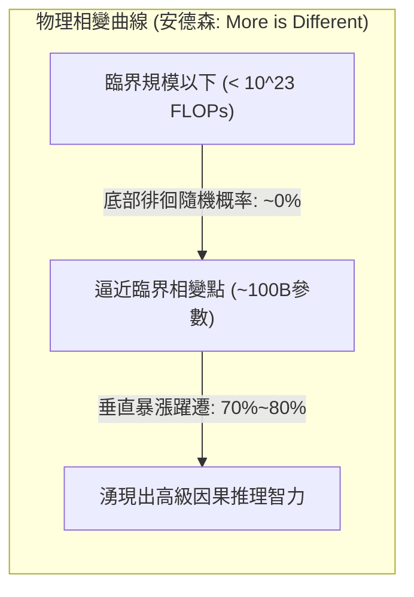

# Stanford CS329A (第13講): LLM Reasoning — 大模型推理的本質與思維鏈 (CoT, Self-Consistency, 湧現能力)

數十年來，人工智慧學術界一直籠罩在對聯結主義神經網路的深層懷疑之中：
> *「自回歸大型語言模型本質上不過是一個在統計上順理成章拼湊下一個詞的『隨機鸚鵡（Stochastic Parrot）』。面對需要多步運算、形式邏輯和因果推理的複雜問題時，它只能吐出似是而非的幻覺，根本不具備真正的演繹推理能力。」*

早期前沿大模型在面對國小應用題時的糟糕表現似乎印證了這一點：缺乏中間思維草稿紙的模型往往跳過步驟直接給出一個離譜的錯誤數字。

從本講開始，**Stanford CS329A: Self-Improving AI Agents**正式進入萬眾矚目的壓軸終章——**Part 4: 最前沿（Frontiers, Lectures 13 through 17）**。我們將直面機器智慧最深奧的精神高地：**LLM Reasoning Foundations**（大模型推理的底層基石）。以Google DeepMind推理研究總負責人、思維鏈（Chain-of-Thought）開創者**周登勇（Denny Zhou）博士**的經典研究為核心，深入剖析大語言模型內部「推理的火花」究竟是如何被點燃的：
- **思維鏈提示法 (Chain of Thought CoT Prompting, NeurIPS 2022):** 僅透過引入自然語言中間推理步驟，在不更新任何模型權重的前提下，讓PaLM 540B的數學解題準確率從18%暴增至57%的底層奧秘。
- **自洽性解碼 (Self-Consistency Decoding LLM, ICLR 2023):** 基於「通向真理的道路殊途同歸，通向謬誤的歧途各不相同」的托爾斯泰收斂法則，透過多重推理路徑取樣與多數投票，過濾隨機幻覺雜訊。
- **湧現式認知能力 (Emergent Cognitive Abilities AI, 2022):** 複雜系統物理學中的相變規律（“More is Different”）與史丹佛大學Arora教授「湧現是否為非線性指標造成的蜃景（Mirage）」之世紀大論戰。

{/* truncate */}


---

## 1. 「隨機鸚鵡」神話的終結

早期研究者在為大模型編寫Few-Shot範例時，通常將問題與最終答案直接強行綁定：

```text
[標準直接提示法 (失敗模式)]
-----------------------------------------------------------------------------------------
Q: 羅傑有5個網球。他又買了2罐網球。每罐有3個網球。請問羅傑現在一共有多少個網球？
A: 答案是11。
-----------------------------------------------------------------------------------------
```

這種直接映射迫使模型將整個複雜的多步計算圖壓縮至「單次下一個Token的預測」之中。由於沒有任何中間計算快取（Scratchpad），注意力機制無法承載高階因果依賴，導致模型只能憑空捏造錯誤答案。

周登勇博士與Jason Wei的研究團隊僅改變了範例中的一行表達，便徹底逆轉了AI演進的軌跡：

```text
[思維鏈提示法 (Chain-of-Thought)]
-----------------------------------------------------------------------------------------
Q: 羅傑有5個網球。他又買了2罐網球。每罐有3個網球。請問羅傑現在一共有多少個網球？
A: 羅傑最初擁有5個網球。
   買入2罐網球，每罐3個，即 2 * 3 = 6 個網球。
   5 + 6 = 11。
   因此，答案是11。
-----------------------------------------------------------------------------------------
```

```
┌─────────────────────────────────────────────────────────────────────────┐
│                 支撐機器認知推理的三大核心支柱                          │
└────────────────────────────────────┬────────────────────────────────────┘
                                     │
       ┌─────────────────────────────┼─────────────────────────────┐
       ▼                             ▼                             ▼
┌──────────────────────────┐  ┌──────────────────────────┐  ┌──────────────────────────┐
│     思維鏈 (CoT)         │  │     自洽性 (Self-Cons.)   │  │   湧現能力 (Emergent)    │
├──────────────────────────┤  ├──────────────────────────┤  ├──────────────────────────┤
│ • <問題, 推理步驟, 答案> │  │ • Sample-and-Marginalize │  │ • 安德森“More is Differ” │
│ • 模型權重更新: 0次      │  │ • 托爾斯泰真理收斂法則   │  │ • 臨界算力規模 > 10^23 FL│
│ • GSM8K: 18% -> 57% 躍遷 │  │ • 多路徑多數投票 (T=0.7) │  │ • 蜃景假說 (Mirage, p^L) │
│ • 自然語言逐步因果演繹   │  │ • 準確率提升: 56%->74.4% │  │ • 宏觀智慧相變躍遷       │
│ • 消融實驗排除單純數式/點│  │ • 模型內在置信度無監督度量│  │ • 非線性智慧爆發的物理實像│
└──────────────────────────┘  └──────────────────────────┘  └──────────────────────────┘
```

---

## 2. 思維鏈提示法 (Wei, Zhou et al., NeurIPS 2022)

發表於2022年末的經典論文**《Chain-of-Thought Prompting Elicits Reasoning in Large Language Models》**徹底重塑了推理算力的配置範式。

在此之前，學術界普遍認為讓模型掌握複雜多步推理，必須在數萬條人工標註的數據集上進行全面微調（Fine-tuning）或訓練外置驗證器（Verifier）：
- 在國小數學應用題基準**GSM8K**上，當時全球頂尖的超大模型`PaLM 540B`採用標準提示的準確率僅為慘淡的**18%**。
- 然而，僅僅在提示詞中加入**8個包含自然語言中間推演步驟的CoT範例**，模型的準確率便瞬間**暴漲至57%**！
- 這一躍升不僅將準確率拔高了39個百分點，甚至直接超越了OpenAI此前透過數萬條數據微調配合獎勵模型驗證器才達到的33%紀錄——**而且整個過程沒有更新模型的一個參數權重**！


### 嚴謹的消融實驗：到底是什麼賦予了大模型推理能力？
面對學界對CoT「是否只是塞入了算式」或「單純增加Token延長時間」的質疑，周登勇團隊進行了無懈可擊的消融對比實驗：
1. **純算式消融 (Equation Only):** 不寫自然語言推導，僅列出算式（如 `5 + (2 * 3) = 11`），模型準確率瞬間跌回 **18%**。
2. **純算力延長消融 (Dots Only):** 用省略號點（`......`）替代推理步驟給模型「拖延思考時間」，性能提升為零。
3. **答案後置推演 (Reasoning after Answer):** 讓模型先輸出最終答案，再補寫推導過程，模型表現同樣崩潰。
- **結論:** 賦予大模型真正推理火種的，既非純數學符號，亦非盲目的Token填充，而是**「模擬人類思維、使用自然語言逐步鋪展因果前提的順序演繹能力（Natural Language Reasoning Steps）」**。

---

## 3. 多元思維的民主制：Self-Consistency (Wang, Zhou et al., ICLR 2023)

CoT雖然帶來了革命性突破，但受限於傳統的**貪婪解碼（Greedy Decoding）**機制，存在著極其脆弱的致命傷：
> *「貪婪解碼在每一步都只選取局部概率最高的那一個Token，沿著單一路線狂奔。在長達10步的推導鏈條中，一旦模型在第3步出現微小的符號疏忽，即便後續第4至第10步的邏輯再嚴絲合縫，也只能不可逆地墜入錯誤的深淵。」*

2023年，周登勇與王雪智團隊提出了**Self-Consistency Decoding LLM**，透過優雅的統計邊緣化方法取代了脆弱的單路徑貪婪解碼。

### 托爾斯泰收斂法則：「真理的路徑殊途同歸，謬誤的藉口各不相同」
列夫·托爾斯泰在《安娜·卡列尼娜》開篇寫道：
> *「幸福的家庭都是相似的，不幸的家庭各有各的不幸。」*

周登勇博士敏銳地洞察到，這種拓撲結構在數學推理空間中完全適用：
- 面對一道複雜的綜合推理題，無論採用代數代換、建立幾何座標系，還是利用反向推導，**所有推演邏輯正確的思考路徑，最終都必然在唯一的真理終點強力收斂（Converge，如答案均為42）**。
- 反觀那些出現推演邏輯漏洞或計算疏忽的錯誤路徑，有的算得 $-14$，有的算得 $108$，有的算得 $3.14$——它們在**無限廣袤的謬誤解空間中雜亂無章地發散（Diverge）**！

```text
                                [數學推理問題 Prompt]
                                         │
        ┌────────────────┬───────────────┼───────────────┬────────────────┐
        ▼                ▼               ▼               ▼                ▼
   [路徑1: 代數推導] [路徑2: 幾何分析] [路徑3: 符號筆誤] [路徑4: 歸納還原] [路徑5: 公式誤用]
    ... 逐步推導 ... ... 逐步推導 ... ... 逐步推導 ... ... 逐步推導 ... ... 逐步推導 ...
        │                │               │               │                │
        ▼                ▼               ▼               ▼                ▼
     得數: 42         得數: 42        得數: -14       得数: 42         得數: 108
     (記一票!)        (記一票!)                       (記一票!)
        │                │                               │
        └────────────────┴───────────────┬───────────────┘
                                         ▼
                         [多數投票聚合選出眾數: 42]
                        (排除了單次隨機錯誤的最終答案)
```

### 取樣與邊緣化建模 (Sample-and-Marginalize)
Self-Consistency透過設定適度取樣溫度（$T = 0.7$），獨立抽取 $m$ 條不同的CoT推理軌跡，並在最終離散答案空間進行多數投票（Majority Vote）：

```text
========================================================================================
自洽性 (Self-Consistency) 多數投票數學公式:
========================================================================================
Final Answer = argmax_a  Σ_{i=1}^m  1[ a_i = a ]

其中:
  • m   : 取樣的獨立推理軌跡數量 (通常取 5 至 40)
  • a_i : 從第 i 條推理軌跡末尾提取出的最終離散答案
  • 1[·]: 指示函數，當軌跡答案與候選答案 a 相符時返回 1，否則返回 0
========================================================================================
```

### 實驗收益與無監督置信度自知
- 在`PaLM 540B`上，將CoT（56.5%）與Self-Consistency結合，基準準確率進一步**飆升至74.4%（淨增17.9個百分點）**。
- **內在不確定性自我覺察:** 獲得最高票數答案的得票率（例如40票中斬獲38票 vs 40票中僅得12票）與真實答案的正確概率呈現出絕佳的正相關。這為智慧體提供了一種完全無需外掛評判模型的**內在元認知（Metacognition）置信度標尺**。

---

## 4. “More is Different”: 湧現能力與世紀大論戰

為什麼CoT與Self-Consistency等強大的推理技巧在1B或7B這樣的小模型上完全不起作用？

1977年諾貝爾物理學獎得主菲利普·安德森（Philip Anderson）曾寫下名篇《More is Different》（多者異也）。孤立研究一個水分子永遠無法窺見水的表面張力，解析單顆沙粒也無法預測雪崩。

周登勇與Jason Wei在重量級論文**《Emergent Abilities of Large Language Models》**中明確指出，大神經網路內部同樣發生著嚴密的物理學**相變（Phase Transition）**：
> **「所謂湧現能力（Emergent Ability），是指在小規模模型中完全不存在（性能近乎於隨機猜測），但只要算力或參數量突破特定臨界規模（通常為 `10^(23)` FLOPs 或約100B參數），便毫無預兆地發生垂直暴漲的非線性智力飛躍。」**



### 世紀學術大論戰：湧現能力是一場數學指標的蜃景嗎？
2024年，史丹佛大學Sanjeev Arora教授團隊發表了引發全球AI界震動的挑戰論文：**《Are Emergent Abilities of Large Language Models a Mirage? (大模型的湧現能力是蜃景嗎？)》**

#### 挑戰方的論證：非線性階梯指標的扭曲假象
Arora團隊將批判矛頭直指常用的評測指標——**完全匹配準確率 (Exact Match)**：
- 假設一個需要 $L$ 步因果鏈條的推導任務，每一步Token的預測準確率為 $p$。
- 隨著模型參數規模的擴大，底層對單個Token的預測概率 $p$ 其實呈現出**完全平滑且均勻的線性增長**（例如從 `0.6 \to 0.7 \to 0.8 \to 0.9`）。
- 然而，如果評測者堅持採用「只有整條鏈條 $L=5$ 個Token全部猜對才給分」的非線性嚴苛指標，對外公布的準確率將被扭曲為 $p^L$：
  $`0.6^5 = 0.07 \; (7\%) \quad \longrightarrow \quad 0.9^5 = 0.59 \; (59\%)`$
- **蜃景假說的結論:** 模型的底層神經元能力其實一直在均勻平滑地進化，只是因為評測者戴了一副**非線性的階梯放大鏡，才在外部表象上誤以為智慧發生了斷崖式的跳躍**！

```text
========================================================================================
非線性指標蜃景假說數學模型:
========================================================================================
Accuracy_ExactMatch = ( p_token )^L

其中:
  • p_token : 底層單Token預測成功率 (隨規模平滑線性增長)
  • L       : 強因果關聯的推導鏈條長度
  • 當 L 較長時，底層的平滑線性增長在宏觀指標上被放大為階梯狀跳躍！
========================================================================================
```

#### 周登勇團隊的堅決反駁與辯證統一
周登勇團隊對此給出了扎實的實證回應：
1. 即使直接追蹤完全平滑且連續的**交叉熵損失函數（Cross-Entropy Loss）**，在諸多高難度任務上，損失值在達到臨界規模之前依然紋絲不動，直到跨越閾值才驟然下降，展現出無可辯駁的真性物理相變。
2. 即使改用多項選擇或連續的語義相似度指標（BLEU、ROUGE），諸多複雜推理任務的突變跳躍依然鮮明存在。

**我們應當掌握的辯證洞察:**
> *「不可否認，非連續指標確實在視覺上放大了湧現的陡峭程度；但同樣必須清醒地認識到，人類邏輯推演本身就具有『前提出錯則全盤皆輸』的嚴密因果性。在複雜的認知鏈條中，微觀突觸概率的微小提升一旦越過臨界點，誘發系統宏觀演繹能力的非線性質變，依然是複雜的物理客觀現實。」*

---

## 5. 推理範式核心維度對比矩陣

```text
=============================================================================================================
維度                  標準直接Few-Shot提示          思維鏈提示 (CoT)              自洽性解碼 (Self-Cons.)
-------------------------------------------------------------------------------------------------------------
推理過程展現          無 (直接映射 Q -> A)          自然語言逐步展開因果推演      多路徑發散探索加多數投票
解碼機制              局部貪婪最大化 (Greedy)       局部貪婪最大化 (Greedy)       取樣加邊緣化求眾數 (Mode)
推演計算成本          1x 基準 FLOPs                 每個請求約耗費 3x Token       基準算力的 15x 至 30x
GSM8K 準確率          18% (PaLM 540B)               57% (+39%p 暴漲)              74.4% (再提 +17.4%p)
核心失效模式          直接陷入隨機幻覺              單步細微失誤導致雪崩式錯誤    多條錯誤路徑巧合性共謀
不確定性自知          無 (過度自信的Softmax)        無                            透過勝出答案得票率完美刻畫
模型規模適用門檻      各尺度模型均可運行            在 >100B / 10^23 FLOPs湧現    在具備CoT湧現能力的模型起效
=============================================================================================================
```

---

## 6. 技術深度問答 (Q&A)

### Q1: 在今天，7B或8B這樣的小型開源模型能夠進行CoT推理嗎？
在2022年，未經特殊處理的百億以下Base模型確實無法自發運行CoT。

然而，演算法級後訓練技術的飛躍改寫了這一格局：
- **知識蒸餾 (Distillation):** 將頂尖超大模型生成的數百萬條高純度CoT軌跡直接作為蒸餾目標注入小模型。
- **強化學習 (RLVR):** 配合可驗證獎勵函數，當今如`DeepSeek-R1-Distill-Qwen-7B`或`Llama-3.1-8B-Instruct`等小型端側模型在GSM8K上已能達到85%以上的高分，完勝當年的原始PaLM 540B。
- 湧現的物理臨界線並非永恆不變，數據純度與訓練演算法的精進正將其持續推向更輕量化的模型。

### Q2: 在工業落地中部署Self-Consistency，取樣的最佳路徑數（m）是多少？
實測數據顯示，準確率隨著取樣路徑數 $m$ 呈對數線性增長，並很快迎來邊際效應遞減：
- **5至10條路徑區間:** 便已收割了整個集成收益的 **80%以上**。
- 將路徑從10條盲目擴增至40條，雖然API算力帳單翻了4倍，帶來的準確率提升卻僅在1%到2%之間徘徊。
- **實戰準則:** 在生產環境中，將取樣溫度設為 **$T = 0.7$ 並抽取 5 至 8 條獨立推理路徑進行多數投票**，是兼顧經濟成本與推演精度的最佳帕累托甜點（Sweet Spot）。

---

## 總結與下期預告

機器推理並非虛無縹緲的神蹟。**Chain-of-Thought (CoT)**揭示了自然語言正是機器邏輯沉澱的物理載體；**Self-Consistency**用統計民主制化解了確定性解碼的單點崩潰；而**湧現能力大論戰**則向我們展示了智慧在微觀概率積累與宏觀因果躍遷中的辯證演進。

然而，純粹依靠自然語言的CoT推導，其本質依然建立在概率取樣之上，始終無法徹底排除極其微妙的隱蔽幻覺。

面對像**國際數學奧林匹克競賽（IMO）金牌壓軸大題**那樣不允許哪怕一絲一毫邏輯瑕疵的終極嚴密性挑戰，純語言模型該如何突破自我？

在下一講**第14講**中，我們將共同見證DeepMind將神經網路的直覺想像與嚴格的形式化符號邏輯（Lean 4、Z3 SMT）融為一體、斬獲IMO金牌水準的歷史性傳奇：**《AlphaProof & Mathematical Reasoning: 數學推理與形式化驗證 (AlphaGeometry, AlphaProof, Lean 4)》**。

---

### 核心要點總結
- **語言是思想的容器:** 僅僅將推導分解為自然語言中間步驟（CoT），便在零參數修改下令PaLM 540B準確率暴增39個百分點。
- **真理匯聚，謬誤離散:** Self-Consistency多數投票利用推理拓撲結構過濾雜訊，將準確率推向74.4%新高。
- **相變確鑿存在:** 當算力跨越臨界規模（`10^(23)` FLOPs），底層概率的微觀進化必然激發出系統宏觀認知能力的根本躍遷。