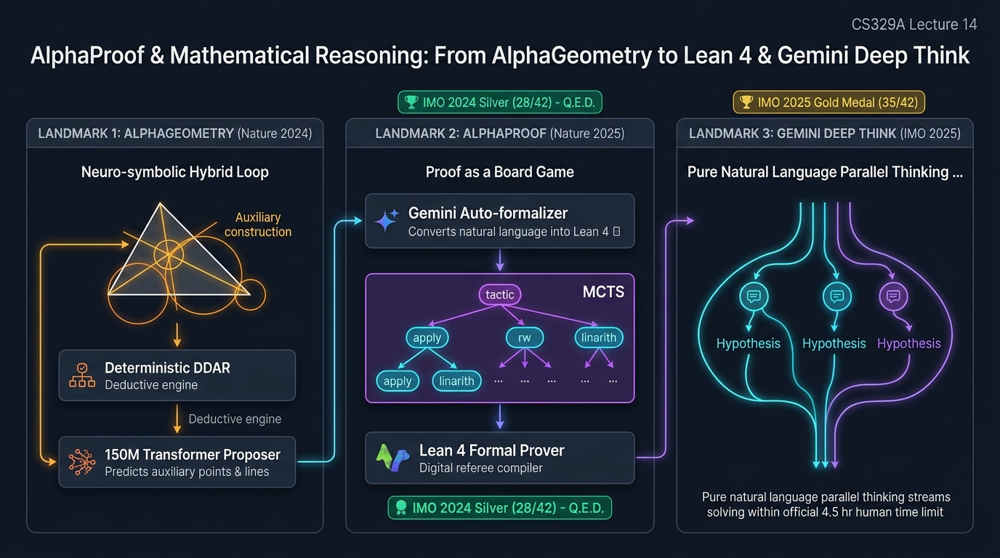

# Stanford CS329A (Ep 14): AlphaProof & Mathematical Reasoning — 정형 검증, Lean 4, AlphaGeometry 및 Gemini Deep Think

지난 강의에서 우리는 생각의 사슬(Chain-of-Thought, CoT) 프롬프팅과 자기 일관성(Self-Consistency) 디코딩이 신경망 내부에서 다단계 인과 추론의 불꽃을 어떻게 점화시켰는지 배웠습니다. 그러나 암호학 프로토콜 검증, 항공우주 궤도 제어 소프트웨어, 인류 최고 권위의 수학 정리 증명과 같은 미션 크리티컬 영역에서 자연어 텍스트는 본질적인 취약점을 안고 있습니다:
> *"언어 모델이 생성한 자연어 CoT 풀이가 아무리 유려해 보일지라도, 그것은 여전히 확률적 토큰 생성의 산물에 불과합니다. 단 한 번의 사소한 부호 실수, 순환 논증, 환각에 기반한 보조 정리는 전체 시스템을 붕괴시킵니다. 엄밀한 수학의 세계에서 99%만 맞는 증명이란 0% 맞는 증명과 같습니다."*

**Stanford CS329A: Self-Improving AI Agents**의 **Part 4: 프런티어(Frontiers in Reasoning & Autonomy)** 두 번째 강의인 **Lecture 14**에 오신 것을 환영합니다. 구글 딥마인드(Google DeepMind)의 연구 총괄이자 알파프루프(AlphaProof) 개발을 이끈 **탕 르엉(Thang Luong) 박사**의 연구를 토대로, 인공지능이 확률적 단어 생성을 넘어 100% 무결점의 기계적 연역 추론으로 진화하여 국제수학올림피아드(IMO) 메달을 석권한 경이로운 여정을 분석합니다:
- **AlphaGeometry (Nature 2024):** 결정론적 기호 연역 엔진과 생성형 트랜스포머의 창의적 보조선 생성을 융합한 신경-기호(Neuro-Symbolic) 아키텍처.
- **AlphaProof (DeepMind, Nature 2025):** 린(Lean 4) 대화형 정리 증명기, 자동 정형화(Auto-formalization) 및 테스트 타임 강화학습(TTRL)을 통해 증명을 알파제로(AlphaZero) 바둑 게임으로 재정의한 시스템.
- **Gemini Deep Think (IMO 2025):** 순수 자연어 추론과 평행 사고(Parallel Thinking)의 극치로 인간의 4.5시간 시험 제한 시간 내에 세계 최초 공식 IMO 금메달(35/42)을 쟁취한 패러다임.
- **LLM 정형 검증과 수학적 추론:** 기계적 컴파일러 기반 정형 커널과 자유로운 자연어 강화학습의 장단점 비교.

{/* truncate */}



---

## 1. 수학: 인공지능 지능 검증의 궁극적 시금석 (Litmus Test)

왜 수학은 자율 인공지능 에이전트의 능력을 평가하는 최고의 시험대로 인정받을까요? 코딩 벤치마크(SWE-bench)나 일반 대화형 과제는 부분 점수나 휴리스틱한 임시방편을 허용하지만, 정형 수학은 다음과 같은 타협 없는 3대 구조적 제약을 부과합니다:

```text
┌──────────────────────────────────────────────────────────────────────────┐
│              수학이 인공지능의 궁극적 시금석인 3대 핵심 이유             │
└────────────────────────────────────┬─────────────────────────────────────┘
                                     │
        ┌────────────────────────────┼────────────────────────────┐
        ▼                            ▼                            ▼
┌─────────────────────────┐  ┌─────────────────────────┐  ┌─────────────────────────┐
│ 객관적 기계 검증 가능성 │  │  극단적 보상 희소성     │  │ 방대한 조합 탐색 공간   │
├─────────────────────────┤  ├─────────────────────────┤  ├─────────────────────────┤
│ • 정형 논리 시스템      │  │ • 100단계 연역 중       │  │ • 무한에 가까운 보조정리 │
│   (Lean 4, Coq, Isabelle)│   마지막 단계까지 보상 0  │    분기 계수 (b -> inf)   │
│ • 결정론적 컴파일러 검증│  │ • 최종 Q.E.D. 도달 시만 │  │ • 창의적 보조선/보조점   │
│ • 환각 확률 0%          │    유일한 양수 보상 지급   │    발명이 필수적인 구조   │
│ • 참/거짓의 이진 분립   │  │ • 신용 할당의 극단 난도 │  │ • 단순 무작위 탐색 불가능│
└─────────────────────────┘  └─────────────────────────┘  └─────────────────────────┘
```

1. **객관적 기계 검증 가능성 (Objective Mechanical Verifiability):** 주관적인 감상이 개입하는 문학이나 법률과 달리, 정형 수학은 Lean 4와 같은 결정론적 타입 검사기 컴퓨터 프로그램이 100% 기계적으로 무결점을 판정합니다.
2. **극단적 보상 희소성 (Extreme Reward Sparsity):** 수백 단계에 걸친 올림피아드 증명에서 에이전트는 목표(`Goal Solved`)를 완벽히 닫기 전까지 단 한 번의 보상도 받지 못합니다. 99%까지 맞더라도 마지막 등식에서 틀리면 보상은 0입니다.
3. **방대한 조합 탐색 공간 (Massive Combinatorial Search Space):** 체스(평균 분기 계수 약 35)나 바둑(약 250)과 달리, 수학적 정리와 보조선의 탐색 공간은 수학적으로 무한(`b \to \infty`)합니다.

---

## 2. 신경-기호 융합: AlphaGeometry (Trinh et al., Nature 2024)

국제수학올림피아드의 기하학(Geometry) 문제는 인간 천재들에게도 가장 까다로운 난관입니다. 아무리 많은 교과서 공리를 암기하고 있어도, 그림 위에 새로운 **보조선(Auxiliary Construction)** — 예컨대 눈에 띄지 않는 세 점을 지나는 보조원을 그리거나 수선의 발을 내리는 행위 — 을 찾아내지 못하면 4시간 내내 단 한 걸음도 전진하지 못합니다.

전통적인 인공지능 연구는 두 갈래로 나뉘어 있었습니다:
- **기호 논리 엔진 (DDAR):** 연역 데이터베이스와 대수 추론기로 구성되어 100% 오류 없는 논리를 전개하지만, 창의성이 전혀 없어 공리 적용이 막히면 1초 만에 멈춰 섭니다.
- **심층 신경망 (Transformers):** 직관적 패턴 인식이 뛰어나지만, 사소한 수치 오차나 각도 착시로 증명 전체가 무너지는 환각을 겪습니다.

AlphaGeometry는 이 두 패러다임을 비대칭 상호의존 구조로 완벽하게 결합했습니다:

```text
               +-------------------------------------------+
               |            유클리드 기하학 문제 입력       |
               +---------------------+---------------------+
                                     |
                                     v
                        +----------------------------+
                        |   기호 논리 엔진 (DDAR)    | <---------+
                        |   - 연역 데이터베이스 (DD) │           │
                        |   - 대수 추론 엔진 (AR)    │           │
                        +--------------+-------------+           │
                                       |                         │
                         [증명 목표 달성 여부 판단]              │
                           /                   \                 │
                        (성공)                 (실패 / Stalled)  │
                         /                       \               │
                        v                         v              │
             +--------------------+    +-----------------------+ │
             | 최종 증명 출력     |    | 150M 파라미터         | │
             | (인간 가독형 텍스트)│    | 보조 도형 제안 신경망 │ │
             +--------------------+    +-----------+-----------+ │
                                                   |             │
                                       [창의적 보조점/보조선   │
                                        생성 후보 예측]        │
                                                   +-------------+
```

### 1억 개의 합성 데이터 엔진 (Synthetic Data Generation)
AlphaGeometry를 훈련하는 데 가장 큰 장애물은 데이터 기근이었습니다. 수백 년의 인간 올림피아드 역사상 고난도 정형 기하학 증명은 1,000건도 되지 않았습니다. 딥마인드 팀은 데이터 합성 파이프라인을 설계했습니다:
1. **무작위 기하 도형 생성:** 10억 개의 무작위 점, 선분, 원의 조합을 컴퓨터로 무작위 생성.
2. **전방 연역 추적:** 기호 엔진(DDAR)이 이 무작위 도형들 속에서 우연히 성립하는 1억 개의 유효한 기하학 정리와 증명 경로를 역으로 발견.
3. **보조선 의존성 정제:** 1억 개의 정리 중 오직 특정한 보조선이 주어져야만 증명할 수 있었던 900만 건의 핵심 증명을 분리.
4. **지도학습 증류:** 150M 파라미터 트랜스포머에게 "기호 엔진이 막혔을 때 바로 그 900만 건의 필수 보조선을 짚어내는 직관"을 집중 훈련시켰습니다.

### 벤치마크 결과
역대 IMO 기하학 30문제 벤치마크에서:
- 기존 최고 기호주의 방법론(Wu's method)은 10문제 해결에 그쳤습니다.
- AlphaGeometry는 인간 제한 시간 내에 **30문제 중 25문제를 완벽하게 증명**하여 인간 올림피아드 금메달리스트 수준의 기량을 증명했습니다.
- 심지어 2004년 IMO 1번 문제에서는 출제 위원회조차 인지하지 못했던 불필요한 전제를 찾아내어 정리를 더 넓은 차원으로 일반화했습니다.

---

## 3. 증명을 보드게임으로 만들다: AlphaProof (Nature 2025)

그러나 기하학은 수학의 한 분야일 뿐입니다. 정수론, 추상대수학, 조합론과 같은 수학 전체를 공략하려면 에이전트는 기계적으로 검증 가능한 정형 언어로 다단계 논리를 전개해야 합니다.

2024년 7월, 탕 르엉 박사 연구팀은 정리 증명을 기계 심판관과 겨루는 2인 영합 보드게임으로 치환한 **AlphaProof**를 공개했습니다.

```text
┌──────────────────────────────────────────────────────────────────────────┐
│                   AlphaProof 시스템 아키텍처                             │
└────────────────────────────────────┬─────────────────────────────────────┘
                                     │
     ┌───────────────────────────────┴───────────────────────────────┐
     ▼                                                               ▼
┌──────────────────────────┐                   ┌───────────────────────────┐
│ Gemini 자동 정형화기     │                   │ AlphaZero 증명 탐색망     │
├──────────────────────────┤                   ├───────────────────────────┤
│ • 자연어 수학 문제 입력  │                   │ • 3B 파라미터 트랜스포머  │
│ • 1억 건의 문제 데이터   │                   │ • Lean 4 전술(Tactic)     │
│ • 양방향 번역 검증       │                   │   정책: apply, rw, ring   │
│ • Lean 4 정형 명세 코드  │                   │ • 가치 신경망: 최종       │
│ • 8,000만 건 유효 정리   │                   │   Q.E.D. 목표까지의 거리  │
└────────────┬─────────────┘                   └─────────────┬─────────────┘
             │                                               │
             └───────────────────────┬───────────────────────┘
                                     ▼
                      ┌─────────────────────────────┐
                      │    Lean 4 정형 커널 환경    │
                      ├─────────────────────────────┤
                      │ • 엄격한 타입 검사기        │
                      │ • 환경 피드백 루프 제공     │
                      │ • 이진 검증 (0 또는 1):     │
                      │   - 전술 컴파일 성공 여부   │
                      │   - 타입 거주(Inhabitation)│
                      └─────────────────────────────┘
```

### Lean 4 환경: 수학의 무한한 바둑판
Lean 4는 귀납적 구성의 미적분학(CIC)에 기반한 순수 함수형 프로그래밍 언어입니다. 커리-하워드 동형(Curry-Howard Correspondence)에 따라:
- **수학적 명제(Proposition)**는 **타입(Type)**에 대응됩니다.
- **수학적 증명(Proof)**은 해당 타입을 점유하는 **프로그램 항(Term)**에 대응됩니다.
- **Lean 컴파일러**는 오류 없는 심판관이 되어, 증명 코드가 컴파일되면 정리는 무조건 100% 검증됩니다.

에이전트는 매 증명 단계마다 현재의 `Goal` 상태를 관찰하고, `induction`, `ring`, `rw [mul_comm]`, `linarith`와 같은 정형 전술(Tactic) 명령어를 한 수씩 둡니다.

### 자동 정형화 (Auto-Formalization): 8,000만 개의 정리 구축
전 세계에서 Lean 4 코드를 유창하게 작성할 수 있는 수학자는 1,000명 미만입니다. 딥마인드는 Gemini를 활용해 인터넷의 자연어 수학 문제를 Lean 4 명세로 번역하고, 의미론적 역번역 검증기를 통과시켜 **8,000만 건의 정형 수학 데이터셋**을 구축했습니다.

### 테스트 타임 강화학습 (TTRL, Test-Time Reinforcement Learning)
IMO 2024의 가장 악명 높은 6번 문제(전 세계 참가자 609명 중 5명만 해결한 극난도 조합론 문제)를 만났을 때, AlphaProof는 기본 모델만으로는 답을 찾지 못했습니다. 딥마인드는 테스트 시점에 새로운 지능을 학습시키는 **TTRL**을 가동했습니다:

```text
[IMO 6번 문제 입력]
         │
         ▼
[Gemini 자동 문제 합성기]
         │
         ├──> 문제의 핵심 구조를 유지한 400,000개의 유사 변형 문제 즉석 합성
         │    (더 작은 매개변수, 특수 조건, 보조 정리 문제들)
         ▼
[수천 대의 TPU v5e 클러스터 투입]
         │
         ├──> 3일 동안 40만 개 변형 문제를 풀며 알파제로 자가대진 실행
         ├──> 추론 시점에 모델의 시냅스 가중치를 동적으로 특화 업데이트
         ▼
[해당 문제에 특화된 초지능 맞춤형 모델 각성]
         │
         ▼
[6번 문제에 대한 100% 기계 검증 Lean 4 완벽 증명 생성 완료!]
```

AlphaProof는 6문제 중 4문제를 완벽하게 풀어내어 **28점/42점으로 공식 IMO 은메달(Silver Medal)**을 획득했습니다 (금메달 기준인 29점에 단 1점 차이).

---

## 4. 순수 자연어 추론의 금메달 정복: Gemini Deep Think (IMO 2025)

AlphaProof의 성공에도 불구하고 두 가지 현실적 한계가 존재했습니다:
1. 자연어 문제를 Lean 4 코드로 번역하고 검증하는 데 방대한 전처리 파이프라인이 요구되었습니다.
2. TTRL을 실행하는 데 3일간의 천문학적 컴퓨팅이 소요되어, 인간 대회의 규칙인 **'하루 4.5시간 제한'**을 초과했습니다.

2025년 7월, 딥마인드는 정형 언어 번역 없이 순수 자연어만으로 올림피아드 금메달을 정복한 **Gemini Deep Think**를 공개했습니다:

```text
┌──────────────────────────────────────────────────────────────────────────┐
│                   Gemini Deep Think: 평행 사고 메커니즘                  │
└────────────────────────────────────┬─────────────────────────────────────┘
                                     │
        ┌────────────────────────────┼────────────────────────────┐
        ▼                            ▼                            ▼
┌─────────────────────────┐  ┌─────────────────────────┐  ┌─────────────────────────┐
│ 가설 경로 A (대수 치환) │  │ 가설 경로 B (기하 반전) │  │ 가설 경로 C (조합 부등식)│
├─────────────────────────┤  ├─────────────────────────┤  ├─────────────────────────┤
│ • 4단계 전개 중         │  │ • 3단계 보조정리서 막힘 │  │ • 점근적 상한 도출 완료 │
│ • 모순점 발견 검증 진행 │  │ • 해당 분기 깔끔히 가지치기│ • 가설 A의 전제로 통합 │
└─────────────────────────┘  └─────────────────────────┘  └─────────────────────────┘
```

Gemini Deep Think는 단일 토큰 체인만을 따라가는 대신 **평행 사고(Parallel Thinking)**를 수행합니다:
- 수십 개의 서로 다른 대수적, 기하학적 가설 경로를 동시에 머릿속에 펼쳐두고 진행합니다.
- 특정 경로가 막다른 골목에 도달하면 실패로 끝나지 않고, 부분적 불변량을 추출하여 다른 활성 분기로 교차 결합합니다.
- 인간과 동일한 4.5시간의 제한 시간 내에 시험지를 풀고 답안을 작성하여, 6문제 중 5문제를 해결하며 **35점/42점으로 인공지능 역사상 최초의 공식 IMO 금메달(Gold Medal)**을 쟁취했습니다.

---

## 5. 아키텍처 비교: 정형 검증 vs 자연어 강화학습

```text
+-----------------------+----------------------------------+----------------------------------+
| 비교 항목             | 정형 검증 (AlphaProof, Lean 4)   | 순수 자연어 RL (Deep Think)      |
+-----------------------+----------------------------------+----------------------------------+
| 검증 엔진             | Lean 4 기계적 타입 검사기        | 다중 에이전트 LLM 및 자기 비판   |
| 환각(Hallucination)   | 정확히 0% (컴파일 성공 시 무결점)| > 0% (미세 논리 비약 위험 잔존)  |
| 탐색 소요 시간        | 수시간 ~ 3일 (MCTS + TTRL)       | 4.5시간 (실시간 동적 추론)       |
| 적용 대상 분야        | 암호학, 스마트 컨트랙트, 정밀수학| 오픈 도메인 과학 연구, 전략 기획 |
| 인프라 의존성         | Lean 4 생태계 및 Mathlib 정형 DB | 대규모 분산 강화학습 인프라      |
+-----------------------+----------------------------------+----------------------------------+
```

---

## 6. 핵심 요약 및 엔지니어링 통찰

1. **합성 데이터는 프런티어 추론의 열쇠:** AlphaGeometry는 실제 데이터가 극도로 부족할 때, 결정론적 기호 엔진으로 수억 개의 정형 증명을 합성하여 신경망의 직관을 사전 학습시킬 수 있음을 입증했습니다.
2. **정형 검증은 환각을 원천 차단:** 단 한 번의 오류도 수천억 원의 손실을 초래하는 미션 크리티컬 시스템에서는 Lean 4와 같은 엄격한 컴파일러 환경에 에이전트를 결합해야 합니다.
3. **추론 시점 연산(TTRL)의 잠재력:** AlphaProof는 추론 시점에 수십만 개의 유사 문제를 합성하고 가중치를 실시간 업데이트하는 테스트 타임 강화학습이 초난도 문제 해결의 열쇠임을 보여주었습니다.
4. **자연어 평행 사고의 승리:** Gemini Deep Think는 다차원 가설을 동시에 펼치는 평행 사고를 통해 인간의 시험 시간 내에 금메달 수준의 추론을 완성했습니다.

다음 **Lecture 15: Autonomous Systems & Reliability**에서는 통제된 수학 환경을 넘어 복잡한 현실 세계 소프트웨어 환경에서 에이전트가 어떻게 자가 치유(Self-Healing), 샌드박스 보안, 안전 가드레일을 유지하는지 다루겠습니다. 많은 기대 바랍니다!