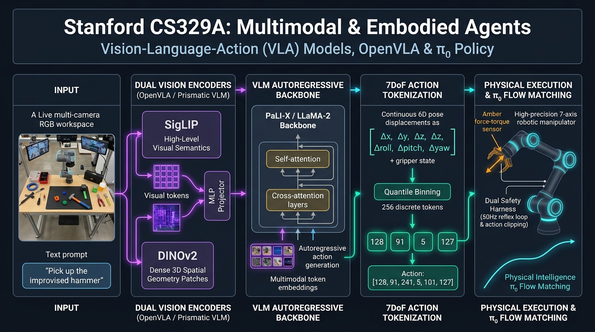

# Stanford CS329A (Ep 16): Multimodal & Embodied Agents — Vision-Language-Action (VLA) Models, RT-2, OpenVLA, and π₀

In our previous lecture on Autonomous Systems & Reliability, we explored how software agents operate within digital execution sandboxes, governed by multi-perimeter trust boundaries and AI Control protocols. Yet, a fundamental question confronts the artificial intelligence community:
> *"Can an intelligence confined solely to computer screens, generating text tokens and compiling software scripts, ever attain true Artificial General Intelligence (AGI)? Our physical reality is not governed by virtual shell commands; it is shaped by gravity, friction, 3D Euclidean geometry, and the delicate contact dynamics of rigid and deformable objects."*

What happens when we bestow a foundation model with physical embodiment — providing it with two high-resolution RGB eyes (cameras) and a seven-degree-of-freedom steel arm (robotic manipulator)?
- Picking up a fragile raw egg without fracturing the shell and placing it onto a frying pan;
- Sorting children's scattered toys by color into designated storage containers across a cluttered living room;
- Aligning and inserting micro-electronic connectors with sub-millimeter precision on an industrial assembly line.

Welcome to **Lecture 16** of **Stanford CS329A: Self-Improving AI Agents**, the penultimate lecture of **Part 4: Frontiers (Frontiers in Reasoning & Autonomy)**. Grounded in the pioneering research of **Dr. Danny Driess** (Founding Research Scientist at Physical Intelligence, former Lead at Google DeepMind Robotics), we investigate the architectural revolution of **Vision-Language-Action (VLA) Models**:
- **Actions as Language Tokens (RT-2, DeepMind 2023):** Treating continuous 7DoF robot arm kinematics as foreign language tokens within a 55B parameter vision-language model.
- **The Open-Source Vanguard (OpenVLA, 2024):** Defeating 55B closed models with a 7B parameter architecture via SigLIP + DINOv2 dual-vision fusion, quantile binning, and LoRA adaptation running on consumer gaming GPUs.
- **Continuous Flow Matching & Diffusion Policies (`\pi_0`):** Overcoming discrete token jitter to master high-frequency deformable object manipulation, such as folding laundry and assembling boxes.
- **Embodied Safety Architectures:** Multi-tier software action clipping coupled with hardware force-torque sensor reflex loops.

{/* truncate */}



---

## 1. The Physical Frontier: Overcoming the Robotics Data Drought

For decades, robotics research was crippled by a severe **data famine**. While language models flourished on trillions of web tokens, real-world robotic interaction data was excruciatingly scarce:
- Collecting physical trajectories requires operating expensive hardware in physical facilities.
- A fleet of 13 Google robots operating continuously for 17 months yielded only `\approx 130,000` demonstrations.
- Consequently, traditional robot policies suffered from extreme brittleness: altering laboratory lighting by 10% or shifting a can by 5 centimeters caused the robot arm to flail helplessly in empty space.

The revolutionary insight articulated by Dr. Danny Driess and the DeepMind team was to bridge web-scale internet intelligence directly into physical actuators:
> *"Do not train a robot policy from scratch on limited physical data. Instead, take a massive foundation Vision-Language Model (VLM) pre-trained on billions of web images and texts, and teach it to emit motor control signals as if physical actions were simply another foreign language vocabulary."*

```text
┌──────────────────────────────────────────────────────────────────────────┐
│              The Vision-Language-Action (VLA) Paradigm Shift             │
└────────────────────────────────────┬─────────────────────────────────────┘
                                     │
     ┌───────────────────────────────┴───────────────────────────────┐
     ▼                                                               ▼
┌──────────────────────────────────┐   ┌──────────────────────────────────┐
│ Traditional Robotics Policy      │   │ Vision-Language-Action (VLA)     │
├──────────────────────────────────┤   ├──────────────────────────────────┤
│ • Small CNN/ResNet trained on    │   │ • 7B - 55B Multi-modal Backbone  │
│   few thousand lab demonstrations│   │ • Pre-trained on Internet Images │
│ • 0% semantic generalization     │   │ • Rich Common Sense Reasoning:   │
│ • Fails if object shifts 5 cm    │     "A rock can serve as a hammer"   │
│ • Requires manual task re-coding │   │ • Zero-shot transfer to novel    │
│ • Isolated task silos            │     unseen objects and cluttered envs│
└──────────────────────────────────┘   └──────────────────────────────────┘
```

---

## 2. Actions as Tokens: RT-2 (Brohan et al., DeepMind 2023)

In July 2023, Google DeepMind unveiled **Robotic Transformer 2 (RT-2)**, transforming foundation vision-language models (such as PaLI-X 55B and PaLM-E 12B) into end-to-end robotic controllers.

```text
[Input: RGB Camera Feed] + [Instruction: "Move the soccer ball to the Messi photo"]
                                     │
                                     ▼
     ┌───────────────────────────────────────────────────────────────┐
     │             Massive VLA Backbone (PaLI-X 55B)                 │
     │  • Web-scale semantic knowledge: Identifies Lionel Messi      │
     │  • Spatial scene understanding: Computes 3D coordinates       │
     └───────────────────────────────┬───────────────────────────────┘
                                     │
                                     ▼ (Autoregressive Next-Token Output)
                   "Action: 1 128 91 241 5 101 127"
                     │       │  │   │   │  │   │   └─ Gripper Closure (127)
                     │       │  │   │   └──┴───┴───── 3D Rotation (Δroll, Δpitch, Δyaw)
                     │       └──┴───┴──────────────── 3D Displacement (Δx, Δy, Δz)
                     └─────────────────────────────── Episode Termination Flag
```

### The 7DoF Action Space & 256-Bin Discretization
Industrial manipulators operate across a 7-Degree-of-Freedom (7DoF) continuous action space:
1. **Translational Displacements (`\Delta x, \Delta y, \Delta z`):** Hand position shift in 3D Euclidean space.
2. **Rotational Displacements (`\Delta roll, \Delta pitch, \Delta yaw`):** Wrist orientation change.
3. **Gripper State ($gripper$):** Binary or continuous aperture state (`0 = open, 1 = closed`).

To convert continuous floating-point motor signals into discrete tokens compatible with transformer vocabulary heads, RT-2 engineered **Uniform Action Discretization**:
- Each continuous action dimension is bounded within an operating interval `[a_min, a_max]` (e.g., `[-30cm, +30cm]`).
- The continuous interval is partitioned into **256 uniform bins**:

```text
\text{bin\_index} = \left\lfloor 256 \times \frac{a - a_{\min}}{a_{\max} - a_{\min}} \right\rfloor, \quad \text{clamped to } [0, 255]
```

- 256 rarely used tokens in the VLM's existing vocabulary are reassigned as dedicated action tokens.
- An **Output Constraint Mask** is enforced during decoding: when emitting motor actions, the transformer logit head is restricted exclusively to these 256 valid action tokens.

### Emergence of Semantic Physical Generalization
Because RT-2 retained the semantic reasoning of web-scale pre-training:
- When instructed to *"Pick up the improvised hammer,"* the robot chose a stone over an eraser, despite never encountering the phrase in its physical training data.
- It accurately executed abstract relational commands: *"Knock over the soda can closest to the apple,"* exhibiting 3-fold higher generalization than dedicated robotics baselines (RT-1).

### Co-Fine-Tuning: Banishing Catastrophic Forgetting
If a 55B parameter VLM is fine-tuned solely on robot trajectories, the network suffers from **Catastrophic Forgetting**, erasing its common-sense semantic reasoning within thousands of gradient steps. RT-2 resolved this via **Co-Fine-Tuning**:
- Every training batch blends robot demonstration trajectories with standard web vision-text pairs (VQA, captioning).
- This ensures the model preserves its conceptual understanding of world semantics while mastering motor control.

---

## 3. Democratization: OpenVLA (Kim et al., Stanford & Berkeley 2024)

While RT-2 proved the VLA concept, its 55B parameter footprint required cloud TPU clusters, operating as a closed, proprietary system inaccessible to academic researchers.

In 2024, Stanford and UC Berkeley released **OpenVLA**, an open-source, 7B parameter foundation VLA trained on the Open X-Embodiment dataset (970,000 real-world robot trajectories across 22 hardware embodiments).

```text
               +-------------------------------------------+
               |             RGB Camera Input              |
               +---------------------+---------------------+
                                     |
                       +-------------+-------------+
                       |                           |
                       v                           v
             +--------------------+     +--------------------+
             |  SigLIP Encoder    |     |  DINOv2 Encoder    |
             | (High-Level Visual |     | (Low-Level Dense   |
             |  Semantic Tokens)  |     |  3D Spatial Patches|
             +---------+----------+     +----------+---------+
                       |                           |
                       +-------------+-------------+
                                     | (Channel-Axis Concatenation)
                                     v
                        +----------------------------+
                        |   2-Layer MLP Projector    |
                        +--------------+-------------+
                                       |
                                       v
                        +----------------------------+
                        |   Llama-2 7B LLM Backbone  |
                        +--------------+-------------+
                                       |
                                       v
                        +----------------------------+
                        | 256 Quantile Action Tokens |
                        +----------------------------+
```

### 1. Dual-Vision Fusion: SigLIP + DINOv2 (Prismatic VLM)
Robotic manipulation requires both semantic comprehension (*"What is this object?"*) and dense spatial geometry (*"Where is the rim of the cup to within 2 millimeters?"*):
- **SigLIP (Semantic Encoder):** Captures high-level linguistic-visual associations.
- **DINOv2 (Spatial Geometric Encoder):** Self-supervised vision transformer capturing high-frequency depth, edge contours, and spatial landmarks.
- Concatenating their feature vectors along the channel dimension increased robot grasping precision by over 20% compared to using SigLIP alone.

### 2. Quantile Action Binning
RT-2 used uniform linear binning, which allocates equal resolution across the entire velocity range. In real-world manipulation, however, **90% of movements are delicate sub-centimeter adjustments**, while rapid arm swings occur only 1% of the time.
- OpenVLA calculates empirical **Quantiles** of the action distribution from 970,000 demonstrations:

```text
\text{Bin Boundaries: } q_k = \text{Quantile}\left(\mathcal{D}_{\text{actions}}, \frac{k}{256}\right), \quad k \in [0, 256]
```

- This concentrates token resolution precisely where fine-motor control is most critical, dramatically reducing grasping failures.

### 3. LoRA Fine-Tuning on a Single RTX 4090
- By freezing the vision backbone and applying **Low-Rank Adaptation (LoRA)** to only 1.4% of Llama-2's parameters ($r=32$), OpenVLA can be adapted to novel robot embodiments in under 15 hours.
- Utilizing 4-bit NormalFloat (NF4) quantization compresses the model into **7GB of VRAM**, allowing real-time 6Hz robot control on a single consumer gaming GPU (NVIDIA RTX 4090), while outperforming the 55B parameter RT-2-X by **16.5% absolute success rate** across 29 tasks.

---

## 4. The Continuous Horizon: Physical Intelligence `\pi_0` (2024)

Despite the success of RT-2 and OpenVLA, discrete action tokenization suffers from intrinsic limitations:
- Partitioning continuous space into 256 bins causes discretization quantization noise, leading to micro-vibrations (**jittering**) in high-frequency control (`>50Hz`).
- Complex multi-modal manipulation of deformable materials — such as folding laundry, manipulating flexible cables, or packing cardboard boxes — requires modeling continuous probability distributions.

To transcend these limitations, Dr. Danny Driess and the Physical Intelligence team developed **`\pi_0` (pi-zero)**:

```text
┌──────────────────────────────────────────────────────────────────────────┐
│                   Physical Intelligence π₀ Architecture                  │
└────────────────────────────────────┬─────────────────────────────────────┘
                                     │
     ┌───────────────────────────────┴───────────────────────────────┐
     ▼                                                               ▼
┌──────────────────────────┐                   ┌───────────────────────────┐
│ High-Level VLM Planner   │                   │ Continuous Diffusion /    │
├──────────────────────────┤                   │ Flow Matching Policy      │
│ • Semantic Goal Tracking │                   ├───────────────────────────┤
│ • Long-Horizon Reasoning │ ── Latent Goals ─►│ • 50Hz Real-Time Inference│
│ • Visual Scene Parse     │                   │ • Continuous Vector Field │
└──────────────────────────┘                   │ • Denoising Flow Match    │
                                               └─────────────┬─────────────┘
                                                             │
                                                             ▼
                                               [Smooth Continuous Trajectory]
                                               (Handles Folding Cloth & Boxes)
```

Instead of autoregressively emitting discrete tokens, `\pi_0` utilizes **Flow Matching**:
- The high-level VLM conditions a continuous diffusion vector field.
- The action policy integrates velocity vectors over continuous time, generating smooth, multi-step motor trajectories without discretization artifacts.
- This enabled the world's first autonomous system capable of executing seven diverse complex household chores (including folding laundry out of a hamper and clearing dining tables) on a single unified policy.

---

## 5. Architectural Comparison: Embodied Robotics Frameworks

```text
+-----------------------+----------------------------------+----------------------------------+
| Feature Vector        | RT-2 (Google DeepMind)           | OpenVLA (Stanford / Berkeley)    |
+-----------------------+----------------------------------+----------------------------------+
| Model Scale           | 55B (PaLI-X) / 12B (PaLM-E)      | 7B (Llama-2 Backbone)            |
| Vision Encoder        | Single ViT (Web-scale)           | Dual-Fusion (SigLIP + DINOv2)    |
| Action Discretization | 256 Uniform Bins                 | 256 Quantile Bins                |
| Hardware Footprint    | Multi-TPU Cloud Cluster          | Single Consumer GPU (RTX 4090)   |
| Parameter Efficiency  | Full fine-tuning                 | 1.4% LoRA + 4-bit Quantization   |
| Open-Source Status    | Closed / Proprietary             | 100% Open Weights & Codebase     |
+-----------------------+----------------------------------+----------------------------------+
```

---

## 6. Embodied Safety: The Dual-Tier Reflex Architecture

Physical robots exert real mechanical force capable of damaging property or injuring humans. Production robotic agents enforce a **Dual-Tier Safety Architecture**:

```text
[VLA Model Action Output: 7DoF Delta]
                 │
                 ▼
[Tier 1: Software Velocity & Workspace Clipping]
  ├── Clamp max velocity: ||Δpos|| <= 5 cm/step
  └── Enforce virtual safety geofence bounding box
                 │
                 ▼
[Tier 2: Hardware Force-Torque Sensor Reflex Loop (1000 Hz)]
  ├── If external force F_contact > 20 Newtons:
  └── Override VLA command -> Immediate E-Stop / Compliant Force Damping
```

1. **Software Action Clipping:** The low-level controller clamps any instantaneous delta vector exceeding physical safety thresholds (e.g., maximum 5cm translation per inference cycle) and enforces geofenced workspace limits.
2. **Hardware Force-Torque Reflex:** Operating directly on joint microcontrollers at 1,000Hz, force-torque sensors detect unexpected physical contact resistance. If threshold limits are exceeded (e.g., colliding with a human arm), the low-level driver immediately overrules the VLA, decoupling motor current to prevent injury.

---

## 7. Key Engineering Takeaways

1. **Physical Action is a Modality of Language:** Discretizing 7DoF continuous motion into vocabulary bins enables foundation models to transfer internet-scale common-sense knowledge into physical manipulation.
2. **Dual Vision Fusion is Essential for Robotics:** Combining high-level semantic encoders (SigLIP) with dense 3D spatial representations (DINOv2) dramatically improves sub-millimeter precision.
3. **Quantile Binning Solves Action Imbalance:** Aligning token resolution with the empirical distribution of fine-motor movements eliminates dead zones in robot dexterity.
4. **Diffusion & Flow Matching are the Future of Continuous Control:** Systems like `\pi_0` resolve discrete token jitter, mastering complex deformable tasks that challenge human dexterity.

In our grand finale, **Lecture 17: Future Research Directions**, we synthesize all 17 lectures of Stanford CS329A, analyzing the grand open challenges in self-improving artificial intelligence, autonomous agent swarms, and the path to artificial general intelligence. See you at the finish line!