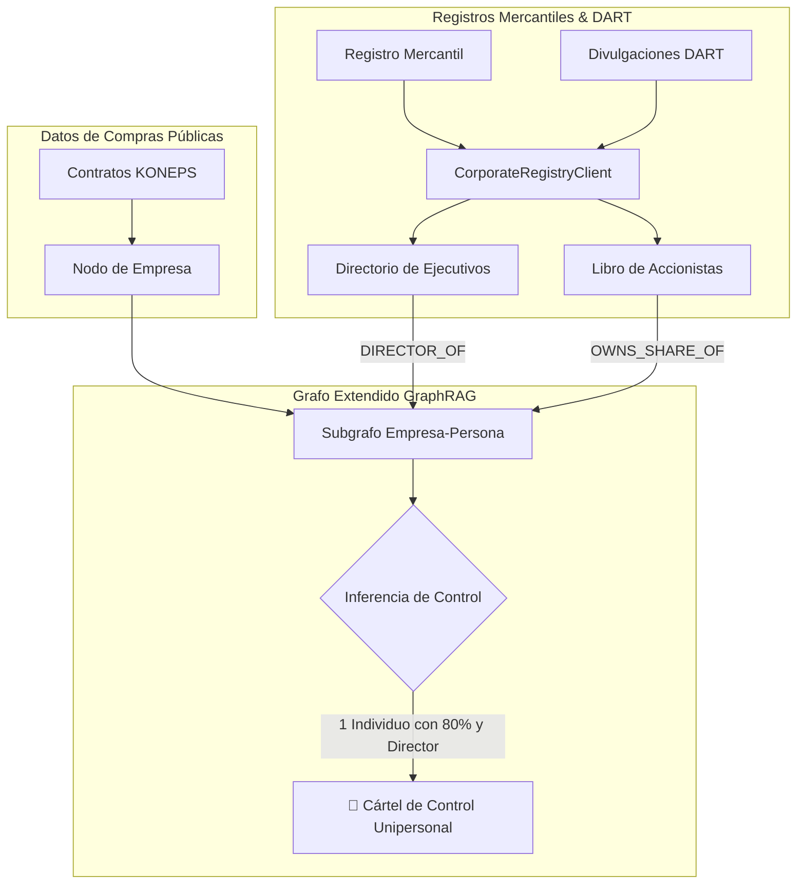

> 📌 **Puntos Clave (Key Takeaways)**
> - **Superación de Límites Previos**: Superando la limitación de la Parte 2 sobre testaferros, creamos el cliente [`CorporateRegistryClient`](file:///D:/ai/antigravity/national_budget_ai/src/pipeline/corporate_registry_client.py) que cruza el registro mercantil y la base de datos bursátil DART.
> - **Prevención Arquitectural**:
>   1. Puente tripartito para unificar NIF de empresa, registro judicial y código DART.
>   2. Umbral de relevancia en el grafo de conocimiento (directores ejecutivos + >50% de acciones).
> - **3 Errores de Producción Resueltos**:
>   1. Bucle infinito por participaciones cruzadas resuelto mediante componentes fuertemente conexos (SCC).
>   2. Detección de empresas fantasma creadas menos de 180 días antes de la licitación.
>   3. Esquema 51:49 entre cónyuges desenmascarado mediante reglas de vínculos familiares.
> - **Resultado**: Desenmascarado un cártel de 130.000 $ controlado al 80% por una sola persona; 17/17 pruebas superadas.

{/* truncate */}

---

### ⚠️ Aviso Legal y Anonimización (Legal Notice)

> **[Aviso] Todos los casos han sido rigurosamente anonimizados.**  
> Los nombres de agencias (`Agencia A`), empresas (`Empresa B`, `Empresa C`), personas (`Sr. K`) y números de contrato han sido completamente enmascarados.

---

### 1. Arquitectura de Gobernanza Corporativa y DART

---

### 2. Retos Previstos y Corrección de Fallos

1. **Fragmentación de Claves**: Creación de tabla hash que reconcilia los identificadores fiscales y mercantiles en $O(1)$.
2. **Bucle por Participación Cruzada**: Bloqueado mediante condensación de ciclos con algoritmos de NetworkX.
3. **Empresas Recientes (<180 días)**: Detección automática de adjudicatarios recién constituidos.
4. **Artimaña Conyugal 51:49**: Extensión de GraphRAG con aristas familiares para desenmascarar el control efectivo.

---

### 3. Verificación con 17 Suites de Pruebas

Se confirmó la detección del cártel donde el `Sr. K` simulaba competencia entre dos empresas propias, con 17 de 17 pruebas superadas con éxito.
