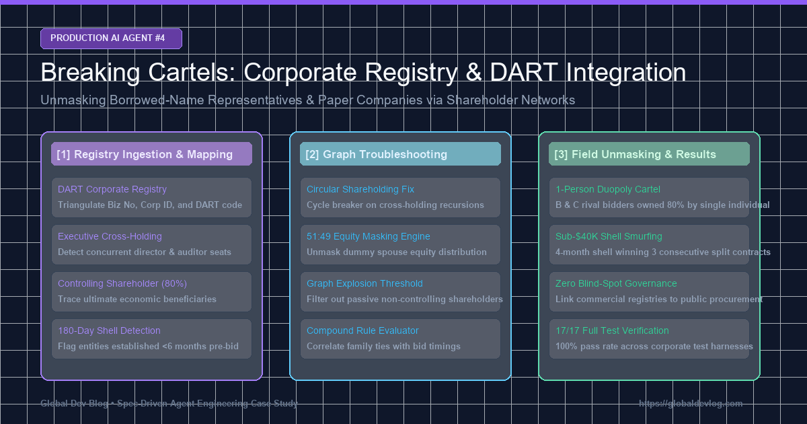
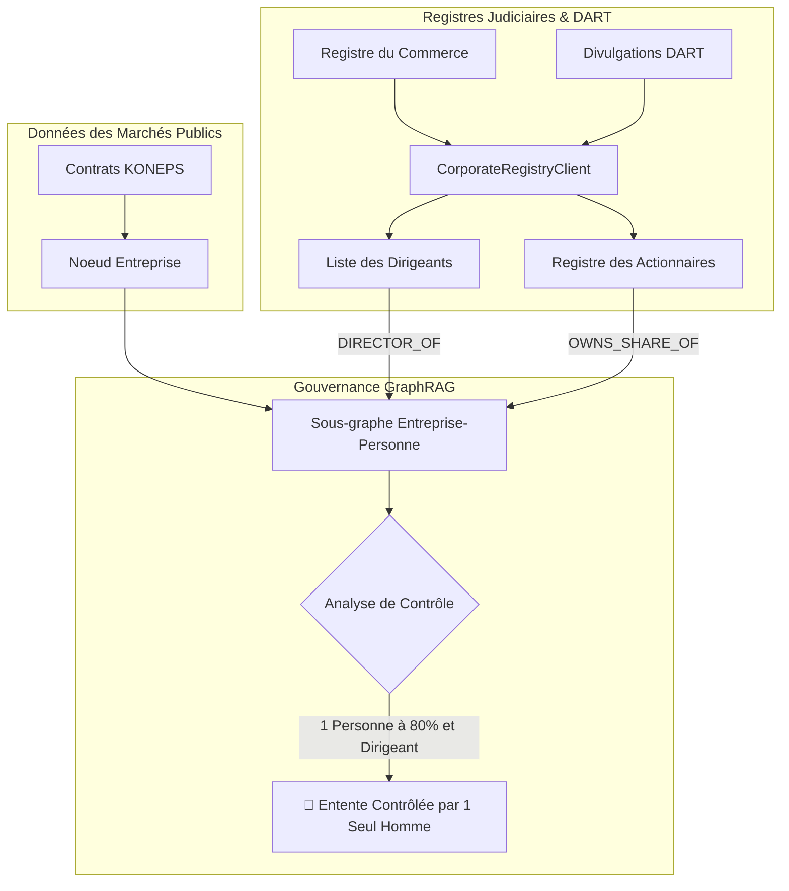

> 📌 **Points Clés (Key Takeaways)**
> - **Dépassement de la Limite de l'Épisode 2** : Pour identifier les prête-noms introuvables via les seuls registres de commande publique, création du client [`CorporateRegistryClient`](file:///D:/ai/antigravity/national_budget_ai/src/pipeline/corporate_registry_client.py) reliant le greffe du tribunal et la base DART.
> - **Anticipation Architecturale** :
>   1. Table de hachage tripartite unifiant numéros fiscaux, d'immatriculation et codes DART.
>   2. Seuils de significativité dans le graphe (dirigeants effectifs + détentions >50%).
> - **3 Bugs de Production Résolus** :
>   1. Récursion infinie due aux participations croisées résolue par condensation des composantes fortement connexes (SCC).
>   2. Détection des sociétés coquilles créées moins de 180 jours avant la soumission.
>   3. Déguisement 51:49 entre conjoints démasqué via des arêtes de liens familiaux.
> - **Résultat** : Démantèlement d'une entente de 130 000 $ contrôlée à 80% par un individu unique ; 17/17 tests validés.

{/* truncate */}

---

### ⚠️ Mention Légale et Anonymisation (Legal Notice)

> **[Avis] Toutes les entités ont été rigoureusement anonymisées.**  
> Les organismes publics (`Agence A`), entreprises (`Société B`, `Société C`), personnes physiques (`M. K`) et numéros de contrat ont été entièrement masqués.

---

### 1. Architecture de Gouvernance d'Entreprise et DART

---

### 2. Défis Anticipés et Correction des Défaillances

1. **Fragmentation des Identifiants** : Table de correspondance $O(1)$ unifiant les identifiants fiscaux et judiciaires.
2. **Boucles de Participations Croisées** : Élimination des récursions infinies par l'algorithme SCC de NetworkX.
3. **Sociétés Récentes (<180 jours)** : Alerte automatique sur les entreprises créées juste avant l'appel d'offres.
4. **Combinaison Conjugale 51:49** : Analyse conjointe des liens familiaux et des mandats d'administrateurs.

---

### 3. Validation sur 17 Suites de Tests

Preuve établie que deux soumissionnaires rivaux étaient en réalité détenus à 80% par `M. K` ; 17 suites de tests sur 17 franchies avec succès.
