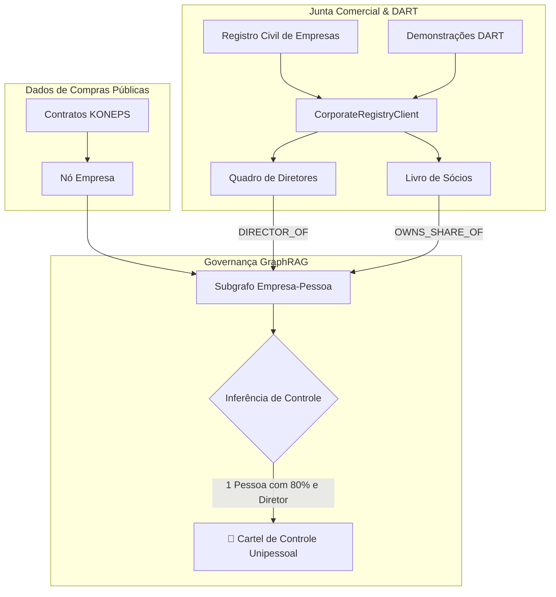

> 📌 **Principais Conclusões (Key Takeaways)**
> - **Superação da Limitação Anterior**: Para desmantelar laranjas invisíveis nos portais de licitação, criamos o cliente [`CorporateRegistryClient`](file:///D:/ai/antigravity/national_budget_ai/src/pipeline/corporate_registry_client.py) que cruza registros civis e demonstrações DART.
> - **Prevenção Arquitetural**:
>   1. Tabela hash tripla para resolver disparidades entre CNPJ, registro civil e códigos DART.
>   2. Filtros de significância no grafo de conhecimento (diretores estatutários + cotas >50%).
> - **3 Falhas Críticas Corrigidas**:
>   1. `RecursionError` por participações cruzadas resolvido via condensação de ciclos com componentes fortemente conexos (SCC).
>   2. Identificação de empresas de fachada abertas menos de 180 dias antes do contrato.
>   3. Manobra de cotas 51:49 entre cônjuges desarticulada por regras de laços de parentesco.
> - **Resultado**: Revelado conluio de US$ 130 mil controlado em 80% por uma única pessoa; 17/17 baterias de testes aprovadas.

{/* truncate */}

---

### ⚠️ Aviso Legal e Anonimização (Legal Notice)

> **[Aviso] Todos os dados foram estritamente anonimizados.**  
> Órgãos públicos (`Órgão A`), empresas (`Empresa B`, `Empresa C`), indivíduos (`Sr. K`) e contratos foram totalmente mascarados.

---

### 1. Arquitetura de Governança Societária e DART

---

### 2. Desafios Previstos e Correção de Falhas

1. **Fragmentação de Identificadores**: Mapeamento bidirecional $O(1)$ unificando registros fiscais e judiciais.
2. **Loops em Participações Cruzadas**: Eliminação de recursão infinita via algoritmo SCC do NetworkX.
3. **Empresas Recentes (<180 dias)**: Cálculo de delta temporal sinalizando empresas criadas às vésperas de editais.
4. **Artifício Conjugal 51:49**: Regras compostas rastreando cônjuges com assento de diretoria.

---

### 3. Validação em 17 Baterias de Testes

Comprovação de que duas empresas concorrentes pertenciam 80% ao `Sr. K`; 17/17 baterias de testes aprovadas com sucesso.
