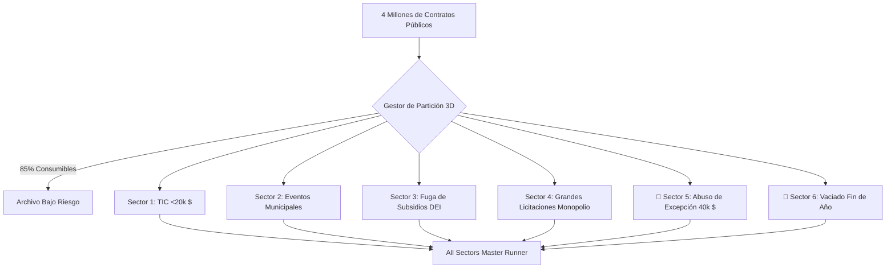

> 📌 **Puntos Clave (Key Takeaways)**
> - **Suite Integral de 6 Sectores**: Filtrado de 85% de compras rutinarias sobre 4 millones de contratos, expandiendo la auditoría a **6 sectores críticos de fraude**.
> - **2 Grandes Puntos Ciegos Descubiertos**:
>   1. **Sector 5 (Fraccionamiento Preferencial de 40.000 $)**: Evasión mediante contratos concentrados en el 98% del umbral legal ($180.000 detectados).
>   2. **Sector 6 (Vaciado Presupuestario de Fin de Año)**: Rápida adjudicación de 3 contratos en 4 días a finales de diciembre para evitar la devolución de fondos.
> - **Prevención Arquitectural**: Algoritmo de proximidad (96-99.8%) y comprobación de viabilidad física de plazos de entrega.
> - **Corrección de Bugs**: Desduplicación entre sectores por peso de gravedad y normalización de precios netos sin IVA.

{/* truncate */}

---

### ⚠️ Aviso Legal y Anonimización (Legal Notice)

> **[Aviso] Todos los casos han sido rigurosamente anonimizados.**  
> Los nombres de agencias (`Agencia A`), contratistas (`Empresa D`), personas y contratos han sido totalmente enmascarados.

---

### 1. Arquitectura de Auditoría en 6 Sectores

---

### 2. Retos Previstos y Corrección de Fallos

1. **Excepción Política vs. Fraccionamiento**: Análisis de proximidad al umbral legal para evitar falsos positivos en empresas sociales legítimas.
2. **Cierre Rutinario vs. Vaciado Rápido**: Detección de proyectos donde el plazo hasta el 31 de diciembre hace físicamente imposible la entrega de los servicios.
3. **Colisiones Entre Sectores**: Asignación de sector prioritario según la gravedad penal del delito administrativo.
4. **Impuesto IVA**: Deducción inversa de importes con IVA para verificar el umbral legal real sin impuestos.

---

### 3. Validación y Resultados en Campo

Detección de 3 contratos fraccionados de 39.000 $ en la `Agencia A` y adjudicaciones exprés de 100.000 $ en la `Agencia C` en diciembre; 17/17 pruebas superadas.
