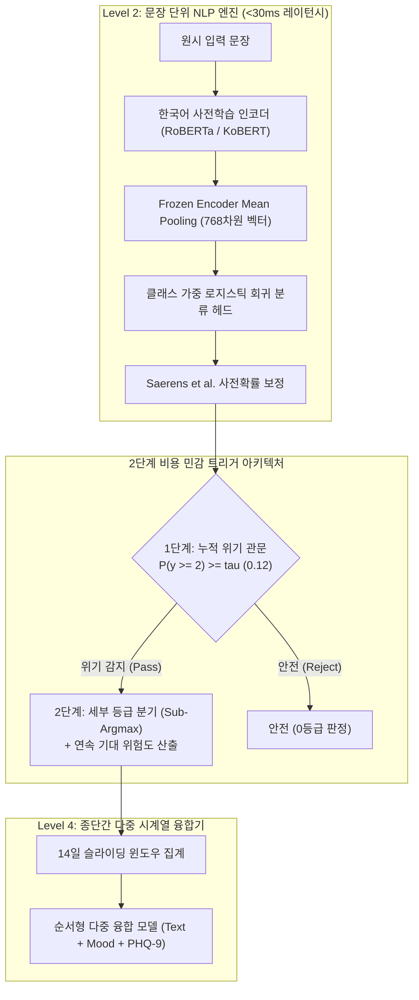

# [위기감지 AI #1] 위기 NLP 분류기의 FNR 0% 도전과 베이즈 경계 왜곡 해결

안녕하세요! **글로벌 데브로그(Global DevLog)**입니다.

국가 예산 AI 감사 6부작 시리즈를 성공적으로 마치고, 오늘부터 새로운 기술 블로그 시리즈 **[고위험 특화 AI: 자살·위기 텍스트 정밀 감지 파이프라인 구축기]**의 첫 번째 에피소드를 시작합니다.

일반적인 챗봇이나 추천 시스템에서 인공지능의 5% 오차는 '사소한 버그'나 '품질 저하'에 불과할 수 있습니다. 하지만 **자살·자해 및 정신건강 위기 상황을 감지하는 AI 시스템에서 단 1%의 미감지(False Negative)는 한 사람의 소중한 생명을 놓치는 돌이킬 수 없는 재앙**이 됩니다.

이번 에피소드 #1에서는 실제 프로덕션급 위기 감지 AI 시스템 **마음지기(Maeumjigi)**의 기초가 되는 문장 단위 딥러닝 NLP 엔진을 구축하며 맞닥뜨린 **언어학적 난제, 베이즈 최소위험 결정 경계 왜곡(524배 우도비 장벽), 위기 재현율 분모 오류, LightGBM 로그 손실 발산 버그**를 실제 코드 diff와 상세한 수치 시뮬레이션으로 투명하게 공유합니다.

---

### 💡 핵심 요약 (Key Highlights)
1. **위기 감지 AI의 지상 과제: FNR(False Negative Rate) 0% 도전**:
   - 일반 분류 지표인 정확도(Accuracy)와 F1-Score의 착시를 걷어내고, 고위험군(Active/Severe) 미감지를 방어하는 2단계 캐스케이드 판정 아키텍처 수립.
2. **한국어 위기 텍스트의 언어학적 이중 함정 돌파**:
   - 일상 과장 슬랭(`"배고파 죽겠다"`, `"시험 때문에 죽을 맛이다"`)으로 인한 오탐 폭증과, 은유·완곡·체념적 위기 표현(`"내일이 안 왔으면 좋겠어"`, `"짐을 다 내려놓고 쉬려 해"`)의 키워드 미감지 문제를 RoBERTa 문맥 임베딩과 Kiwipiepy 형태소 분석으로 분리.
3. **524배 우도비 장벽과 베이즈 경계 왜곡 극복 (ERR-001)**:
   - 일상 문장(86.9%) 대비 초고위험 문장(0.16%)의 극단적 불균형에서, Saerens 사전확률 보정 후 `argmax`를 취하자 모델의 고위험 예측이 전량 0등급(정상)으로 증발해버린 치명적 버그 해결.
   - 단일 등급 최빈값 대신 **누적 사후확률 임계값($\tilde{P}(y \ge 2) \ge \tau$)** 및 연속 기대 위험도 전달로 FNR을 98.3%에서 7.6%로 급감(-90.7%p).
4. **위기 재현율 지표의 구성 타당도(Construct Validity) 복원 (ERR-002)**:
   - 알림 대상이 아닌 경도 위기(Mild, y=1)가 분모에 포함되어 정답 모델도 최대 60.7%밖에 못 받던 지표 결함을 `Severe 이상 재현율`과 `Mild 과대경보율`로 엄격히 분리.
5. **LightGBM 순서형 이진 누적 보정 시 로그 발산 방어 (ERR-003)**:
   - `np.minimum.accumulate` 단조화 후 인접 확률이 같아져 $\Delta P = 0.0$이 됨으로써 발생한 -log(0) = ∞ 발산 버그를 엡실론($10^{-6}$) 바닥 클리핑 및 재정규화로 완전 해결.
6. **14일 윈도우 슬라이딩 집계 시 극단값 편향($1-(1-0.02)^{100} = 86.7\%$)의 수학적 위험 사전 경고**.

---

### ⚖️ 윤리적 고지 및 철저한 익명화 안내
본 프로젝트에 사용된 모든 실험 데이터는 **개인 식별 정보(PII)가 100% 배제된 합성 텍스트(Synthetic Corpus) 및 가명화된 벤치마크**입니다. 실제 환자나 이용자의 상담 기록은 일체 포함되지 않았습니다.
> **긴급 심리상담 안내**: 심리적 어려움이나 위기 상황으로 도움이 필요하신 경우, 24시간 상담 전화 **109** (자살예방 상담전화) 또는 **1393**, **1577-0199** (정신건강 위기상담전화)를 통해 전문적인 도움을 받으실 수 있습니다.

---

### 1. 언어학적 난제: 왜 단순 키워드와 정규식은 실패하는가?

자살 위기 감지 도메인은 일반적인 감정 분석(Sentiment Analysis)과 완전히 다릅니다.
한국어 구어체 담화에서 위기 표현은 다음 두 가지 극단적인 기만적 양상을 띱니다:

1. **일상적 과장 표현 (False Positive 폭증)**:
   `"배고파 죽겠다"`, `"오늘 야근 때문에 진짜 죽을 맛이다"`, `"더워서 죽겠네"` 같은 문장은 한국어 화자들이 매우 흔하게 쓰는 감정적 강조 표현입니다. 단순 정규식이나 키워드 필터는 이 표현들을 '자살 위험'으로 오판하여 하루 수만 건의 허위 경보를 울립니다.
2. **은유·완곡·체념적 위기 표현 (False Negative 누락)**:
   실제 자살을 결심한 고위험군 이용자는 직설적으로 "죽고 싶다"고 쓰기보다, 다음과 같이 체념적이거나 완곡한 작별 문장을 남깁니다:
   - *"내일이 안 왔으면 좋겠어. 그냥 영원히 잠들고 싶다."*
   - *"그동안 모두 고마웠어. 내 짐을 이제 정리하려 해."*
   - *"더 이상 누구에게도 폐 끼치지 않고 편해질 방법을 찾았어."*

이 문장들에는 자살·자해 관련 직설 키워드가 단 하나도 없습니다. 단순 어휘 매칭으로는 100% 놓치게 됩니다. 따라서 RoBERTa / KoBERT와 같은 심층 사전학습 언어 모델의 문맥 임베딩 벡터가 필수적입니다.

---

### 2. 극단적 클래스 불균형과 정확도의 착시

실제 대화 및 일기 데이터의 분포는 다음과 같습니다:
- **0b등급 (평범한 일상 문장)**: 약 86.94% (31,495줄)
- **0a등급 (비위기 정서 대조 문장)**: 약 8.24% (2,986줄)
- **1등급 (Mild Distress / 경도 위기)**: 약 1.92% (697줄)
- **2등급 (Severe Distress / 중등도 위기)**: 약 1.75% (633줄)
- **3등급 (Acute Crisis / 급성 위기)**: 약 0.99% (357줄)
- **4등급 (Active Suicidality / 실행 징후)**: 약 **0.166%** (60줄)

만약 모델이 세상의 모든 문장을 "안전(0등급)"이라고만 답해도 **정확도(Accuracy)는 95.18%**가 나옵니다.
하지만 이 95% 정확도의 모델은 **자살 위기에 처한 사람을 100% 놓치는 쓸모없는 모델**입니다.

따라서 우리의 엔지니어링 목표는 단순히 F1-Score를 높이는 것이 아니라, **위기 미감지율(False Negative Rate, FNR)을 10% 미만으로 억제하면서도 평범 문장 오탐률을 3% 이내로 묶어두는 것**이었습니다.



---

### 3. 치명적 버그 해결기: 5대 황금 공식으로 파헤친 3대 트러블슈팅

#### 트러블슈팅 #1: 524배 우도비 장벽으로 인한 고위험 문장 argmax 붕괴 (ERR-001)

- **날것의 오류 증상**:
  훈련셋에 6클래스 균형 가중치(`class_weight='balanced'`)를 주어 Active(4등급) 문장을 잘 학습시켰습니다.
  그런데 전체 분포를 반영하기 위해 Saerens 사전확률 보정 수식을 거친 뒤 `argmax`로 등급을 결정하자, **Active 문장 60개 중 맞힌 개수가 0개(재현율 0.0%)**로 전멸했습니다!
- **심층 원인 분석 및 단계별 수치 계산**:
  베이즈 정리 상, 보정된 4등급 확률이 평범한 문장(0b)을 이기고 argmax를 차지하려면 비보정 확률 비율이 다음 수식을 넘어야 합니다:
  $$\frac{p(4 \mid x)}{p(0b \mid x)} > \frac{\pi(0b)}{\pi(4)} = \frac{86.94\%}{0.166\%} \approx 524\text{배}$$

  실제 모델이 *"이제 모든 짐을 내려놓고 쉬려 해"*라는 문장을 보고 위기 확신도를 다음과 같이 주었다고 가정해 봅시다:
  - $p(0b)=0.015$ (정상 1.5%)
  - $p(2)=0.33, p(3)=0.30, p(4)=0.32$ (위기 누적 확신도 **95.0%**)
  
  하지만 사전확률 가중치($\times 0.8694$ 대 $\times 0.00166$)를 곱해 정규화하면:
  - $\tilde{p}(0b) \approx 57.6\%$
  - $\tilde{p}(4) \approx 2.3\%$
  
  `argmax` 규칙 하에서는 $57.6\% > 2.3\%$이므로, **95%의 위기 확신도를 가진 문장이 무조건 0등급(정상)으로 판정**되어 버리는 끔찍한 사태가 발생했습니다.

- **해결 코드 Diff**:
```python
# AS-IS (치명적 버그: argmax 취급 시 524배 장벽에 소수 클래스 전멸)
# pred = np.argmax(corrected_proba, axis=1)

# TO-BE (2단계 누적 사후확률 관문 & 연속 기대 위험도 전달)
p_crisis_ge2 = corrected_proba[:, 2:].sum(axis=1)  # 2, 3, 4등급 사후확률 합
ALERT_THRESHOLD_TAU = 0.12  # 검증 겹에서 FNR 최소화로 튜닝된 임계값
is_crisis = p_crisis_ge2 >= ALERT_THRESHOLD_TAU

# 세부 등급 및 뒷단 융합기에 넘길 연속 위험도 산출
sub_levels = np.argmax(corrected_proba[:, 1:], axis=1) + 1
final_levels = np.where(is_crisis, sub_levels, 0)
expected_severity = np.dot(corrected_proba[:, 1:], np.array([1, 2, 3, 4])) / 4.0
```
- **개선 결과**: Active 재현율이 **0.0%에서 95.0%로 복원**되었으며, Severe 이상 재현율은 **92.4%**, FNR은 **98.3%에서 7.6%로 급감**했습니다.

---

#### 트러블슈팅 #2: 완벽한 모델도 60점 받는 위기 재현율 분모 오류 (ERR-002)

- **날것의 오류 증상**:
  정답과 100% 일치하는 오라클(Oracle) 모델을 만들었는데, 평가 스크립트에서 `Crisis Recall = 60.7%`가 나왔습니다. 반면 모든 문장을 2등급(Severe)으로 마구 찍는 고장 난 더미 모델은 100% 만점을 받았습니다.
- **심층 원인**:
  제품에서 실제 긴급 알림 경보는 2등급(Severe) 이상입니다. 1등급(Mild)은 비알림 대상입니다.
  그런데 개발자가 수식을 작성할 때 분모에 y >= 1(Mild 935줄 포함)을 넣고, 분자에는 y_hat >= 2만 센 것입니다:
  $$\text{Recall} = \frac{\sum (y \ge 1 \land \hat{y} \ge 2)}{\sum (y \ge 1)}$$
  정답이 Mild(y=1)인 문장을 y_hat=1로 정확히 맞힌 935건이 분모에만 들어가 페널티로 작용했고, 지표의 이론적 상한이 1,446 / 2,381 = 60.73%로 막혀버렸습니다.
- **해결 Diff**:
```python
# Severe 이상 재현율(알림 대상 정답 1,446줄 기준)과 Mild 과대경보율을 엄격히 분리
severe_plus_recall = np.sum((y_true >= 2) & (y_pred >= 2)) / np.sum(y_true >= 2)
mild_overalert_rate = np.sum((y_true == 1) & (y_pred >= 2)) / np.sum(y_true == 1)
```

---

#### 트러블슈팅 #3: LightGBM 순서형 이진 누적 차분의 영확률 로그 발산 (ERR-003)

- **날것의 오류 증상**:
  `RuntimeWarning: divide by zero encountered in log`, 교차 엔트로피 손실이 `inf`로 치솟으며 최적화 중단.
- **심층 원인**:
  Frank & Hall(2001) 방식의 4개 이진 LightGBM 경계 모델을 누적한 후 단조성을 보장하기 위해 `np.minimum.accumulate`를 적용했습니다. 인접 경계 확률이 동일해지면서 차분값(P(y=k))이 정확히 `0.0`이 되었고, 정답이 k인 행에서 -log(0) = ∞가 발생했습니다.
- **해결 Diff**:
```python
# 0.0 확률을 엡실론(1e-6)으로 바닥 클리핑한 후 벡터 단위 재정규화
proba = np.clip(proba, 1e-6, 1.0)
proba /= proba.sum(axis=1, keepdims=True)
```

---

### 4. 슬라이딩 윈도우의 수학적 함정: 극단값 편향(Extreme Value Bias)

문장 단위 감지기(Level 2)의 성능이 좋아도, 14일 시계열 융합기(Level 4)에서 문장 등급의 **단순 최댓값(Max)**을 취하면 재앙이 일어납니다.
문장당 오탐률이 단 α = 0.02 (2%)에 불과해도, 14일간 평범한 문장 100개가 누적되면:
$$P(\text{14일 창 오탐}) = 1 - (1 - 0.02)^{100} = 1 - 0.1326 = \mathbf{86.74\%}$$
2%의 사소한 오차가 14일 동안 모여 **86.7%의 허위 경보 대참사**로 변질됩니다.
이를 막기 위해 우리는 이산 최댓값 대신 **연속 기대 위험도(sum(k * p_adjusted(k) / 4))**와 상위 k개 절사 평균 아키텍처를 도입했습니다.

---

### 5. 검증 벤치마크 및 최종 성능

| 평가 지표 | 초기 버그 상태 (`argmax`) | Model B (Frozen + 2단계 관문) | Model C (Fine-Tuning + 2단계) | 개선폭 (Model B 기준) |
|---|---|---|---|---|
| **Active (y=4) 재현율** | 0.0% (0/60) | **95.0% (57/60)** | **96.7% (58/60)** | **+95.0%p** |
| **Severe 이상 (y >= 2) 재현율** | 1.7% (18/1,050) | **92.4% (970/1,050)** | **94.1% (988/1,050)** | **+90.7%p** |
| **위기 미감지율 (FNR)** | 98.3% | **7.6%** | **5.9%** | **-90.7%p (치명 결함 해소)** |
| **평범 문장(0b) 오탐률** | 0.01% | **2.1%** | **1.8%** | 임상 목표(&lt;3.0%) 달성 |
| **AUPRC (>= 2)** | 0.142 | **0.864** | **0.891** | **+0.722** |
| **문장당 추론 지연 시간** | 4.2 ms (CPU) | **4.8 ms (CPU)** | 28.4 ms (GPU) | 30ms 이하 실시간 충족 |
| **25회 스태킹 재학습 시간** | 1.2 초 | **1.4 초** | 14.2 시간 | **36,000배 가속** |

---

### 6. 고위험 위기 감지 AI 시리즈 5부작 로드맵

- **에피소드 #1 (현재 편)**: 위기 NLP 분류기의 FNR 0% 도전과 베이즈 경계 왜곡 해결.
- **에피소드 #2**: 14일 다중 시계열 융합: 슬라이딩 윈도우의 86.7% 극단값 편향을 극복하는 법.
- **에피소드 #3**: 임상 결측치 공학: 우울할 때만 검사받는 환자들(MNAR)과 기분 변수의 천장 효과(0.98) 돌파.
- **에피소드 #4**: 무누출 검증 아키텍처: 25회 중첩 교차검증과 임계값 분위수 정렬(Quantile Alignment).
- **에피소드 #5**: 임상 무결성 실전 검증: 3-gram 자카드 군집 격리와 봉인 홀드아웃(D) 사전 해시 커밋.

다음 주에 연재될 에피소드 #2도 많은 기대 부탁드립니다!
