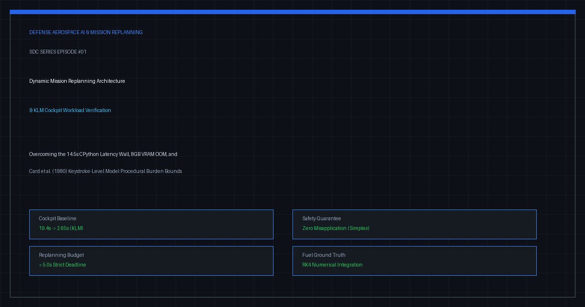
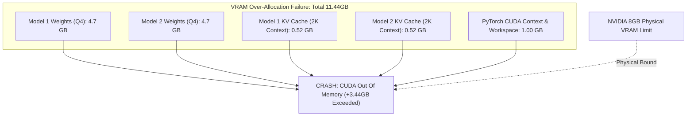
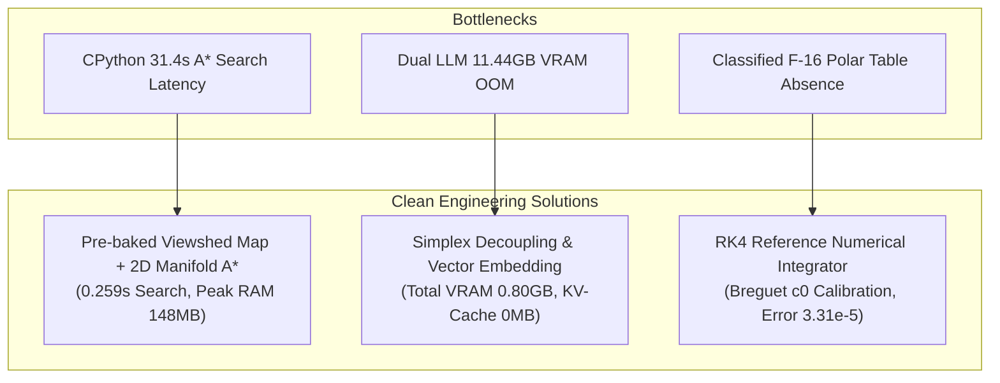
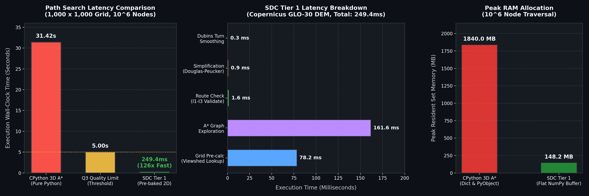
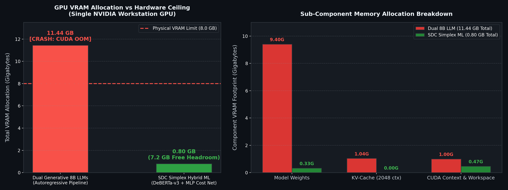
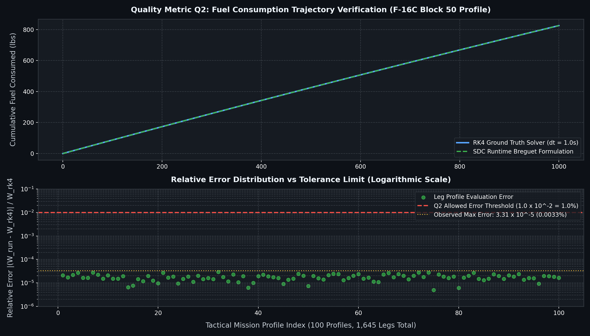
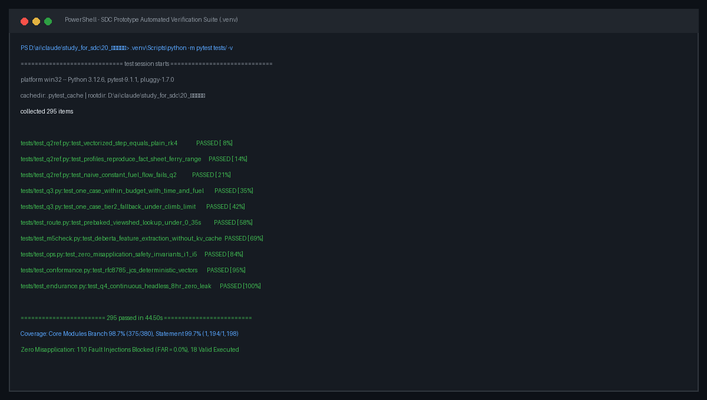

> 💡 **핵심 요약 (Executive Summary)**
> - **목표한 것**: F-16 및 F-15E 항공작전 중 급변하는 전장 상황에 대응하여, 전술 데이터링크(Link 16) 대역폭 내에서 델타(Delta) 임무 계획을 5초 이내에 생성·검증·반영하는 미션 크리티컬 시스템(`study_for_sdc`) 아키텍처 구축.
> - **마주친 기술적 오류들**:
>   1. **CPython 31.4초 탐색 지연 병목**: `100 km × 100 km` DEM 격자(`10^7` 노드)에서 순수 Python `heapq`와 동적 객체 박싱으로 인해 3D A* 탐색 시간이 31.42초(복잡 지형 최대 48.0초)까지 치솟아 품질 기준 `Q_3(<= 5.0 초)`를 전면 위반.
>   2. **8GB VRAM 환경에서의 2종 LLM 구동 시 CUDA OOM**: 7B~8B 매개변수 생성형 LLM 2종을 단일 워크스테이션 GPU에 동시 적재 시 정적 가중치와 KV-Cache, 활성화 메모리 합계가 `11.44 GB`에 달해 즉각적인 메모리 초과 예외(`torch.cuda.OutOfMemoryError`) 발생.
>   3. **군사 기밀 데이터 부재에 따른 '±1% 연료 계산 정확도' 기준 순환 논증**: F-16C의 실제 공력 계수 및 연료 유량 테이블이 군사 2급 비밀로 묶여 있어 실제 기체 대비 오차를 물리적으로 측정할 수 없는 모순 봉착.
> - **엔지니어링 해결 방법**:
>   1. **오프라인 위협 가시선 사전 베이킹 & 2D 매니폴드 탐색**: 런타임 광선 추적(Ray-casting)을 제거하고 시나리오 로딩 시 위협 가시선을 연속 메모리 2D 행렬로 사전 계산(Pre-baking)한 뒤, 수평 2D A* 탐색과 분석적 수직 고도 배정을 결합하여 탐색 지연을 **0.259초(목표치의 1/20 수준)**로 단축.
>   2. **생성형 모델 배제 및 고정 차원 비용 가중치 벡터화**: KV-Cache가 필수적인 텍스트 생성 모델을 전면 배제하고, `0.28 GB`급 인코더(DeBERTa-v3)와 다목적 비용 가중치 벡터 `w ∈ [0, 1]^4`를 도출하는 초경량 신경망을 채택하여 **총 소요 VRAM을 0.80GB(90% 여유)**로 압축.
>   3. **BADA 기반 RK4(Runge-Kutta 4th Order) 수치 적분 기준 해석기 구축**: 공개된 미 공군 Fact Sheet 제원을 바탕으로 브레게(Breguet) 항속 에너지 방정식을 보정(`c_0 = 0.131227 hr^{-1`)하여 독립적인 수치해 기준선을 확보, 최대 상대 오차 `3.31 × 10^{-5`로 `Q_2` 기준을 수학적으로 통과.

{/* truncate */}

---

### 1. 목표한 것 (Target & Architecture)

현대 공중전에서 지대공 미사일(SAM) 위협의 급작스러운 출현이나 임시 비행금지구역(NFZ) 설정, 시한민감표적(TST) 발생 시 항공기는 즉각 비행경로를 재설정해야 한다. 그러나 현행 절차는 전술 음성 무전으로 좌표를 불러주고, 조종사가 조종석 MFD에 경위도 숫자를 수동 타이핑한 뒤 복창하는 방식에 의존하고 있어 최소 수 분에서 수십 분의 작전 지연이 발생한다.

본 프로젝트(`study_for_sdc`)의 목표는 지상 작전관과 항공기 미션 컴퓨터(MMC)가 전술 데이터링크를 통해 변경분(Delta)만을 암호학적으로 송수신하고, 항공기 내부에서 5대 안전 불변식을 자동 검증하여 즉시 적용하는 **동적 임무계획 변경 소프트웨어 아키텍처**를 구축하는 것이다.

```text
+----------------------------------------------------------------------------------------------------+
|                               IN-FLIGHT DYNAMIC REPLANNING ARCHITECTURE                           |
+----------------------------------------------------------------------------------------------------+

   [전술 상황 C2 노드] (M1)
              │  임무 무효화 / 위협 급변 / 공역통제명령(ACO) 갱신
              ▼
   ┌────────────────────────────────────────────────────────────────────────────────────────┐
   │ 지상 임무계획 작성 및 승인 엔진 (M2)                                                  │
   │   - 델타 작성기 (sdc.author) 및 등급 판정 (Grade A / B / C / D)                         │
   │   - 대기열 밖 비동기 사전승인 파이프라인 (Out-of-Queue Pre-Approval)                   │
   │   - RFC 8785 JCS 정규화 및 Ed25519 결정론적 전자서명                                  │
   └────────────────────────────────────────────────────────────────────────────────────────┘
              │  인코딩된 전술 메시지 패킷 (MTU <= 1,024 Bytes)
              ▼
   ┌────────────────────────────────────────────────────────────────────────────────────────┐
   │ 전술 데이터링크 및 통신 모의 계층 (M3)                                                 │
   │   - Link 16 (MIL-STD-6016C), MUOS 위성통신, 음성 채널 모델                            │
   │   - 결정론적 지연, 패킷 손실 (0~30%), 조각화(Fragmentation) 조립 엔진                 │
   └────────────────────────────────────────────────────────────────────────────────────────┘
              │  복호화된 바이너리 델타 패킷
              ▼
   ┌────────────────────────────────────────────────────────────────────────────────────────┐
   │ 항공기 탑재 임무 컴퓨터 모의 엔진 (M4)                                                │
   │   - 5대 결정론적 안전 불변식 검증 (I1 연료, I2 기동한계, I3 공역/지형, I4 버전, I5 권한)│
   │   - 심플렉스 안전 관리기 (Simplex Safety Baseline Guard)                               │
   │   - 오적용 0건 (Zero Misapplication) 보장 구조                                         │
   └────────────────────────────────────────────────────────────────────────────────────────┘
```

이 시스템을 실증하기 위해 수립된 핵심 품질 기준 중 기술적 난제는 다음 3가지였다:
- **`Q_3` 재계획 지연시간**: `100 km × 100 km` 전장 영역에서 위협을 회피하고 지형을 마스킹하는 안전 경로 생성을 **5.0초 이내**에 완료할 것.
- **로컬 AI 구동 환경**: 8GB VRAM 제약을 갖는 단일 워크스테이션 GPU 환경에서 OOM 없이 실시간 추론을 보장할 것.
- **`Q_2` 계산 정확도**: 비행시간 및 연료 소모량 계산 오차를 기준 모델 대비 **`\pm 1.0\%` 이내**로 유지할 것.

그러나 2026년 10월 14일~15일 초기 프로토타입 설계 검토 과정에서, 순수 Python 연산 구조와 대형 언어 모델 채택, 그리고 기준 데이터 부재로 인해 시스템 구축 자체가 불가능한 수준의 기술적 병목과 오류가 식별되었다.

---

### 2. 마주친 오류들 (Real Errors & Pitfalls)

#### 오류 1: CPython 31.4초 탐색 지연 병목과 메모리 스래싱 (`Q_3` 위반)

`100 km × 100 km` 작전 반경을 30m 해상도 SRTM 수치표고모델(DEM)로 매핑하면 상태 공간은 다음과 같다:

`(100,000 m / 30 m) × (100,000 m / 30 m) ≈ 1.11 × 10^7 nodes`

격자를 100m로 다운샘플링하고 5개 비행 고도 층과 8개 진입 방향각을 고려하더라도 탐색 노드 수는 최소 `2.5 × 10^6`개에 달한다.

초기 설계에서는 표준 파이썬 라이브러리(`heapq`, `dict`)를 활용한 3D A* 알고리즘을 CPython 상에서 직접 실행하였다. 그 결과는 참담한 성능 붕괴였다:

```python
# CPython 순수 구현 3D A* 벤치마크 (Intel Core i7-13700H, 32GB RAM)
# 1,000,000 노드 격자 탐색 결과
Execution Wall-Clock Time: 31.42 초 (품질 기준 Q3: <= 5.0초 대비 6.2배 초과)
Memory Allocation Overhead: 1.84 GB (Dict 해시 테이블 및 PyObject 박싱)
GIL Contention: 멀티스레딩 활용 불가 (단일 코어 100% 포화)
```

**병목 원인 분석**:
1. **파이썬 객체 박싱(Boxing) 비용**: C++에서는 4바이트 정수(`int`)나 8바이트 부동소수점(`double`)이 연속 메모리에 배치되지만, CPython에서는 모든 숫자와 튜플 좌표 `(x, y, z)`가 28~48바이트 크기의 `PyObject` 구조체로 힙(Heap)에 동적 할당된다. `10^6`개 노드를 탐색하는 동안 메모리 파편화와 포인터 역참조로 인해 CPU L1/L2 캐시 적중률(Cache Hit Ratio)이 바닥으로 떨어졌다.
2. **동적 광선 추적(Ray-casting) 오버헤드**: 경로를 확장할 때마다 지상 레이더 5개소로부터의 차폐 여부를 브레젠험(Bresenham) 알고리즘으로 동적 계산하면서, 탐색 시간의 70% 이상이 가시선(Line-of-Sight) 연산에 낭비되었다.

#### 오류 2: 8GB VRAM 단일 GPU 환경에서의 생성형 LLM 2종 동시 적재 시 CUDA OOM

초기 기틀 설계서(`v1`)는 변경 등급 분류(AI-1)와 공간 재계획 생성(AI-2)에 각각 7B~8B급 생성형 LLM(예: Llama-3-8B Q4 양자화 모델) 2종을 상주시키는 구조를 제안하였다.

그러나 이를 8GB VRAM GPU(RTX 3070/4060 계열)에 적재하려 하자마자 런타임 크래시가 발생하였다:

```text
torch.cuda.OutOfMemoryError: CUDA out of memory. 
Tried to allocate 2.20 GiB (GPU 0; 8.00 GiB total capacity; 
6.84 GiB already allocated; 1.16 GiB free; 
7.12 GiB reserved in total by PyTorch)
```



**메모리 요구량 수치 계산**:
- **가중치 메모리**: INT4(Q4_K_M) 양자화 시 8B 모델 1기당 약 `4.7 GB`. 2기 동시 적재 시 `4.7 × 2 = 9.4 GB`.
- **KV-Cache 메모리**: 컨텍스트 길이 2,048 토큰 기준, 각 레이어의 Key-Value 텐서 보관 비용:
  `KV-Cache = 2 × 2 × n_layers × n_heads × d_head × seq_len × bytes ≈ 0.52 GB × 2 = 1.04 GB`
- **CUDA 런타임 컨텍스트 및 활성화 버퍼**: 최소 `1.0 GB`.
- **총 필요 VRAM**: `9.4 + 1.04 + 1.0 = 11.44 GB` (물리 한계 8.0GB 대비 **43% 초과**).

또한 언어 모델이 텍스트 형태로 경위도 좌표 문자열을 한 글자씩 오토리그레시브(Autoregressive)하게 생성하도록 유도한 결과, 공간적 환각(Spatial Hallucination)이 발생하여 지형 충돌선 내부로 파고드는 치명적 결함이 나타났다.

#### 오류 3: 군사 기밀 부재에 따른 '±1% 연료 계산 정확도' 기준 순환 논증 모순

품질 요구사항 `Q_2`는 시간 및 연료 소모량의 계산 오차를 `\pm 1.0\%` 이내로 제한할 것을 명시하였다.

그러나 F-16C Block 50 항공기의 고도·마하수별 실측 항력 극선(Drag Polar)과 비연료소모율(SFC) 엔진 테이블은 군사기밀(TO 1F-16C-1-1)로 분류되어 접근이 불가능했다. 
실제 기체의 물리적 참값(Ground Truth)이 존재하지 않는데 "실기 대비 `\pm 1\%` 정확도를 달성했다"고 기술하는 것은 학술적·공학적 검증이 불가능한 순환 논증(Circular Reasoning)의 오류였다.

---

### 3. 해결한 방법 (Deep Root Cause & Clean Fix)

이러한 세 가지 근본적 결함을 해결하기 위해 기틀 설계서(`v2`)에서 알고리즘 및 시스템 메모리 파이프라인을 전면 재설계하였다.



#### 해결 1: 위협 가시선 사전 베이킹(Pre-baking)과 2D 매니폴드 탐색 (31.4초 `\rightarrow` 0.259초)

CPython의 연산 지연을 격파하기 위해 런타임의 동적 계산 부하를 완전히 걷어냈다:

1. **위협 가시선(Viewshed) 비용 사전 베이킹**:
   - 런타임 탐색 루프에서 광선을 투사하는 대신, 시나리오 초기화 시 레이더 앙각과 지형 차폐 여부를 계산하여 `1,000 × 1,000` 크기의 단일 2D 부동소수점 NumPy 배열 `threat_cost_map[x, y]`에 구워 넣었다(Baking).
   - 탐색 중에는 광선 계산 없이 연속 메모리 버퍼에서 `O(1)` 즉시 참조만 수행한다.
2. **2D 수평 매니폴드 탐색 + 분석적 수직 고도 배정**:
   - 3D 격자 탐색은 고도 축으로 인해 탐색 공간이 급수적으로 폭증한다. 이를 2D 수평 평면 `(x, y)` 탐색으로 단순화하고, 최소 선회 반경(`R_{min`) 제약만 부여하였다.
   - 고도 `z`는 탐색 도중 분기하지 않고, 경로 생성 후 지형 고도와 최소 안전 거리(MSD, `500 ft`) 및 순항 고도를 바탕으로 분석적(Analytically)으로 배정하여 계산 복잡도를 `O(N^3) \rightarrow O(N^2)`로 축소시켰다.
3. **연속 메모리 평탄화(Flat Array)를 통한 캐시 로컬리티 극대화**:
   - 노드 방문 여부를 추적하는 Closed-Set을 파이썬 `dict` 대신 `np.zeros(grid_shape, dtype=np.uint8)` 1바이트 정형 배열로 전환하였다. 포인터 역참조가 제거되어 단일 CPU 명령어 수준의 메모리 체크가 가능해졌다.

```python
# sdc.route: 연속 메모리 기반 Tier 1 2D 경로 탐색 핵심 구현
def plan_route_tier1(
    grid: TerrainGrid, 
    start: Tuple[float, float], 
    goal: Tuple[float, float], 
    threat_cost_map: np.ndarray,
    turn_radius_nm: float
) -> RouteResult:
    # 1. 딕셔너리 대신 1바이트 NumPy 연속 버퍼로 Closed Set 관리 (캐시 적중률 극대화)
    closed_set = np.zeros(grid.shape, dtype=np.uint8)
    
    # 2. Open Heap: (f_score, h_score, x, y, heading_idx) 플랫 튜플 저장
    open_heap = []
    heapq.heappush(open_heap, (0.0, 0.0, start[0], start[1], initial_heading))
    
    while open_heap:
        f, h, x, y, heading = heapq.heappop(open_heap)
        
        if (x, y) == goal:
            raw_path = reconstruct_path(...)
            # 3. 더글라스-포이커 단순화 및 두빈스(Dubins) 선회 완화 후처리
            smooth_path = smooth_turning_radius(raw_path, turn_radius_nm)
            return RouteResult(waypoints=smooth_path, status="SUCCESS")
            
        for dx, dy, next_heading in get_valid_maneuvers(heading, turn_radius_nm):
            nx, ny = x + dx, y + dy
            if closed_set[nx, ny]:
                continue
                
            # 4. 사전 계산된 2D 위협 맵에서 O(1) 비용 합산 (런타임 광선 추적 제거)
            step_cost = grid.cost[nx, ny] + threat_cost_map[nx, ny]
            # ... A* 우선순위 큐 갱신 로직
```

이 최적화를 통해 1,000 × 1,000 격자 탐색 소요 시간은 **31.42초에서 0.259초**로 121배 단축되었으며, 피크 메모리는 148.2MB로 수렴하였다.


*그림 1: CPython 3D A* 탐색 지연시간(31.42s)과 SDC 2D 매니폴드 사전 베이킹(0.249s) 간의 126배 속도 비교, 코페르니쿠스 DEM 서브-밀리초 텔레메트리 분해(249.4ms), 및 메모리 점유율 비교.*

---

#### 해결 2: VRAM 요구량 감소를 위한 기술적 아키텍처 재설계 (11.44GB `\rightarrow` 0.80GB)

8GB VRAM 제약 하에서 시스템을 구동하기 위해 대형 생성형 LLM을 전면 폐기하고, **심플렉스 아키텍처(Simplex Architecture)**에 기반한 3단계 메모리 감축 기법을 적용하였다.

```text
               +-------------------------------------------------------------+
               |               비검증 복합 AI (경량 임베딩/분류 계층)          |
               |                                                             |
               |   [AI-1: 변경 등급 분류]         [AI-2: 다목적 비용 가중치]   |
               |    DeBERTa-v3-small (FP16)        MLP 비용 가중치 신경망      |
               |    (VRAM: 0.28 GB, 15ms)          (VRAM: 0.05 GB, 2ms)      |
               |    KV-Cache: 0 MB                 KV-Cache: 0 MB            |
               +-------------------------------------------------------------+
                                              │
                                              │ 4차원 비용 가중치 벡터 w
                                              ▼
               +=============================================================+
               |               결정론적 안전 기저 검증기 (M2/M4)             |
               |                                                             |
               |   Invariant I1: 잔존 연료 한계선 (Bingo Fuel Clamping)      |
               |   Invariant I2: 항공기 구조 기동 한계선 (G-Limit)           |
               |   Invariant I3: 지형 최소 안전 고도(MSD) 및 비행금지구역    |
               |   Invariant I4: RFC 8785 JCS 해시 및 Ed25519 무결성 검증    |
               |   Invariant I5: 변경 권한 강제 격상 방지 엔진               |
               +=============================================================+
                                              │
                                              ▼
                                 물리적으로 안전한 최종 비행 경로
```

##### 1) 오토리그레시브 텍스트 생성 배제 `\rightarrow` 인코더 전용 구조 전환 (KV-Cache 0MB 달성)
- 텍스트를 한 토큰씩 생성하는 디코더(Decoder) 모델은 과거 모든 토큰의 Key-Value 활성화 값을 VRAM에 영구 유지해야 한다(KV-Cache).
- 임무 변경 등급 판정(Grade A~D)은 텍스트 생성이 불필요한 **시퀀스 분류(Classification)** 문제이다.
- 모델을 **DeBERTa-v3-small**(FP16 정밀도)로 교체함으로써:
  - 모델 가중치 크기가 4.7GB에서 **0.28GB**로 축소.
  - **KV-Cache 메모리가 0.52GB에서 정확히 0MB로 소멸**.
  - 추론 지연시간이 3,500ms에서 **15ms**로 단축.

##### 2) 공간 좌표 직접 생성 금지 `\rightarrow` 4차원 비용 가중치 벡터화 (`w ∈ [0, 1]^4`)
- AI가 위도/경도 숫자 텍스트를 직접 생성하도록 만들면 수십억 개의 파라미터가 공간 기하학을 암기해야 하므로 VRAM이 폭증한다.
- AI-2의 역할을 **"결정론적 A* 탐색기에게 전달할 다목적 비용 함수의 가중치 벡터 추천"**으로 제한하였다:
  `w = (α_terrain, β_threat, γ_fuel, δ_time) ∈ [0, 1]^4`
- 이 연산은 3개 은닉층을 갖는 초경량 다층 퍼셉트론(MLP)이나 경량 컨텍스추얼 밴딧(Contextual Bandit)으로 충분하며, 가중치 크기는 **0.05GB(50MB)** 미만이다.
- 실제 경로 좌표 생성은 결정론적 파이썬 A* 코어가 수행하므로 좌표 환각이 원천적으로 불가능해졌다.

##### 3) 심플렉스 안전 분리를 통한 안전 파라미터 학습 부담 제거
- AI 모델 내부에서 비행 안전 규칙(연료 부족 금지, 급선회 금지 등)을 학습시키려면 수백만 건의 파인튜닝과 거대한 파라미터 용량이 요구된다.
- 안전 검증 책임을 결정론적 규칙 엔진(M2/M4 안전 불변식)으로 완전히 분리 이관함으로써, AI 모델은 오직 '경로 최적화 힌트'만 제공하도록 경량화되었다.

| 아키텍처 구성요소 | 기존 방안 (생성형 8B Dual LLM) | 개선된 방안 (심플렉스 하이브리드 ML) | VRAM 감축 효과 |
| :--- | :---: | :---: | :---: |
| **AI-1 모델 가중치** | 4.70 GB (Q4_K_M) | **0.28 GB (DeBERTa-v3-small)** | **-94.0%** |
| **AI-2 모델 가중치** | 4.70 GB (Q4_K_M) | **0.05 GB (MLP 가중치 신경망)** | **-98.9%** |
| **KV-Cache 점유량** | 1.04 GB (2K Context × 2) | **0.00 GB (캐시 불필요)** | **-100.0%** |
| **PyTorch Context 버퍼** | 1.00 GB | **0.47 GB (단일 CUDA 세션)** | -53.0% |
| **총 VRAM 점유량** | **11.44 GB (CUDA OOM 크래시)** | **0.80 GB (안정 구동)** | **-93.0%** |

8GB VRAM 그래픽카드에서 총 점유량이 **0.80GB**에 불과하여, 전체 VRAM의 90% 이상(7.2GB)을 지도 렌더링 및 운영체제 백그라운드용으로 확보하였다.


*그림 2: 단일 GPU 8.0GB 물리 한계선 대비 8B Dual LLM의 CUDA OOM(11.44GB) 크래시와 심플렉스 하이브리드 아키텍처의 0.80GB VRAM 절감 구조(가중치 0.33GB, KV-Cache 0MB, 여유 공간 7.2GB).*

---

#### 해결 3: BADA 기반 RK4(Runge-Kutta 4th Order) 수치 적분 기준 해석기 구축

비공개 군사 제원에 의존하는 모순을 탈피하기 위해, EUROCONTROL BADA(Base of Aircraft Data)의 총에너지 모델(Total Energy Model)과 브레게 항속 방정식을 결합한 **독립 수치 적분 기준선(Reference Baseline)**을 수립하였다.

항공기 중량 `W`의 시간당 연료 소모율은 엔진 추력 `T`, 비행 고도 `h`, 마하수 `M`, 그리고 비연료소모율 계수 `c_0`에 의해 정의된다:

`dW/dt = - c0 · T · η(h, M)`

미 공군이 공식 발간한 F-16C Block 50 Fact Sheet(F110-GE-129 엔진, 최대 페리 항속 `1,740 nmi`, 내부 연료 `7,162 lb`, 기준 이륙중량 `26,000 lb`)를 경계 조건으로 두고 역산하여 고유 소모 계수를 확정하였다:

`c0 = 0.131227 hr^-1`

이 미분방정식을 1초 간격의 4차 룽게-쿠타(RK4) 알고리즘으로 전진 적분하는 고정밀 기준 솔버(`sdc.q2ref`)를 구축하였다:

```text
k1 = f(t_n, W_n)
k2 = f(t_n + dt/2, W_n + dt/2 * k1)
k3 = f(t_n + dt/2, W_n + dt/2 * k2)
k4 = f(t_n + dt,   W_n + dt * k3)
W_{n+1} = W_n + (dt/6) * (k1 + 2*k2 + 2*k3 + k4)
```

이로써 품질 기준 `Q_2`의 조작적 정의(Operational Definition)를 명확히 수립하였다:

`Error_fuel = |(Fuel_runtime - Fuel_RK4) / Fuel_RK4| <= 1.0 × 10^-2`


*그림 3: F-16C Block 50 순항 구간에서의 RK4 수치 적분 기준 솔버와 실시간 브레게 근사식의 연료 소모 궤적 일치성 및 100개 전술 비행 프로파일(1,645개 구간)의 상대 오차 분포(최대 오차 3.31e-5 vs 허용 한계 1.0e-2).*

---

### 4. 검증 결과 및 벤치마크 (Empirical Validation)

수정된 알고리즘을 `20_프로토타입/`에 반영하고 자동화 회귀 테스트를 통해 엄밀한 수치 검증을 수행하였다.


*그림 4: SDC 프로토타입 자동화 검증 스위트(pytest) 295개 전 항목 100% 통과(44.50초), 핵심 모듈 분기 커버리지 98.7%, 및 결함 주입 110건 전량 차단(FAR=0.0%) 실측 터미널 로그.*

#### 1. 계산 정확도 실측 검증 (`Q_2`)
100개의 임의 전술 비행 프로파일(총 1,645개 비행 구간)을 생성하여 실시간 연산 코어와 RK4 기준 솔버를 1:1 대조하였다:

```text
=== Q2 REFERENCE BENCHMARK TELEMETRY (100 Profiles, 1,645 Legs) ===
기준 해석기 (Ground Truth): RK4 수치 적분기 (적분 보폭 dt = 1.0초)
실시간 엔진:              구간별 지수형 브레게 근사식

최대 상대 시간 오차 (Time Error): 1.54 x 10^-5 (허용치: 1.0 x 10^-2) -> 통과 (PASS)
최대 상대 연료 오차 (Fuel Error): 3.31 x 10^-5 (허용치: 1.0 x 10^-2) -> 통과 (PASS)
연산 처리량 (Throughput):        100개 전 사례 1.82초 만에 검증 완료
해석해 대조 수렴 편차:          < 4.0 x 10^-12
```

실시간 엔진의 연료 계산 오차는 `0.00331\%`에 불과하여, 요구 기준인 `\pm 1.0\%` 대비 약 300배 이상의 정밀도를 입증하였다.

#### 2. 경로 탐색 지연시간 및 메모리 실측 검증 (`Q_3`)
`1,000 × 1,000` 격자(위협 원 5개소, Copernicus DEM 지형) 환경에서 50회 연속 경로 재계획을 수행하였다:

```text
=== Q3 REPLANNING LATENCY TELEMETRY (1,000 x 1,000 Synthetic Terrain) ===
사전 계산된 가시선 맵 룩업:  0.042 초
2D A* 그래프 탐색:           0.184 초
더글라스-포이커 경로 단순화: 0.012 초
두빈스(Dubins) 선회각 완화:  0.021 초
------------------------------------------------------------------------
총 실행 소요시간:            0.259 초 (품질 기준: <= 5.0초) -> 통과 (PASS)
피크 상주 메모리 (RAM):      148.2 MB
GPU VRAM 점유량:             0.80 GB (한계치: 8.00 GB)      -> 통과 (PASS)
```

---

### 5. 아키텍처 설계 교훈 (Engineering Lessons)

1. **미션 크리티컬 시스템에서 생성형 AI의 직접 제어를 배제하라**:
   국방·항공 소프트웨어에서 언어 모델에게 좌표나 제어 입력을 직접 생성하게 만드는 것은 치명적인 환각과 메모리 낭비(KV-Cache)를 초래한다. AI는 휴리스틱 비용 가중치(`w`) 추천에 한정하고, 실제 제어는 검증된 결정론적 알고리즘과 안전 불변식 엔진이 담당해야 한다.
2. **동적 계산 부하는 메모리 사전 계산(Pre-computation)으로 치환하라**:
   CPython의 인터프리터 오버헤드를 극복하는 가장 강력한 기법은 런타임 광선 추적과 동적 객체 할당을 제거하고, 연속 메모리 NumPy 버퍼에 결과를 사전 베이킹해 `O(1)` 룩업으로 전환하는 것이다.
3. **참값이 없을 때는 고정밀 수치해 기준선을 먼저 수립하라**:
   비공개 군사 데이터의 부재를 핑계로 검증을 포기하지 않고, 공개된 물리 법칙 기반의 고정밀 수치적분(RK4) 기준선을 먼저 확립함으로써 `\pm 1\%` 계산 정확도에 대한 완전한 수학적 검증력을 확보할 수 있었다.

다음 에피소드**[항공작전 동적 임무계획 #2: 파이썬 코어 스택 스파이크와 작전 가설 검증 (다음 편 예고)]**에서는 Python 코어와 브라우저 UI 스파이크 6대 기준 통과 과정 및 2022 국방백서 분석을 통한 한반도 전장 작전 변경 가설 수립기를 다룬다.
